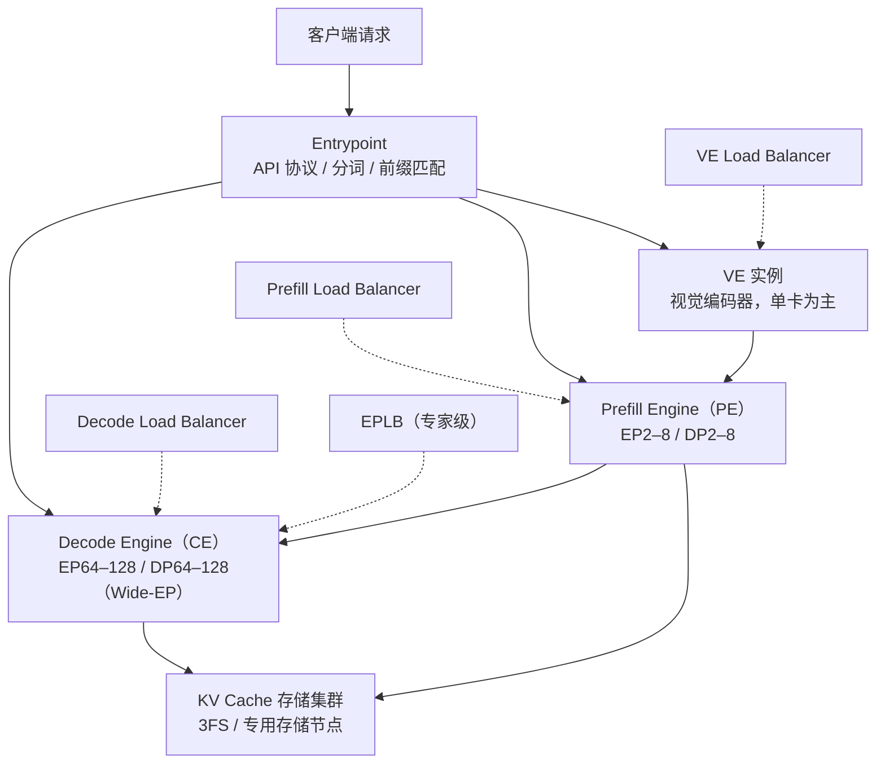

# 第 1 章 定位与全景：一个给 V4.1-Flash 用的「后厨运营系统」

## 一、这一章要解决的问题

打开 DeepInfer 的 README，第一眼看到的是三个关键词：**高性能**、**大规模**、**DeepSeek 模型**。但对第一次接触的人来说，真正要回答的是四个问题：

- 模型已经能回答问题了，为什么还需要一个「推理框架」？
- 既然 vLLM 已经开源且生态成熟，DeepSeek 为什么还要自己做一个？它和 vLLM 是什么关系？
- 官方反复提到的 E/P/D、Wide-EP、KV 存储、四类负载均衡器，分别在解决什么瓶颈？
- 这个开源仓库到底给了什么、没给什么？拿到它能不能直接上线一个服务？

这一章先建立全景，后续十章再逐个拆开。

## 二、机制与原理

### 2.1 推理框架到底在管什么

模型本身只做一件事：**给定 token 序列，输出下一个 token 的概率分布**。但要把这件事变成「同时服务成千上万个用户、还要便宜」，框架必须接管五类工作：

| 层次 | 要解决的问题 | DeepInfer 的答案 |
|---|---|---|
| **调度** | 多个请求如何共享一次 GPU 前向？谁先算、谁后算？显存不够时怎么办？ | C++ 连续批处理调度器、chunked prefill、抢占/重算、DP 步型投票 |
| **缓存** | 每个请求的历史 KV 放哪？如何复用？显存不够时如何换出？ | 分页 KV block + 每序列 state 槽位 + SWA 环 + 落盘布局 |
| **通信** | 权重和专家分散在几十上百张卡上，token 如何搬运？ | DP / CP / EP 进程组、DeepEP 的 dispatch/combine、EPLB、userbuffer |
| **算子** | 每一步的计算如何在特定硬件上跑满？ | FlashMLA、DeepGEMM、DeepSelect、TileLang 自定义 kernel、Mega MoE |
| **输出** | 如何采样、如何保证格式合法、如何复现？ | 融合采样器、MTP 验证、xgrammar 结构化输出、确定性采样 |

一句话：**模型决定「能不能答」，框架决定「答得起不起、答得快不快、能同时答多少人」**。

### 2.2 三个设计目标（官方）

官方 Q&A 把 V4.1 Flash 推理系统的目标归纳为三条（来源：官方）：

1. **支持多厂商加速器**：同一套框架既跑 NVIDIA，也跑华为昇腾，并尽量吃满各自硬件的性能。
2. **围绕 commodity hardware 组织 P 与 D**：Prefill 用普通 8 卡机，Decode 用 64–128 卡的超节点；两阶段的计算/通信/调度按各自负载特征设计，而不是一套配置硬套两个阶段。
3. **KV cache 保留超过 72 小时**：给上下文复用留出长窗口，命中时直接跳过重复 prefill；代价是要承担容量与管理开销。

这三条目标直接解释了后面所有设计：为什么有 Wide-EP、为什么有独立的 state cache、为什么有 KV 落盘布局、为什么调度器要把 prefill 和 decode 当成两种「步型」。

### 2.3 生产架构：E/P/D + Wide-EP + 专用存储 + 四类 LB

官方给出的参考架构是 **E/P/D 三阶段分离 + 专用存储节点**（来源：官方）：



各部分的职责与官方口径：

| 组件 | 作用 | 关键配置 / 数据 |
|---|---|---|
| **VE**（Vision Encoder） | 把图片编码成 embedding，与语言模型解耦 | 一般单 GPU 一个实例，推荐便宜卡 |
| **PE**（Prefill Engine） | 读完整 prompt、建立 KV cache、产出首 token | EP2–8 / DP2–8，取 HBM 允许的最小并行度 |
| **CE**（Decode Engine） | 逐 token 解码 | EP64–128 / DP64–128，取 GPU 允许的最大并行度 |
| **KV 存储** | 跨请求、跨机器复用 block KV | 3FS，约 100 PiB SSD；TTL 3 天 / 7 天 |
| **四类 LB** | P / D / VE / 专家四个维度的负载均衡 | 详见第 11 章 |

几个容易误解的点：

- **P 与 D 分离后，TTFT（首 token 延迟）与 TBT（相邻 token 间隔）可以分别优化**：P 端决定首 token 何时出来，D 端决定后续 token 的节奏；这也是生产要把两阶段拆开的核心原因之一（来源：官方）。
- **Wide-EP 是 Decode 的核心**：把专家摊到 64–128 张卡上，单步解码时每张卡只需搬运很少的专家权重，MoE 部分的访存压力大幅下降；再配合 EPLB，吞吐才能上去（来源：官方）。
- **生产当前不用 TP，也不用 CP**（来源：官方）。开源代码支持 `--cp`，示例里也有 CP8 的跑法，但生产部署走的是 DP + EP；第 5、10 章会讲 CP 在代码里如何实现。
- **最小高效部署单元是 64P + 64D**，因为推荐的 Decode 配置本身就要 64 卡以上；官方也说 1P + 1D 可以部署，但效率不在一个量级（来源：官方）。
- **P/D 可以跨数据中心**：V4.1 的 KV 压缩得足够狠，跨机房传输在技术上可行，代价是可靠性；官方给的经验带宽是每 8 卡约 400 Gbps（来源：官方）。

### 2.4 开源版与生产版的差距

README 里有一句非常关键的话（来源：官方）：

> Required for a complete inference service (not included in this release):
> - A KV cache system
> - VE/Prefill/Decode disaggregation (most required engine functionality is already implemented)
> - Load balancing across data-parallel replicas for both prefill and decode

翻译成工程语言：

| 能力 | 状态 | 影响 |
|---|---|---|
| 核心引擎（调度 / cache / 模型 / 采样） | 有 | 可以跑离线批量推理 |
| `EngineType.PROMPT / COMPLETION` | 有 | 为 P/D 分离留了钩子与虚函数 |
| P/D 的部署编排、请求路由 | 无 | 需要自己写服务层把两端接起来 |
| KV cache 跨机存储 / 前缀匹配 | 无 | 开源版只有单机显存 + 单机 state cache |
| 四类负载均衡器（P / D / VE / 服务层专家调度） | 无 | 需要自己在服务层做路由；引擎内的 EPLB 除外 |
| 在线 HTTP / gRPC / 流式 API | 无 | `LLMEngine` 明确「本版本不含在线服务封装」 |

所以正确的预期是：**这是一个「引擎内核 + 离线推理 + 研究样本」的开源，而不是一个开箱即用的在线推理平台**。它的价值在于：核心调度、KV 布局、MoE 并行、投机解码、异步调度这些最难的部分，代码是完整可读的。

### 2.5 与 vLLM 的关系：骨架相同，器官大改

几乎每个核心文件头都写着 `Derived from vLLM; modified by DeepSeek.`，README 的致谢也说明它「最初主要基于 vLLM 构建」，并参考了 SGLang 与 TensorRT-LLM（来源：官方 / 一手）。

| 维度 | 保留自 vLLM 的部分 | DeepSeek 改动 / 新增 |
|---|---|---|
| 入口 | `LLM` / `LLMEngine` / `Worker` 的分层 | 离线入口保留，在线封装移除 |
| 调度 | `Scheduler` / `BlockManager` / `Sequence` 的概念 | 调度器整体改为 C++；新增 DP 步型投票、MTP 变长预算、ZOS |
| 缓存 | PagedAttention 式的 block table | 新增 state cache、SWA 环、压缩 KV、YoCo dropped region |
| 模型 | `nn.Module` + 权重加载 | V4.1 专用模块（MLA 变体、Indexer、YoCo、Engram、HC） |
| 采样 | `SamplingParams` / Sampler | 融合采样、DFlash 验证、结构化输出 mask、确定性采样 |
| 并行 | DP / CP / EP 概念 | EPLB、Wide-EP、Mega MoE、昇腾适配 |

因此，**不要指望它兼容 vLLM 的 API 或配置**：`EngineArgs` 的字段不同，没有 OpenAI Server，模型也只支持 V4.1-Flash。把它理解成「vLLM 的骨架 + DeepSeek 的器官」更准确。

### 2.6 版本与硬件门槛

| 项 | 要求 | 说明 |
|---|---|---|
| 操作系统 | Linux | C++ 扩展、`posix_ipc`、NUMA 绑定都依赖 Linux |
| 编译器 | GCC >= 13 | 构建 `csrc/` 与 vendor 算子 |
| Python | 3.12 | `pyproject.toml` 要求 >= 3.12 |
| CUDA | 13 | NVIDIA 路径；`torch==2.13.0+cu132` |
| CANN | 9.2 | 昇腾路径 |
| GPU | NVIDIA SM100（Blackwell 代数据中心卡） | 消费级卡不在支持范围 |
| NPU | 华为昇腾 950 | 通过 `deepinfer/npu_ops` 与 `tilelang_ops/asc` 适配 |
| 模型 | DeepSeek-V4.1-Flash | 默认 checkpoint `DeepSeek-V4.1-Flash-1017` |

构建命令（来源：官方）：

```bash
export DEEPINFER_ACCELERATOR=nvidia   # 或 ascend
./build.sh
```

`build.sh` 做三件事：安装 `requirements-{nvidia,ascend}.txt`、构建 `vendor/` 下的算子子模块、用 `setup.py` 编译 `csrc/` 并链接 `.so`（来源：一手）。这意味着**没有预编译 wheel**，首次构建时间不短。

## 三、源码走读

### 3.1 先读哪几个文件

| 文件 | 读它为什么有用 |
|---|---|
| `README.md` | 支持模型、特性、硬件、缺失组件，一页看完 |
| `doc/inference_deployment_qa.md` | 生产架构、KV 存储、负载均衡、EPLB、投机解码的第一手问答 |
| `pyproject.toml` / `requirements*.txt` | 版本、依赖、Python/CUDA 门槛 |
| `build.sh` / `scripts/build.sh` | 构建顺序：依赖 → vendor → 本仓库扩展 |
| `.gitmodules` | 六个 vendor 子模块：DeepEP / DeepGEMM / DeepSelect / FlashMLA 及 Ascend 版本 |
| `deepinfer/entrypoints/llm.py` | 离线入口，`generate()` 的完整调用链 |
| `deepinfer/engine/llm_engine.py` | 引擎主循环，所有部件在这里汇合 |
| `deepinfer/environ.py` | 所有 `DEEPINFER_*` 环境变量的集中定义与默认值 |

### 3.2 仓库地图

```text
deepinfer/                 引擎与模型（Python）
├── entrypoints/           离线 LLM 入口
├── engine/                LLMEngine、EngineArgs、C++ 调度器绑定
├── worker/                Worker、ModelRunner、CacheEngine、CUDA Graph
├── model_executor/        模型、层、算子、EPLB、并行组
├── structure_output/      xgrammar 编译 / matcher / mask
├── ve/                    多模态预处理
└── distributed/           共享内存广播
csrc/                      C++ 调度器、BlockManager、Sequence、ZOS
deep_cluster/              GPU/NPU 探测、NUMA、拓扑
examples/                  离线推理、benchmark、sweep
eval/                      AIME / GPQA / HLE 评测
tests/                     PPL、batch invariant、EPLB、sampler 等回归
vendor/                    DeepEP / DeepGEMM / DeepSelect / FlashMLA
```

### 3.3 本笔记的组织方式

- **第 2 章**沿「`generate()` → 引擎 → worker → 模型」走一遍启动链路。
- **第 3–4 章**拆调度与缓存，这是框架的「操作系统」。
- **第 5–7 章**拆模型执行：注意力、MoE、投机解码。
- **第 8–9 章**拆「看不见但决定体验」的部分：异步调度、确定性、采样与结构化输出。
- **第 10–11 章**回到全局：多模态、并行组、生产部署与评测。

## 四、常见坑与边界条件

1. **「开源了就能部署在线服务」**：不能。没有 HTTP Server、没有请求队列、没有 P/D 编排、没有 KV 存储与负载均衡。你要自己写服务层，或者只用离线批量推理。
2. **「能不能跑别的模型」**：基本不能。模型加载、注意力、MoE、MTP 都按 V4.1 的字段写死；换个模型需要改 `model_executor/models/`，不是改个配置就行。
3. **「开源版有没有前缀缓存」**：调度器支持 fork 子序列共享父序列的 block，但**自动前缀匹配**在官方生产架构里由 Entrypoint + kvcache-store 完成，这部分没开源；不要以为 `prefix_caching_hit` 变量就代表有完整的 prefix cache 服务。
4. **把官方生产数字当成本地 benchmark**：155 万亿 token/天、$38/GPU-hour、AIME 99.9% 都是官方口径，依赖完整生产栈与 V4.1-Flash 权重，开源仓库本身复现不了。
5. **Windows 开发机**：不支持。代码里有 `posix_ipc`、`fcntl`、`mmap`、NUMA 绑定、C++ 扩展，Windows 上连构建都过不去。
6. **消费级 GPU**：不支持。SM100 是数据中心卡；`capability` 检测与 kernel 选择都按目标硬件写死。
7. **许可证**：主仓库 Apache-2.0，但 `vendor/` 子模块各自有许可证，商用前逐个核对。

## 五、关键结论

1. **DeepInfer 是推理引擎，不是推理平台**：核心引擎完整，服务化组件缺失。
2. **它只为 DeepSeek-V4.1-Flash 服务**：不是通用模型运行时。
3. **生产架构是 E/P/D + Wide-EP + 专用 KV 存储 + 四类 LB**，开源版只覆盖其中的引擎部分。
4. **它与 vLLM 同源但已大幅分叉**：调度器改 C++、加 ZOS、加 V4 模型、加 EPLB、加 state cache。
5. **三条设计目标**（多厂商、commodity P/D、长 KV 保留）解释了后面几乎所有工程取舍。
6. **硬件门槛极高**：Linux + GCC 13 + Python 3.12 + CUDA 13 / CANN 9.2 + SM100 / Ascend 950。
7. **它的最大价值是设计样本**：即使跑不起来，调度、缓存、并行、投机解码的实现也值得逐章读。

## 本章要点回顾

- 推理框架管五件事：**调度、缓存、通信、算子、采样/输出**；模型只管「下一个 token 的概率」。
- 官方三目标：**多厂商加速器、commodity P/D、KV 保留 >72 小时**。
- 生产架构：**E/P/D 分离 + Wide-EP（Decode EP64–128）+ 3FS KV 存储 + 四类 LB**。
- 开源版：**引擎 + 离线推理 + 多模态 + 投机 + SO + 评测**；缺 **在线服务、KV 存储、P/D 编排、LB**。
- 与 vLLM：**同源分叉**，API 与配置不兼容。
- 门槛：**Linux / GCC 13 / Python 3.12 / CUDA 13 或 CANN 9.2 / SM100 或 Ascend 950**。
- 正确预期：**当设计样本读，不要当开箱即用的服务平台**。
