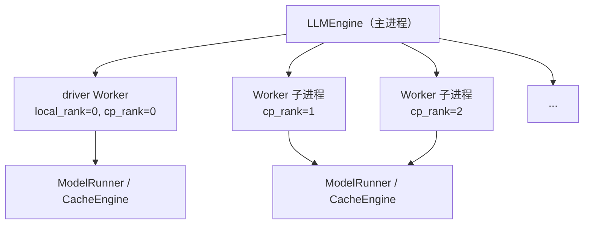
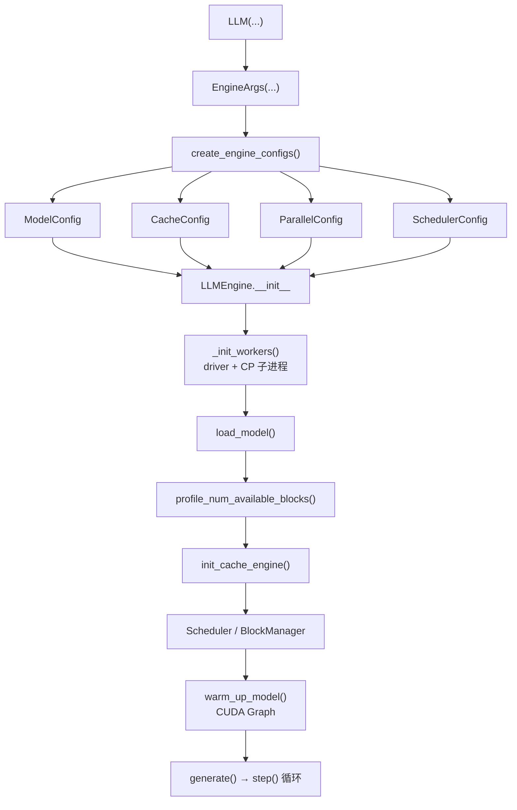

# 第 2 章 代码地图与启动链路：从 `LLM.generate()` 到一次 GPU step

## 一、这一章要解决的问题

第一次读 DeepInfer，最容易迷路的地方不是算法，而是**对象太多**：`LLM`、`LLMEngine`、`Worker`、`ModelRunner`、`CacheEngine`、`Scheduler`、`DeepseekForCausalLM`、`V4Attention`、`Sampler`……它们分别在哪个进程、什么时候创建、谁调用谁？

这一章沿一条最短路径走完：

```text
LLM.generate()
  → EngineArgs / 四类 Config
  → LLMEngine 初始化（worker、模型、KV、调度器、CUDA Graph）
  → step() 循环（调度 → 执行 → 后处理）
  → RequestOutput
```

把这条链路走通，后面每章都只是在这条链路上放大某一段。

## 二、机制与原理

### 2.1 入口：`LLM` 只是一个薄壳

`deepinfer/entrypoints/llm.py` 的 `LLM` 做三件事：

1. **补默认值**：`disable_log_stats=True`、`stop_preempted_request=False`，并设置 `TOKENIZERS_PARALLELISM=false`。
2. **构造 `EngineArgs`**：把 `model / tokenizer / expert_parallel_size / gpu_memory_utilization / seed / ...` 转成引擎参数，并标记 `offline_inference=True`。
3. **驱动引擎**：`generate()` 逐个 `add_request()`，然后 `_run_engine()` 循环调用 `llm_engine.step()`，直到没有未完成请求；最后按 request_id 排序、反分词输出。

注意两个与在线服务不同的点（来源：一手）：

- `LLM` 默认 `stop_preempted_request=False`：显存不足时**优先重算**被抢占的请求，而不是直接终止；`EngineArgs` 本身的默认值反而是 `True`。
- `LLM` 默认 `disable_log_stats=True`：离线批量推理不打印每步统计；需要观测时显式打开。

### 2.2 第一层配置：`EngineArgs` → 四类 Config

`deepinfer/engine/arg_utils.py` 的 `EngineArgs` 是唯一入口参数对象，`create_engine_configs()` 把它拆成四个配置：

| 配置 | 文件 | 负责什么 | 关键默认值 |
|---|---|---|---|
| `ModelConfig` | `deepinfer/config.py` | 模型路径、tokenizer、最大长度、dtype、是否多模态 | `max_model_len=4096`（未指定时） |
| `CacheConfig` | 同上 | `block_size`、`gpu_memory_utilization`、block 数（profile 后填） | `block_size` 由模型元数据推导，V4.1 为 128 |
| `ParallelConfig` | 同上 | DP / CP / EP / ENP 的大小与 rank | `dp = max(1, ep // cp)`；`model_parallel_size = cp` |
| `SchedulerConfig` | 同上 | 最大批 token 数、最大序列数、chunked prefill、抢占策略 | `max_num_seqs=256`；`max_num_batched_tokens` 自动推导 |

两个容易被忽略的推导：

- **运行时最大长度**不是 `max_model_len`，而是加上投机与 ZOS 的余量（`config.py:_get_runtime_max_model_len`）：

```text
runtime_max_model_len = max_model_len
                      + nextn                      # 投机草稿
                      + (nextn + 1 if ZOS else 0)  # 异步调度滞后的 token
                      + nextn                      # draft 再往后
```

- **最大批 token 数**默认取 `max(max_model_len, 4096, max_num_seqs × (1 + nextn))`。如果显式传入，必须不小于 `max_num_seqs × (1 + nextn)`，否则断言失败。

### 2.3 第二层初始化：`LLMEngine.__init__` 的八个动作

`deepinfer/engine/llm_engine.py:155` 开始，按顺序：

| 步骤 | 做什么 | 关键代码 |
|---|---|---|
| 1 | 记录 `CUDA_VISIBLE_DEVICES` 的第一个卡为 driver GPU | `gpu_ids[0]` |
| 2 | 加载 tokenizer | `get_hf_tokenizer` |
| 3 | 解析模型类；多模态模型则启动 `MultimodalProcessor` | `_get_model_architecture` |
| 4 | 创建 worker（driver 在本进程，CP 其余 rank 为子进程） | `_init_workers` |
| 5 | 加载模型权重 | `_run_workers("load_model")` |
| 6 | 显存 profile → 计算 block 数 → 分配 KV/state cache | `_init_cache` |
| 7 | 创建 C++ `Scheduler` 与对象池 | `_create_scheduler` |
| 8 | 初始化统计器、profile HTTP（可选） | `StatsLogger`、`ProfileManager` |

其中第 4 步的进程模型值得单独说：



- **driver worker 在引擎进程内**，持有回调（`post_process_fn`、`pre_sampler_sync_fn`），负责与 C++ 调度器交互。
- **CP（context parallel）的其余 rank 是子进程**，通过 `SpawnProcessWithCrashHeader` 启动；参数用 pickle 传递，`ModelConfig` 自定义了 `__getstate__/__setstate__`，在子进程里重新加载 `model_cfg`。
- driver 调用 `run_workers(method, ...)` 时，方法名与参数通过共享内存广播给 CP 组（`cp_broadcast_object`），所有 rank 执行同名方法。

### 2.4 第三层：显存 profile 与 KV 分配

`_init_cache()` 先让每个 worker 跑 `profile_num_available_blocks()`，再做三件事：

1. **模拟一次满负载 step**：用 `max_num_seqs` 条虚拟序列、总 token 数等于 `max_num_batched_tokens`，跑完整的 forward + sample + post-process；MoE 还会强制 1.8 倍不均衡，把最坏情况的显存峰值算进去。
2. **算可用 KV 显存**：`总显存 × gpu_memory_utilization − 峰值显存 − 2 × state cache`；除以每个 block 的字节数得到 block 数。
3. **全局对齐 block 数**：所有 rank 做 all-reduce，按 `SUM / world_size` 取平均后向下取偶；这样得到的是全局统一值，但**不保证每张卡都放得下**——docstring 写的是「取最小值」，实现是平均值，显存不对称时要按最小卡估算（详见第 4 章）。

得到 `num_gpu_blocks` 后，`CacheEngine.allocate_gpu_cache()` 一次性分配：

- `gpu_blocks`：分页 KV 的主缓冲区（所有层共享一段大 buffer，按层切 view）。
- `gpu_states`：每序列一个 state 槽位（SWA / 压缩状态）。
- 同时把布局信息写回 `CacheConfig`（`bytes_per_block`、`num_state_seqs`、`bytes_of_state_per_seqs`）。

接着 `init_cache_engine()` 构造 `GPUCacheInterface`，再 `warm_up_model()` 捕获 CUDA Graph。**CUDA Graph 捕获失败的常见原因之一是显存不够**：`LLM` 的文档字符串专门提示，遇到 `illegal memory access` 可以调低 `gpu_memory_utilization` 再试（来源：一手）。

### 2.5 第四层：一次 `step()` 的流水线

`LLMEngine.step()`（`llm_engine.py:860`）是引擎的心跳：

```text
step()
├── schedule（C++ Scheduler.schedule）
│   ├── 选 prefill 或 decode
│   ├── 分配/追加 KV block，必要时抢占
│   └── 生成 SequenceMetadata（seqlen_q/k、block table、slot mapping）
├── clone / zero states & blocks（fork 请求需要）
├── post_schedule（子类钩子）
├── 多模态 fetch（如有）
├── _execute_model_async_step → Worker.execute_model_step
│   ├── 1. forward 当前 step
│   ├── 2. post-process 上一步（ZOS 时）
│   ├── 3. sample 当前 step
│   └── 4. post-process 当前 step（非 ZOS 或 prefill）
├── 回收 deferred 资源
└── 返回 RequestOutput 指针数组
```

`Worker.execute_model_step`（`worker/worker.py:88`）的注释把顺序写得很清楚：**forward → post-process 上一轮 → sample → post-process 本轮**。ZOS 开启时，decode 步的 post-process 会推迟到下一步，与下一次 forward 重叠（第 8 章）。

`ModelRunner` 再把 forward 拆成两步：

- `execute_main_model()`：准备 `InputMetadata`（位置、slot、block table、SWA/压缩索引），选择 CUDA Graph 或 eager，调用模型。
- `execute_sample()`：准备 `SamplerInputs`，调用 `model.sample()`（其中包含 DFlash 草稿与验证）。

### 2.6 输出：`RequestOutput` 的所有权

`_process_model_outputs()` 把采样结果交给 C++ `scheduler.process_outputs()` 更新序列状态，然后用 `build_request_outputs()` 生成输出对象。这些对象来自 `RequestOutputPool`，**下一步会被自动释放**（来源：一手）：

- 需要跨步保留时，调用 `pool.clone(list[RequestOutput])` 复制，并自行 `release`。
- 离线 `LLM._run_engine()` 每步都 `RequestOutput.clone(raw_output)`，所以用户拿到的结果不受下一步影响。

## 三、源码走读

### 3.1 关键文件与入口函数

| 文件 | 入口 | 说明 |
|---|---|---|
| `deepinfer/entrypoints/llm.py` | `LLM.generate` / `_run_engine` | 离线入口、请求编排 |
| `deepinfer/engine/arg_utils.py` | `EngineArgs.create_engine_configs` | 参数 → 配置 |
| `deepinfer/config.py` | `ModelConfig` / `ParallelConfig` / `SchedulerConfig` | 配置推导与校验 |
| `deepinfer/engine/llm_engine.py` | `LLMEngine.__init__` / `step` | 引擎初始化与主循环 |
| `deepinfer/worker/worker.py` | `execute_model_step` | 一步内的四阶段 |
| `deepinfer/worker/model_runner.py` | `execute_main_model` / `execute_sample` | 输入准备与模型调用 |
| `deepinfer/worker/cache_engine.py` | `CacheEngine` / `GPUCacheInterface` | KV/state 分配与布局 |
| `csrc/engine/scheduler.hpp` | `Scheduler::schedule` | 选批与 block 管理（第 3 章） |

### 3.2 启动时序（按代码顺序）



### 3.3 参数是如何传到 worker 的

1. `LLMEngine` 把四个配置对象通过 `SpawnProcessWithCrashHeader(args=...)` 传给子进程。
2. `ModelConfig` 不可直接 pickle `model_cfg`（AttrDict 内含复杂对象），于是 `__getstate__` 只传运行时标量，`__setstate__` 在子进程重新 `load_model_config(self.model)` 并回填。
3. `CacheConfig` 在 profile 之后被**原地更新**（`num_gpu_blocks` 等），再传给 `init_cache_engine`。
4. `ParallelConfig` 的 rank 在 `init_parallel_groups` 中创建进程组时使用；`data_parallel_rank` 由 `engine_rank % dp` 得出。

## 四、常见坑与边界条件

1. **`LLM` 与 `EngineArgs` 默认值不一致**：`LLM` 把 `stop_preempted_request` 设为 `False`，`EngineArgs` 默认 `True`。离线跑长请求时，前者会重算而不是终止；在线语义下通常反过来。
2. **`max_model_len` 不传就是 4096**：不是「模型支持多少就多少」。长上下文实验必须显式设置，并同时保证 `max_num_batched_tokens` 足够。
3. **`max_num_batched_tokens` 有下限**：至少 `max_num_seqs × (1 + nextn)`；不开 chunked prefill 时还必须 >= `max_model_len`，否则启动直接报错。
4. **`CUDA_VISIBLE_DEVICES` 必须设置**：`LLMEngine.__init__` 第一行就读取它，没设会 `KeyError`；昇腾下要求与 `ASCEND_RT_VISIBLE_DEVICES` 一致。
5. **driver worker 不是独立进程**：它在引擎进程内，因此引擎里的 Python 代码与模型执行共享 GIL；真正的并行来自 GPU 流与 CP 子进程。
6. **CUDA Graph 捕获可能 OOM**：调低 `gpu_memory_utilization` 或关掉 graph（`DEEPINFER_ENFORCE_EAGER=1`）再试。
7. **`RequestOutput` 会被下一步释放**：不要在异步代码里裸存指针，先 `clone`。
8. **离线结束要 `flush`**：ZOS 下最后一步的 post-process 可能还在途，`LLM._run_engine()` 在 `unfinished=False` 时会调用 `flush_inflight_reqs()`，自定义调用方也要做。
9. **`LLM.close()` 不是可选的**：它会停 worker、关 SO 线程池、释放共享内存；只靠 GC 可能在退出时留下资源泄漏告警。

## 五、关键结论

1. `LLM` 是薄壳，真正的中枢是 `LLMEngine`；`EngineArgs` 是唯一参数入口。
2. 配置推导有两个隐藏项：`runtime_max_model_len` 要加投机/ZOS 余量，`max_num_batched_tokens` 有下限。
3. 初始化顺序是：**worker → 模型 → 显存 profile → KV/state 分配 → 调度器 → CUDA Graph**；顺序不能换。
4. 进程模型是 **driver + CP 子进程**；driver 在引擎进程内，CP 通过共享内存广播方法调用。
5. 一次 `step()` = **调度 → 执行（forward/sample）→ 后处理**；ZOS 把后处理推迟一轮，与下一次 forward 重叠。
6. 输出对象有池化生命周期，跨步使用必须 `clone`。

## 本章要点回顾

- `LLM.generate()` → `EngineArgs` → 四类 Config → `LLMEngine`。
- 初始化八步：tokenizer、模型类、worker、load_model、profile、init_cache、scheduler、stats。
- driver worker 在引擎进程内；CP 其余 rank 是子进程，通过 `cp_broadcast_object` 同步方法调用。
- 显存 profile 用「满负载模拟 + 强制 MoE 不均衡」算峰值，再全局取最小 block 数。
- 一次 step：C++ 调度 → `Worker.execute_model_step` 四阶段 → `scheduler.process_outputs` → `RequestOutput`。
- ZOS decode 步的 post-process 留到下一步；离线结束时必须 flush。
- 常见坑集中在默认值、长度下限、`CUDA_VISIBLE_DEVICES`、CUDA Graph OOM 与输出对象生命周期。
