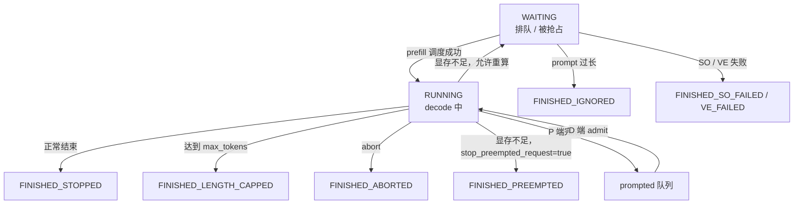
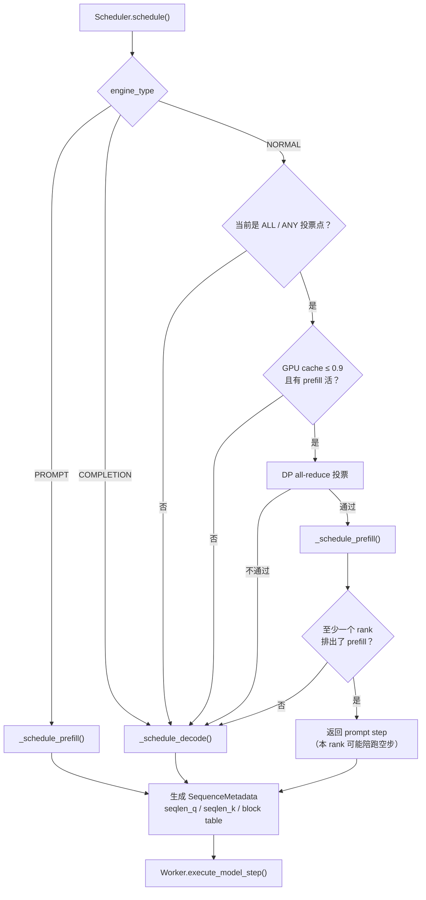

# 第 3 章 调度器：连续批处理、chunked prefill 与抢占

## 一、这一章要解决的问题

一个推理服务同时收到 200 个请求：有的 prompt 只有 100 token，有的 10 万 token；有的刚进来，有的已经生成到一半。GPU 每一刻只能执行一批计算，调度器必须回答：

- 这一步做 **prefill** 还是 **decode**？两者能混在一起吗？
- 哪些请求进这一批？超长 prompt 怎么切？
- KV 显存块不够时，抢占谁、被抢占的请求怎么办？
- 多张数据并行卡之间，如何保证同一步做同一类工作，不让某些卡空转陪跑？

DeepInfer 的调度器在 `csrc/engine/scheduler.hpp`，整体是 **C++ 实现、Python 通过 pybind 调用**。这一章按「选步型 → 选请求 → 分配块 → 生成元数据」的顺序拆开。

## 二、机制与原理

### 3.1 三种引擎类型

```python
# deepinfer/engine/engine_type.py
NORMAL      = 0   # 同时处理 prompt 与 completion
PROMPT      = 1   # 只做 prefill
COMPLETION  = 2   # 只做 decode
```

| 类型 | 用途 | 调度行为 | 约束 |
|---|---|---|---|
| `NORMAL` | 离线推理、单机 P+D | 在 prefill 与 decode 之间动态切换 | 需要 DP 步型投票 |
| `PROMPT` | P/D 分离中的 P 端 | 只走 `_schedule_prefill`，没活时也返回空 prefill 结果 | 不做 decode |
| `COMPLETION` | P/D 分离中的 D 端 | 只走 `_schedule_decode` | **必须** `stop_preempted_request=true`，否则启动断言失败 |

`COMPLETION` 的约束来自一个硬事实：它没有 prefill 通道，被抢占的请求无法重算，只能终止（`scheduler.hpp` 构造函数里的 `TORCH_CHECK`）。

### 3.2 队列与状态机

调度器维护三个队列：

- `waiting`：还没开始或被打回重算的请求。
- `running`：正在 decode 的请求。
- `prompted`：P 端做完 prefill、等待 D 端接收的请求（P/D 分离用；单机 NORMAL 通常为空）。

`SequenceStatus` 的状态机（简化）：



注意 `FINISHED_*` 一旦进入就不可逆，`is_finished()` 直接用枚举顺序判断（`status >= FINISHED_STOPPED`）。

### 3.3 NORMAL 引擎：先投票决定「这一步做 P 还是 D」

NORMAL 引擎不能简单地在每个 rank 上独立决定做 prefill 还是 decode，否则 DP 组里会出现「一半卡做 P、一半卡做 D」的集体通信错位。DeepInfer 的做法是**全组投票**（`_schedule`）：

```text
每 prefill_attempt_interval（默认 70）个 decode step → ALL 点
  （刚做完 prompt step 的下一步 decode_step=0，也落在 ALL 点）
每 prefill_any_attempt_interval（默认 100）个 decode step → ANY 点
其余 step → 直接 decode
```

- **ALL 点**：所有 rank 都有 prefill 活，才全组切到 prefill，避免「一个 rank 干活、其余陪跑空 prompt step」。
- **ANY 点**：任一 rank 有活就全组切 prefill，给孤立 rank 兜底，防止它饿死。
- 两类点重合时按 ANY 算。
- 做 prefill 前还要看 **GPU cache 使用率 ≤ 0.9**（`GPU_CACHE_PREFILL_WATERMARK`），否则继续 decode，先消化显存。
- 预填充后还有**第二次投票**：确认至少一个 rank 真的排出了 prefill；如果全组都空手（slot 满、KV 块不够），就转 decode，避免「空 prompt step 把 `decode_step` 清零 → 下一步又投票 → 又空手」的死循环。

这里的 `decode_step` 是全组同步的计数器：每次 decode +1，每次 prompt step 清零。投票次数与语义在全组一致，不会卡在 all-reduce。

### 3.4 Prefill 调度：FIFO + chunked + 多重上限

`_schedule_prefill` 从 `waiting` 队头开始，逐个尝试：

| 检查 | 行为 |
|---|---|
| 已终止（abort / VE 失败 / SO 失败） | 移入 `ignored_seqs`，带回 finish reason |
| `schedulable == false` | 直接 `break`（队头不可调度，后面也不可调度） |
| prompt 长度 > `prompt_limit` | 标记 `FINISHED_IGNORED`，不报错 |
| KV block / state 无法分配且以后也没戏（`NEVER`） | `FINISHED_IGNORED` |
| KV block 暂时不够（`LATER`） | `break`，等下一步 |
| 已调度序列数达到 `max_num_seqs` | `break` |
| `sum(seqlen_k)` 超过 `prefill_max_sum_seqlen_k`（默认 2^30） | `break` |

`prompt_limit` 的取值：

```text
chunked_prefill = true  → max_model_len
chunked_prefill = false → min(max_model_len, max_num_batched_tokens)
```

也就是说，**不开 chunked prefill 时，单条 prompt 不能超过一步的 token 预算**；超过就直接被忽略。

#### chunked prefill 如何切

如果当前 prompt 放不进剩余预算，就切一段：

```text
new_workload = min(seq_workload,
                   floor((max_num_batched_tokens - num_batched_tokens) / cp_align) × cp_align)
```

`cp_align = cp_size × 2`（CP > 1 时），保证每张 CP rank 分到的 token 数是偶数、可均分。切出来的这一段就是 `seqlen_q`，剩下的部分留在 `waiting`，下一步继续。

还有三个细节：

1. **chunk checkpoint**：`chunk_checkpoints` 允许调用方指定必须停下的位置（例如多模态的图片边界）。
2. **图片不能被切开**：`_adjust_chunk_size` 检查切点是否落在 `IMAGE + IMAGE_PAD × N` 的图片单元内部；如果是，往前收缩或往后扩展，整个图片单元留到下一个 chunk。
3. **NORMAL 引擎一次只切一条**：切完当前 prompt 就 `break`，避免一个超长请求把整步预算吃光。

#### fork 子序列与前缀共享

如果 `block_table` 非空、且 `branch_id` 以 `_` 开头，说明这是从父请求 fork 出来的子序列：

- 保留父序列已有的 block（`pin` 住），只为新增部分分配新 block；
- 如果 `cache.num_tokens` 不是 block 的整数倍，把最后一个半满 block 复制一份（`clone_blocks`），避免子序列写脏父序列；
- 克隆 state（`clone_states`），子序列从父序列的 state 快照继续。

这套机制用于 benchmark 里的「共享前缀、不同后缀」场景，不是完整的前缀缓存服务。

> ⚠️ 变量名 `prefix_caching_hit` 有误导性：**新建请求（`block_table` 为空）也会被置为 `true`**。它实际控制的是「是否跳过 `lookahead_tokens` 的前置检查」，而不是「命中了前缀缓存」。

### 3.5 Decode 调度：先 admit，再按输出长度排序

`_schedule_decode` 分两段：

1. **admit**：把 `prompted` 队列里的请求转入 `running`，直到 `max_num_seqs`；fork 请求要先克隆 state 和最后一个半满 block。
2. **选批与抢占**：
   - 按 `get_output_len()` **降序**排序；
   - 从**输出最短**的一端开始调度（`running[r-1]`）；
   - 每调度一条，`_append_slot` 检查是否需要新 block；没有空闲 block 时，从**输出最长**的一端抢占（`running[l]`），直到腾出一块；
   - 如果腾不出来，当前这条也被抢占。

这实际上是一个 **最短输出优先 + 最长输出先被抢占** 的策略：短请求尽快完成，长请求在显存紧张时让位。官方注释把它称为 LCFS，但从代码行为看，更准确的描述是「按输出长度排序的短作业优先」。

被抢占的请求有两条路（`_preempt`）：

| 条件 | 行为 |
|---|---|
| `stop_preempted_request == true` | 标记 `FINISHED_PREEMPTED`，释放 block，直接结束 |
| `stop_preempted_request == false` | `reset_for_recompute()`，放回 `waiting` 队头，释放 block；下次重新 prefill |
| 请求带结构化输出（`so_status != 0`）且允许重算 | **不支持重算**，直接结束（SO 状态无法回滚） |

### 3.6 MTP 变长调度：这一步验证几个草稿？

decode 调度最后会调用 `_mtp_varlen.schedule(scheduled, seqlens_q)`，为每个请求决定本步的 `seqlen_q`（1 个 golden token + 验证几个 draft）。它综合两类信息（`csrc/engine/mtp_varlen.hpp`）：

- **接受率**：用 N−2 轮的置信度估计选「最佳 batch 大小」，用 N−1 轮的值给每个请求分配验证名额；
- **耗时模型**：用 `profile_decode_perf()` 得到的 `(batch_size, forward_ms)` 曲线，加上运行时拟合的斜率与 sampler 耗时，估算每个 batch size 的吞吐，取最大者。

结果是「把验证名额优先给最可能被接受的请求」，这也是第 7 章的主题。不开 `DEEPINFER_ENABLE_MTP_VARLEN` 时，每个请求固定验证 `nextn` 个（默认 5）。

### 3.7 BlockManager：一个带引用计数的空闲链表

`csrc/engine/block_manager.hpp` 的 `BlockManager` 很简单，但有几个关键设计：

- **block 0 保留**：`Blocks` 构造函数把 0 当作「空/占位」，从 1 开始分配。CUDA Graph 的 padding 行就落在 dummy slot 0。
- **引用计数**：`allocate` 加 1，`free` 减 1，归零才回到空闲链表；因此 fork 子序列可以共享父序列的 block（`pin_blocks`）。
- **空闲链表**：侵入式双向链表，`_pop_front` O(1)，适合每步高频分配/释放。
- **state 与 block 联合分配**：`BlockManagerMutexAcquire::try_allocate_seq` 同时检查 block 与 state，任一不足就返回失败；state 不够时，block 也不会被占用。

## 三、源码走读

### 3.1 调度器入口

| 位置 | 内容 |
|---|---|
| `csrc/engine/scheduler.hpp:79` | `struct Scheduler` 定义、构造参数与限制 |
| `:275` | `_schedule()`：NORMAL 的步型投票，PROMPT/COMPLETION 的直接分发 |
| `:351` | `_schedule_prefill()`：FIFO、chunked、fork、多重上限 |
| `:559` | `_schedule_decode()`：admit、排序、抢占、MTP 变长 |
| `:667` | `schedule()`：把选中的序列转成 `SequenceMetadata` |
| `:766` | `_preempt()`：终止或重算 |
| `csrc/engine/block_manager.hpp:119` | `BlockManager` / `Blocks` |
| `csrc/engine/sequence.hpp:30` | `SequenceStatus` 枚举 |

### 3.2 一次调度的决策流



### 3.3 `SequenceMetadata` 里有什么

`schedule()` 为每个被选中的序列构造元数据，关键字段：

- `seqlen_q`：本步 query 长度（prefill 是 chunk 长度；decode 是 1 + 验证的 draft 数）。
- `seqlen_k`：本步 key 总长度 = `cache.num_tokens + total_inflight_tokens + seqlen_q`；异步调度下要加上在途 token。
- `block_table`：KV block 列表（decode 时使用）。
- `position_end` 校验：保证不超过 `runtime_max_model_len`，否则 RoPE cache 等按位置索引的 buffer 会越界。
- `start_inflight_step(max_seqlen_q)`：把本步的在途 token 记到序列状态里，供下一步的 `seqlen_k` 使用。

这也是 ZOS 下 CPU 侧元数据会「滞后一步」的根源：本轮调度时，上一轮的采样结果还没回到 CPU，只能用估计值；第 8 章会讲如何在 GPU 上修正。

## 四、常见坑与边界条件

1. **COMPLETION 引擎必须 `stop_preempted_request=true`**：否则构造函数直接 `TORCH_CHECK` 失败。
2. **不开 chunked prefill 时，prompt 不能超过一步预算**：超过会被标记 `FINISHED_IGNORED`，而不是报错或自动切分，排查时容易误以为「请求丢了」。
3. **`prefill_max_sum_seqlen_k` 默认 2^30**：看起来无限，但它限制的是**所有 prompt 的 seqlen_k 之和**，长上下文高并发时会先撞上这个上限，表现为「有请求但调度不动」。
4. **CP 对齐会浪费预算**：`cp_align = cp_size × 2`，chunk 会被向上取整到该倍数；CP 越大，尾部 padding 越多。
5. **抢占带 SO 的请求会直接终止**：结构化输出的 matcher 状态无法重算，`stop_preempted_request=false` 也救不回来。
6. **`prefix_caching_hit` 不是前缀缓存命中**：见 3.4 的说明；真正的跨请求前缀匹配不在开源调度器里。
7. **NORMAL 的「陪跑空步」是设计行为**：某个 rank 没有 prefill 活、但组内其他 rank 有活时，它会返回空 prompt step 以保持步型一致；这不是 bug，但会让该 rank 的有效吞吐下降。
8. **decode 排序不是严格 LCFS**：代码按输出长度降序排序后从最短端调度、从最长端抢占；理解成「短作业优先 + 长请求先让位」更准确。

## 五、关键结论

1. 调度器在 **C++** 里，Python 只负责把 `SequenceMetadata` 转成输入张量。
2. NORMAL 引擎用 **ALL / ANY 两档投票**决定全组做 P 还是 D；COMPLETION 只能 decode，PROMPT 只能 prefill。
3. Prefill 是 **FIFO + chunked + 多重上限**；decode 是 **短输出优先 + 长输出先被抢占**。
4. `BlockManager` 用 **引用计数 + 侵入式空闲链表**支持 fork 共享与前缀复用。
5. 显存不足时，请求要么被重算（回 `waiting`），要么被终止；带结构化输出的请求不能重算。
6. MTP 变长调度把「验证几个草稿」也纳入调度决策，目标是最大化每步有效吞吐。

## 本章要点回顾

- 三种引擎类型：`NORMAL` / `PROMPT` / `COMPLETION`；`COMPLETION` 必须开 `stop_preempted_request`。
- NORMAL 用 **70 步 ALL 点 + 100 步 ANY 点**投票，避免 DP 组步型不一致。
- Prefill：FIFO、chunked、`prompt_limit`、`prefill_max_sum_seqlen_k`、图片边界对齐、fork 共享。
- Decode：admit → 按输出长度排序 → 短输出先调度、长输出先抢占。
- 抢占两种结局：**重算**（回 waiting）或 **终止**（`FINISHED_PREEMPTED`）；SO 请求只能终止。
- `BlockManager`：block 0 保留、引用计数、O(1) 空闲链表、block/state 联合分配。
- MTP 变长调度：用置信度与耗时曲线决定每步验证多少草稿。
