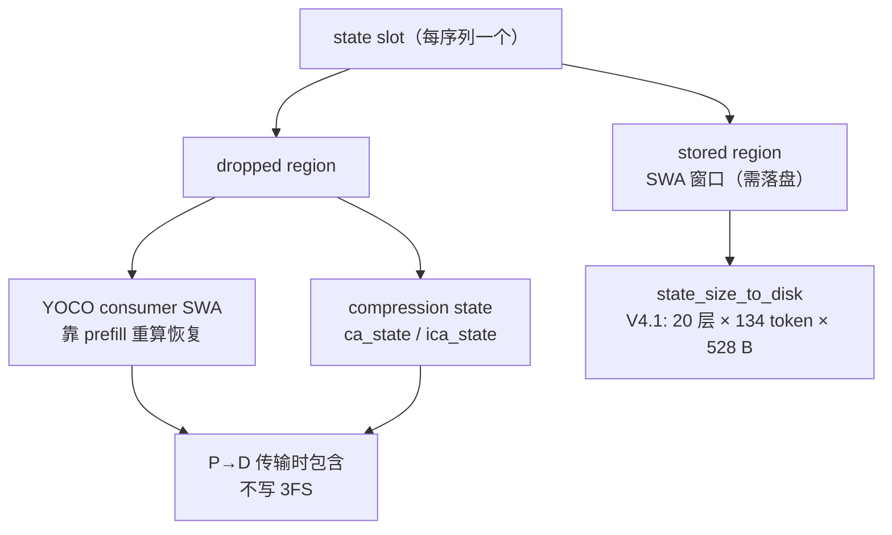

# 第 4 章 KV cache 与状态缓存：分页块、StateBlock 与 SWA 环

## 一、这一章要解决的问题

推理框架里最贵的资源不是算力，是**显存里的历史状态**。每个请求的每一层、每个 token 都要留下 KV；上下文越长、并发越高，KV 越大。DeepInfer 的 KV 管理不是「一个 tensor 存所有层」，而是三套结构叠在一起：

1. **分页 block KV**：主 KV、压缩 KV、Indexer KV，按 128 token 一块分配；
2. **每序列 state 槽位**：SWA 环、压缩状态，按序列独占；
3. **落盘 / 跨机布局**：哪些字节需要写盘、哪些只在本机、P 端如何交给 D 端。

这一章回答：这三套结构分别存什么、怎么对齐、显存怎么算、哪些状态会丢、丢了怎么恢复。

## 二、机制与原理

### 4.1 先分清五类缓存张量

V4.1 的注意力不是单一 KV，`cache_engine.py` 的 `KVCache` 数据类把每层的缓存分成五类（来源：一手）：

| 字段 | 存什么 | 布局 | 是否分页 |
|---|---|---|---|
| `ca_cache` | **压缩 KV**（compressed attention），每 N 个 token 压成一个 | `[num_blocks, block_size/N, 1, bytes_per_token]` | 是 |
| `ica_cache` | **Indexer KV**（稀疏索引器的 K） | `[num_blocks, block_size/N, 1, index_bytes]` | 是 |
| `swa_cache` | **SWA 窗口 KV** | `[num_state_seqs, swa_block_size, 1, 528]` | 否，每序列固定槽 |
| `ca_state` | 压缩器的滚动状态 | `[num_state_seqs, ring_size, 2, dim]` | 否 |
| `ica_state` | Indexer 的滚动状态 | `[num_state_seqs, ring_size, 2, index_dim]` | 否 |

几个常量：

- **block_size = 128**：`ModelMetadata.resolved_tokens_per_block` 直接返回 128，不是 vLLM 常见的 16。
- **KVSTORE_GRAIN = 128**：落盘粒度也是 128 token，只在 128 的整数倍位置写。
- **对齐 128 B**：`kvcache_align_to = 128`，MXFP8 / 稀疏 FP4 的 scale 需要块对齐。
- **主 KV 每 token 288 B 或 528 B**：per-16 FP4 为 288 B；MXFP8 为 528 B（512 B 数据 + 16 B scale）。Indexer KV 是 per-32 UE8M0 的 FP4。

### 4.2 分页 block KV：所有层共享一段大 buffer

`CacheEngine.allocate_gpu_cache()` 一次性分配两块大显存：

```text
gpu_blocks : [total_kv_bytes]        # 所有层的分页 KV 拼在一起，按层切 view
gpu_states : [num_state_seqs, total_state_bytes]  # 每序列一个 state 槽
```

`GPUCacheInterface._kvcache_layout()` 负责「切 view」：遍历运行时注意力层，算出每层的 `(layer_id, kv_offset, kv_length)`，再把 `gpu_blocks` 的对应区间包装成该层的 `KVCache`。这样做的原因有三：

- **一次分配**，避免每层单独分配造成碎片；
- **统一 block id 空间**：block table 里存的是全局 block id，所有层用同一套 ID；
- **共享 KV**：`layer_kv_map` / `layer_index_module_map` / `layer_index_k_map` 允许后面的层复用前面层的 cache，不重复占空间（`share-kv` / `share-index`）。

block 的分配与回收由 `BlockManager` 负责（第 3 章）：`block 0` 是保留的 dummy，CUDA Graph 的 padding 行写到这里；其余 block 用引用计数支持 fork 共享。

### 4.3 StateBlock：每序列一个「固定大小的抽屉」

分页 block 只解决「按 token 增长」的 KV；SWA 与压缩状态是**每序列固定大小**的，放进 state cache 更合适。

`StateBlock` 把一个 state 槽分成两段（`cache_engine.py:221`）：

```text
[ stored region: SWA ] [ dropped region: YOCO consumer SWA | compression state ]
```

| 区域 | 内容 | 是否落盘 | 跨机传输 |
|---|---|---|---|
| **stored region** | 需要跨请求保留的 SWA 窗口（V4.1 前 20 层） | ✅ | ✅ |
| **dropped region — YOCO consumer SWA** | consumer 层的 SWA，恢复靠 prefill 重算 | ❌ | ✅（P→D 传完整 state） |
| **dropped region — compression state** | `ca_state` / `ica_state` 等压缩边界累加器 | ❌ | ✅ |

`state_size_to_disk` 只包含 stored region：V4.1 是 **20 层 × 134 token × 528 B = 1,415,040 B/序列**（来源：官方 Q&A）。134 = 128 的 SWA 窗口 + 6 个投机回退位置；多出来的 6 个位置由 ring buffer 的额外槽位吸收。

> 为什么 consumer SWA 可以丢？因为 YoCo 的 consumer 层在 prefill 时可以重算；而 compression state 的窗口边界天然对齐到 128 token 的落盘粒度，没有跨边界依赖，所以也可以不落盘（来源：官方 Q&A）。

### 4.4 SWA 环：窗口 + 回退余量

SWA（Sliding Window Attention）只保留最近 `window_size` 个 token 的 KV。`swa_cache` 是每序列一个环形缓冲区，大小是：

```text
swa_block_size_inference = window_size + DEEPINFER_MAX_BACKTRACKING_TOKENS
```

`DEEPINFER_MAX_BACKTRACKING_TOKENS` 默认取 `max(env, nextn + 1)`；`nextn=5` 时是 6。多出来的位置用于投机解码被拒绝时的回退：验证失败要回到之前的 token，窗口必须还能覆盖它。

这里有两个容易混淆的点：

- **SWA 只存窗口，不存全量**；全量历史在压缩 KV 里（每 N 个 token 一个 key）。
- **SWA 槽位是按序列固定分配的**，不是按 token 分页；所以它不进入 block table，而是通过 `state_id` 索引。

### 4.5 落盘：为什么是 128 的整数倍

`KVSTORE_GRAIN = 128` 是落盘粒度。具体规则（来源：官方 Q&A）：

- **Prefill 后**：在序列末尾保留 1 个 token，再向下取整到 128 的倍数；如果不足一个完整的 128 单元，本轮不落盘。
- **Chunked prefill 中间**：不落盘，只有最后一个 chunk 落。
- **Decode 期间**：显存里另有一份 replica 区域；每跨过一个 128 边界，就把当前窗口复制到 replica；请求结束时从最近一次完整副本取数，落点向下取整到 128。
- **最多溢出 5 个 token**：复制位置可能越过边界最多 5 个 token，由 ring buffer 多出的 6 个位置吸收。

`DEEPINFER_PREFILL_STORE_EXTRA_STATE`（默认关）会为每个 SWA 层额外保留 `DEEPINFER_PREFILL_STORE_EXTRA_SIZE`（默认 128）个 token，目的是让多轮对话更容易命中——因为落盘只在 128 倍数处发生，prefill 结束时可能刚好差一点。

### 4.6 显存怎么算：profile + 2 倍 state + 全局平均

`WorkerBase.profile_num_available_blocks()`（`worker/base.py:212`）：

```text
available = total_gpu_memory × gpu_memory_utilization − peak_allocated
available -= 2 × state_cache_size        # state store & copy buffer
num_gpu_blocks = available // cache_block_size
```

- `peak_allocated` 来自一次满负载 profile run（含 MoE 强制 1.8 倍不均衡）。
- state cache 乘 2：一份是正常 state，一份是 copy buffer（落盘 / P→D 传输要复制）。
- 最后跨 rank 做 all-reduce，**取平均**后向下取偶（代码是 `SUM / world_size / 2 * 2`）。

得到的 block 数还要过一道校验（`llm_engine.py:_init_cache`）：

```text
max_seq_len = block_size × num_gpu_blocks × 0.8
require runtime_max_model_len <= max_seq_len
```

不满足就直接报错，提示你提高 `gpu_memory_utilization` 或降低 `max_model_len`。

### 4.7 生产环境的三级存储

官方 Q&A 给出的生产分层（来源：官方）：

| 内容 | 介质 | 副本 | 管理者 |
|---|---|---|---|
| 在途 block KV + state KV | 推理 GPU 显存 | — | P / D 实例 |
| SWA KV cache | 本地 host memory | 单副本，不落 3FS | P / D 实例；跨机命中走 400G VLAN |
| 分页 block KV | 专用 3FS 存储集群 | 无应用层副本，依赖 3FS 自身冗余 | kvcache-store |

关键设计是**把 block KV 放到独立存储集群**，而不是本地分层存储：

- 任何 prefill 机器都能命中任意前缀，不需要「前缀亲和」路由；
- 存储扩缩容与计算节点解耦；
- 计算节点故障不影响 KV（计算节点故障率比存储节点高一个数量级以上）。

这套存储系统**没有随开源仓库发布**；开源版只有单机 HBM + 单机 state cache，以及为 P→D 搬运预留的布局字段（`state_size_to_disk`、`TO_CE` 视图等）。

## 三、源码走读

| 位置 | 内容 |
|---|---|
| `deepinfer/worker/cache_engine.py:205` | `KVCache` 数据类：五类 cache 字段 |
| `:221` | `StateBlock`：stored / dropped 两段布局、每层 32B 对齐、`state_size_to_disk` |
| `:309` | `KVCacheManager`：按层切 view、share-kv 映射、压缩比例 |
| `:540` | `GPUCacheInterface`：一个序列的 cache 视图、state 切片、落盘读写 |
| `:851` | `CacheEngine`：分配、`get_state_shape`、`get_cache_block_size` |
| `deepinfer/model_executor/model_metadata_utils.py:134` | `resolved_tokens_per_block = 128` |
| `deepinfer/worker/base.py:212` | `profile_num_available_blocks` |
| `csrc/engine/block_manager.hpp:27` | `Blocks`：block 0 保留、引用计数 |
| `deepinfer/engine/llm_engine.py:416` | `_init_cache`：block 数校验与 cache 初始化 |

### 4.1 StateBlock 的内部布局



### 4.2 一次请求的 cache 生命周期

```text
add_request
  → Sequence 创建，block_table 为空，state_id = -1
  → prefill 调度：BlockManager 分配 block + state slot
  → 每层写入：ca_cache / ica_cache（分页） + swa_cache / ca_state（state 槽）
  → decode：每步追加 block（_append_slot），SWA 环滚动
  → 请求结束：block/state 引用计数减 1；归零回收
  → 需要复用时：select_state_slice_to_store 按 128 对齐取出 stored region
```

### 4.3 `share-kv` 是怎么省空间的

`_get_kv_mapped_layer_id` / `_get_index_mapped_layer_id` 会读取模型配置里的 `layer_info_shared_cfg`：

- `layer_kv_map[layer_id] = source_layer_id`：本层复用 source 层的 KV，不再单独占空间；
- `layer_index_module_map` / `layer_index_k_map`：Indexer 的 K 也可以共享；
- 只允许指向**前面已经处理过的层**（`mapped <= layer_id`），否则断言失败。

所以 `KVCache` 的布局是「按需分配」的，不是每层都占一份；模型配置里共享得越多，block 能装下的 token 越多。

## 四、常见坑与边界条件

1. **文档说取最小值，代码取平均值**：`_init_cache` 的 docstring 写「take the minimum number of blocks across all workers」，但实际是 all-reduce SUM 后除以 world size。各 rank 显存不对称时，平均值可能让某些卡放不下；排查 OOM 时以代码为准。
2. **state cache 要按 2 倍预留**：profile 时减去了 `2 × state_size`；如果手动估算显存，漏掉 copy buffer 会高估可用 block 数。
3. **`DEEPINFER_MAX_BACKTRACKING_TOKENS` 不能小于 `nextn + 1`**：环境变量定义里用 `max(v, nextn+1)` 兜底；关掉投机后它也不会自动变小，仍按配置值占空间。
4. **SWA 只在 128 倍数落盘**：多轮对话如果每轮长度不是 128 的倍数，命中率会低于预期；`DEEPINFER_PREFILL_STORE_EXTRA_STATE` 就是为这个场景准备的。
5. **chunked prefill 中间不落盘**：只有最后一个 chunk 落；如果请求被 abort，之前 chunk 的 KV 不会进入持久化。
6. **YoCo consumer SWA 不落盘**：依赖 prefill 重算恢复；如果关闭截断（`DEEPINFER_YOCO_PREFILL_TRUNCATION_MODE=off`）但模型仍有 consumer 层，`load_state_from_store_to_prefill_cache` 会断言失败。
7. **block 0 不可用**：它是 dummy / padding 槽；任何「为什么 block 数比预期少 1」的疑问都来自这里。
8. **共享层不占新空间，但要求顺序**：`share-kv` 只能复用前面的层；配置写反会在启动时断言。

## 五、关键结论

1. V4.1 的 KV 是**三套结构**：分页 block KV、每序列 state 槽、落盘/跨机布局。
2. `block_size = 128`、`KVSTORE_GRAIN = 128`、对齐 128 B，是整套布局的三个基准数。
3. `StateBlock` 把 state 分成 **stored（需落盘）** 与 **dropped（可重算）** 两段；V4.1 每序列落盘量约 **1.4 MB**。
4. SWA 是**环形窗口 + 6 token 回退余量**；只在 128 倍数处落盘，chunked prefill 中间不落。
5. 显存按「profile 峰值 + 2× state」计算，block 数跨 rank 取平均后取偶。
6. 开源版只有单机 cache；生产的三级存储（HBM / host / 3FS）与跨机命中未开源。

## 本章要点回顾

- 五类 cache：`ca_cache`、`ica_cache`、`swa_cache`、`ca_state`、`ica_state`。
- `block_size=128`、`KVSTORE_GRAIN=128`、`kvcache_align_to=128`。
- `StateBlock` = stored SWA + dropped（YoCo consumer SWA + compression state）。
- V4.1 落盘量：20 层 × 134 token × 528 B ≈ 1.4 MB/序列。
- SWA 窗口 + `MAX_BACKTRACKING_TOKENS`（默认 6）组成环形槽。
- 显存公式：`总显存 × utilization − profile 峰值 − 2×state`。
- 生产三级存储：HBM（在途）/ host（SWA）/ 3FS（分页 block KV），未开源。
- 共享层（share-kv / share-index）只复用前面的层，不重复占空间。
