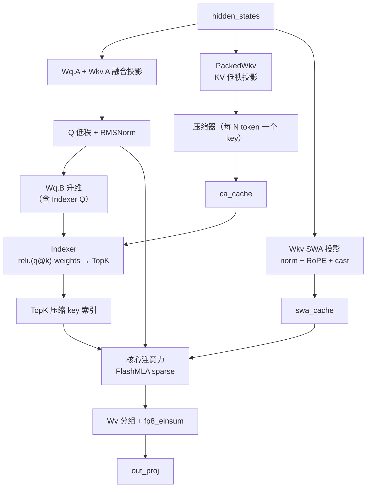

# 第 5 章 注意力栈：MLA、压缩 KV、稀疏索引与 SWA

## 一、这一章要解决的问题

V4.1 的注意力不是「一次标准 scaled dot-product attention」，而是**几条分支拼起来的复合结构**：

- Q/KV 先做低秩投影（MLA），KV 不存完整矩阵，只存低秩潜向量；
- 长上下文再按比例压缩（每 N 个 token 一个压缩 key）；
- 稀疏注意力用一个 Indexer 选出 TopK 个压缩 key，只在这些 key 上算；
- 每个 query 还额外看一个滑动窗口（SWA）；
- 前若干层与后若干层还分 producer / consumer（YoCo），consumer 的 SWA 从共享 hidden 投影。

这一章按数据流拆开：**Q 怎么来 → KV 怎么来 → 索引怎么选 → 注意力怎么算 → 输出怎么投**。

## 二、机制与原理

### 5.1 MLA：KV 不存完整矩阵，只存低秩潜向量

标准多头注意力每个 token 每层要存 `2 × num_heads × head_dim` 个 KV 元素；上下文一长，KV cache 就爆炸。MLA（Multi-head Latent Attention）的做法是：

```text
Q:  hidden → Wq.A（降到 q_lora_rank）→ RMSNorm → Wq.B（升到 num_heads × head_dim）
KV: hidden → Wkv.A（降到 kv_lora_rank + qk_rope_head_dim）→ 只缓存这个潜向量
    其中 qk_rope_head_dim 是解耦的 RoPE 部分，不参与压缩
```

代码里的对应字段（`V4AttentionBase.__init__`）：

| 字段 | 含义 |
|---|---|
| `q_lora_rank` | Q 的低秩维度 |
| `kv_lora_rank` | KV 潜向量维度 |
| `qk_head_dim` / `head_dim` | 每个 head 的维度 |
| `qk_rope_head_dim` | 其中走 RoPE 的尾部维度 |
| `o_groups` / `o_lora_rank` | 输出投影的分组数与低秩维度 |

`num_key_value_heads == 1` 是硬断言：V4.1 的 KV 是单头共享的（MQA 式），所有 query head 共用同一份潜向量。每个 token 的缓存量是 `kv_lora_rank + qk_rope_head_dim`，再按精度打包：

- **per-16 FP4**：288 B/token；
- **MXFP8**：528 B/token（512 B 数据 + 16 B scale）。

### 5.2 压缩 KV：每 N 个 token 一个 key

MLA 已经压了一次，V4.1 又加了一层**时间维压缩**：`kv_compress_ratio = N`，每 N 个 token 只产生一个压缩 key，写到 `ca_cache`：

```text
ca_cache: [num_blocks, block_size / N, 1, bytes_per_token]
```

- `N = 1` 表示不压缩（`is_c1`），走 dense 路径；
- `N > 1` 时，前向要维护一个**压缩器状态**（`ca_state`），把窗口内的 token 累加/池化成新的 key；
- 压缩窗口的边界天然对齐到 128 token 的落盘粒度，所以 `ca_state` 不需要跨边界持久化（第 4 章）。

每层的 `PackedWkv` 负责 KV 投影与压缩；如果某层只做 SWA、不做压缩，`ca_cache` 可以为空，`block_size` 也从 `ca_cache.shape[1] × N` 推导。

### 5.3 Indexer / DSA：先选 TopK，再算注意力

长上下文下，即使压缩了 KV，key 的数量仍然很大。V4.1 用**稀疏索引器**（DeepSeek Sparse Attention）进一步裁剪：

```text
对每个 query：
  1. indexer 计算每个压缩 key 的分数：logits = relu(q_index @ k_index) * weights
  2. 取 TopK（topk_tokens）个压缩 key
  3. 核心注意力只在这 TopK 个 key 上计算（delegate 给 FlashMLA 的 sparse 路径）
```

`index_attn.py` 的 `MQA` 是这部分的实现：

| 组件 | 作用 |
|---|---|
| `index_k_module`（`KProject`） | 从主压缩 KV 投影出 Indexer 的 K |
| `weights_proj` | 给每个 index head 学一个权重 |
| `topk_tokens` | 每个 query 保留多少个 key |
| `candidate_topk_blocks` | 先按 block 粒度粗筛，再在候选块内 fine-grained TopK |
| `FP4_INDEX_KV_FORMAT` | Indexer 的 Q/K 都用 FP4（E2M1 + UE8M0 scale） |
| `deep_select.interface.topk` | 实际的 TopK 算子（vendor/DeepSelect） |

Indexer 的内存是单独核算的：`compute_chunk_size = min(8192, DEEPINFER_INDEX_ATTN_MEMORY_LIMIT // row_bytes // 8 * 8)`，默认上限 10 GiB（`DEEPINFER_INDEX_ATTN_MEMORY_LIMIT`）。行太宽时会分 chunk 计算，避免一次 materialize 全部 logits。

### 5.4 SWA：每个 query 额外看一个窗口

除了压缩 KV + TopK，每个 query 还要看最近的 `window_size` 个 token。这部分走独立的 `swa_cache`：

```text
swa_cache: [num_state_seqs, swa_block_size, 1, 528]
swa_block_size = window_size + MAX_BACKTRACKING_TOKENS
```

为什么单独存？

- 压缩 KV 的粒度是 N 个 token，最近窗口内的细节（尤其是 draft 回退需要的 token）用压缩 key 表达不了；
- SWA 是**每序列固定大小**的环形结构，放 state cache 比放分页 block 更省管理开销。

Prefill 时，`kv_swa_full_index` 为每个 query 行列出窗口内可见的 key（从 `swa_cache` 历史 + 本轮新 KV 拼成的大 buffer 中取）；decode 时 `kv_swa_index` 从环形槽位直接取。最后，核心注意力把 **SWA 分支的 key** 与 **压缩 KV 的 TopK key** 拼在一起算（`kv_index_cat`）。

### 5.5 一次 forward 的完整数据流



对应的代码路径（`V4Attention.forward`，`attn.py:752`）：

1. `compute_attn_info()`：把紧凑的索引字段展开成 kernel 可消费的完整索引（幂等）。
2. `_project_current_hidden_inputs()`：把当前 hidden（以及 shared hidden）投影成 KV 与 index weights。
3. `_project_q_and_swa()`：融合投影出 Q 低秩与 SWA KV。
4. `_prepare_swa_kv()`：norm + RoPE + Hadamard + cast + 写 `swa_cache`；prefill 时同时准备 CP all-gather。
5. `_project_q_b()`：Q 升维，拆出 Indexer Q。
6. `_compute_kv_ca_index()`：调用 Indexer 选 TopK，得到 `kv_ca_index`；同时把压缩 KV 写入 `ca_cache`。
7. Prefill：把 `[SWA cache | 当前 SWA KV | 压缩 cache]` 拼成一个连续 buffer，调用 `prefill_attn_varlen_sparse`。
8. Decode：调用 `decode_mla_mqa_sparse`，主 key 用 `swa_cache`，额外 key 用 `ca_cache` + `kv_ca_index`。
9. `_wv_and_o_proj()`：Wv 分组投影（`deep_gemm.fp8_einsum`）+ `out_proj`。

### 5.6 Prefill 与 decode 的差异

| 维度 | Prefill | Decode |
|---|---|---|
| Q 长度 | 整个 chunk（可能上千 token） | 每序列 1 + 验证的 draft 数 |
| KV 来源 | 历史 cache + 本轮新 KV，拼成连续 buffer | 直接从 `swa_cache` / `ca_cache` 按索引取 |
| 注意力算子 | `flash_mla_sparse_fwd`（varlen） | `flash_mla_with_kvcache`（paged） |
| 索引 | `kv_swa_full_index` + `kv_ca_index` | `kv_swa_index` + `kv_ca_index` |
| 是否 causal | sparse 路径只支持非 causal（由索引本身表达可见性） | 同上 |
| CUDA Graph | 不捕获（形状变化大） | 捕获（批大小分档） |

`attention_backend.py` 还会把 head 数补齐到 FlashMLA 支持的 **64 / 128**：不足就补零，超过 128 直接报错。

### 5.7 CP：prefill 时把上下文切给多张卡

CP > 1 时，模型层在 prefill 开头调用 `input_metadata.prepare_for_mirror_cp()`，按 CP rank 把 token 重排成镜像布局，再 `gather` hidden states。注意力内部对压缩器的输入与 SWA KV 做 `all_gather`，保证每个 rank 都能看到完整 KV；输出后再按反向索引还原顺序。

注意三个边界：

- **CP 只用于 prefill**：decode 时 `use_cp = is_prompt and cp > 1`，为假；
- **COMPLETION 引擎不允许 CP > 1**：`LLMEngine.__init__` 里有断言；
- 官方生产当前**不使用 CP**（来源：官方 Q&A），开源代码的 CP 是给离线/实验场景准备的。

### 5.8 YoCo：前 producer、后 consumer

YoCo（You Only Cache Once）把模型按 `n_prefill_layer` 切成两段：

- `layer < n_prefill_layer`：producer，正常算 KV；
- `layer >= n_prefill_layer`：consumer，**SWA 从第一层 consumer 的共享 hidden 投影**，不重复算。

Prefill 截断有三种模式（`DEEPINFER_YOCO_PREFILL_TRUNCATION_MODE`）：

| 模式 | 行为 | 代价 |
|---|---|---|
| `off` | 不截断，consumer 层也跑全量 query | 最慢，但最准 |
| `mask` | 保留全部 query，只收窄 SWA 可见域 | 计算量仍大，索引被 mask |
| `compact` | 真正移除截断区的 query | 最快，但需要边界 gather / KV 全量写入 |

`compact` 模式下，`_store_yoco_full_kv()` 会用**完整 hidden** 更新主 KV/Index KV，保证 KV 覆盖完整上下文；但 query 只保留末尾 `KEEP_TOKENS` 个。官方要求 `KEEP_TOKENS` 覆盖 `window_size + MAX_BACKTRACKING_TOKENS`，且开启截断时必须显式设置（默认 0）。注意：代码只在 `ModelMetadata` 里断言 `> 0`，**并不校验这个下界**；配小了不会启动失败，但可能让回放/回退覆盖不到完整窗口。

## 三、源码走读

| 位置 | 内容 |
|---|---|
| `deepinfer/model_executor/models/v4_modules/attn.py:65` | `V4AttentionBase`：投影、norm、RoPE、Wv/O |
| `:228` | `V4Attention`：压缩 KV、Indexer、SWA、YoCo、共享层 |
| `:752` | `forward`：完整数据流 |
| `:589` / `:628` | `_prefill_attention` / `_decode_attention` |
| `:672` | `_store_yoco_full_kv`：compact 模式的完整 KV 更新 |
| `:883` | `DFlashAttention`：draft 专用注意力（第 7 章） |
| `deepinfer/model_executor/models/v4_modules/index_attn.py:56` | `MQA`：Indexer 打分与 TopK |
| `deepinfer/model_executor/layers/attention_backend.py` | FlashMLA 的 prefill / decode 封装 |
| `deepinfer/model_executor/models/v4_modules/yoco.py` | YoCo 判定、边界 compact |
| `deepinfer/model_executor/models/v4_modules/cross_layer.py` | 跨层共享的 `shared_hidden` / `pre_rope_kv` / `topk` |

### 5.1 为什么 KV 要「拼成一个大 buffer」再算 prefill

Prefill 的注意力需要同时看三类 key：

```text
[ 历史 SWA 窗口（swa_cache） | 本轮新 SWA KV | 压缩 KV（ca_cache） ]
```

FlashMLA 的 sparse prefill 接收的是**一个连续的 KV buffer + 索引**，而不是多个 cache 指针。所以 `_prepare_prefill_kv()` 先算总长度、分配/复用一个 buffer，再用 `load_paged_kv_cache` 把 `swa_cache` 与 `ca_cache` 的块拷进去，最后用 `kv_index_cat` 把两段索引拼起来。共享 KV 的层会复用同一个 buffer（`cross_layer_runtime.loaded_prefill_kv`），只换索引。

### 5.2 融合 kernel 省了什么

`fused_norm_rope_hadamard_cast_store_kvcache` 把五件事合成一个 kernel：

```text
RMSNorm → RoPE → Hadamard 变换 → 量化（FP8/FP4）→ 写 KV cache
```

对 Q 也有一条融合路径（`fused_norm_rope_attn_rope_cast`），把 Q 的 norm + RoPE + 注意力 + 输出 RoPE + cast 串起来。这减少的不只是 kernel 启动开销，更重要的是**减少中间张量的显存读写**——decode 每步都要走一遍，省下来的带宽直接变成吞吐。

## 四、常见坑与边界条件

1. **head 数不是 64/128 会被补零**：`_pad_attention_heads` 会补到下一个支持值；超过 128 直接 `ValueError`。补零会浪费算力，但保证 kernel 可用。
2. **sparse attention 只支持非 causal**：`decode_mla_mqa_sparse` 里 `causal=False`；可见性完全由索引表达，不要指望 mask 参数。
3. **`use_swa=False` 必须搭配 packed KV**：`V4AttentionBase` 有断言；纯 SWA 层与 packed-KV 层的索引语义不同。
4. **所有层都断言 `sink_mode == "swa"`**：这是 V4.1 的配置约束，改模型配置时要先满足。
5. **Indexer 内存上限太小会启动失败**：`compute_chunk_size` 必须 > 0；默认 10 GiB，调小要确保至少能放 8 行。
6. **YoCo 的 `KEEP_TOKENS` 有下限，但代码不校验**：官方要求覆盖 SWA 窗口 + 最大回退；代码只断言 `> 0`，配小了不会启动失败，可能在回放/回退时覆盖不到完整窗口。开启截断时必须显式设置，不能依赖默认 0。
7. **YoCo 截断会关闭 `prompt_logprobs`**：`add_request()` 里会强制置 `False` 并打 warning；需要 prompt logprobs 的实验不要开截断。
8. **CP 只在 prefill 生效**：decode 不做 CP；`COMPLETION` 引擎配 CP > 1 会断言失败。
9. **batch invariant 会关掉部分融合路径**：`use_fused_norm_rope_attn_rope_cast` 的条件里包含 `not DEEPINFER_BATCH_INVARIANT`（dense packed-KV decode 场景），确定性优先于峰值性能。

## 五、关键结论

1. V4.1 的注意力是 **MLA + 时间压缩 + 稀疏 TopK + SWA** 的复合结构，不是单一 attention。
2. MLA 只缓存低秩潜向量；压缩 KV 每 N 个 token 一个 key；SWA 单独存环形窗口。
3. Indexer 用 `relu(q@k)·weights` 打分，TopK 后只算少量 key；Indexer Q/K 是 FP4。
4. Prefill 把三类 key 拼成一个连续 buffer，交给 FlashMLA sparse；decode 用 paged cache + 索引。
5. YoCo 让后半模型复用共享 hidden；`compact` 模式真正减少 query，但 KV 仍按全量写入。
6. CP 在 prefill 时重排 token 并 all-gather KV；生产当前不用 CP。

## 本章要点回顾

- MLA：Q 低秩 `q_lora_rank`，KV 只存 `kv_lora_rank + qk_rope_head_dim`。
- 压缩 KV：每 N 个 token 一个 key，`ca_cache` 按 block 分页。
- Indexer：`relu(q@k)·weights` → TopK → 只算 TopK 个 key。
- SWA：独立环形缓存，`window_size + 回退余量`。
- Prefill 拼 `[SWA 历史 | 新 SWA | 压缩 KV]`；decode 用 paged cache。
- YoCo：`n_prefill_layer` 切分 producer / consumer；`mask` 与 `compact` 两种截断。
- 常见坑：head 数、非 causal、`use_swa=False` 的 packed KV 前提、YoCo keep tokens、CP 仅 prefill。
