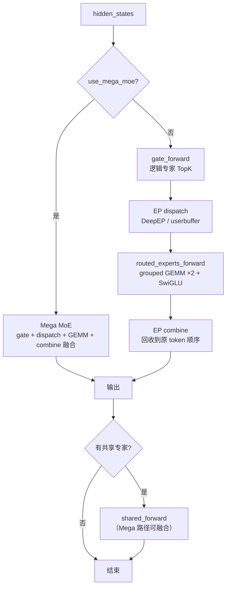

# 第 6 章 MoE、专家并行与 EPLB：热专家为什么要复制

## 一、这一章要解决的问题

稠密模型每个 token 都要走一遍全部参数；MoE 把 FFN 换成 N 个「专家」，每个 token 只选其中少数几个。好处是**总参数可以很大、激活参数很小**；代价是工程复杂度：

- 专家分散在多张 GPU 上，token 要**跨卡搬运**（dispatch / combine）；
- 不同专家的热度差异很大，热门专家会成为瓶颈；
- 训练时要防塌缩，推理时要防**负载倾斜**。

DeepInfer 的答案是：**EP（专家并行）+ EPLB（专家负载均衡）+ Mega MoE（通信计算融合）**。这一章拆开这三件事。

## 二、机制与原理

### 6.1 结构：一个 MoE 层里有什么

`model_executor/models/v4_modules/moe.py` 定义三个容器：

| 组件 | 作用 |
|---|---|
| `TopKGate` | 给每个 token 打分，选出 TopK 个专家，输出权重 |
| `FusedExperts` | 路由专家的权重容器（`linear1` / `linear2`），加载时重排成运行时布局 |
| `ReplicatedSharedExpert` | 所有 token 都走的共享专家（不参与路由） |

V4.1 的门控配置（`DeepseekMoE.__init__` 的断言）：

- `topk_method == "noaux_tc"`：不做辅助损失，用 bias 校正负载；
- `norm_topk_prob == true`：TopK 权重归一化；
- `scoring_func == "sqrtsoftplus"`：打分函数是 `sqrt(softplus(x))`；
- `activation_type == "swiglu"`：专家内部是 SwiGLU；
- `routed_scaling_factor`：路由输出缩放。

多模态模型还有一个 `e_score_correction_bias_vl`，只对图像 token 生效（`images_seq_mask`）。

### 6.2 逻辑专家与物理槽位

这是理解 EPLB 的关键区分：

```text
逻辑专家（logical expert）  = 模型定义的专家，编号 0..R-1
物理槽位（physical expert）  = GPU 上实际存放的副本，编号 0..P-1
P = R + E                        （E = 冗余副本数）
每个 rank 放 P / ep_size 个物理槽位
```

- **Gate 只认识逻辑专家**。
- **EPLB 维护两张映射**：
  - `logical_to_physical_map[logical, replica] = physical`；
  - `physical_to_logical_map[physical] = logical`。
- **Dispatch 使用物理槽位**：token 被送到目标物理槽位所在的 rank。

为什么要多出 E 个副本？因为热专家可能被很多 token 选中；如果它只有一个副本、且所在 rank 的带宽/算力有限，就会成为长尾。复制热专家后，token 可以分散到多个副本上，**用显存换负载均衡**。

`resolve_num_extra_experts()` 会把冗余数向上补齐，使 `R + E` 能被 `ep_size` 整除；benchmark 默认从 32 个冗余专家起（`DEEPINFER_OVERRIDE_NUM_EXTRA_EXPERTS`），实际值以补齐后为准。

### 6.3 MoE forward：三条路径

`DeepseekMoE.forward()` 根据硬件与精度选路径：



三条路径的差别：

| 路径 | 条件 | 特点 |
|---|---|---|
| **Mega MoE** | EP 组在 scale-up 域内（GPU 走 NVLink，NPU 视为单域），且精度组合支持；NPU 上仅 `fp8×fp4` 路径 | 把 dispatch / GEMM / combine 融成更少的 kernel，减少中间张量访存 |
| **DeepEP dispatch/combine** | 跨节点 / 非 NVL 域 | 标准 EP 通信，异步与计算流重叠 |
| **共享专家** | `n_shared_experts > 0` | 复制到每个 rank，不走 EP；Mega 路径可融合进同一次 GEMM |

`routed_experts_forward()` 是标准的「两次 grouped GEMM + SwiGLU」：

```text
gate_up_proj: [num_expanded_tokens, 2 × intermediate]
  → SwiGLU + per-token cast
  → down_proj: [num_expanded_tokens, hidden]
```

权重支持 `bf16 × bf16`、`fp8 × fp8`、`fp8 × fp4` 三种组合（`mma_type`）；FP4 权重要求 checkpoint 是 QAT 产物，代码里有位模式断言。

### 6.4 Dispatch 与 combine：token 怎么跨卡

以 DeepEP 路径为例（`DeepInferMoE.dispatch/combine`）：

- **dispatch**：按 `topk_idx` 把 token 的 hidden 发到目标物理槽位所在 rank；同时把 `topk_weights` 带过去；`expert_count` 顺便累加，供 EPLB 统计。
- **combine**：把各专家算完的结果按原 token 收回，乘上路由权重；共享专家的输出可以作为 `bias` 一起加回来。
- **通信与计算重叠**：`async_with_compute_stream=True`、`previous_event` / `EventHandle` 让 dispatch/combine 与 GEMM 在不同流上重叠；`DEEPINFER_USERBUFFER_COMM_SMS` 控制通信占用的 SM 数。
- **缓冲区**：`userbuffer.allocate_ep()` 或 `allocate_sym_buffer()` 预分配，避免每步临时申请；`max_num_tokens` 在 prefill 与 decode 下不同（`max_num_prefilling_tokens` vs `max_num_decoding_tokens`）。

`dispatch` 里还有一个值得注意的开关：`do_cpu_sync` 在 prefill 且非 compact 模式时为真，在 compact 模式下关闭，因为「YoCo compaction 下 CPU 同步会成为瓶颈」（代码注释）。

### 6.5 EPLB：统计 → 决策 → 搬运

EPLB 的运行时状态在 `eplb/__init__.py` 的 `ExpertLoadBalancer`，分三步：

#### 1）统计

- 每个 step 在 `dispatch` 时累加 `expert_count[physical]`；
- 每 `DEEPINFER_EXPERT_COUNT_WINDOW_SIZE`（默认 100）个 step 形成一个窗口；
- 每 `DEEPINFER_EXPERT_REARRANGEMENT_STEP_INTERVAL` 个 step 触发一次重排（**默认 0，即关闭**）；
- 首次重排提前到 1/4 周期后，尽早纠正冷启动不均衡。

#### 2）决策

`policy.py:rebalance_experts_global()`：

```text
1. 先复制热专家：
   每轮选「加一个副本后，最大每副本负载下降最多」的逻辑专家，
   给它分配一个冗余物理槽位；共 E 轮。
2. 再把物理槽位均衡到各 rank：
   按「每副本历史负载」降序，逐个 expert 贪心放到当前
   「各 step 峰值负载之和」最小的 rank，直到每个 rank 放满 capacity 个。
```

目标函数是 `sum_steps max_rank(load)`，也就是**最小化历史窗口内的最坏 rank 负载**，而不是平均负载。这比简单的 round-robin 更贴近尾延迟。

#### 3）搬运

`shuffle.py` 提供两种：

- **节点内**：用 `torch.distributed._symmetric_memory` 建镜像 buffer，走 IPC/NVLink，避免走网络；
- **跨节点**：`expert_model_parallel_shuffle_inplace` 用 P2P 传输。

搬运是**原地**的：把所有 rank 的权重按新映射重排，不需要额外的全量副本（节点内镜像是逐层复用的一层大小 buffer）。

#### 统计指标

`_log_rearrangement_metrics` 输出：

- `rank_balance`：平均 rank 负载 / 峰值 rank 负载；
- `logical_balance`：平均逻辑专家负载 / 最大逻辑专家负载；
- `rank_peak`、`physical_peak`；
- 官方 Q&A 用的 `moe_lb = slowest rank / mean`，取值越接近 1 越好。

### 6.6 生产配置：Prefill 与 Decode 不同

官方 Q&A 给出两套 EPLB 参数（来源：官方）：

| 阶段 | 冗余专家起点 | 统计窗口 | 重排间隔 | 实测 `moe_lb` |
|---|---|---|---|---|
| Prefill | 每 GPU 4 个 | 100 step | 1000 step | 1.074（EP4DP4）/ 1.045（EP2DP2） |
| Decode | 每 GPU 1 个（EP64 补齐后每 GPU 7 个） | 1000 step | 10000 step | 1.090 |

为什么 Decode 的窗口更长、重排更稀疏？因为 Decode 的 batch 小、每步统计噪声大，频繁重排得不偿失；而 Prefill 的 batch 大、统计更稳定，可以更快响应。

这也解释了 **Wide-EP** 的收益：Decode 用 EP64–128，把专家摊薄到更多卡上，单步每卡只需搬运很少的专家权重；再配合 EPLB 把热专家复制到空闲卡，MoE 部分的访存压力显著下降（来源：官方）。

### 6.7 EP 的拓扑约束

`DeepseekMoE.__init__` 里几条硬约束：

- `num_physical_experts % ep_size == 0`；
- `num_local_physical_experts = num_physical_experts // ep_size`；
- `use_mega_moe` 要求 EP 组在 scale-up 域内（GPU 的 NVLink / NPU 单域）；NPU 上只有 `fp8×fp4` 组合会走 Mega MoE；
- 共享专家是 **replicated**，不参与 EP；
- `num_physical_topk = num_topk`：每个 token 仍然选 K 个物理槽位（副本算不同槽位）。

`parallel_state.py` 的 EP 组是**连续 rank**（`(edp, ep)` reshape），所以一个 EP 组内的 GPU 通常在同一节点/NVLink 域；跨节点的大 EP 需要底层网络支持（生产用 400G 互联）。

## 三、源码走读

| 位置 | 内容 |
|---|---|
| `deepinfer/model_executor/models/v4_modules/moe.py:40` | `TopKGate` |
| `:70` | `FusedExperts` |
| `deepinfer/model_executor/models/v4_modules/mlp.py:148` | `DeepseekMoE`：物理/逻辑专家、EP 组、Mega 判定 |
| `:359` | `gate_forward`：门控与 EPLB 映射 |
| `:461` / `:493` | `dispatch` / `combine` |
| `:528` | `mega_moe_forward` |
| `deepinfer/model_executor/eplb/__init__.py:42` | `ExpertLoadBalancer`：统计、重排、指标 |
| `deepinfer/model_executor/eplb/policy.py:73` | `rebalance_experts_global`：复制 + 贪心放置 |
| `deepinfer/model_executor/eplb/shuffle.py` | 节点内 / 跨节点权重搬运 |
| `deepinfer/model_executor/models/deepseek.py:324` | `_init_eplb`：按布局分组创建 balancer |

### 6.1 EPLB 的初始映射

```text
physical:  [0, 1, ..., R-1, 0, 1, ..., E-1]
logical:   [0, 1, ..., R-1]
```

即「原始专家 + 前面几个专家的副本」。之后每次重排，`policy.py` 可能改变副本归属与物理顺序；`logical_to_physical_map` 的每一行最多有 `E+1` 个槽位（1 个原始 + 若干副本），无效位是 -1。

### 6.2 为什么 Gate 要读 `logical_count`

同一个逻辑专家可能有多个物理副本。Gate 选完逻辑专家后，需要把它们**均匀分配到副本**上，否则复制了也没用。`gate_kwargs` 里的 `to_physical_map` 与 `logical_count` 就是给 `moe_topk_gate` / `bf16_mega_gate` 做这件事的。

### 6.3 MTP 层也参与 EPLB

`DeepseekForCausalLM._init_eplb` 把主模型层与 DFlash 的 MoE 层一起分组：

```python
moe_layers = [*self.model.layers, *(self.MTP_module.moe_layer_list() if self.load_nextn else [])]
```

所以投机头的专家也会被统计与重排；如果只调主模型，MTP 层可能成为新的热点。

## 四、常见坑与边界条件

1. **EPLB 默认是关的**：`DEEPINFER_EXPERT_REARRANGEMENT_STEP_INTERVAL` 默认 0；不显式设置，永远不会重排。`examples/offline_inference.py` 默认打开（`--disable_eplb` 可关）；`examples/benchmark.py` 需要显式 `--enable_eplb`。
2. **冗余专家数会被补齐**：`DEEPINFER_OVERRIDE_NUM_EXTRA_EXPERTS` 只是下限；实际 `num_physical_experts` 会向上补到 `ep_size` 的倍数，日志与图表用补齐后的值。
3. **`num_physical_experts % ep_size != 0` 直接断言失败**：EP 大小与专家数必须整除。
4. **Mega MoE 只限 scale-up 域**：跨节点会退回 DeepEP dispatch/combine，性能特征完全不同；不要拿单机 benchmark 推跨机。NPU 上只有 `fp8×fp4` 会走 Mega 路径。
5. **FP4 权重要求 QAT checkpoint**：`process_moe_weight` 里有位模式断言；普通 FP8 checkpoint 转 FP4 会在加载时报错。
6. **共享专家不走 EP**：它是 replicated 的，每个 rank 都有一份；显存估算时不要把它算进 EP 分摊。
7. **EPLB 重排有同步成本**：节点内用 symm_mem IPC，跨节点走 P2P；重排间隔太短会拖慢 decode。
8. **batch invariant 与 EPLB 的交互**：`userbuffer.py` 在 `DEEPINFER_BATCH_INVARIANT=1` 且重排开启时关闭 multiple reduction，避免结果随专家重排变化；两者同时开要接受额外开销。
9. **`DEEPINFER_FORCE_IMBALANCE_RATIO` 是 profile 专用**：它用随机路由模拟不均衡，把显存峰值算高；正常推理不要设。

## 五、关键结论

1. MoE 的核心区分是 **逻辑专家**（模型定义）与 **物理槽位**（GPU 副本）；EPLB 维护两者映射。
2. 热专家复制 + 贪心放置，目标是最小化历史窗口内的**最坏 rank 负载**，不是平均负载。
3. 三条执行路径：Mega MoE（NVL 域内融合）、DeepEP dispatch/combine（跨节点）、共享专家（replicated）。
4. EPLB 的统计窗口与重排间隔在 Prefill / Decode 上不同；默认关闭，需要显式开启。
5. Wide-EP 的收益来自「把专家摊薄 + EPLB 复制热专家」，两者缺一不可。
6. 关键约束：专家数能被 EP 整除、FP4 需要 QAT、Mega 需要 NVL 域。

## 本章要点回顾

- 逻辑专家 vs 物理槽位；`P = R + E`，每 rank `P / ep_size`。
- Gate 选逻辑专家，EPLB 映射到物理副本；`logical_count` 决定副本分配。
- MoE forward：gate → dispatch → grouped GEMM ×2 + SwiGLU → combine。
- Mega MoE 把通信与计算融合，只在 scale-up 域内启用（NPU 仅 `fp8×fp4`）。
- EPLB 三步：统计（窗口）→ 决策（复制热专家 + 贪心放置）→ 搬运（symm_mem / P2P）。
- 生产参数：Prefill 4 冗余/100/1000；Decode 1 冗余/1000/10000。
- 坑：默认关闭、整除约束、QAT、NVL 域、共享专家不参与 EP。
