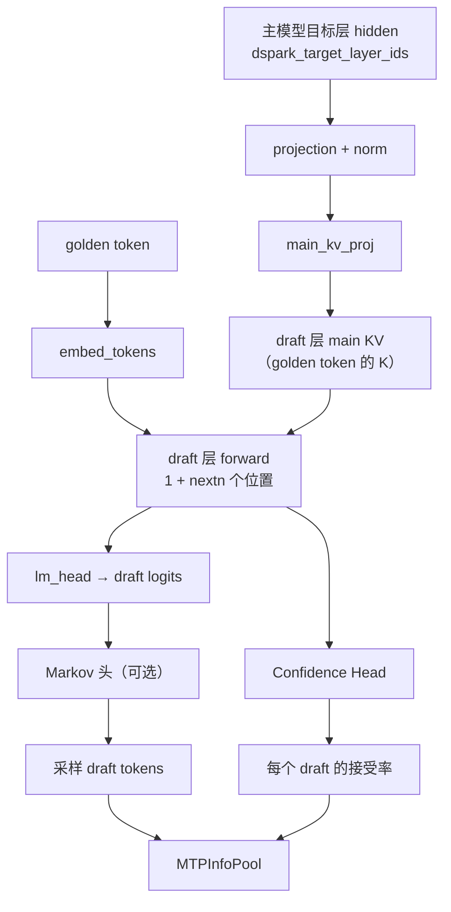

# 第 7 章 投机解码：DFlash、置信度头与变长验证

## 一、这一章要解决的问题

Decode 每生成一个 token 都要把主模型完整跑一遍；如果一次能"猜"出后面 5 个 token，再让主模型**一次批量验证**，猜对的部分就白赚了。这就是投机解码（speculative decoding）。

但「固定猜 5 个」不是最优：

- 有的请求下一个 token 很确定，5 个草稿全中；
- 有的请求很发散，5 个草稿可能只中 1 个，剩下 4 个的验证算力纯属浪费；
- 不同请求、不同位置的接受率差别很大。

DeepInfer 的方案是 **DFlash 草稿头 + Confidence Head 预测接受率 + 变长验证调度**。官方文档把这组能力称为 **DSpark and confidence-scheduled verification**，配置项也以 `dspark_*` 命名；代码里的投机头实现在 `deepinfer/model_executor/models/mtp/dflash.py`。这一章拆开：草稿怎么来、怎么验证、怎么决定验证几个。

## 二、机制与原理

### 7.1 一次投机解码的时序

```text
第 N 步（decode）：
  主模型 forward → 采样 golden token
  → DFlash 以 golden token 为起点，生成 max_MTP_value（默认 5）个草稿
  → 草稿写入 MTPInfoPool
第 N+1 步：
  主模型 forward（输入 = 上一步 golden token + 5 个草稿）
  → 得到 6 个位置的 logits
  → 逐个比较草稿 token 在主模型分布下的概率：
      接受 → 输出该 token
      拒绝 → 在第一个拒绝位置用残差分布重采样，停止验证
  → 统计 accepted / verified 数量
  → 用最后一个被接受的 token 再生成下一轮草稿
```

几个术语：

| 术语 | 含义 |
|---|---|
| **golden token** | 主模型自己采样出的 token，作为草稿的起点 |
| **draft token** | DFlash 猜出来的后续 token |
| **verify** | 用主模型分布逐个校验 draft |
| **accepted length** | 本轮最终被接受的连续 token 数（含 golden） |
| **verified length** | 本轮实际送进主模型验证的 token 数（含 golden） |

### 7.2 DFlash 的结构

`DFlash` 是一个独立的 `nn.Module`，由 checkpoint 里的 MTP 层构造（`models/mtp/dflash.py:82`）：

| 组件 | 作用 |
|---|---|
| `layers` | `DFlashDecoderLayer` 列表，每层有自己的 draft KV |
| `main_kv_proj` | 把目标层特征投影成每个 draft 层的主 KV |
| `projection` / `projection_norm` | 把多个目标层的 hidden 拼起来，投到 hidden_size |
| `embed_tokens` / `lm_head` | 与主模型共享词嵌入与输出头 |
| `markov_w1` / `markov_w2`（可选） | Markov 头：把上一个 token 的 embedding 加到 logits 上，增强局部连贯性 |
| `confidence_head` | 线性层，预测每个 draft token 的接受概率 |
| `mtp_info_pool` | 跨 step 保存草稿、logprobs、置信度 |
| `decode_graph_runner` | DFlash 专用的 CUDA Graph 捕获器 |

几个关键设计：

- **主 KV 来自目标层特征**：`update_main_cache()` 在主模型 forward 内部执行，把 `dspark_target_layer_ids` 这些层的 hidden 投影成 draft 层的 main-token K，写进 draft KV。这样 prefill 时不需要额外跑一遍 draft 模型。
- **草稿层是固定步长的**：`_embed_draft_init_tokens()` 把 `draft_init_tokens` 填成 `[golden, noise, noise, noise, noise]`，一次 forward 处理整个块；`sample_drafts()` 再逐步采样。
- **主 KV 与 draft KV 分离**：`DFlashAttention` 有独立的 draft KV；`main_kv_proj` 会复制一份 KV 权重，显存略增（代码注释明确说明）。
- **窗口必须与主模型一致**：`DFlash.window_size == cfg.window_size[0]`，否则 SWA 布局对不上。

### 7.3 草稿是怎么生成的

`DFlash.run_drafts()` 是 decode 的完整路径：

```text
1. driver 广播 last_valid_offset 与 golden_tokens 给 CP follower
2. build_dflash_input()：按固定步长构造 draft 的 InputMetadata
3. forward_drafts()：跑完所有 draft 层，得到每个位置的 hidden
4. sample_drafts()：
   - post_norm + lm_head → logits
   - 可选 Markov 头修正 logits
   - 逐位置采样 draft token
   - Confidence Head 输出每个位置的接受概率
   - 写入 MTPInfoPool（草稿、logprobs、置信度）
```

`sample_drafts()` 的循环里，`step_i` 从 0 到 `max_MTP_value-1`，每一步：

- 取该位置的 logits；
- 有 Markov 头时，用上一步 draft token 的 embedding 修正；
- 用与主采样器相同的 `process_sampling`（温度、top-k/p、种子）；
- 置信度头用 `hidden + markov_emb` 预测接受率；
- 结果按位置写入 pool。

**草稿层数与草稿个数是解耦的**：checkpoint 里的 MTP 层数由 `num_nextn_predict_layers` 决定，而每步生成几个草稿由 `DEEPINFER_USE_NEXTN_DECODE`（默认 5）决定。`deepseek.py` 里有注释明确这一点。

### 7.4 验证：接受、拒绝与重采样

`Sampler._verification()`（`layers/sampler.py:410`）在 decode 步执行：

1. `prepare_verification_metadata()` 把 `total_q` 行映射到 `(request, local_step, is_verify)`：哪些行是待验证的 draft，哪些是普通 token。
2. `process_sampling()` 同时处理「采样本轮 token」与「验证上一轮草稿」：
   - 对 draft 行，读取 `MTPInfoPool` 里上一轮的 logprobs 与 token；
   - 计算接受概率（`accept_probs`）与接受结果（`accept_result_verify`）。
3. `get_accept_result()` 找出每个请求的**接受前缀**与最终行：
   - 第一个被拒绝的位置用残差分布重采样；
   - 全部接受时，在最后一个 draft 之后正常采样。
4. `finalize_verification()` 打包 `sampled_tokens` 与 `verified_tokens`，统计 `num_generated_tokens`、`num_verified_tokens`。

类文档字符串把规则写得很清楚（来源：一手）：

> 验证上一轮 MTP 预测的 draft tokens：逐步比较 draft token 在新旧分布下的 logprob，按 speculative decoding 的接受/拒绝规则决定是否接受；被接受的 draft tokens 作为 accepted tokens 输出；第一个被拒绝的位置用 residual probability 重采样作为 output token；全部接受则在最后一个 draft token 之后正常采样。

一个细节：如果本轮遇到 EOS，`sample_drafts()` 会把该请求下一轮所有草稿的置信度置 0，避免继续猜（`sampler.py` 里 `emitted_stop_token` 的处理）。

### 7.5 为什么需要「变长验证」

假设每个请求都固定验证 5 个草稿：

- 接受率高的请求，5 个都能用上，赚；
- 接受率低的请求，后几个草稿大概率被拒，验证它们的算力浪费；
- 不同请求混在一批里，浪费会被放大。

变长验证的思路是：**按每个草稿的预期接受率排序，把验证预算分配给边际收益最高的前缀**。

官方 Q&A 的生产数据（来源：官方）：

| 配置 | 平均验证长度 | 平均接受长度 | 相对固定 5 的吞吐 |
|---|---:|---:|---:|
| 固定 5 | 5.00 | 3.29 | 基准 |
| 变长（60 并发/rank） | 3.58 | 3.21 | **+5.4%** |
| 变长（72 并发/rank） | 3.24 | 3.12 | +6.7% |
| 变长（96 并发/rank） | 3.24 | 3.15 | +11.0% |
| 变长（16 并发/rank） | 4.44 | 3.24 | −1.5% |

结论：**低并发时变长验证可能亏**（调度开销大于省下的验证），高并发时收益明显；官方在生产工作点（约 60 并发/rank）给出的收益是 +4–7%，表中最高的 96 并发达到 +11%。

### 7.6 变长调度：`MTPVarlen`

`csrc/engine/mtp_varlen.hpp` 的 `MTPVarlen::schedule()` 在每步 decode 调度时执行：

```text
1. 收集每个请求的 draft 数与接受率（来自 Confidence Head）
2. 用 N−2 轮的接受率计算「最佳 batch 大小」：
   从全 1 token 开始，按接受率从高到低逐个加入，
   用 (batch_size, forward_ms) 曲线 + 拟合斜率 + sampler 耗时估算吞吐，
   取吞吐最大的 batch 大小
3. 用 N−1 轮的接受率给每个请求分配 seqlen_q：
   每个请求先 1 个 golden token，剩余名额按接受率从高到低分配
4. 返回每个请求的 seqlen_q 给调度器
```

为什么用 N−2 与 N−1 两轮？因为 ZOS 下本轮调度时，上一轮的接受率可能还没回到 CPU（第 8 章）；用更早一轮的统计做 batch 决策，用最近一轮做请求内分配，是一个折中。代码注释明确写了这个约束。

### 7.7 ZOS 下的 GPU 修正

ZOS 开启时，CPU 侧调度用的是**滞后的**接受率；GPU 在 forward 前要按最新结果修正：

`Worker._correct_seqlens_qk()`（`worker/worker.py:191`）：

```text
1. prepare_zos_inputs()：对比上一步与本步的 seq 交集，生成 remap / seqlens_q / seqlens_k
2. 若开启 MTP varlen：
   compute_seqlens_q_by_confidence_rates(total_q, remap, prev_confidence, seqlens_q)
3. compute_seqlens_k_zos()：用上一轮 num_accepted_tokens 修正 seqlen_k
4. 若 varlen，把修正后的 seqlens_q 拷回 pinned CPU buffer（D2H），
   供 sampler 前的 CPU 元数据更新使用
```

这就是官方 Q&A 说的「CPU 只固定总预算，per-request 长度在 GPU 上用 TileLang kernel 重算（累积乘积、全局排序 TopK、融合 remap scatter），结果写回 pinned buffer」。

### 7.8 CUDA Graph：把整段草稿路径录成图

DFlash 的 decode 路径形状固定（每请求 1 + nextn 行），非常适合 CUDA Graph：

- `capture_dflash_model()` 在主模型 graph 之后捕获；
- graph 里包含：driver 广播、固定步长 metadata、draft 层 forward、采样、MTPInfoPool 写入；
- replay 时一次调用完成，省去逐 kernel 的 CPU 发射开销；
- 与主模型共享 graph memory pool 与 stream。

## 三、源码走读

| 位置 | 内容 |
|---|---|
| `deepinfer/model_executor/models/mtp/dflash.py:46` | `ConfidenceHead` |
| `:82` | `DFlash`：draft 层、main KV、Markov、置信度、pool |
| `:198` | `update_main_cache`：主 KV 来自目标层特征 |
| `:241` | `forward_drafts`：固定步长草稿 forward |
| `:279` | `sample_drafts`：逐位置采样 + 置信度 |
| `:347` | `run_drafts`：广播 → metadata → forward → sample |
| `deepinfer/model_executor/layers/sampler.py:410` | `_verification`：接受/拒绝/重采样 |
| `csrc/engine/mtp_varlen.hpp:133` | `MTPVarlen::schedule`：变长预算 |
| `deepinfer/worker/worker.py:191` | `_correct_seqlens_qk`：ZOS 下 GPU 修正 |
| `deepinfer/model_executor/models/deepseek.py:298` | MTP 模块构造与 EPLB 纳入 |

### 7.1 主 KV 与 draft KV 的关系



### 7.2 一次验证的输入布局

主模型 forward 的输入不是一个 token，而是：

```text
每请求：[golden token, draft_1, draft_2, ..., draft_k]
```

`seqlen_q = 1 + k`；`InputMetadata` 用 `mtp_first_token_positions` 标记每个请求的起始行，`prepare_verification_metadata()` 再把这些行映射成「第几步、是否待验证」。这样一次 forward 就能同时得到 golden 与所有 draft 位置的 logits。

### 7.3 `MTPInfoPool` 的跨步依赖

草稿在 N 步写入、N+1 步读取，中间隔着一次 forward+sample。pool 用 slot 隔离不同请求，slot 0 保留给 padding / dummy；写入与读取都在同一 CUDA stream 上，靠 stream 顺序保证可见性（sampler 文档注释有说明）。这也是为什么 DFlash CUDA Graph 可以把「采样 + pool 写入」一起捕获。

## 四、常见坑与边界条件

1. **`DEEPINFER_USE_NEXTN_DECODE` 默认 5**：显式设 0 才关闭投机；不设不是"自适应"，而是固定 5。
2. **草稿层数 ≠ 草稿个数**：`MTP_num_layers` 由 checkpoint 的 `num_nextn_predict_layers` 决定，草稿个数由环境变量决定；两者解耦。
3. **DFlash 的 window 必须与主模型一致**：`assert self.window_size == cfg.window_size[0]`，否则 SWA cache 布局对不上。
4. **主 KV 权重会复制一份**：`main_kv_proj` 从主注意力 KV 权重克隆，显存略增；估算显存时别漏。
5. **低并发下变长验证可能负收益**：官方数据在 16 并发/rank 时是 −1.5%；不要无脑开，先看你的并发区间。
6. **确定性采样必须关掉 varlen**：README 给的组合是 `DEEPINFER_BATCH_INVARIANT=1`、`DEEPINFER_ENABLE_MTP_VARLEN=0`，并传固定 `seq_seed`；变长验证会改变每步验证的长度，破坏可复现性。
7. **ZOS 下 CPU 的接受率是滞后的**：`MTPVarlen` 用 N−2/N−1 两轮历史；如果手动改调度逻辑，要保留这个约束。
8. **EOS 后置信度会被清零**：不要指望请求结束后还能读到最后一步的 confidence。
9. **PROMPT 引擎的 DFlash 是 `prefill_only`**：只加载 main-cache 路径参数；P/D 分离时 P 端不生成草稿。

## 五、关键结论

1. 投机解码 = **草稿 + 批量验证**；DFlash 是代码里的草稿头实现，DSpark 是官方对这套投机解码与置信度调度能力的称呼（配置项以 `dspark_*` 命名）。
2. 主 KV 来自目标层特征，prefill 不额外跑 draft 模型；draft KV 独立存放。
3. 验证规则是标准的 speculative sampling：接受前缀、首个拒绝位置用残差分布重采样。
4. Confidence Head 预测每个草稿的接受率，`MTPVarlen` 用它分配变长验证预算。
5. 变长验证在高并发下 +4–7%，低并发可能负收益；官方生产按并发区间权衡。
6. ZOS 下 per-request 长度在 GPU 上修正，CPU 只负责总预算。

## 本章要点回顾

- 一次 decode：主模型采样 golden → DFlash 猜 5 个 → 下一步批量验证。
- 验证：接受前缀 + 首个拒绝位置残差重采样；全接受则再采一个。
- Confidence Head：输入 hidden（+ Markov embedding），输出每个 draft 的接受概率。
- `MTPVarlen`：N−2 轮定 batch，N−1 轮分配每请求验证长度。
- 生产收益：验证长度 5.00 → 3.2–4.4，接受长度基本不变，吞吐 +4–7%。
- 坑：nextn 默认 5、varlen 与确定性互斥、低并发负收益、window 必须一致。
