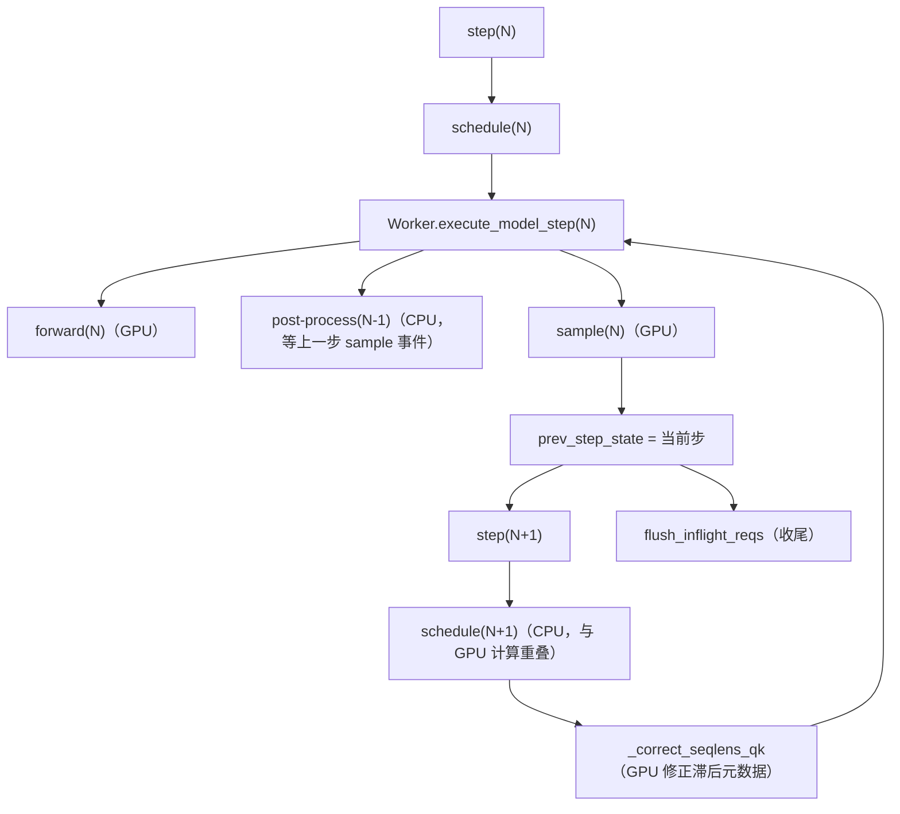

# 第 8 章 零开销异步调度与批不变性：消气泡与可复现

## 一、这一章要解决的问题

Decode 的每一步看起来只有「算」和「采样」，但真正拖慢 GPU 的往往是**两步之间的 CPU 工作**：

```text
schedule(N) → forward(N) → sample(N) → post-process(N) → schedule(N+1) → ...
```

`schedule` 与 `post-process` 都是纯 CPU 逻辑，而 `post-process(N)` 必须先等 `sample(N)` 的结果从 GPU 回来。于是 GPU 在 `post-process(N)` 与 `schedule(N+1)` 期间**空转**。请求越多、每步越短，这个气泡占比越大。

另一件看似矛盾的事：推理框架为了性能会按 batch 形状选不同 kernel、不同归约顺序；结果同一个请求单独跑和拼批跑，输出可能不一样。评测、调试、Agent 回放都需要**批不变性（batch invariance）**。

这一章讲 DeepInfer 的两个答案：**ZOS（零开销调度）** 与 **batch invariant / 确定性采样**。

## 二、机制与原理

### 8.1 气泡从哪来

`LLMEngine.step()` 的正常顺序是：

```text
1. scheduler.schedule()           CPU
2. worker.execute_model_step()
   ├── forward(N)                 GPU
   ├── sample(N)                  GPU
   └── post-process(N)            CPU（需要先 sample_end_evt.synchronize()）
3. 返回 RequestOutput
```

第 2 步的 `post-process` 里有 `sample_end_evt.synchronize()`（`worker/worker.py:_post_process_step`），这是 CPU 等 GPU 的同步点。同步之后才能：

- 把采样结果写回序列状态；
- 判断哪些请求结束、释放 block；
- 为下一步调度准备 `seqlen_k` / `seqlen_q`。

如果每步都同步，GPU 就会在 CPU 做这些事时闲着。

### 8.2 ZOS 的核心：把「上一轮的后处理」塞进「这一轮的计算」

ZOS 把流水线改成：

```text
GPU:  forward(N) → sample(N) ──────────────→ forward(N+1) → sample(N+1)
CPU:  schedule(N+1) → launch(N+1) → post-process(N-1) → launch sample(N+1)
```

具体到 `Worker.execute_model_step()` 的四步：

| 步骤 | 做什么 | ZOS 下的差异 |
|---|---|---|
| 1 | forward 当前 step | 不变；但 CPU 侧 `seqlens_q/k` 可能滞后，需要 GPU 修正 |
| 2 | post-process **上一 step** | ZOS 下这是主要的重叠点 |
| 3 | sample 当前 step | 不变 |
| 4 | post-process 当前 step | **decode 时推迟到下一步**；prefill 或非 ZOS 时当场做 |

`WorkerStepState` 保存了当前步的 `seq_metadata_list`、`scheduler_outputs`、`sampler_output`、`sample_end_evt`、`graph_size` 等，作为「上一 step」传给下一次调用。`prev_step_state` 就是这条流水线的传送带。

`pre_sampler_sync` 回调在采样前执行，做四件事：

1. `DeferredRelease.release()`：释放上一轮缓存的 `SequenceMetadata`、`RequestOutput`、clone 的 block/state；
2. 保存 KV cache（如果是 prompt 步，调用 `pe_do_save_kvcache` 等钩子）；
3. `so_matcher_builder.pump()`：把已编译好的结构化输出 matcher 挂到请求上；
4. 对 COMPLETION / NORMAL 引擎，finalize 已完成的请求。

这些工作都发生在 GPU 执行 forward/sample 的同时，不再占用 GPU 的空闲时间。

### 8.3 滞后的元数据如何在 GPU 上修正

ZOS 下 CPU 调度第 N+1 步时，第 N 步的采样结果还没回来。于是 CPU 只能用**上一轮的信息**估算 `seqlen_q/k`，GPU 在执行 forward 前再修正。

`Worker._correct_seqlens_qk()`（`worker/worker.py:191`）：

```text
1. prepare_zos_inputs(seq_metadata_list, prev.seq_metadata_list, ...)
   → 找出两步 batch 的交集，生成 remap / seqlens_q / seqlens_k / has_overlap
2. 若开启 MTP varlen：
   compute_seqlens_q_by_confidence_rates(
       total_q, remap, prev.sampler_output.confidence_rates_gpu, seqlens_q)
3. 若 nextn > 0：
   compute_seqlens_k_zos(
       seqlens_k, seqlens_q, remap,
       prev.sampler_output.num_accepted_tokens_gpu, nextn)
4. 若 varlen：把修正后的 seqlens_q D2H 到 pinned buffer，
   供 sampler 前的 CPU 元数据更新
```

这里的关键是 **remap**：上一步的 batch 与这一步的 batch 不一定相同（有请求完成、有新请求加入），要用映射把「上一轮的接受结果」对应到本轮的行。`MetadataZOS` 里保存了 `prev_sampled_token_ids`、`prev_predict_token_ids`、`prev_num_accepted_tokens`，供 kernel 使用。

### 8.4 空批与收尾

ZOS 下还有两个边角情况：

- **placeholder step**：如果调度器这一步没有选中任何序列（例如 DP 投票后本 rank 陪跑），Worker 会构造一个假的 `SequenceMetadata`（`_placeholder_seq_metadata`），让流水线继续运转；它的 `mtp_info_write_slot` 是 0（dummy slot），store kernel 会跳过。
- **收尾 flush**：最后一步的 post-process 还在 `prev_step_state` 里，`LLM._run_engine()` 在 `unfinished=False` 时调用 `flush_inflight_reqs()`，把在途结果全部处理完。

### 8.5 ZOS 的代价与边界

ZOS 不是免费的：

- `prev_step_state` 要持有上一步的 sampler 输出与 metadata，显存/内存占用增加；
- 调度器必须容忍「滞后的状态」，逻辑更复杂；
- 某些操作不能放进 forward/sample 的 launch 路径（会引入同步），代码用 `forbid_cuda_sync()` 守卫；
- 最后一步必须 flush，否则会丢输出。

默认行为（`EngineType.default_zero_overhead_scheduling`）：

- `NORMAL`：开
- `COMPLETION`：开
- `PROMPT`：关（P 端只做 prefill，没有 decode 流水线）

### 8.6 批不变性：为什么同一请求会因拼批而变

即使输入 token、采样参数、随机种子都相同，下面这些因素也会让输出漂移：

| 来源 | 机制 |
|---|---|
| **归约顺序** | 矩阵乘 / attention 的 split-K、分块大小随 batch 形状变化，浮点加法不满足结合律 |
| **kernel 选择** | 不同 batch size 走不同 kernel（例如是否 fused、是否走 CUDA Graph） |
| **MoE 路由** | TopK 平票时的 tie-break、专家重排、副本选择 |
| **投机验证长度** | 变长验证改变每步实际验证的 draft 数 |
| **随机数** | 采样种子相同，但采样位置 / 分布形状可能变 |
| **padding** | CUDA Graph 把 batch 补齐，如果 mask 没处理好，padding 会污染结果 |

### 8.7 DeepInfer 的 batch invariant 开关

`DEEPINFER_BATCH_INVARIANT=1` 主要做三件事（来源：一手）：

1. `runtime_config.configure_worker_kernels()`：
   ```python
   deep_gemm.use_deterministic_algorithms(True)
   tile_kernels.use_deterministic_algorithms(True)
   ```
   让底层算子走确定性实现（固定归约顺序）。
2. `attention_backend.decode_mla_mqa_sparse(..., enable_batch_invariant=True)`：FlashMLA 的 decode 路径按批不变模式执行。
3. `userbuffer.py`：当 batch invariant 与 EPLB 重排同时开启时，关闭 multiple reduction，避免专家重排改变归约结果。

此外，CUDA Graph 的 padding 行通过 `valid_token_mask` 标记为无效；MoE 的 `gate_force_random` 对 padding 也置 False，避免 padding token 参与路由。

**平台限制**：昇腾路径直接断言 `not DEEPINFER_BATCH_INVARIANT`（`runtime_config.py`），目前只支持 NVIDIA。

### 8.8 确定性采样：三个条件缺一不可

README 给出的确定性采样组合（来源：官方）：

```bash
DEEPINFER_BATCH_INVARIANT=1
DEEPINFER_ENABLE_MTP_VARLEN=0
# 并在 SamplingParams 里传固定的 seq_seed
```

为什么三个都要？

- `BATCH_INVARIANT=1`：保证 logits 不随拼批变化；
- `MTP_VARLEN=0`：固定每步验证的草稿数，避免验证长度变化；
- 固定 `seq_seed`：采样 kernel 用 `seq_seed + sample_position` 生成随机数；种子固定，随机序列才固定。

对应的测试是 `tests/models/test_batch_invariant.py`：同一批 prompt 先以 64 条并发跑一遍，再逐条单跑，逐 token 比较 `token_ids`、`logprobs`、`top_token_ids`、`top_logprobs`，要求完全相等。

### 8.9 性能代价

Batch invariant 与 ZOS 都是「用一点性能换正确性/流水线效率」：

- batch invariant 会禁用部分融合路径（例如 dense packed-KV decode 的 `fused_norm_rope_attn_rope_cast` 在 batch invariant 下不启用），并让 GEMM 走确定性实现；
- 离线示例在 NVIDIA 上默认打开 `DEEPINFER_BATCH_INVARIANT=1`（`examples/offline_inference.py`），目的是让 PPL 基线可复现，而不是追求峰值吞吐；
- benchmark 默认不设置它（除非外部环境变量显式打开），测的是性能上限。

## 三、源码走读

| 位置 | 内容 |
|---|---|
| `deepinfer/worker/worker.py:88` | `execute_model_step`：四阶段与 ZOS 推迟 |
| `:191` | `_correct_seqlens_qk`：GPU 侧修正 |
| `:247` | `_post_process_step`：同步点与输出 |
| `:274` | `flush_inflight_reqs`：收尾 |
| `deepinfer/engine/llm_engine.py:860` | `step()`：调度与执行 |
| `:961` | `_execute_model_async_step` |
| `:977` | `flush_inflight_reqs` |
| `deepinfer/engine/engine_type.py` | `default_zero_overhead_scheduling` |
| `deepinfer/worker/runtime_config.py:54` | `configure_worker_kernels`：确定性算子 |
| `deepinfer/model_executor/parallel_utils/userbuffer.py:79` | batch invariant 与 EPLB 的 multiple reduction |
| `deepinfer/model_executor/layers/attention_backend.py:77` | FlashMLA `enable_batch_invariant` |
| `tests/models/test_batch_invariant.py` | 批不变性回归 |

### 8.1 ZOS 的数据流



### 8.2 为什么同步点不能随便加

`ModelRunner.execute_main_model()` 与 `execute_sample()` 都包在 `forbid_cuda_sync()` 里：

```python
with cpu_timer.record(...), cuda_timer.record(...), forbid_cuda_sync():
    ...
```

只要在 forward/sample 的 launch 路径里出现 `.item()`、`.cpu()`、`torch.cuda.synchronize()`，守卫就会抛错（可通过 `DEEPINFER_DISABLE_SYNC_GUARD=1` 临时关掉，仅用于 debug）。这条约束是 ZOS 能成立的前提：launch 必须纯异步。

### 8.3 输出为什么"晚一步"

`step()` 返回的 `RequestOutput` 对应的是**上一步**的采样结果，因为当前步的 post-process 被推迟了。离线 `LLM._run_engine()` 在循环结束时 flush，所以用户看到的是完整结果；如果你自己驱动 `LLMEngine.step()`，要记得在 `has_unfinished_requests()` 为假时调用 `flush_inflight_reqs()`。

## 四、常见坑与边界条件

1. **ZOS 默认开，但 PROMPT 引擎默认关**：P 端没有 decode 流水线，开了反而增加复杂度。
2. **不要在 forward/sample 里加同步**：`forbid_cuda_sync` 会直接报错；`DEEPINFER_DISABLE_SYNC_GUARD` 只用于定位问题，不要在生产打开。
3. **最后必须 flush**：自定义驱动循环如果只调 `step()`，会丢掉最后一步的在途输出。
4. **batch invariant 只在 NVIDIA 支持**：NPU 路径断言失败；跨平台比较输出时不要假设一致。
5. **batch invariant 不等于「跨硬件/跨版本一致」**：它只保证同一套软硬件下，不同 batch 组合的结果一致；换 GPU 型号、换 kernel 版本仍可能变。
6. **确定性采样必须同时关 varlen**：只开 `BATCH_INVARIANT=1` 而保留变长验证，验证长度仍会变，输出不可复现。
7. **`DEEPINFER_BATCH_INVARIANT=1` 会牺牲性能**：benchmark 通常不开，离线 PPL 回归通常开；先明确你要「快」还是「可复现」。
8. **EPLB 重排与 batch invariant 的交互**：重排会改变专家放置，代码在两者同时开启时关闭 multiple reduction；但这不等于零成本，重排本身仍有同步开销。
9. **`prev_step_state` 会延长对象生命周期**：长序列、大 batch 下要留意显存/内存峰值。

## 五、关键结论

1. ZOS 的核心是**把上一轮 post-process 与下一轮 schedule 塞进当前轮 GPU 计算期间**，消除 CPU-GPU 气泡。
2. 代价是元数据滞后：CPU 用历史信息估算 `seqlen_q/k`，GPU 用 `remap + 接受结果` 修正。
3. 收尾必须 `flush_inflight_reqs()`；placeholder step 用来保持流水线运转。
4. 批不变性来自**确定性算子 + FlashMLA 专用模式 + 固定归约 + padding mask**，只在 NVIDIA 支持。
5. 确定性采样 = `BATCH_INVARIANT=1` + `MTP_VARLEN=0` + 固定 `seq_seed`，三者缺一不可。
6. 两者都是性能与正确性的权衡：benchmark 追性能，评测/回归追可复现。

## 本章要点回顾

- Decode 气泡：`schedule` / `post-process` 是 CPU 工作，GPU 等它们。
- ZOS 流水线：GPU 算 N，CPU 同时做 `schedule(N+1)` 与 `post-process(N-1)`。
- `prev_step_state` 传递上一轮状态；decode 的 post-process 推迟一轮。
- 滞后修正：`prepare_zos_inputs` + `compute_seqlens_*` + remap + D2H。
- 收尾：`flush_inflight_reqs`；空批：placeholder step。
- 批不变性：确定性 kernel + FlashMLA flag + 固定归约 + mask；NVIDIA only。
- 确定性采样三条件：`BATCH_INVARIANT=1`、`MTP_VARLEN=0`、固定 `seq_seed`。
