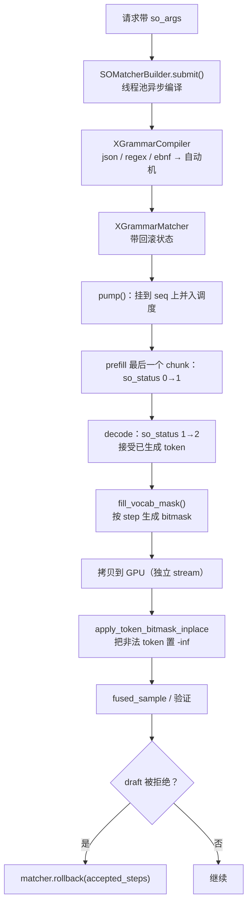

# 第 9 章 采样与结构化输出：从 logits 到合法 JSON

## 一、这一章要解决的问题

模型最后一层输出的是一个 **logits 向量**，长度等于词表大小。要把它变成用户看到的 token，中间还有一整套决策：

- 温度、top-k、top-p 怎么作用？
- 随机种子在哪一步用？为什么固定 `seq_seed` 还不够复现？
- 投机解码的验证与普通采样怎么共用一套 kernel？
- 要求输出 JSON / 正则 / EBNF 时，如何保证**每一个 token 都合法**，而不是事后校验？

这一章分两部分：**采样**（`Sampler` / `SamplingParams`）与**结构化输出**（`structure_output/`）。

## 二、机制与原理

### 9.1 `SamplingParams`：参数与默认值

`deepinfer/sampling_params.py` 是用户唯一需要接触的采样配置：

| 参数 | 默认 | 说明 |
|---|---|---|
| `temperature` | 1.0 | 小于 `1e-5` 时被当作贪心：`top_p=1`、`top_k=-1` |
| `top_p` | 1.0 | 核采样，必须 `(0, 1]` |
| `top_k` | -1 | -1 表示不限制；0 非法 |
| `max_tokens` | 16 | 0 会被改成 1 |
| `ignore_eos` | false | 忽略 EOS，跑满 `max_tokens` |
| `top_logprobs` | 0 | 返回每个位置概率最高的 N 个 token（0–1000） |
| `prompt_logprobs` | false | 返回 prompt 每个 token 的 logprob |
| `first_n_token_no_eos` | 0 | 前 N 个 token 禁止 EOS |
| `so_args` | None | 结构化输出配置，见 9.4 |
| `golden_token_ids` | None | 强制指定输出（teacher forcing / 测试） |
| `seq_seed` | None | uint64 采样种子；不传则随机生成 |

`logprobs`（布尔）是为了兼容旧 API 保留的，**会被忽略**；要拿 logprob 请用 `prompt_logprobs` / `top_logprobs`。

### 9.2 采样器的执行路径

`Sampler.forward()`（`layers/sampler.py:114`）：

```text
1. 从 hidden_states 里 gather 出需要采样的行（每个 prompt 的最后一行 / decode 的每行）
2. logits = hidden @ lm_head.weight        （bf16 GEMM）
3. 可选：blacklist token 置 -inf
4. 结构化输出 mask（若有 SO 请求）
5. fused_sample：
   - temperature 缩放
   - top-k / top-p 截断
   - log-softmax
   - 用 seq_seed + sample_position 采样
6. 可选：prompt logprobs / top logprobs / sum_smaller_probs
7. 返回 SampledInfo（token、logprob、topk 信息）
```

几个工程细节：

- **`force_topk`**（`DEEPINFER_SAMPLER_FORCE_TOPK`）：只在 top-k 个 token 上做 softmax / 采样，减少大片 logits 的读写；代价是要额外维护 token_index 映射。离线示例默认传 4096。
- **`sum_smaller_probs`**（`DEEPINFER_COMPUTE_SUM_SMALLER_PROBS`）：统计「比采样 token 概率更小的所有 token 的概率和」，用于某些评测/校准场景；默认关。
- **prompt logprobs 分块计算**：`_PROMPT_LOGPROB_CHUNK_SIZE = 8192`，避免一次 materialize 整个 prompt 的 logits；只有 CP rank 0 产出结果。
- **验证路径共用**：decode 时 `fused_sample` 同时完成「本轮采样」与「上一轮 draft 验证」；`is_verify`、`last_nextn_token_logprobs` 等参数把两条逻辑融合在一个 kernel 里（第 7 章）。

### 9.3 随机数与可复现

采样 kernel 的随机源是 `seq_seed + sample_position`：

- `seq_seed` 是每序列一个 uint64，`SamplingParams` 不传时用 `random.getrandbits(64)` 生成；
- `sample_position` 是该 token 在序列中的位置，保证同一种子下不同位置用不同随机数；
- `tag`（`default` / `mtp`）区分主采样与草稿采样的 RNG 命名空间。

所以「固定 `seq_seed`」是确定性采样的必要条件，但不是充分条件：还要 batch invariant（logits 一致）与固定验证长度（`MTP_VARLEN=0`），见第 8 章。

### 9.4 结构化输出：编译期与运行期分离

`so_args` 的格式（`SamplingParams` 文档）：

```python
so_args = {
    "schema_type": "json" | "regex" | "ebnf",
    "schema": "...",                      # JSON Schema / 正则 / EBNF 文本
    "trigger_token_ids": [ ... ],         # 可选：完整出现后才开始约束
    "bound_token_id": 123,                # 可选：触发后先强制走完 trigger 序列
}
```

整个流程分两段（来源：官方 Q&A + 一手代码）：



#### 编译期

`structure_output/compiler.py` 的 `XGrammarCompiler` 包装 xgrammar 的 `GrammarCompiler`：

- `json` → `compile_json_schema(schema, strict_mode=True)`；
- `regex` → `compile_regex`；
- `ebnf` → `compile_grammar`；
- 编译结果缓存，默认上限 **10 GiB**（`DEEPINFER_XGRAMMAR_CACHE_LIMIT_BYTES`）；
- `DEEPINFER_XGRAMMAR_DISABLE_CACHE` 是 kill switch；如果上限 <= 0，代码会警告缓存无界增长，并提到 CVE-2025-32381。

`SOMatcherBuilder` 用线程池异步编译（`max_workers` 来自空闲 CPU，`DEEPINFER_SO_BUILDER_CPUS` 默认 4）。请求在 `add_request()` 时先 `submit()`，编译完成后由 `pump()` 挂到 `seq.so_matcher` 并真正入调度。这样**编译不阻塞主线程**，但请求的首 token 会多等一次编译（通常远小于一次 prefill）。

#### 运行期

`XGrammarMatcher`（`matcher.py:58`）包住 xgrammar 的 `GrammarMatcher`，额外处理三件事：

1. **trigger tokens**：在触发序列完整出现前，不施加约束；用 KMP 匹配，支持重叠/回退。
2. **bound token**：触发后先强制逐 token 走完 trigger 序列，再进入 grammar；防止模型跳过触发词。
3. **回滚**：投机解码被拒时，`rollback(steps)` 把 matcher 状态退回；`MAX_ROLLBACK_TOKENS = nextn + 2`，回滚步数超过保留历史会抛错。

每个 decode step，`Sampler._get_so_mask()`：

- 用上一轮**被接受的 token**（`last_accepted_token + last_output_token`）推进 matcher；
- 对每个 draft token 预演 `accept_token`，记录能连续接受几步；
- 为第 0 步（正常采样）与第 1..nextn 步（draft 验证）分别填 bitmask；
- 把 bitmask 从 pinned CPU 拷到 GPU（独立 stream，`record_stream` 防复用）；
- `apply_token_bitmask_by_step_inplace` 在对应 logits 行上把非法 token 置 `-inf`。

### 9.5 失败策略：只失败一个请求

结构化输出的错误处理原则是「**只判死本请求，不带崩引擎**」（代码注释）：

- 编译超时（默认 20 s）→ `aborted_matcher`，请求标记 `FINISHED_SO_FAILED`；
- matcher 运行时异常 → `set_aborted`，请求失败；
- 日志里会打印 request_id，方便定位；
- 主采样路径不 `raise`，避免连坐整个 batch 与 NCCL 超时。

### 9.6 SO 与投机解码的交互

投机解码会一次验证多个 draft，每个 draft 位置都需要自己的 mask：

- `_get_so_mask()` 返回 `max_MTP_value + 1` 组 bitmask；
- 第 k 组对应「假设前 k 个 draft 都被接受」时的合法 token 集；
- 验证时如果第 k 个 draft 被拒，matcher 回滚到实际接受步数；
- 请求遇到 EOS 后，后续 draft 的置信度被置 0（第 7 章）。

这也是 `MAX_ROLLBACK_TOKENS = nextn + 2` 的由来：最多回滚一轮验证的所有 draft，再加两个余量。

## 三、源码走读

| 位置 | 内容 |
|---|---|
| `deepinfer/sampling_params.py` | `SamplingParams`：默认值、校验、种子 |
| `deepinfer/model_executor/layers/sampler.py:59` | `Sampler` 类文档：完整流程 |
| `:114` | `forward`：prefill / decode 分支 |
| `:302` | `_get_so_mask`：matcher 推进与 bitmask |
| `:410` | `_verification`：投机验证 |
| `deepinfer/model_executor/layers/sampler_utils.py:113` | `process_sampling`：温度 / top-k/p / 验证 |
| `deepinfer/structure_output/compiler.py:14` | `XGrammarCompiler` |
| `deepinfer/structure_output/matcher.py:58` | `XGrammarMatcher`：trigger / bound / rollback |
| `deepinfer/structure_output/so_matcher_builder.py:19` | 异步编译与 pump |
| `deepinfer/structure_output/mask.py` | bitmask 分配与 `apply_vocab_mask_by_step_inplace` |
| `examples/_structured_output.py` | JSON / regex / EBNF 示例 |

### 9.1 SO 的状态码

`so_status` 在代码里有四个值（按代码使用方式归纳）：

| 值 | 含义 |
|---|---|
| `0` | 尚未激活（prefill 还没跑完最后一个 chunk，或没有 SO） |
| `1` | matcher 已就绪，等待第一个 decode token |
| `2` | 正在接受 token 并生成 mask |
| `-1` | 失败 / 中止，请求应被终止 |

`llm_engine.step()` 在 prefill 最后一个 chunk 后把 0 改成 1；`_get_so_mask()` 在第一个 decode 步把 1 改成 2，并开始 `accept_token`。如果最后一个 prefill chunk 的 `so_status` 不是 0 或 matcher 为空，会直接把请求判死（代码里有错误日志），避免后续 mask 逻辑踩空。

### 9.2 为什么 mask 在 CPU 上填

xgrammar 的 matcher 是 CPU 库，状态推进、bitmask 填充都在 CPU 上完成；GPU 只负责把 bitmask 应用到 logits。DeepInfer 用 pinned memory + 独立 stream 把这次拷贝与主计算重叠：

- `bitmasks_cpu` 预分配 `max_MTP_value + 1` 组；
- `so_copy_stream` 等待当前流的一个 event，再异步 H2D；
- 主采样流等待 `so_mask_ready` event 后再使用；
- `record_stream` 防止 allocator 提前复用。

所以结构化输出不是「免费的」：每个 SO 请求每步都有一次 CPU matcher 推进 + H2D 拷贝；请求多时这部分会成为 CPU 瓶颈。

## 四、常见坑与边界条件

1. **`temperature < 1e-5` 会被改成贪心**：同时把 `top_p` 设 1、`top_k` 设 -1；你以为在调低温，实际是直接 argmax。
2. **`logprobs` 布尔参数被忽略**：要 logprob 请用 `top_logprobs` / `prompt_logprobs`。
3. **`max_tokens=0` 会被改成 1**：不能用来「只做 prefill 不生成」。
4. **`seq_seed` 不传就是随机**：想复现必须显式传；且还要满足 batch invariant + 固定验证长度。
5. **`so_args` 不接受 `serialized`**：离线接口只接受 `schema_type + schema`；`bound_token_ids`（复数）也已废弃，只能传单个 `bound_token_id`。
6. **xgrammar 缓存无上限会 OOM**：`DEEPINFER_XGRAMMAR_CACHE_LIMIT_BYTES <= 0` 时只有警告，不阻止运行；生产必须设正数。
7. **SO 编译超时 20 s**：复杂 schema 可能超时，请求会失败；可以调 `DEEPINFER_XGRAMMAR_TIMEOUT`，但要权衡首 token 延迟。
8. **SO 请求被抢占后不能重算**：matcher 状态无法回滚到任意历史，调度器会直接终止该请求（第 3 章）。
9. **YoCo 截断会关闭 prompt logprobs**：`add_request()` 强制置 False 并打 warning；要 prompt logprobs 就别开截断。
10. **`force_topk` 与 draft 验证要 remap**：开启后 draft 的 logprob 空间与主采样空间不同，代码用 `remap_draft_topk` 对齐；自己改采样逻辑时别漏。

## 五、关键结论

1. 采样是「logits → 温度 → top-k/p → log-softmax → 带种子采样」；`fused_sample` 把主采样与投机验证融合在一个 kernel。
2. 可复现需要三件事：固定 `seq_seed`、batch invariant、固定验证长度。
3. 结构化输出是**编译期 + 运行期**分离：xgrammar 异步编译成自动机，运行期每步推进 matcher、填 bitmask、在 GPU 上屏蔽非法 token。
4. trigger / bound tokens 允许「先自由生成，出现触发词后再约束」；matcher 支持回滚以配合投机解码。
5. SO 失败只影响单个请求，不会拖垮引擎。
6. 每个 SO 请求每步都有 CPU 推进 + H2D 成本；高并发下要评估这部分开销。

## 本章要点回顾

- `SamplingParams`：温度、top-k/p、`seq_seed`、`so_args`、`golden_token_ids`。
- 采样路径：gather → logits → blacklist → SO mask → fused_sample → 输出。
- `force_topk` 省带宽但增加映射；`sum_smaller_probs` 默认关。
- SO 编译：JSON strict / regex / EBNF；缓存默认 10 GiB；异步线程池。
- SO 运行：matcher 推进 → 每步 bitmask → H2D → 屏蔽 logits；draft 被拒则回滚。
- 状态码 0/1/2/-1；失败只终止本请求。
- 坑：温度贪心化、`logprobs` 被忽略、`max_tokens=0`、种子、缓存上限、抢占后不能重算。
