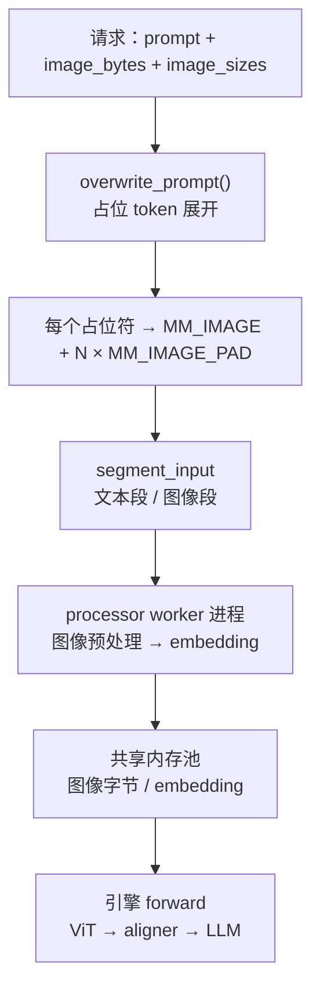
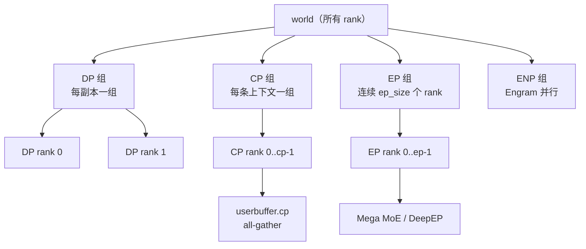

# 第 10 章 多模态与并行组：图片怎么变 token，DP/CP/EP 怎么切

## 一、这一章要解决的问题

前面九章默认输入是纯文本。真实服务里还有两类复杂性：

1. **多模态**：一张图要经过视觉编码器变成一串 token/embedding，再与文本拼在一起；图片不能像普通 token 那样随便切 chunk。
2. **并行拓扑**：模型放不进一张卡，就要拆成 DP / CP / EP / ENP 多个进程组；不同组解决不同维度的切分，rank 的排列方式决定了通信是否高效。

这一章先讲图片如何进入引擎，再讲进程组如何组织，最后把开源版的「同引擎 VE」与生产版的「E/P/D 分离」对上。

## 二、机制与原理

### 10.1 图片进入引擎的五个步骤

以 `ve/multimodal_processor.py` 为例：



#### 1）校验 image token

模型 config 里的 `image_token_id` 必须与 tokenizer 里的图像占位 token ID 一致，否则直接断言失败：

```python
assert self.mm_config.image_token_id == image_token_id
```

这是防止「图片 token 静默落到错误 ID」的关键校验（代码注释明确说明）。

#### 2）展开占位符

`overwrite_prompt()` 把每个图像占位符替换成：

```text
MM_IMAGE + MM_IMAGE_PAD × (N - 1)
```

其中 `N = image_processor.estimate_num_tokens(image_input)`，由图像尺寸与 patch size 决定。引擎侧的 `MM_IMAGE` / `MM_IMAGE_PAD` 不是词表里的 ID，而是：

```python
mm_image_token     = vocab_size + ImageTokenOffset.IMAGE
mm_image_pad_token = vocab_size + ImageTokenOffset.IMAGE_PAD
```

`ImageTokenOffset` 一共 5 个特殊图像 token（`IMAGE`、`IMAGE_PAD`、`IMAGE_START`、`IMAGE_NEW_LINE`、`IMAGE_END`），它们在词表之外单独编号，避免与真实 token 冲突。

#### 3）记录 segment

展开的同时，`multi_modal_data["segment_input"]` 会记录：

- 文本段：只记长度（`TextLengthInput`）；
- 图像段：宽高、编码后的字节、该图在展开序列中的 `(start, count)`。

这样后续的 processor worker 不需要重新解析整条 prompt，只要按 segment 处理。

#### 4）预处理 worker

`_start_workers()` 用 `fork` 启动多个 `MultimodalProcessor` 子进程：

- 输入队列 / 输出队列，缓冲区默认 512（`DEEPINFER_MULTI_MODAL_BUFFER_SIZE`）；
- 默认 8 GB/rank 的 pinned host 共享池（`DEEPINFER_MULTIMODAL_POOL_SIZE_GB`）；
- worker 超时默认 1800 s（`DEEPINFER_MULTI_MODAL_WORKER_TIMEOUT`）；
- 每个 worker 绑定到引擎 GPU 所在 NUMA（`bind_numa(which_numa(0))`）。

图像预处理（解码、缩放、归一化）是 CPU 工作，放在独立进程里，避免阻塞引擎主线程。

#### 5）前向时的消费

`LLMEngine.step()` 每步调用 `multi_modal_processor.fetch()`，把已处理好的 segment 取回；如果某张图处理失败（损坏/超时），会把对应请求 abort，并打印错误。真正的视觉编码在模型 forward 里：`models/vision_encoder/vit.py` + `vl_aligner.py` + `mlp_projector.py`，输出与文本 embedding 拼在一起，交给 LLM。

### 10.2 图片为什么不能随便切 chunk

Chunked prefill 按 token 数切分，但一张图在序列里是 `MM_IMAGE + N × MM_IMAGE_PAD` 的连续单元；如果切在中间，视觉编码器会拿到半张图。调度器的 `_adjust_chunk_size()` 会检查切点：

- 如果切点落在 `IMAGE_PAD` 区域内，且往前能找到 `IMAGE`，就把整个图片单元往前收缩或往后扩展；
- 允许在两张图片之间（`MM_IMAGE` 边界）切开。

这条逻辑在 C++ 调度器里（第 3 章），不在多模态处理器里；因为切分决策发生在调度时。

### 10.3 视觉编码器在开源版里是「同引擎」的

开源示例的 `--prompt_mode image` 把原始图片直接喂给引擎，ViT 与 LLM 在同一个 engine 进程里：

```text
prompt + image → ViT → aligner → LLM tokens → decode
```

生产架构则是 **E/P/D 分离**：VE 单独部署（一般单 GPU 一个实例，推荐便宜卡），PE 只做语言模型 prefill，CE 只做 decode。开源版没有 VE 的独立服务编排，但代码里已经按「VE 可分离」的方式组织：

- `ve/` 独立目录；
- `MultimodalProcessor` 可以在 COMPLETION 引擎里关闭（`engine_type != COMPLETION` 才构造）；
- `EngineType.PROMPT / COMPLETION` 为 P/D 分离留了钩子。

所以第 1 章说「P/D 编排未开源」：**部件在，编排不在**。

### 10.4 并行组：四类切分，五套进程组（含派生组）

`deepinfer/model_executor/parallel_utils/parallel_state.py` 的 `ParallelProcessGroup.create_process_groups()` 一次性建好：

| 组 | 切分维度 | rank 排列 | 用途 |
|---|---|---|---|
| **DP** | 数据并行 | `(replica, dp, cp)` → 每组 `dp` 个 rank | 不同请求分到不同副本；attention 走 DP |
| **CP** | 上下文并行 | `(dp, cp)` → 每组 `cp` 个 rank | 一条长上下文切给多卡做 prefill |
| **EP** | 专家并行 | 连续 `ep_size` 个 rank | MoE 专家分布 |
| **ENP** | Engram 并行 | `(replica, enp)` | Engram 模块的并行组 |
| **ep_in_dp** | DP 内的 EP | 连续 `ep_size` 个 rank | DP 组内部的专家通信 |

关键公式（`config.py:ParallelConfig`）：

```text
data_parallel_size = max(1, expert_parallel_size // context_parallel_size)  # 未显式指定时
model_parallel_size = context_parallel_size
world_size = max(cp_size × dp_size, engram_parallel_size)
data_parallel_rank = engine_rank % data_parallel_size
```

约束：

- `(cp × dp) % ep == 0`：EP 必须整除总副本数；
- `world_size % (cp × dp) == 0`、`world_size % enp == 0`；
- `ep_size` 的组是**连续 rank**，所以一个 EP 组通常落在同一节点/NVLink 域；
- ENP 默认等于 `cp × dp`，也可以单独指定。

### 10.5 进程组是怎么建出来的

`create_process_groups()` 用 `torch.distributed.new_group()` 按 rank 列表切分：

- **world**：所有 rank；
- **local**：每个 rank 单独一组（用于本地操作）；
- **DP / CP / EP / ENP**：按上面的 reshape 规则；
- **CPU 组**：DP / CP / EP-in-DP 各建一份 `gloo` 后端，用于 CPU 侧的广播与同步（ZOS 下尤其重要）。

CP 组还会创建一个 **共享内存 MessageQueue**（`distributed/shm_broadcast.py`），用于 `cp_broadcast_object`：driver 把方法名/参数写进共享内存，CP follower 读取并执行同名方法。这比 pickle + NCCL broadcast 更轻，适合每步高频调用。

`init_device_groups()` 会对每个 NCCL/HCCL 组做一次空的 `all_reduce`，强制建立通信；因为 PyTorch 默认进程组改成 gloo 后，NCCL 子组是懒初始化的，不先跑一次 collective 会拿到空指针。

### 10.6 CP 的实现：prefill 时重排 token

CP 只在 prefill 生效（第 5 章）：

1. `input_metadata.prepare_for_mirror_cp()` 按 CP rank 重排 token，生成 `mirror_cp_index` / `mirror_cp_reverse_index`；
2. 模型开头 `gather(hidden_states, mirror_cp_index)`，让每张卡拿到自己负责的 token；
3. 注意力内部对压缩器输入、SWA KV 做 `all_gather`，保证每张卡都能看到完整 KV；
4. 输出后 `gather(..., mirror_cp_reverse_index)` 还原原始顺序。

CP 的收益是「长 prompt 的 prefill 算力分摊」，代价是额外的 all-gather 与索引重排；所以生产当前不用 CP（来源：官方 Q&A）。

### 10.7 通信缓冲区：userbuffer

`model_executor/parallel_utils/userbuffer.py` 预分配三类缓冲区：

| 缓冲区 | 用途 |
|---|---|
| `userbuffer.cp` | CP all-gather 的临时张量 |
| `userbuffer.allocate_ep()` | DeepEP dispatch/combine 的缓冲区 |
| `userbuffer.allocate_sym_buffer()` | Mega MoE 的对称内存缓冲区 |

好处是**避免每步临时分配**，并让通信与计算流可以精细重叠（`async_with_compute_stream`、`EventHandle`）。`DEEPINFER_USERBUFFER_COMM_SMS` 控制通信占用的 SM 数，`limit_num_sms()` 在共享专家计算时限制 SM，避免和通信抢资源。

### 10.8 平台抽象：NVIDIA 与昇腾

`deepinfer/platform.py` 用 `PlatformGPU` / `PlatformNPU` 两个类封装差异：

| 维度 | GPU | NPU |
|---|---|---|
| 分布式后端 | NCCL | HCCL |
| TileLang 算子目录 | `tilelang_ops/cuda` | `tilelang_ops/asc` |
| FP8 scale 类型 | int32 | int16 |
| Host 内存 pin | `cudaHostRegister` | `aclrtHostRegisterV2` |
| 设备环境 | `CUDA_VISIBLE_DEVICES` | `ASCEND_RT_VISIBLE_DEVICES`（必须与前者一致） |
| 额外补丁 | — | `deepinfer/npu_ops`（DeepSelect、ViT attention 等） |

`deep_cluster/` 负责硬件探测与 NUMA 绑定：NVIDIA 走 `/proc/driver/nvidia/gpus` + NVML，昇腾走 CANN；两者都不依赖 CUDA context（避免在 driver 初始化前创建上下文）。

## 三、源码走读

| 位置 | 内容 |
|---|---|
| `deepinfer/ve/multimodal_processor.py:29` | `MultimodalProcessor`：校验、展开、worker、fetch |
| `deepinfer/ve/processor/` | 图像 / 文本 / 多模态 segment 处理 |
| `deepinfer/multimodal_tokens.py` | `ImageTokenOffset` 五个特殊 token |
| `deepinfer/model_executor/models/vision_encoder/` | ViT、aligner、projector |
| `deepinfer/model_executor/parallel_utils/parallel_state.py:51` | `ParallelProcessGroup` |
| `:70` | `create_process_groups`：DP/CP/EP/ENP 排列 |
| `deepinfer/config.py:150` | `ParallelConfig` 公式与校验 |
| `deepinfer/model_executor/parallel_utils/userbuffer.py` | CP / EP / Mega MoE 缓冲区 |
| `deepinfer/distributed/shm_broadcast.py` | CP 共享内存广播 |
| `deepinfer/platform.py` | GPU / NPU 抽象 |
| `csrc/engine/scheduler.hpp:_adjust_chunk_size` | 图片边界对齐 |

### 10.1 一次多模态请求的完整路径

```text
LLM.generate(prompts, multi_modal_data)
  → LLMEngine.add_request()
      → MultimodalProcessor.overwrite_prompt()   # 展开图片 token
      → scheduler.add_sequence()
  → step()
      → multi_modal_processor.fetch()            # 取预处理结果
      → Worker.execute_model_step()
          → ViT → aligner → LLM
      → Sampler
  → RequestOutput
```

注意 `fetch()` 在调度之后、模型执行之前；如果图片还没处理完，这一步的 `multi_modal_data` 可能不完整，引擎会等或 abort（取决于超时/失败状态）。

### 10.2 并行组的拓扑示意



## 四、常见坑与边界条件

1. **image token ID 必须与 tokenizer 一致**：`assert self.mm_config.image_token_id == image_token_id`，不一致直接启动失败。
2. **图片不能被 chunk 切开**：调度器会把切点移到图片边界；如果单张图片本身超过 `max_num_batched_tokens`，请求可能一直无法调度（而不是立刻报错）。
3. **共享池按 rank 预留 8 GB**：8 卡节点就是 64 GB pinned host memory；节点内存紧张时要调 `DEEPINFER_MULTIMODAL_POOL_SIZE_GB`。
4. **多模态 worker 是 fork 出来的**：父进程里不要在 fork 前创建 CUDA context 相关状态（代码用 `ForkProcessWithCrashHeader` 并做了 NPU 的 SIGTERM 处理）。
5. **CP 只在 prefill 生效**：decode 不做 CP；`COMPLETION + cp > 1` 会断言失败。
6. **EP 组是连续 rank**：跨节点大 EP 需要底层网络支持；不要假设任意 rank 组合都能高效通信。
7. **`ep_size` 必须整除 `cp × dp`**：否则启动断言失败。
8. **昇腾要求两个可见设备变量一致**：`CUDA_VISIBLE_DEVICES` 与 `ASCEND_RT_VISIBLE_DEVICES` 不一致会直接 `RuntimeError`。
9. **开源版没有 EPD 编排**：VE 可以在同引擎跑，也可以关掉；但把 VE 拆成独立服务、做 E/P/D 路由，需要自己写。

## 五、关键结论

1. 图片进入引擎要经过「校验 image token → 展开为 IMAGE + PAD → segment → worker 预处理 → ViT/aligner」。
2. 图片是**不可分割的 chunk 单元**，调度器会在边界处调整切分。
3. 开源版是「同引擎 VE」，生产是「E/P/D 分离」；部件在，编排不在。
4. 并行有四套组：DP（请求）、CP（上下文）、EP（专家）、ENP（Engram）；`world = max(cp×dp, enp)`。
5. CP 只在 prefill 生效，靠 token 重排 + all-gather 实现；生产当前不用。
6. 平台差异被 `Platform` / `deep_cluster` / `npu_ops` 三层封装，NVIDIA 与昇腾走不同后端。

## 本章要点回顾

- 图像 token：`MM_IMAGE + N × MM_IMAGE_PAD`，ID 在词表外单独编号。
- 多模态 worker：fork 进程 + 共享内存池 + 超时/失败 abort。
- chunk 切分不能切图片；调度器负责对齐。
- 并行组：DP / CP / EP / ENP；EP 连续 rank；`world_size` 取最大值。
- CP：prefill token 重排 + attention all-gather；decode 不用。
- userbuffer：CP / EP / Mega MoE 三类预分配通信缓冲。
- 平台：GPU（NCCL/CUDA）vs NPU（HCCL/CANN），环境变量必须一致。
