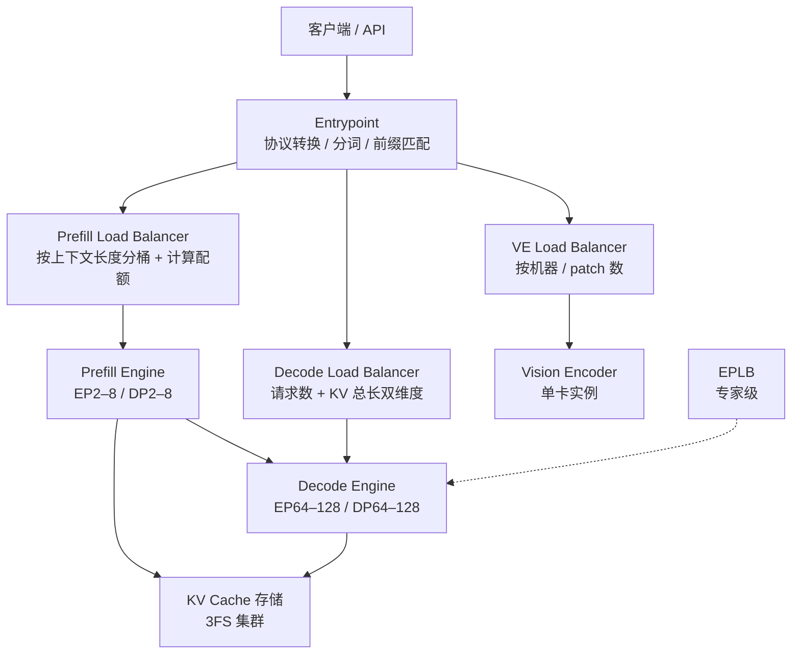

# 第 11 章 生产部署与评测：开源版离线上服务还差什么

## 一、这一章要解决的问题

前九章拆的是引擎内部；这一章回到「把它用起来」：

- 官方生产架构里，KV 存储、四类负载均衡、弹性容错是怎么做的？
- 开源版能复现哪些数字，不能复现哪些？
- 拿到仓库后，如何用 benchmark、eval、tests 验证一个部署是否正确、是否够快？
- 如果真要上线，还需要自己补哪些组件？

这一章的数据分两类：**官方生产口径**（不可由开源版直接复现）与**仓库内可运行的基准/评测**。正文会逐条标注。

## 二、机制与原理

### 11.1 生产拓扑：E/P/D + 专用存储 + 四类 LB



官方口径（来源：官方 Q&A）：

- **P/D 分离**，VE 独立部署；生产**不用 TP，也不用 CP**。
- Prefill 用**最小的 EP/DP**（HBM 允许范围内），Decode 用**最大的 EP/DP**（GPU 允许范围内）。
- 最小高效部署单元是 **64P + 64D**；1P + 1D 也能部署，但效率不在一个量级。
- 单集群日处理 **155 万亿 token**；GPU 小时收入 **$38**（低谷定价）。
- P/D 可跨（相邻）数据中心，按每 8 GPU 约 **400 Gbps** 预留互联带宽。

### 11.2 KV 存储：为什么放到 3FS

第 4 章讲过三级存储，这里补生产细节（来源：官方 Q&A）：

| 内容 | 介质 | 副本 | 管理者 |
|---|---|---|---|
| 在途 block KV + state KV | GPU 显存 | — | P / D 实例 |
| SWA KV cache | 本地 host memory | 单副本；跨机命中走 400G VLAN | P / D 实例 |
| 分页 block KV（主 KV + Indexer K） | 专用 3FS 集群 | 无应用层副本，依赖 3FS 冗余 | kvcache-store |

为什么 block KV 不放在本地分层存储，而要单独一个存储集群？

1. **任意前缀可命中**：每台 prefill 机器都能查任意历史前缀，不需要「前缀亲和」路由，路由策略可以纯粹按负载来。
2. **扩缩容解耦**：存储节点与计算节点独立扩缩，不会因为计算节点扩缩而搬 KV。
3. **故障隔离**：计算节点故障率比存储节点高一个数量级以上；KV 放独立集群，计算节点挂了不影响缓存。

3FS 的工程参数（来源：官方 Q&A）：

- 10+2 纠删码，一个 EC 组容忍两台节点同时故障；读时向 11 个节点同时发请求，任意 10 个返回即可解码。
- 每个存储节点一个 GC Worker，按 LRU 回收过期 KV，把磁盘占用压在 watermark 以下。
- 约 **100 PiB** SSD；TTL **3 天**（Agent 流量）/ **7 天**（Chatbot 流量）。
- 经验值：TTL 从 7 天降到 3 天，Chatbot 的 KV 命中率损失约 **0.5%–1%**（长尾命中很重）。
- 单存储服务器推荐 **20 × 30.73 TB SSD**，读 ≥ **40 GB/s**、写 ≥ **5 GB/s**，容量按 **24 小时**数据量规划。
- 每 GPU 约 **14.4 TB** 逻辑容量（物理容量更大）。

### 11.3 四类负载均衡

#### Prefill LB：按上下文长度分桶 + 计算配额

官方做法（来源：官方 Q&A）：

1. **分桶**：按总上下文长度分 4 档——`<16K` / `16–64K` / `64–256K` / `≥256K`。
2. **动态分配引擎**：每档分到多少 engine，按上一轮该档的「计算配额需求」比例重新分配；每档有自己的 per-batch 计算配额上限。
3. **跨 DP 组**：引擎按剩余计算配额**主动拉取**任务；因为任意引擎都能命中任意前缀，所以不做 prefix-affinity 路由。
4. **DP 组内**：请求到达时，交给当前配额负载最低的 DP rank。
5. **单 GPU 内**：FIFO 出队；chunk 大小不是固定值，而是从预算里解出来：
   - 每个 prefill step 给一个时间预算 `compute_quota_limit`（纳秒）；
   - 用拟合的二次成本模型 `cost(q, c)` 预测耗时（`q` = 本步 query token 数，`c` = 已算前缀长度）；
   - 解二次方程，取「不超过 32768 token 预算、且刚好用完剩余时间」的最大 `q`；
   - 预算还要在 DP 组内做一次 all-reduce MIN，取最紧的那个。

这套调度的目标是**按计算量而不是按请求数**分配，避免长上下文请求把短请求饿死。

#### Decode LB：请求数 + KV 总长

Decode 的负载有两个维度：

- **请求数**决定每步 batch size；
- **KV 总长**决定 attention 部分的成本。

官方策略是「短请求发给并发低但 KV 总长大的 GPU，长请求发给 KV 总长小的 GPU」，参考 DualPath 的组内调度算法（来源：官方 Q&A）。所有 decode 实例的 GPU 在一个统一池子里路由，不按前缀亲和。

#### VE LB：按机器 + patch 数

图片按**机器粒度**路由（来源：官方 Q&A）：

1. prefill 机器随机选一台「每个 GPU 都挂了一个 VE」的机器；
2. 在该机器上，把图片交给当前处理 patch 数最少的 GPU；
3. patch 数直接按 `(width / patch_size) × (height / patch_size)` 估算。

#### EPLB

专家级负载均衡见第 6 章；官方四类 LB 里它单独算一类。

#### 效果

官方说整体能达到「完美均衡离线基准」的约 **80%**（来源：官方 Q&A）。这是一个很有参考价值的数字：**负载均衡做得再好，也会损失约 20% 的理想吞吐**，因为真实路由有延迟、有状态、有尾部长请求。

### 11.4 弹性与容错

| 机制 | 做法 | 关键数字 |
|---|---|---|
| **Prefill 扩缩** | 按「非缓存 token 数」决定机器数 | 有速率限制与上下界 |
| **Decode 扩缩** | 按「running 请求数」调整 | 同上 |
| **缩容保护** | 配额利用率 > 0.8 时禁止缩容 | 0.8 |
| **CE 优雅退出** | 收到 shutdown 后进入 1 分钟宽限期；未完成请求连同 KV 一次性转给其他 CE | 1 min |
| **重启** | 重启耗时分钟级；靠配额冗余 + 请求级重路由兜底，而不是缩短单机重启 | 分钟级 |
| **EP failover** | 大 EP 实例所有 GPU 是一个通信域，单卡故障整实例不可用；重启时按当前健康 GPU 重新确定 EP size | 重新定 EP |

这条「重启分钟级 + 请求级重路由」的取舍很重要：它不追求单实例高可用，而是把可用性交给上层调度与冗余。

### 11.5 低精度与 kernel

官方口径（来源：官方 Q&A）：

| 内容 | 格式 |
|---|---|
| 主 KV | per-16、e4m3（类似 NVFP4，但没有 global scale） |
| Indexer KV | per-32、ue8m0，MXFP4 |
| MoE routed-expert 权重 | per-32、ue8m0，MXFP4 |

Kernel 方面：

- **Mega MoE**：在 scale-up 域内，无论 EP 大小、batch 大小，都比非融合 MoE 明显更快，所以是通用方案。
- **FlashMLA**：内部版本比开源版多一个手调 SASS 优化，decode kernel 快 **5%–10%**；端到端差距最多 **5%**。
- 官方建议用 `examples/benchmark.py` 的 trace 看实际 kernel 使用情况。

### 11.6 Benchmark：仓库里怎么量

`examples/benchmark.py` 把 prefill 与 decode **解耦**：

- `--prefill_batch_size` / `--non_cached_tokens` 只影响 prefill 的 chunk 与后缀长度；
- `--decode_num_requests` 只影响 decode 的 batch；
- 默认：`decode_num_requests=64`、`context_length=32768`、`non_cached_tokens=4096`、`prefill_batch_size=32768`、`nextn=5`。

三个指标（来源：一手 `examples/README.md`）：

| 指标 | 口径 |
|---|---|
| **prefill throughput**（tokens/s/GPU） | 跳过 5 个 warmup chunk，取最后 11 个样本的 10 个稳态区间；token 数 / 总时长 / 设备数 |
| **decode avg_SPS**（steps/s） | 跳过 50 个 warmup + 60 个带日志的 step，取最后 61 个样本的 60 个区间；与 MoE LB flush 冲突的区间丢弃 |
| **decode throughput**（tokens/s/GPU） | `avg_SPS × decode_num_requests × (1 + nextn) / cp`，按**全接受**记账 |

「全接受」意味着 decode throughput 是**上限口径**：不管真实接受率是多少，每步都按 `1 + nextn` 个 token 算。所以它适合比较硬件/配置，不适合预测线上真实吞吐。

其他细节：

- `PROFILE=1` 时 prefill/decode 各跑一段 profiler，导出 head-to-tail 的 trace；trace 里的 step 时间包含 profiler 开销（bsz=1 时可能膨胀近 50%），**不要用 trace 算 SPS**。
- `sweep/run_sweep.sh` 扫一个维度，`plot_pareto.py` 画吞吐-延迟曲线；一个 tag 一条曲线。
- `--result_jsonl` 把完整配置与原始量写一行 JSON，便于复现。
- `ep_size = WORLD_SIZE × len(CUDA_VISIBLE_DEVICES)`；`--cp` 必须整除 `ep_size`。
- 冗余专家通过 `DEEPINFER_OVERRIDE_NUM_EXTRA_EXPERTS` 传入，默认 32；引擎会向上补齐到 `ep_size` 的倍数。

### 11.7 Eval：仓库里怎么验能力

`eval/` 支持 AIME 2026、GPQA Diamond、HLE，生成与打分分离：

```text
[1/2] inference → 原始输出写盘
[2/2] evaluate  → 读盘、抽取答案、打分
```

| Benchmark | 题数 | 每题样本 | Pass@1 口径 |
|---|---:|---:|---|
| AIME 2026 | 30 | 32 | 32 个样本的平均准确率 |
| HLE | 2500（2158 文本 + 342 图像） | 1 | 单样本准确率 |
| GPQA Diamond | 198 | 8 | 8 个样本的平均准确率 |

官方参考值（来源：官方 `eval/README.md`）：AIME **99.9%**、GPQA **93.4%**、HLE-Full **42.6%**。这些数字用于**部署自检**，不是严格基准；生成有随机性，重复运行会小幅波动。

打分方式：

- 默认 **LLM judge**（需要 `EVAL_JUDGE_BASE_URL / API_KEY / MODEL`）；
- 可选 **rule**（AIME 取 `\boxed{}` 里的整数，GPQA 取 `ANSWER:` 后的字母）；
- HLE 只支持 LLM judge（一半以上是自由文本，精确匹配会系统性低估）；
- AIME 上两种打分方式在 960 条 rollout 上完全一致。

只有 `summary.json` 里的 `coverage_complete = true`，Pass@1 才有效；否则说明某些 rank/样本缺失。

### 11.8 Tests：仓库里怎么验正确性

`tests/` 覆盖的是「引擎行为」而不是「模型能力」：

| 测试 | 验什么 |
|---|---|
| `tests/models/test_offline_inference.py` | 离线推理、PPL、结构化输出（`--check_structured_output`） |
| `test_offline_inference_long.py` | 长上下文 PPL（16389 输入 / 4096 输出 / nextn=5） |
| `test_batch_invariant.py` | 拼批 vs 单跑逐 token 一致（64 序列、EP8、nextn=5） |
| `test_kl.py` | 采样分布 / 数值一致性 |
| `test_sampler.py` | 采样器行为 |
| `test_eplb_policy.py` | EPLB 重排策略 |
| `test_ve_batch_invariant.py` | 多模态 batch invariant |
| `tests/worker/test_state_cache_ops.py` | state cache 读写 |
| `tests/worker/test_userbuffer.py` | 通信缓冲区 |
| `tests/test_cuda_sync_guards.py` | forward/sample 路径没有非法同步 |

PPL 基线存在 `tests/models/offline_decode_ppl.json`，按平台/负载分组；数值变化确认符合预期后，用 `examples/refresh_offline_decode_ppl.py` 更新。多节点刷新/校验按节点拆分，用文件锁避免互相覆盖。

### 11.9 开源边界：上线还缺什么

如果目标是「在自己的集群上提供一个在线服务」，开源版之外至少还要补：

| 组件 | 为什么需要 | 开源版状态 |
|---|---|---|
| HTTP / gRPC / 流式 API | 客户端接入 | ❌ |
| 协议转换与分词（Recipe） | OpenAI / Responses / Messages 协议兼容 | ❌（独立仓库 `deepseek-recipe`） |
| 请求队列与限流 | 多租户、优先级、超时 | ❌ |
| P/D 路由 | 把 prefill 结果交给正确的 decode 实例 | ❌（引擎有 `PROMPT/COMPLETION` 钩子） |
| KV 存储服务 | 跨请求/跨机前缀复用 | ❌ |
| 四类负载均衡 | P / D / VE / 专家 | ❌（EPLB 在引擎内，其余不在） |
| 弹性伸缩与故障转移 | 容量与可用性 | ❌ |
| 可观测性 | 指标、日志、trace、告警 | ⚠️ 引擎内有统计与 profile HTTP，服务层没有 |

所以「开源版能不能上线」的准确回答是：**能作为离线推理引擎上线；要作为在线服务平台，需要自己补齐上面 8 块**。

## 三、源码走读

| 位置 | 内容 |
|---|---|
| `examples/benchmark.py` | prefill/decode 解耦的基准 |
| `examples/sweep/run_sweep.sh` | 单维度扫描 + Pareto 曲线 |
| `eval/README.md` | AIME / GPQA / HLE 的口径与参考值 |
| `tests/models/offline_decode_ppl.json` | PPL 基线 |
| `tests/models/test_batch_invariant.py` | 批不变性回归 |
| `doc/inference_deployment_qa.md` | 生产架构、KV 存储、LB、弹性容错的第一手说明 |

### 11.1 一次基准运行的读法

```text
1. 构造一批共享前缀的请求（benchmark 自动 fork）
2. 跑 prefill：记录 10 个稳态区间 → prefill tokens/s/GPU
3. 跑 decode：记录 60 个稳态区间 → avg_SPS、max_step
4. 按全接受口径换算 decode tokens/s/GPU
5. 可选 PROFILE=1 导出 trace，看 kernel 组成
6. 可选 sweep 扫一个维度，画 Pareto
```

注意第 4 步的「全接受」是**上限**；真实吞吐 = 上限 × 实际接受率相关的系数。第 7 章给出的真实接受长度约 3.2，而全接受按 `1 + 5 = 6` 记账，所以不要拿 decode throughput 直接对线上 QPS。

### 11.2 评测结果的可信度分层

| 结论 | 可信度 | 原因 |
|---|---|---|
| 「仓库能跑通 / 测试通过」 | 高 | 可本地复现（需硬件） |
| 「batch invariant / PPL 基线一致」 | 高 | 有明确回归脚本与基线 |
| 「AIME 99.9%」 | 中 | 官方参考值，依赖权重、judge、采样配置 |
| 「155 万亿 token/天、$38/GPU-hour」 | 低（对本机） | 生产集群口径，开源版无法复现 |
| 「+4–7% 变长验证收益」 | 中 | 官方生产数据，依赖并发区间与硬件 |

## 四、常见坑与边界条件

1. **把 decode throughput 当真实吞吐**：它是全接受口径（每步 `1 + nextn`），真实接受长度通常更低。
2. **用 trace 里的 step 时间算 SPS**：profiler 会膨胀耗时（bsz=1 时可达近 50%），trace 只适合看 kernel 组成。
3. **忽略 MoE LB flush 的干扰**：benchmark 会丢弃与 flush 冲突的区间；自己写计时脚本时要处理。
4. **PPL 基线跨平台不通用**：基线按平台/负载分组；换 GPU/NPU、换 workload 都要重测。
5. **AIME / HLE 数据要自己准备**：仓库不下载数据集；HLE 是 gated，需要先在 Hugging Face 接受条款。
6. **HLE 不能用 rule judge**：`score.py` 会直接拒绝；自由文本必须用 LLM judge。
7. **Pass@1 要先看 `coverage_complete`**：为 false 时数字无效。
8. **官方生产数字不是开源版 benchmark**：155T tokens/day、$38/GPU-hour、AIME 99.9% 都依赖完整生产栈；开源版能复现的是引擎行为与相对趋势，不是绝对值。
9. **开源版没有在线 API**：`LLMEngine` 文档明确「本版本不含在线服务封装」；不要按 vLLM 的 OpenAI Server 预期来找入口。
10. **KV 存储 / LB / P/D 编排未开源**：官方明确与内部基础设施耦合；需要自己实现或只用离线模式。

## 五、关键结论

1. 生产是 **E/P/D + 3FS KV 存储 + 四类 LB + 弹性容错** 的完整系统；开源版只给引擎。
2. KV block 放独立存储集群，是为了「任意前缀可命中 + 扩缩容解耦 + 故障隔离」；SWA 留在本机 host memory。
3. Prefill LB 按上下文长度分桶、按计算配额拉取；Decode LB 同时平衡请求数与 KV 总长；整体约达完美均衡的 80%。
4. 低精度是系统性的：主 KV FP4、Indexer MXFP4、MoE 权重 MXFP4；Mega MoE 是 NVL 域内的通用方案。
5. Benchmark 的 decode throughput 是全接受上限口径；Eval 的 Pass@1 是能力参考值；两者都不能直接当线上 SLA。
6. 上线还缺 API、Recipe、队列、P/D 路由、KV 存储、LB、弹性、可观测性八块。

## 本章要点回顾

- 生产拓扑：E/P/D 分离 + 3FS + 四类 LB；最小高效单元 64P + 64D。
- KV 存储：100 PiB、TTL 3/7 天、14.4 TB/GPU、400 Gbps/8 GPU。
- Prefill LB：4 档上下文 + 计算配额 + 二次成本模型 + 32768 token 预算。
- Decode LB：请求数 + KV 总长双维度；VE LB：按机器 + patch 数。
- 弹性：按非缓存 token / running 请求扩缩；>0.8 禁止缩容；CE 1 分钟优雅退出。
- Benchmark：prefill throughput、avg_SPS、decode throughput（全接受口径）。
- Eval：AIME 99.9 / GPQA 93.4 / HLE 42.6；生成与打分分离；LLM judge。
- 上线缺口：API、Recipe、队列、P/D 路由、KV 存储、LB、弹性、可观测性。
