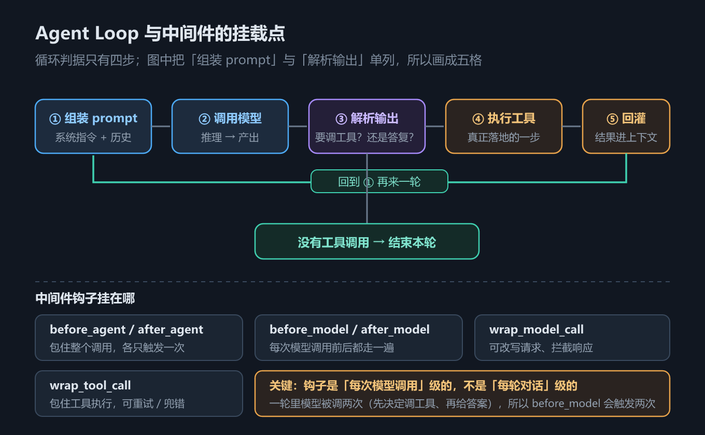

# 图文改造规范（内部元文件）

> 2026-11-11 起生效，v2（合并口味判据与图型库）。适用于框架线 `ch01`–`ch19` 与手写线 `handwritten/ch_s01`–`ch_s11` 的**图文改造轮**。
> 不面向读者。**执行者（人或 agent）在改任何一章前必须先读完本文件**；改完按第 8 节自检。
> 进度与待决策见 [`_图文改造进度.md`](_图文改造进度.md)。

---

## 1. 目标：一章改完应该是什么样

一句话：**读起来像有人在给你讲，而不是像在读手册。**

三条硬判据，同时满足才算合格：

| 判据 | 不合格 | 合格 |
|---|---|---|
| **图承担解释** | 图是标题的装饰，删掉不影响理解 | 图上能看到"谁在什么时候动了什么"或"两条路的差别"，删掉就说不清 |
| **例子落地** | 只有抽象描述 | 每个概念后有一个具象场景，读者能在脑子里演一遍 |
| **句子能一口气读完** | 多层从句、术语堆叠 | 主谓宾短句，超过 35 字就拆 |

---

## 2. 口味判据（来自用户三次返工，优先于任何文采追求）

| 用户原话 | 可执行判据 |
|---|---|
| "缺少对应的图标" | 每张图必须画出**机制、时序、对比或决策路径**之一。贴图就走的段落不合格 |
| "例子也不多" | 每个抽象概念后跟一个具象场景，格式固定两行；**不许全堆在第三节** |
| "不够简单直白" | 一句一个意思；术语首现给白话；先给结论再展开 |
| "内容不够丰富" | 加图、加例子、加"为什么不是别的方案"；**不许用删细节换篇幅** |

### 2.1 改写对照（照这个手感改）

**① 长句拆短**

- 改前：归错的直接后果是：如果它是 Chatbot，评价标准就变成"回答得像不像人"，注意力全在提示词上，忽略权限、评测、运营这些真正决定能否上线的部分。
- 改后：当成聊天机器人 → 只看回答像不像人 → 整天调提示词，忽略权限、评测、运营。

**② 定义后立刻给白话**

- 改前：`AgentState` 内置 `messages` 字段并绑定 `add_messages` reducer。
- 改后：`AgentState` 内置 `messages` 字段，绑了 `add_messages` reducer（归并函数——决定新内容怎么并入旧状态）。

**③ 先结论，后论证**

- 改前：由于不同 provider 的能力标记不同，因此在实际执行时会依据 profile 情况在两种策略之间进行选择……
- 改后：**两条路，走哪条由模型能力决定。** 假模型没有 profile 标记，落工具策略；真实 provider 支持时落原生 schema。

**④ 抽象机制配一个"踩空现场"**

- 改前：自定义字段默认是覆盖语义。
- 改后：你加了个 `summary` 字段想存摘要。第一轮写进去了，第二轮没了——不是代码写错，是字段没绑 reducer，被覆盖成空值。**这类 bug 最难查，因为不报错。**

---

## 3. 不可动清单

| 项 | 说明 |
|---|---|
| 技术事实 | 函数名、参数名、版本号、输出字符串、实测结论一律不改；有疑问先查 `_写作大纲与来源登记.md` |
| 四级口径 | 示例实测 / 本机核对 / 源码核对 / 未实测；标签不得删除、不得升级 |
| 代码块 | Python 与 TS 两段必须继续一一对应；只允许改注释与排版，不改逻辑 |
| 六段骨架 | 一、要解决的问题 → 二、机制与原理 → 三、代码 → 四、常见坑 → 五、关键结论 → 本章要点回顾 |
| 节号与节标题 | 改造轮不得改；如必须改，全量同步交叉引用 |
| 结论与回顾分工 | 结论只放可迁移判断（3–5 条，带口径）；回顾只做可勾选清单 |

**改不动的地方就加，不要删。** 遇到"这段讲得不好但事实重要"，做法是补例子和解释，不是砍掉。

---

## 4. 文风规则

1. **一句一个意思。** 超过 35 字就拆。少用"其中""从而""进而""基于此"。
2. **术语首现给白话。** 格式：`术语（白话解释）`，只给一次，后文不再重复。
3. **先结论后论证。** 每节开头一句把结论说了，再展开为什么。
4. **类比只做台阶，不做论证。** 格式固定 `> 打个比方：…`，一段即收。类比后面必须回到机制。
5. **禁止内部指代。** 正文不许出现"讲义""差异清单第 N 条""上一轮修订"这类对内部过程的口头引用。
6. **不许写"值得注意的是""不难发现"这类空转句。** 要么给信息，要么删。

---

## 5. 配图规则

### 5.1 该配与不配

| 该配 | 不必配 |
|---|---|
| 有循环、有分支、有先后顺序 | 纯清单（表格更清楚） |
| 两个概念容易混（对比图） | 一句能说清的定义 |
| 一次调用的多步往返（时序） | 参数枚举（表格） |
| 决策路径（选 A 还是选 B） | 目录式罗列 |
| 状态随时间的演化（快照、分叉） | 单一事实陈述 |

经验值：**每章 4–7 张**，每小节 0–2 张。宁可少一张，不要多一张装饰图。

### 5.2 图型库（六种，按内容选型）

| 图型 | 用在哪 | 画法要点 |
|---|---|---|
| **结构图** | 分层架构、组件归属 | 用包含关系框（大框套小框），不要用箭头乱连 |
| **时序图** | 多步往返、消息序列 | 每条消息一行，右侧标"谁写的"，关键行用红框强调 |
| **对比图** | 两个方案、两条路径、改前改后 | 左右等宽分栏，中间虚线分隔，两侧用同一组坐标位置对齐 |
| **决策树** | 选型、该不该用 | 按顺序提问，第一个"是"即出口；分支终点放具体方案 |
| **光谱/坐标** | 连续渐变、能力排序 | 一根主轴 + 若干节点，两端标注极端值 |
| **漏斗/筛子** | 多条件筛选、命中计数 | 逐条列问题，右侧标"命中什么"，底部给结论分档 |

**同一章内图型要错开**，连续三张都是结构图，读者会麻木。

### 5.3 编号与命名

- **章节内编号**：`图 5-1`、`图 5-2`…按正文出现顺序从 1 递增。
- 文件名与图号一致：`assets/5-1_agent_loop.svg` 与同名 `.png`。
- 手写线用 `h` 前缀：`assets/h3-1_session.svg` ↔ `图 h3-1`。
- 构建脚本按 `章号×100+序号` 生成锚点（`fig501`）与 SVG marker 前缀，无需手工维护。
- **插图只影响本章**；顺序变了就重排本章编号（用 `TMP_` 临时名重映射）。

### 5.4 视觉规格

- 深色面板，**满幅底色 `#111721`**，`viewBox="0 0 680 H"`，`width`/`height` 与 viewBox 一致。
- 必须含 `<title>` 与 `<desc>`（无障碍 + 构建脚本读取）。
- 色板：
  - 蓝 `#4dabf7` / 底 `#1d2b3d`
  - 紫 `#a78bfa` / 底 `#241f38`
  - 琥珀 `#e8a34b` / 底 `#2a2320`
  - 红 `#f0655f` / 底 `#2a1f24`
  - 中性 `#3a4a5e` / 底 `#1b2532`
  - 正文 `#dfe6ee`、次要 `#93a1b1`、注 `#7d8b9c`
- 字号：标题 17（bold）/ 副标题 12 / 卡内标题 11.5 / 正文 10 / 注 9–9.5
- 边距：左右 ≥ 24，标题区 ≥ 90 高，卡片间距 ≥ 8

### 5.5 SVG 骨架（直接复制改内容）

```svg
<svg xmlns="http://www.w3.org/2000/svg" viewBox="0 0 680 400" width="680" height="400" role="img">
<title>一句话标题</title>
<desc>这张图画了什么、结论是什么（2–3 句，供无障碍与检索）</desc>
<defs>
<marker id="arXa" viewBox="0 0 10 10" refX="8" refY="5" markerWidth="7" markerHeight="7" orient="auto-start-reverse">
<path d="M2 1L8 5L2 9" fill="none" stroke="context-stroke" stroke-width="1.6" stroke-linecap="round" stroke-linejoin="round"/>
</marker>
</defs>

<rect x="0" y="0" width="680" height="400" fill="#111721"/>

<text x="34" y="38" font-family="system-ui, sans-serif" font-size="17" font-weight="700" fill="#dfe6ee">主标题</text>
<text x="34" y="62" font-family="system-ui, sans-serif" font-size="12" fill="#7d8b9c">副标题：一句话说清这张图想证明什么</text>

<!-- 卡片 -->
<rect x="24" y="92" width="300" height="80" rx="7" fill="#1d2b3d" stroke="#4dabf7" stroke-width="1.3"/>
<text x="40" y="120" font-family="system-ui, sans-serif" font-size="11.5" font-weight="700" fill="#8ecbff">卡片标题</text>
<text x="40" y="142" font-family="system-ui, sans-serif" font-size="10" fill="#93a1b1">正文一行</text>

<!-- 箭头（marker 内必须写显式颜色：本机 resvg 不认 context-stroke，箭头会消失） -->
<path d="M330 132L356 132" fill="none" stroke="#6b7a8d" stroke-width="1.5" marker-end="url(#arXa)"/>
</svg>
```

### 5.6 正文引用格式

```markdown

*图 5-1　一句话说明*
```

**图前必须有引导句，图后必须有解读句。** 只有图没有解读的段落，等于没写。

### 5.7 渲染与目检

```bash
node scripts/svg-to-png.mjs "docs/agent开发教程/assets/5-1_xxx.svg" --scale 2 --force
```

渲染完**必须用读图工具看一遍**，逐项检查：

- [ ] 文字不出框、不被卡片边缘压住
- [ ] 同层元素基线对齐
- [ ] 箭头不压在文字上，箭头方向正确
- [ ] `×`、`→` 这类符号落在间隙里，不压边框
- [ ] 底部说明不与上方内容重叠
- [ ] 整体留白均匀，没有某一边特别挤

常见返工点：列宽不够导致文字溢出（把列宽加 10–20px 或缩字号）、多行文字行距不足（行距 ≥ 20）。

---

## 6. 小例子写法

### 6.1 格式（固定两行）

```markdown
> 小例子：<一句场景，具体到人、物、动作>。
> <读者会在哪一步踩空，为什么>。
```

### 6.2 数量与分布

- **每章不少于 8 个**，均匀分布到各小节；**第三节（代码）不超过 1 个**。
- 一个概念不配例子，就等于没讲。宁可多一个，不要少一个。

### 6.3 好坏对照

- ❌ 差：小例子：如果配置错误就会出问题。
- ✅ 好：
  > 小例子：你把 `user_id` 塞进 `messages` 想让工具读到。
  > 结果模型在回答里把用户 ID 念了出来——它看得见历史里的一切，包括你不该让它看见的。

---

## 7. 章节骨架与图位套路

```
## 一、这一章要解决的问题      ← 用具体症状开场，不用定义开场
## 二、机制与原理              ← 每节：结论 → 机制 → 图 → 例子
## 三、代码：Python 与 TypeScript
## 四、常见坑与边界条件
## 五、关键结论                ← 3–5 条，每条可迁移，带口径
## 本章要点回顾                ← 可勾选清单
```

常见的图位（按需取用，不强制全上）：

| 位置 | 图型 | 作用 |
|---|---|---|
| 2.1 开头 | 结构图 | 把整体骨架先摆出来 |
| 机制中段 | 时序图 | 画清"谁在第几步动了什么" |
| 概念对比处 | 对比图 | 两条路并排，差别一眼看到 |
| 参数/选型处 | 决策树或表格 | 决策用图，枚举用表 |
| 章节末 | 光谱或漏斗 | 把零散判断收成一个可操作的口诀 |

---

## 8. 交付检查清单

改完一章逐条打勾，全过才算完：

- [ ] 六段骨架完整，节号与节标题未变
- [ ] 图号从 1 连续到 N，与正文出现顺序一致
- [ ] 每张图 SVG/PNG 成对，且都已渲染、都已目检
- [ ] 每张图前有引导句、后有解读句
- [ ] 小例子 ≥ 8 个，分布在各小节，第三节 ≤ 1 个
- [ ] 全文没有超过 35 字的长句（抽查 10 句）
- [ ] 术语首现都有白话解释
- [ ] 四级口径标签一个不少，没有升级
- [ ] 代码块两语言仍一一对应，输出字符串与实跑一致
- [ ] 结论 3–5 条，每条可迁移；回顾是可勾选清单
- [ ] README 配图索引与本章条目同步
- [ ] `python docs/agent开发教程/_build_html.py` 跑通，连跑两次字节一致
- [ ] 旧图若被替代，README 标"待退役"，不直接删

---

## 9. 批量协作方式

- 每批 2–3 个**并行子代理**，每个只负责一章。
- 子代理**只改自己的章节文件 + 新增自己的配图**。
- **子代理不改 `README.md`、不跑 `_build_html.py`**——由主控统一收口，避免并发写冲突。
- 主控每批验收：配图成对 → 小例子计数 → 构建两次比对 → 抽检 1–2 张图。
- 批间记录进度到 [`_图文改造进度.md`](_图文改造进度.md)。

---

## 10. 踩过的坑（照着避开）

1. **图号必须与正文出现顺序一致。** 顺序改了就要重排本章编号；重排用 `TMP_` 临时名，否则互相覆盖。
2. **`_build_html.py` 已支持 `章号-序号` 命名**（`5-1_xxx` → 内部 `501`）。不要改回全局连续编号，锚点会撞。
3. **SVG 与 PNG 必须成对。** 构建脚本找不到同名 SVG 会直接 `SystemExit`。
4. **中文路径读图用 `np.fromfile + cv2.imdecode`**，`cv2.imread` 会失败。
5. **`×` 等符号要留间隙**，列宽不足会压边框（返工过一次）。
6. **子代理并行时不要碰 README 和构建脚本。**
7. **删旧图前先全局搜引用。** 一张图可能被两章共用。
8. **marker 里不能写 `stroke="context-stroke"`。** 本机 `scripts/svg-to-png.mjs` 用的 resvg 不解析它，渲染出来**箭头会整个消失**（骨架照抄就会中招）。marker 内部的 `<path>` 要写显式颜色，箭头颜色与线一致即可。批 4 的 19 张图已按显式颜色出图；批 1–3 的 44 张 SVG 仍是 `context-stroke`，箭头看不见，待统一替换。
