# 第 4 章　ADP 是什么：企业级智能体开发平台

> **课程对应**：2.1（第 2 章「ADP 产品能力」第 1 节）｜本线扁平编号 `ch_a04`
>
> **本章素材**：课程页面长截图 `adp/2.1.png`（1316 × 10218）。原图 4 张直接裁自课程页面（`a01`、`a03`、`a05`、`a07`），自绘 7 张（`a02`、`a04`、`a06`、`a08`–`a11`）。
> **口径**：「本机核对·长截图」= 逐字来自课程页面；「课程口径」= 厂商自述的数字，未独立验证；「本文补充」= 我构造的类比与案例，非课程原文。

---

## 一、这一章要解决的问题

先做一道题。这是课程 2.1 节的原题：

> 下面哪些说法更接近 ADP？
> A. 只是一个聊天机器人
> B. 企业级 Agent 开发平台
> C. 可以连接知识、工具和流程
> D. 可以支持应用上线和运营

答案是 **B、C、D**。

A 错在哪？错在**"只是"**两个字。

ADP 当然能对话。但你如果把对话当成它的全部，后面每一步都会问错问题：

- 当成聊天机器人 → 只看回答像不像人 → 整天调提示词，忽略权限、评测、运营；
- 当成模型接口 → 只看模型强不强 → 拿榜单做决策，结果连自家文档都读不懂；
- 当成知识库 → 只看能不能搜到 → 以为接完文档就完事，其实那只是第一步。

**这三种误判有一个共同点：把一个零件当成了整台机器。**

这一章分四步讲清楚：

1. 它是什么——一句话定位；
2. 它有几种形态——五种范式；
3. 它为什么必须存在——企业只靠大模型，缺哪五块；
4. 它凭什么被选——四大优势。

第三步是重点。**平台的每一项"不智能"的能力，都是被企业落地时的一个具体问题逼出来的。** 不先看见那些问题，你会觉得权限、评测、运营这些模块又土又没必要。

---

## 二、机制与原理

### 2.1 一句话定位

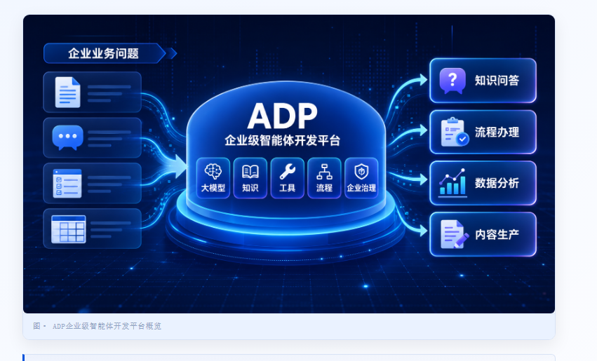

*图 a01　ADP 企业级智能体开发平台概览（裁自课程页面）*

先看这张图。左边是企业的四类业务问题：知识问答、流程办理、数据分析、内容生产。中间是 ADP，肚子里装着五样东西：大模型、知识、工具、流程、企业治理。右边是它产出四类应用。

**重点看中间那五样。** 五样里只有"大模型"是模型，其余四样都不是。

课程给的定义是这么说的：

> 腾讯云智能体开发平台（Tencent Cloud Agent Development Platform，下文简称 Tencent Cloud ADP）是**面向企业**的智能体开发平台，可以帮助企业**构建、上线和持续运营**智能体应用。它把**大模型、知识、工具、流程和企业治理**连接起来，让智能体真正进入业务场景。

（本机核对·长截图）

这句话有三处不能省。省掉任何一处，它就不是 ADP 了：

| 成分 | 省掉会变成什么 |
|---|---|
| **面向企业** | 变成个人玩具。个人用不着权限、审计、多租户；一进企业，这些全得重做 |
| **构建、上线、持续运营** | 变成"应用搭建器"。搭出来只是开始，钱主要花在上线之后 |
| **大模型 + 知识 + 工具 + 流程 + 治理** | 少知识会瞎编，少工具只能聊，少流程不可控，少治理不敢上线 |

课程还有一句更好记的：

> ADP 不是普通 Chatbot，也不是单一大模型接口，而是**企业构建智能体应用的生产与运营平台**。

（本机核对·长截图）

**打个比方：4S 店和修车摊。**

修车摊能修车，4S 店也能修车。差别不在"会不会修"，而在 4S 店还能卖车、上牌、保养、走保险、留维修档案。你要的如果只是补个胎，修车摊更便宜；你要管一支车队，就必须找 4S 店。

ADP 就是那个 4S 店。**"生产"是能造出来，"运营"是造完还能管住。**

再看课程对定位的完整展开：

> ADP 是面向企业的智能体开发平台。它围绕大模型能力，整合**应用构建、知识库、工具连接、Workflow、多 Agent、权限发布、调试评测和运营分析**，帮助企业把 AI 能力变成**可使用、可管理、可上线、可持续优化**的智能体应用。

（本机核对·长截图）

八个能力、四个"可"。**四个"可"其实就是验收清单**：

- 可使用——它答得出来；
- 可管理——管得住人和数据；
- 可上线——敢放到客户面前；
- 可持续优化——改得动、看得见效果。

> 小例子：老板说"我们也要做个 AI 客服"。你只回一句"接个大模型就行"，那就是按修车摊的方案报 4S 店的活。

### 2.2 五种范式：五种跑法，不是五个开关

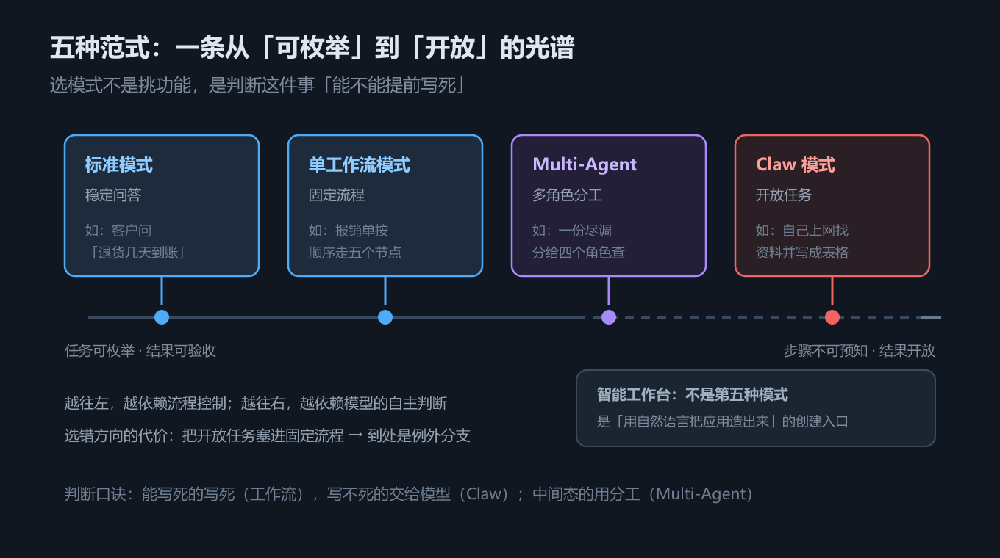

*图 a02　五种范式：一条从「可枚举」到「开放」的光谱*

课程在 2.1.2 把 ADP 能做出来的应用归成五类。**注意：这五类不是五个功能开关，是五种"跑法"。** 跑法选错，后面所有配置都拧着来。

| 范式 | 干什么 | 一句话例子 |
|---|---|---|
| **标准模式**｜稳定问答 | 单个 Agent + 提示词 + 模型 + 知识库 + 工具 | 客户问"退货几天到账" |
| **单工作流模式**｜流程执行 | 把任务拆成节点、变量、条件分支，再挂工具 | 报销单按顺序走五个节点 |
| **Multi-Agent 模式**｜多角色协作 | 多个 Agent 分工，互相校验 | 一份尽调分给四个角色查 |
| **Claw 模式**｜开放任务 | 对着文件、网页、表格、代码自己干，有独立工作空间 | 让它自己上网找资料并写成表格 |
| **智能工作台**｜创建入口 | 用自然语言起草应用、辅助配置、处理临时任务 | "照这个需求给我搭个初稿" |

（本机核对·长截图）

**打个比方：五种装修队。**

- 标准模式＝贴瓷砖的师傅，活单一，随叫随到；
- 单工作流＝按图纸施工的队，先水电、再泥瓦、再油漆，顺序不能乱；
- Multi-Agent＝总包把活分给几个工长，各管一摊，最后验收；
- Claw＝全包给一个能自己跑建材市场的工头，你只说"我要能住"，剩下他自己安排；
- 智能工作台＝装修公司的前台，你说需求，他帮你把队伍组起来。

前四种是**构建模式**（决定应用怎么跑），第五种是**入口**（决定人怎么把应用造出来）。

课程自己也提示了：

> 这里的几种范式用于帮助你理解 ADP 如何把大模型能力变成不同类型的智能体应用。本节不会展开具体的操作教程，第三章会再详细讲每种模式的适用边界、搭建方式和实战案例。

（本机核对·长截图）

**所以这一节只要建立"五种跑法"的直觉。具体怎么配，是第三章的事。**

> 小例子：三个需求，三种跑法。
> ① "能回答公司报销政策吗" → 标准模式。
> ② "帮我把报销单走完审批" → 单工作流。
> ③ "帮我把这堆发票整理成台账，缺的去网上找" → Claw。

### 2.3 五道缺口：平台为什么非存在不可

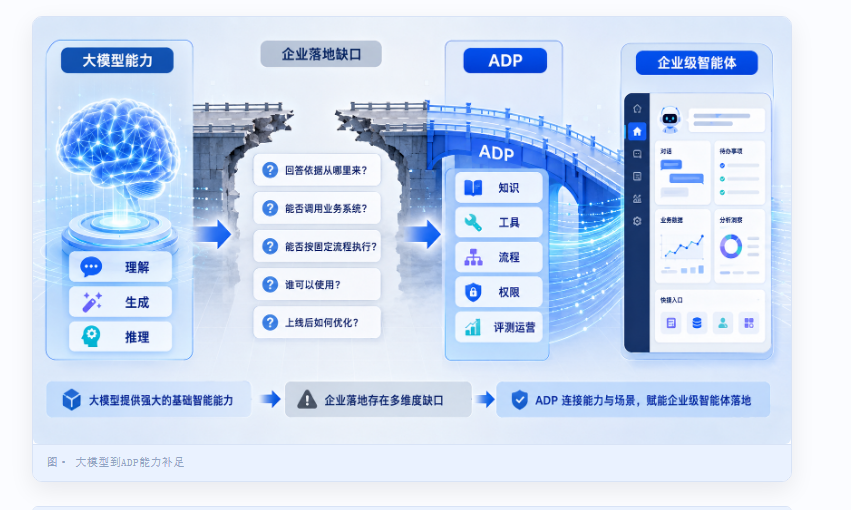

*图 a03　大模型到 ADP 能力补足（裁自课程页面）*

这张图是整章的骨架。左边是大模型的能力，中间的桥断了，右边是 ADP 拿知识、工具、流程、权限、评测运营去补。

中间那五个问号，就是五道缺口：

| 如果只有大模型 | 企业落地时会撞上的问题 | ADP 拿什么补 |
|---|---|---|
| 模型可以生成答案 | 答案得有依据、能追溯，不能靠模型"猜" | 知识库、RAG 检索、引用展示、知识命中调试 |
| 模型可以理解意图 | 业务要的是调系统、读数据、建记录、发通知 | 工具、API、数据库、MCP、Skills、企业系统连接器 |
| 模型可以自由推理 | 审批、分派、报表要稳定流程和可验收结果 | Workflow、条件分支、变量流转、结构化输出 |
| 模型可以多轮对话 | 用户、组织、渠道、数据权限都得管 | 应用权限、发布范围、渠道接入、版本管理 |
| 模型可以快速试用 | 上线后要知道效果、哪里出错、怎么改 | 对话调试、应用评测、日志、运营分析 |

（本机核对·长截图）

**别背表格，记五个翻车现场就行：**

1. **答得顺，但是编的。** 客户问"你们退款政策第几条"，模型说得头头是道，一条都对不上。→ 缺**知识**。
2. **答得好，但办不了。** 客户说"帮我查下订单"，模型回"请提供订单号"，然后就没有然后了。→ 缺**动作**。
3. **第一次对，第二次不对。** 同一张发票提交两遍，一遍过一遍卡。因为模型每次走的路不一样。→ 缺**流程**。
4. **谁都能问。** 实习生一问，把高管薪酬制度也答出来了。→ 缺**边界**。
5. **改完不知道好坏。** 提示词改了三版，哪版好？全靠感觉。→ 缺**度量**。

课程在这里给了一句判断：

> 大模型是智能体的能力基础，但企业级智能体不是"模型接口 + 聊天框"。企业真正需要的是一套能把模型、知识、工具、流程和治理能力组合起来的平台。

（本机核对·长截图）

**这就是为什么 ADP 一半以上的能力跟"模型"没关系。** 权限、评测、运营、审计这些看着"不智能"的模块，恰恰决定它能不能上线。

> **对照框架线**：这五道缺口在代码侧分别对应第 8 章（RAG）、第 7 章（工具）、第 11–13 章（图与流程）、第 6 章（中间件里的 HITL / PII）、第 10 章（可观测与评测）。平台做的事，是把"自己写"变成"配一下"。代价是灵活度换开箱即用。（判断）

### 2.4 边界：最容易搞混的四类产品

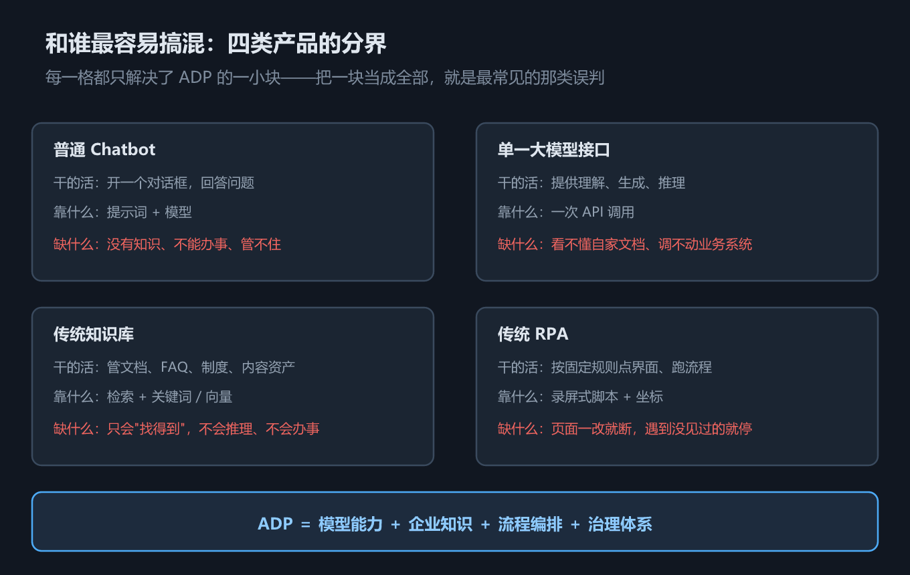

*图 a04　和谁最容易搞混：四类产品的分界*

课程用一张表划界。这张表值得存下来，因为**客户和同事最常拿这四样来类比**：

| 容易混的对象 | 它干的活 | ADP 的不同 |
|---|---|---|
| **普通 Chatbot** | 开个对话框，回答问题 | 不只对话，还能接知识、工具、流程、权限、发布和运营 |
| **单一大模型接口** | 提供理解、生成、推理 | 能用模型，但重点是把模型组织成能上线的应用 |
| **传统知识库** | 管文档、FAQ、制度 | 知识库服务于智能体，能和检索、引用、提示词、工具联动 |
| **传统 RPA** | 按固定规则点界面、跑流程 | 能用 Workflow 固化流程，也能处理更开放的任务 |

（本机核对·长截图）

压成一句话：

> **ADP ＝ 模型能力 ＋ 企业知识 ＋ 流程编排 ＋ 治理体系。** 缺一项，就退回表格左边那一列。

最后一行值得多说一句：**ADP 和 RPA 不是替代关系。**

- RPA 管"规则明确、但系统没接口"的操作（比如老系统只能人工点）；
- Workflow 管"规则明确、且有接口"的流程；
- 模型管"规则说不清"的部分。

三者能同时待在一个应用里。（判断）

> 小例子：客户说"我们已经有知识库了，不用你们这套"。
> 回一句就够：**知识库解决"找得到"，ADP 解决"答得对 + 办得成 + 管得住"。** 前者的终点是搜索框，后者的起点才是。

### 2.5 能力地图：三个维度乘起来

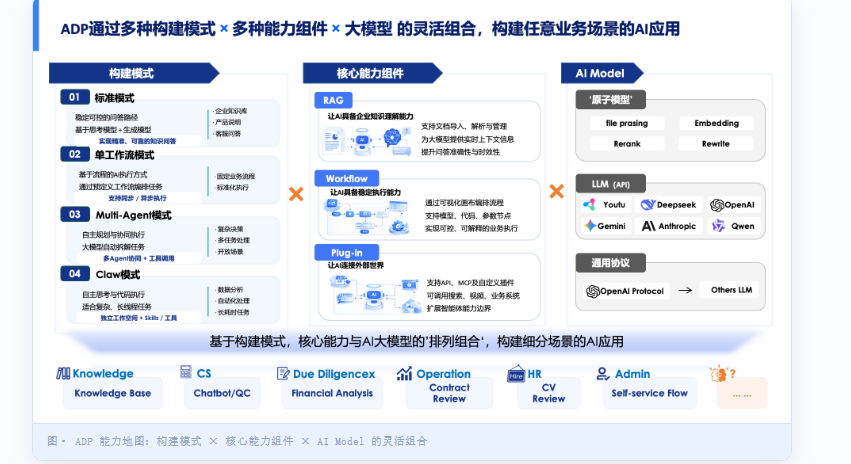

*图 a05　ADP 能力地图：构建模式 × 核心能力组件 × AI Model（裁自课程页面）*

课程原话：

> 理解 ADP 的产品能力，不需要先陷入复杂的后台菜单。我们可以把 ADP 看成「**构建模式、核心能力组件和 AI Model**」的灵活组合。

三个维度各管一件事：

| 维度 | 管什么 | 有哪些 |
|---|---|---|
| **构建模式** | 应用**怎么跑** | 标准模式、单工作流、Multi-Agent、Claw |
| **核心能力组件** | 应用**能干什么** | RAG（知识）、Workflow（流程）、Plug-in（外部连接，含 MCP 与自定义插件） |
| **AI Model** | 智能**从哪来** | 原子模型（Embedding / Rerank / Rewrite）、LLM API（多厂商）、通用协议（OpenAI Protocol） |

图最下面还有一层**业务场景**：知识库、智能客服、尽调与财务分析、运营管控、HR 简历评审、Admin 自助。这一层不是能力，是**落点**。

课程特意提醒了一句：

> 能力地图中的构建模式、核心能力组件、模型能力和底部场景都是**代表性示例**，并不是 ADP 的完整能力清单。

（本机核对·长截图）

**所以：照着图背能力一定漏，按"三维组合"去推才不漏。**

#### 三步看图法

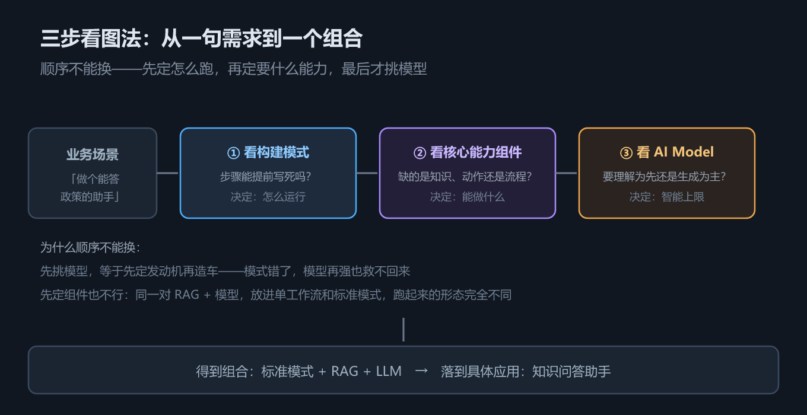

*图 a06　三步看图法：从一句需求到一个组合*

课程给的方法，顺序固定：

1. **第一步：看构建模式。** 它决定应用怎么跑——是稳定问答、固定流程，还是多 Agent 协作。
2. **第二步：看核心能力组件。** 它决定应用能干什么——RAG 补知识，Workflow 补流程，Plug-in 补外部连接。
3. **第三步：看 AI Model。** 它提供底层智能——支撑文档解析、检索、生成、推理和模型接入。

（本机核对·长截图）

**为什么顺序不能换？**

先挑模型，等于先定发动机再造车。模式错了，模型再强也救不回来。

先定组件也不行。同一套 RAG + 模型，放进标准模式和放进单工作流，跑起来完全是两个东西。

三步走完，就得到一张"组合 → 应用 → 场景"的表：

| 组合 | 得到什么应用 | 什么场景 |
|---|---|---|
| 标准模式 + RAG + LLM | 知识问答助手 | 企业知识库、产品说明、客服 FAQ、制度问答 |
| 单工作流 + Workflow + Plug-in | 流程办理助手 | 审批流、任务分派、自动通知、自助服务 |
| Multi-Agent + RAG + Workflow | 分析与复核助手 | 尽调分析、合同审阅、财务分析、复杂报告 |
| 任一模式 + 合适模型 | 场景化 AI 应用 | HR 简历评审、Admin 自助、运营分析、内容生产 |

（本机核对·长截图）

> 小例子：同一个"客服"需求，三种组合。
> ① 只答政策 → 标准模式 + RAG。
> ② 要能改地址 → 再加 Plug-in。
> ③ 要能判断该不该退款、走几级审批 → 换单工作流。

### 2.6 四大优势

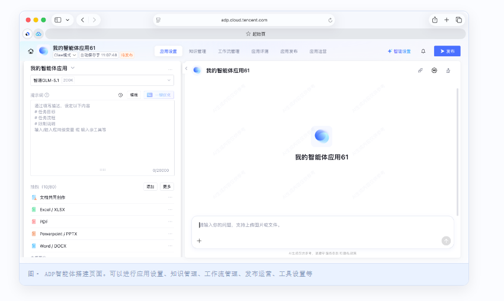

*图 a07　ADP 智能体搭建页面（裁自课程页面）*

先看这张界面图。顶上那排 tab 是重点：**应用设置、知识管理、工作流管理、应用评测、应用发布、应用运营**。

课程图注写的是："可以进行应用设置、知识管理、工作流管理、发布运营、工具设置等"（本机核对·长截图）。

**这排 tab 就是"全生命周期"四个字的实体。** 别的平台往往只有前两个。

课程把"为什么选 ADP 而不是拿开源框架自己拼"归成四条。

**（1）优势一：对话更准。**（课程口径）

对话准不准，不只取决于模型，更取决于系统读不读得懂你的文档。课程给了三项：

- **文档理解**：靠腾讯优图的 OCR 积累，支持 10+ 文件类型、单文档 200 MB，图文混排、表格、公式都能结构化；图片内容也能直接理解作答；
- **自研向量模型**：2B 级 Embedding，课程称在 C-MTEB 基准达 SOTA；配 LLM Reranker（支持 8k+ 长文本），做高召回 + 高精准；
- **Agentic RAG + 结构化问答**：不只匹配一段文本，还能多轮检索、跨文档推理；配 Text-to-SQL，让"问文档、问表格、问数据库"在同一个应用里完成。

**（2）优势二：一站式。**（课程口径）

- 多架构并存：LLM + RAG、Multi-Agent、Workflow 都支持；
- 全生命周期：配置 → 开发 → 调试 → 评测 → 发布 → 运营；
- 企业级评测：内置裁判模型、规则、代码等评估方式，能一键批量对比模型 / 提示词 / 工作流版本；
- 运营与用量：用量、数据分析、对话日志；
- 零代码 / 低代码优先：大部分靠可视化，复杂的再补代码；
- 行业模板：教育、传媒、医疗、金融等；
- 可解释：每条回答带命中文档片段、相似度、检索路径。

**（3）优势三：生态开放。**（课程口径）

- 多模型统一接入：主流模型和自建模型都能一键导入；
- 200+ 连接器与工具，覆盖检索、图片音视频处理、数据分析，支持 MCP 与自定义扩展；
- 集成方式：RESTful API、SDK，可发布到企业微信、小程序。

**（4）优势四：安全、性能、可观测。**（课程口径）

- 流式响应，首字时间 < 1 秒，支持高并发与扩缩容；
- 多租户强隔离、内容安全审核、细粒度权限、操作审计；
- 权限分四层：平台 / 空间 / 应用 / 知识库，数据权限与功能权限解耦；
- 监控告警：请求量、成功率、延迟、Token 消耗；
- 数据洞察：对话记录分析、热点问题挖掘、效果标注、趋势分析。

> 上面所有数字都是**课程口径（厂商自述）**，我没有独立验证。写方案要引用时，先找腾讯云要对应版本的指标说明。

**白话翻译这四条**：

1. 第一条解决"它看不懂我家文档"；
2. 第二条解决"搭完还得自己造评测和运营"；
3. 第三条解决"被一家模型绑死"；
4. 第四条解决"IT 不敢批"。

> 小例子：IT 部门问"这玩意儿能审计吗"。你答不上来，方案就过不了。优势四就是为这个问题准备的。

### 2.7 两种部署形态

| 形态 | 说明 | 什么时候选 |
|---|---|---|
| **公有云** | 标准服务，云端账户直接用，不用自建，按量计费 | 验证阶段、快速上线 |
| **私有化** | 部署在客户专有云或本地，数据由企业自己管 | 数据隐私、合规、网络隔离有硬要求 |

（本机核对·长截图）

课程把部署形态放在"定位"这一节，意思很明白：**部署形态是定位的一部分，不是签合同时才谈的商务选项。**

私有化把运维责任也转给了客户。**运维是成本，不是赠品。**

> 小例子：银行说"数据不能出机房"。这时候争的不是价格，是"私有化之后谁来升级、谁来扩容、出故障谁兜"。

---

## 三、落地：四个案例走一遍

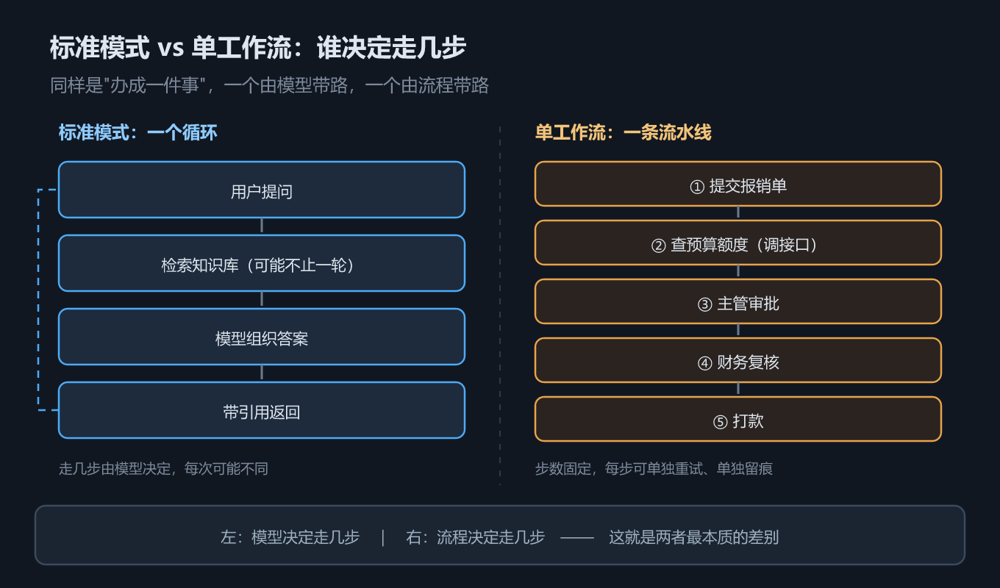

*图 a08　标准模式 vs 单工作流：谁决定走几步*

先记住这张图，后面三个案例都靠它。

- 左边标准模式：提问 → 检索 → 组织答案 → 返回。**走几步由模型决定**，每次可能不同。
- 右边单工作流：提交 → 查额度 → 主管 → 财务 → 打款。**走几步由流程决定**，每步能单独重试、单独留痕。

一句话：**一个由模型带路，一个由流程带路。**

### 案例 A｜客服知识问答

**现象**：售后咨询多。答案散在 12 份文档、一份 FAQ、三个老坐席脑子里。新人答的口径不一样，客户投诉"每次说法都不同"。

**三步看图法**：

1. 看模式——单轮问答为主，没有必须固定走的步骤 → **标准模式**。
2. 看组件——缺的是知识，不是动作 → 上 **RAG**，不上 Plug-in。
3. 看模型——要读懂文档、组织答案 → **LLM API**。

**组合**：标准模式 + RAG + LLM → 知识问答助手。

**会翻车的三处**：

- 文档是扫描件、跨页表格 → 解析就失败，后面全白搭；
- 切分按固定字数，把一条政策切成两半 → 召回片段答非所问；
- 回答不带引用 → **答错了不知道依据哪段**。在企业里，这比答不上来更糟。

**什么时候该换方案**：当问题开始变成"帮我查下我的订单"，说明动作缺口出现了，标准模式 + RAG 到头了，要加工具。

### 案例 B｜报销审批

**现象**：差旅报销，五步固定：提交 → 查额度 → 主管审批 → 财务复核 → 打款。每步有条件，出错要能定位到哪一步。

**三步看图法**：

1. 看模式——流程固定、步骤可枚举 → **单工作流**。
2. 看组件——要按节点走，还要查额度接口 → **Workflow + Plug-in**。
3. 看模型——只在"票据合不合规"这个节点用 → 模型不当主控。

**组合**：单工作流 + Workflow + Plug-in → 流程办理助手。

**为什么不能用标准模式**：不是模型不会，是**财务不敢签**。模型每次走不同的路，等于每次给你一个复现不了的结果。对流程来说，"不稳定"是致命的。

**会翻车的三处**：

- 把判断逻辑写进提示词、不写进分支条件 → 同一张发票两次结果不同；
- 没设计异常分支（查额度超时、审批人离职）→ 流程卡死，没人知道；
- 变量乱命名（应用级 / 工作流级 / 会话级混着用）→ 2.2 上会专门讲这个坑。

**判断口诀**：**流程固定就用 Workflow。** 反过来，如果业务方说"每次情况都不一样，得看具体情况"，那就是选错模式了。

### 案例 C｜尽调分析

**现象**：一份尽调要查工商、财报、诉讼、舆情四类资料。来源各不相同，最后要交叉复核才敢出结论。

**三步看图法**：

1. 看模式——四类资料要分工、要互相校验 → **Multi-Agent**。
2. 看组件——查内部制度用 **RAG**，固定核查步骤用 **Workflow**，调工商 / 舆情接口用 **Plug-in**。
3. 看模型——思考模型做规划和分工，生成模型写报告。

**组合**：Multi-Agent + RAG + Workflow → 分析与复核助手。

**为什么一个 Agent 干不了**：它把四类资料塞进一个上下文，越到后面越记不住前面；出了错也定位不到是哪一段推理歪了。

**多 Agent 的真正好处不是"并行"，是"隔离"**——每个子 Agent 只消化自己那类资料，只把结论带回来。

**会翻车的三处**：

- 职责重叠（两个 Agent 都去查工商）→ 重复劳动，成本翻倍；
- 没有汇总者 → 四个子 Agent 各说各话，没人裁决；
- 把该由 Workflow 固定的步骤交给 Agent 自主安排 → 漏做，且不可复现。

### 反例 D｜看着能用，其实不该上

**现象**：一个人每天要总结三篇论文；或者财务要一个毫秒级的费率试算接口。

**为什么不该上平台**：

- 前者没有权限、没有多角色、没有上线运营需求。一段提示词加个脚本就够，上平台是把简单问题做复杂；
- 后者要的是确定性计算。模型不是算力最优解，写个接口更快、更便宜、更好测。

**判断法**：把 2.3 的五道缺口逐条对。**只命中一条、又没有上线运营需求，就别上。**

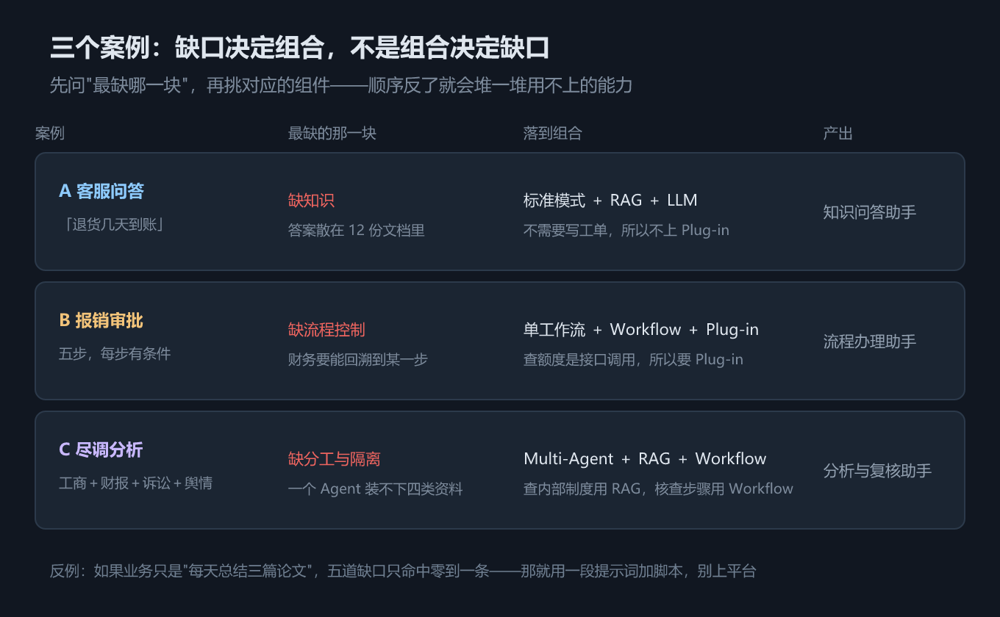

*图 a09　三个案例：缺口决定组合，不是组合决定缺口*

### 该不该上平台：五问筛子

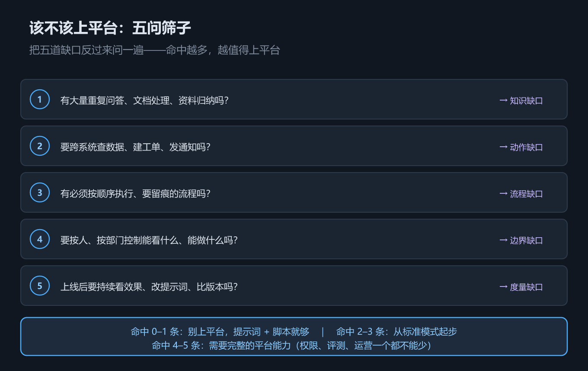

*图 a10　该不该上平台：五问筛子*

把五道缺口反过来问一遍，逐条打勾：

1. 有大量重复问答、文档处理、资料归纳吗？
2. 要跨系统查数据、建工单、发通知吗？
3. 有必须按顺序执行、要留痕的流程吗？
4. 要按人、按部门控制能看什么、能做什么吗？
5. 上线后要持续看效果、改提示词、比版本吗？

**打勾越多，越值得上平台。** 命中 0–1 条，用提示词加脚本；命中 4–5 条，权限、评测、运营一个都不能少。

### 选哪种模式：四个问题

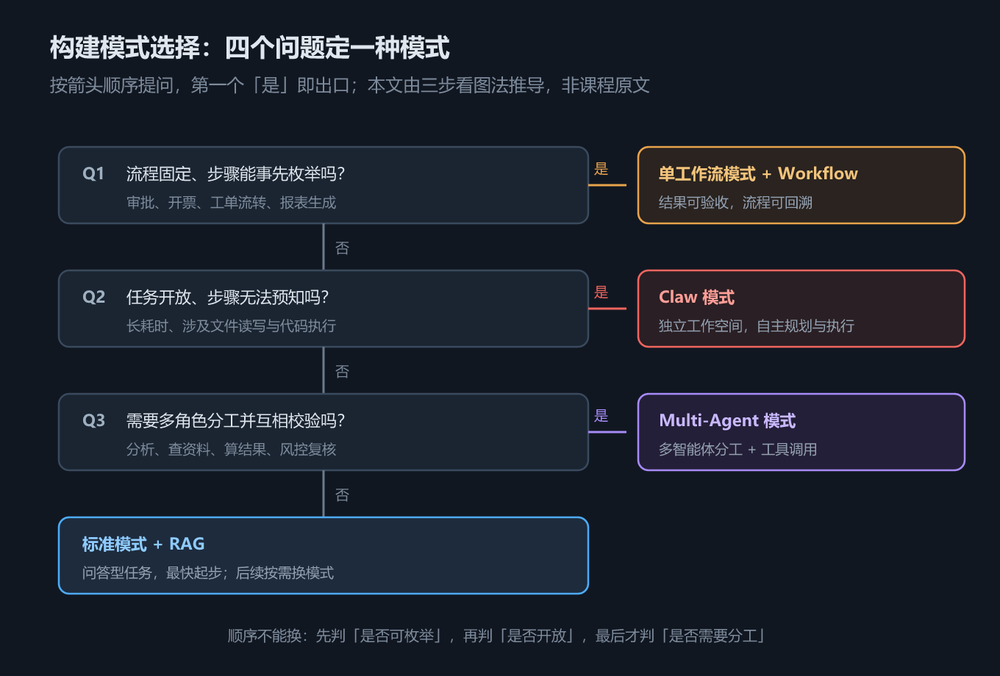

*图 a11　构建模式选择：四个问题定一种模式（本文由三步看图法推导，非课程原文）*

按顺序问，第一个"是"就是出口：

1. 流程固定、步骤能枚举吗？→ **单工作流 + Workflow**
2. 任务开放、步骤无法预知吗？→ **Claw**
3. 需要多角色分工并互相校验吗？→ **Multi-Agent**
4. 都不是 → **标准模式 + RAG**

**顺序不能换。** 因为四个问题对应四种不同的失控风险：流程型怕不稳定，开放型怕做不完，协作型怕结论打架，问答型怕没依据。先锁定风险，再选模式。

---

## 四、常见坑与边界条件

1. **把"模式"当开关。** 模式决定的是**怎么跑**，不是"开不开某个功能"。选错模式的返工成本，远高于选错模型。
2. **以为接了知识库就等于 RAG 好。** 解析、切分、Embedding、Rerank、召回策略，每一环都能拖后腿。"导入成功"只是起点。
3. **把优势理解成"模型强"。** 四条优势里真正拉开差距的是文档理解、检索链路和治理能力。
4. **忽略"运营"这段成本。** 钱主要花在上线后：评测、调优、用量。
5. **把智能工作台当第五种模式。** 它是"用自然语言把应用造出来"的入口，不是另一种跑法。
6. **把私有化当免费的安全选项。** 运维、升级、扩容都转到自己身上了，要单独算账。
7. **把能力地图当清单背。** 课程明说图里只是代表性示例。按三维组合去推，才不会漏。

---

## 五、关键结论

1. **ADP 是"生产与运营平台"，不是 Chatbot、模型接口或知识库。** 判断同类平台，看它有没有覆盖"上线之后"那一段。（本机核对·长截图）
2. **企业只靠大模型差五块：答案不可溯源、不能调系统、流程不稳定、权限缺位、效果不可度量。** 平台的每项非模型能力，都能对上其中一块。（本机核对·长截图）
3. **能力地图是三维组合，不是功能清单。** 按"模式 × 组件 × 模型"推，比照图背可靠。（本机核对·长截图）
4. **先选模式，再选模型。** 换模式是换跑法，换模型只是换上限。顺序倒了，返工量差一个数量级。（判断）
5. **四条优势里三条与模型无关。** 文档理解、一站式框架、安全治理，才是选型时要重点问的。（判断）

---

## 本章要点回顾

- [ ] 能用一句话说清 ADP 的定位，并解释"生产"和"运营"各指什么
- [ ] 能说出五种范式，并分清前四种是跑法、第五种是入口
- [ ] 能讲出五道缺口，每道配一个"翻车现场"
- [ ] 能说清 ADP 与 Chatbot、模型接口、知识库、RPA 的界线
- [ ] 能画出"模式 × 组件 × 模型"三维地图
- [ ] 能用三步看图法，给一个业务场景选出组合
- [ ] 能判断"流程固定"还是"任务开放"，并据此在 Workflow 与 Claw 之间选
- [ ] 能复述四条优势，并说出哪几条与模型无关
- [ ] 能说清公有云和私有化各自的代价
- [ ] 能用五问筛子做一次"该不该上平台"的初筛
