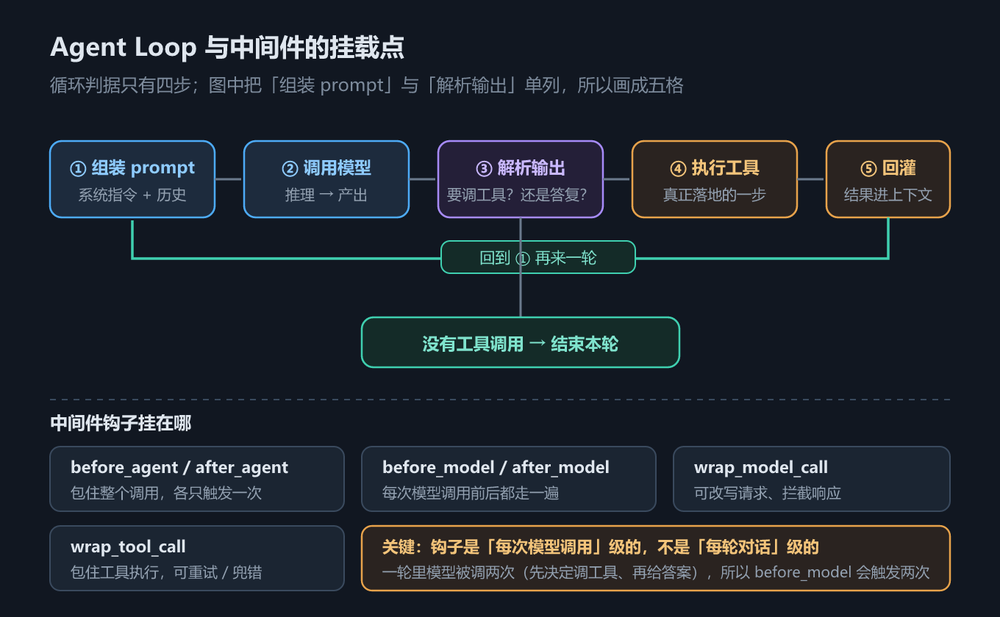
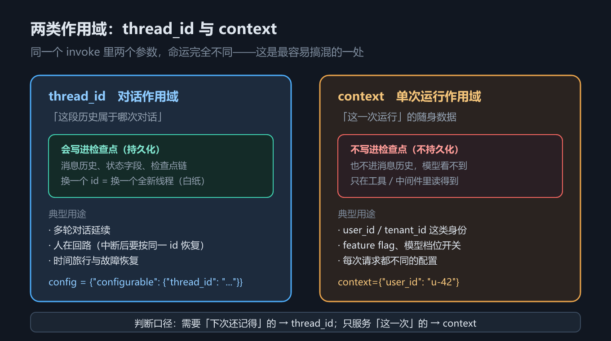

# 第 5 章 create_agent 与 Agent Loop：状态、作用域与结构化输出

## 一、这一章要解决的问题

第 1 章把三件套的边界画清楚了，第 2–4 章把「原料」（模型、消息、结构化输出）备齐了。从这一章开始，所有代码都从同一个函数长出来：`create_agent`（JS 侧 `createAgent`）。

它看起来只是一个「创建 agent」的工厂函数，实际上它一次性替你决定了好几件互相牵连的事：

1. **循环长什么样**——调模型、执行工具、回灌结果、再调模型，什么时候停；
2. **状态放在哪**——哪些东西跟着对话走，哪些东西只属于这一次运行；
3. **结果怎么取**——自由文本从哪读，结构化数据从哪读。

这三件事对应的三个坑分别是：「为什么模型好像自己执行了工具」、「为什么同一个 `thread_id` 的历史越滚越长」、「`response_format` 传了但返回值里找不到」。

**本章回答：一次 `create_agent` 调用，到底换来了一个什么样的东西。**按「先看它怎么转，再看它怎么配，最后看它怎么记」的顺序拆开：2.1 循环怎么转，2.2 `create_agent` 能配哪些参数，2.3 状态怎么只追加，2.4 数据分哪两层作用域，2.5 结构化结果从哪读。第 2–4 章备好的「原料」，从这一章起被同一个函数装配成一个会自己转的 agent。

## 二、机制与原理

### 2.1 Agent Loop：模型从不执行工具

「为什么模型好像自己执行了工具？」——这是本章三个坑里的第一个，也是一切 agent 行为问题的分界线所在。要拆它，先把循环的骨架摆出来：一次 agent 运行，到底是哪些部件在按什么顺序动。

循环的骨架只有四步：

```text
用户消息 → [模型] → 有 tool_calls？
                        ├─ 有 → [tools 节点执行] → ToolMessage 追加进状态 → 回到 [模型]
                        └─ 无 → 结束，最后一条消息就是回答
```

关键认知：**模型只输出「请调用 `get_weather(city='上海')`」这段结构化意图，它自己从不执行任何函数**。真正读参数、调函数、把返回值包成 `ToolMessage` 写回状态的是框架的 **tools 节点**。分清「模型做的」和「框架做的」，是排查 agent 行为问题的第一步——很多看起来像「模型幻觉」的现象，其实是框架在某一步把消息改写或丢弃了。

打个比方（类比，只帮忙记这条分界，不替代上面的机制描述）：模型像只出主意的参谋——它说「去查上海天气」，但既没出门也没打电话；框架的 tools 节点才是跑腿的人，查到什么由它写成字条（`ToolMessage`）递回参谋手里；参谋下一句说什么，取决于它看到的字条。


*图 8　Agent Loop 与中间件挂载点*

图 8 里那些挂在循环各处的挂载点就是**中间件**（第 6 章的主题）。`create_agent` 给你的不是「一个写死的循环」，而是「一个循环 + 一圈插槽」。

### 2.2 `create_agent` 的完整参数表

「一个循环 + 一圈插槽」听起来抽象，落到代码上就是 `create_agent` 的一串参数——这一节把工厂函数到底接受什么一次看全。

下表回答的问题是：**这个函数到底能配哪些东西？**（注意：**本表不列默认值**——`create_agent` 的参数默认值随版本变化，本教程只登记实测确认存在的参数名与语义，要查默认值请以你所用版本的签名为准。）

| 参数（Python / JS） | 作用 | 出处 |
|---|---|---|
| `model` | 模型实例，或 `"provider:model"` 字符串 | 实测示例 |
| `tools` | 工具列表 | 实测示例 |
| `system_prompt` / `systemPrompt` | 系统提示词——harness 的核心部分 | 官方文档 |
| `middleware` | 中间件列表（见第 6 章） | 实测示例 |
| `response_format` / `responseFormat` | 结构化输出 schema（见 2.5） | 实测示例 |
| `state_schema` / `stateSchema` | 自定义状态 schema（默认即 `AgentState`） | 官方文档 |
| `context_schema` / `contextSchema` | 单次运行的上下文 schema（见 2.4） | 实测示例 |
| `checkpointer` | 检查点存储，`thread_id` 生效的前提（见第 12 章） | 实测示例 |
| `store` | 跨线程长期记忆（见第 12 章） | 实测示例（`07_tools.py` 用 `create_agent(store=...)` 跑通并回读成功；**JS 侧另有坑，见第 7 章 2.4 与差异清单 #16**） |
| `name` | agent 的名字；把它当子图挂进别的图时用于标识（见第 18 章） | 实测示例 |
| `interrupt_before` / `interrupt_after` | 在指定节点前后中断执行 | **本机核对签名**（文档正文未列出） |
| `debug` | 调试日志 | **本机核对签名**（文档正文未列出） |
| `cache` | 节点级缓存 | **本机核对签名**（文档正文未列出） |
| `transformers` | 消息变换器 | **本机核对签名**（文档正文未列出） |

最后四行的依据是**本机核对签名**（读 `inspect.signature`，**不在示例输出里**）：官方文档的**正文叙述**只列了部分参数；`interrupt_before`、`interrupt_after`、`cache`、`transformers` 这几个要从 **API 参考页的签名**（或本机 `inspect.signature`）才看得到（版本 `langchain` 1.4.2）。**注意：这四个参数的行为本身一个都没跑过**——「签名里有」只说明它存在，不说明它怎么工作。所以「文档没写」指的是**正文没讲**，不是查不到——参考页本身就是签名。能用，但也不等于稳定，用之前先看自己版本的签名。

### 2.3 `AgentState.messages` 只追加

参数表里有两个参数——`state_schema` 和 `checkpointer`——都绕不开同一个问题：状态放在哪、怎么变。2.4 讲作用域，这一节先讲状态本身，顺手收掉第二个坑：「为什么同一个 `thread_id` 的历史越滚越长？」

agent 的状态容器是 `AgentState`，它内置一个 `messages` 字段，并给这个字段绑定了 `add_messages` reducer（归并函数——决定「新内容怎么并入旧状态」的规则，第 11 章会系统讲）。语义是：**你传进来的消息被追加到历史尾部，而不是替换历史**。

实测证据：同一个 `thread_id` 连续问两轮，第一轮后历史 2 条（user + AI 回复），**第二轮后历史 4 条不是 2 条**——第二轮那一条 user 消息是「加」进去的，不是「换」上去的。

这件事有两面：

- **好处**：多轮对话天然成立，不需要你手动拼历史；
- **代价**：历史只增不减，几轮之后就会撞上上下文窗口——这就是第 9 章「上下文工程」要处理的问题。

注意这个「只追加」是 **`messages` 字段专属**的（靠 `add_messages` reducer 实现）。**自定义字段没有 reducer 时是「覆盖」语义**，两条规则不一样，第 11 章会给出实测对照。

### 2.4 两类作用域：`thread_id` 与 `context`

2.3 讲的是状态怎么「长」，这一节讲状态里的数据分属哪两层。agent 里的数据分两层，混用会出很多怪问题。


*图 9　状态与两类作用域（thread_id / context）*

下表回答的问题是：**一个变量该放 `thread_id` 那一层，还是 `context` 那一层？**

| 维度 | `thread_id`（对话作用域） | `context`（单次运行作用域） |
|---|---|---|
| 归属 | 一次**对话** | 一次**运行** |
| 写入方式 | `config={"configurable": {"thread_id": "..."}}` | `invoke(..., context={...})` |
| 是否进检查点 | **是**，下次同 `thread_id` 可续上 | **否**，运行结束即丢弃 |
| 是否进消息历史 | 消息进（`messages` 字段） | **不进**，模型看不到 |
| 典型内容 | 消息历史、工具改写的状态 | `user_id`、租户 ID、feature flag、数据库连接 |
| 前置条件 | 需要 `checkpointer` | 需要 `context_schema` 声明 |

判断口径很简单：**「这次对话结束后还需要吗？」需要 → `thread_id`；不需要 → `context`。**`context` 是「这一次运行的随身证件」，工具里通过 `runtime.context` 读取，模型完全看不到它（除非你主动写进返回值）。

顺带一条实测差异：`context_schema` 的字段名两边各随本语言习惯——Python 示例里读 `runtime.context['user_id']`，JS 示例里读 `runtime.context.userId`。

### 2.5 结构化输出：`response_format`

作用域分两层讲完了，还剩第三个坑没收尾：「`response_format` 传了但返回值里找不到」。拆它之前，先回到一个老问题——自由文本输出对下游程序不友好。`response_format` 传一个 schema 后，框架会在状态里多写一个 `structured_response` 字段。

实测结论（Python 侧，`langchain` 1.4.2）：`result["structured_response"]` 拿到的是**已校验的 Pydantic 实例**，不是字符串，不需要自己 `json.loads`。

**两语言的默认策略都是工具策略**——把 schema 包装成一个工具让模型调用，参数不合法就写回一条错误 `ToolMessage` 让模型重试。差别在策略工具名怎么定。下表回答的问题是：**既然默认都是工具策略，两边还差在哪、脚本化假模型能不能跑通？**

| | Python | TypeScript |
|---|---|---|
| 默认策略 | 工具策略 | 工具策略（源码：裸 schema 一律包成 `ToolStrategy`） |
| 策略工具名 | 取 schema 的类名 / title | 取 schema 的 `title`；没有 title 时退化为 `extract`（示例实测只见过不带序号的 `extract`；**`extract-N` 自增为源码核对，未实测**） |
| 脚本化假模型能否跑通 | 能（实测通过） | **能**（2026-10 探针补测：脚本按该工具名回一条 tool_call 即出结果） |
| 实测状态 | **已实测** | **已实测**（假模型）。真实 provider 行为**已于 2026-10-16 实测**：`ChatOpenAI` 缺省即走 `response_format: json_schema`、**不发 tool_call**，与假模型基类完全不同（见第 4 章 2.3 与 `code/README.md`「真实模型实测」B） |

TypeScript 侧的写法是 `createAgent({ model, tools: [], responseFormat: Weather })`，取结果用 `result.structuredResponse`——**这段用脚本化假模型就能跑通**，不需要 API Key：假模型的脚本按 `Weather`（schema 的 title）回一条 `toolCall("Weather", {...})` 即可。若脚本回的是普通文本而不是工具调用，`structuredResponse` 会是 `undefined`——策略没被命中，框架不报错。

> ⚠️ **「JS 默认走 provider 原生 JSON schema」是一个流传较广的误读**：那只说对了 **provider 子类**（如 `ChatOpenAI` 覆写了 `withStructuredOutput`）。纯 `BaseChatModel` 子类（含本教程假模型）和 agent 侧的裸 schema 路径，默认都是工具调用——`langchain` 1.5.11 的 `agents/responses.js` 源码可证。真实 provider 下的原生 JSON schema 路径**未实测**。

## 三、代码：Python 与 TypeScript

下面两段是同一件事的两个语言版本，只留主干；完整版（含假模型脚本、四节完整输出）见 `code/` 下的文件。

Python 侧：

```python
from langchain.agents import create_agent
from langchain.tools import ToolRuntime, tool
from langgraph.checkpoint.memory import InMemorySaver
from pydantic import BaseModel, Field
from _fake_model import ScriptedChatModel, reply, tool_call   # 见 code/README.md

@tool
def get_weather(city: str) -> str:
    """查询某个城市的天气。"""
    return f"{city}: 22°C，晴"

# ① 一次工具调用的完整往返
agent = create_agent(
    model=ScriptedChatModel(script=[tool_call("get_weather", {"city": "上海"}, "call_1"),
                                    reply("上海 22°C，晴。")]),
    tools=[get_weather],
)
result = agent.invoke({"messages": [{"role": "user", "content": "上海天气怎么样？"}]})

# ② messages 只追加：同一 thread_id 再问一次
chat = create_agent(model=ScriptedChatModel(script=[reply("你好，我是脚本模型。"),
                                                   reply("你刚才说你叫小明。")]),
                    tools=[], checkpointer=InMemorySaver())
cfg = {"configurable": {"thread_id": "chat-1"}}
chat.invoke({"messages": [{"role": "user", "content": "你好，我叫小明。"}]}, cfg)
second = chat.invoke({"messages": [{"role": "user", "content": "我叫什么？"}]}, cfg)
print(len(second["messages"]))          # 4，不是 2

# ③ 两类作用域：thread_id 走 config，context 走 invoke 关键字
#     ctx_agent 的定义见 code/python/05_create_agent.py（一个读 runtime.context 的 whoami 工具）
out = ctx_agent.invoke({"messages": [{"role": "user", "content": "我是谁？"}]},
                       config={"configurable": {"thread_id": "ctx-1"}},
                       context={"user_id": "u-42"})

# ④ 结构化输出
class Weather(BaseModel):
    """天气查询结果。"""
    city: str = Field(description="城市名")
    temp_c: int = Field(description="摄氏度温度")

struct_agent = create_agent(model=ScriptedChatModel(script=[tool_call("Weather", {"city": "上海", "temp_c": 22}, "s1")]),
                            tools=[], response_format=Weather)
out = struct_agent.invoke({"messages": [{"role": "user", "content": "上海天气？"}]})
print(type(out["structured_response"]).__name__)   # Weather
```

TypeScript 侧：

```typescript
import { createAgent, tool, HumanMessage } from "langchain";
import { MemorySaver } from "@langchain/langgraph";
import { z } from "zod";
import { ScriptedChatModel, reply, toolCall } from "./_fakeModel";   // 见 code/README.md

const getWeather = tool(async (args: { city: string }) => args.city + ": 22C sunny", {
  name: "get_weather",
  description: "查询某个城市的天气。",
  schema: z.object({ city: z.string().describe("城市名") }),   // schema 必填
});

// ① 一次工具调用的完整往返
const agent = createAgent({
  model: new ScriptedChatModel({ script: [toolCall("get_weather", { city: "上海" }, "call_1"),
                                          reply("上海 22°C，晴。")] }) as any,
  tools: [getWeather],
});
const result: any = await agent.invoke({ messages: [new HumanMessage("上海天气怎么样？")] });

// ② messages 只追加
const chat = createAgent({
  model: new ScriptedChatModel({ script: [reply("你好，我是脚本模型。"), reply("你刚才说你叫小明。")] }) as any,
  tools: [], checkpointer: new MemorySaver(),
});
const cfg = { configurable: { thread_id: "chat-1" } };
await chat.invoke({ messages: [new HumanMessage("你好，我叫小明。")] }, cfg);
const second: any = await chat.invoke({ messages: [new HumanMessage("我叫什么？")] }, cfg);
console.log(second.messages.length);        // 4，不是 2

// ③ 两类作用域：thread_id 在 config 里，context 是 invoke 的同级字段
//     ctxAgent 的定义见 code/typescript/05_create_agent.ts（一个读 runtime.context 的 whoami 工具）
await ctxAgent.invoke({ messages: [new HumanMessage("我是谁？")] },
  { configurable: { thread_id: "ctx-1" }, context: { userId: "u-42" } });

// ④ 结构化输出：responseFormat（假模型实测通过；策略工具名 = schema 的 title）
const Weather = z.object({ city: z.string(), tempC: z.number() })
  .meta({ title: "Weather", description: "天气查询结果" });
const structAgent = createAgent({
  model: new ScriptedChatModel({
    script: [toolCall("Weather", { city: "上海", tempC: 22 }, "s1")],
  }) as any,
  tools: [],
  responseFormat: Weather,
});
const structOut: any = await structAgent.invoke({ messages: [new HumanMessage("上海天气？")] });
console.log(structOut.structuredResponse);   // { city: '上海', tempC: 22 }
```

两段代码就是本章主线的四次演示：一次工具往返（①）、历史只追加（②）、两类作用域（③）、结构化输出（④）。逐段对照下面的输出看。

实测输出（Python；下面是**为排版改写过的样子**，逐字原文见 `_实测输出核验/python/05_create_agent.txt`）：

```text
① 一次工具调用的完整往返
  1. [HumanMessage] '上海天气怎么样？'
  2. [AIMessage] ''  tool_calls=[('get_weather', {'city': '上海'})]
  3. [ToolMessage] '上海: 22°C，晴'
  4. [AIMessage] '上海 22°C，晴。'

② 第 1 轮后，历史里有 2 条消息
   第 2 轮后，历史里有 4 条消息（不是 2 条）
   1. [HumanMessage] '你好，我叫小明。'
   2. [AIMessage] '你好，我是脚本模型。'
   3. [HumanMessage] '我叫什么？'
   4. [AIMessage] '你刚才说你叫小明。'

③ 工具看到的 context：user_id=u-42

④ type(result['structured_response']) = Weather
   result['structured_response'] = Weather(city='上海', temp_c=22)
```

> 原先这块把 `[HumanMessage]` 改成了 `HumanMessage :` 的排版，又省掉了 ② 的四条消息清单和 ④ 的 `Weather(city=..., temp_c=22)`——**后者恰好在是「拿到的是已校验实例、不是字符串」这条结论的直接证据**，已补回。
>
> 补充（2026-10-16 真实模型实测）：换成智谱 `glm-4.5-air` 后，**这四步序列不变**；变的是 `content` 文本——真实模型会在发 `tool_call` 的那条 `AIMessage` 里先带一句「我来帮您查询上海的天气情况」。所以**别用 `content == ''` 判断「这条是在调工具」**，要看 `tool_calls` 是否为空。

第 ① 节的四步消息序列（Human → AI(tool_call) → ToolMessage → AI(final)）就是 Agent Loop 的最小完整证据：中间那条 `ToolMessage` **不是模型写的**，是框架的 tools 节点写进去的。

## 四、常见坑与边界条件

**1. `response_format` 传了却取不到值。** 先确认读的是 `result["structured_response"]`（JS 侧 `result.structuredResponse`）而不是最后一条消息。Python 侧返回的是**已校验的对象**（实测：Pydantic 实例），不是 JSON 字符串。JS 侧同样能跑通（实测）：默认走工具策略，假模型的脚本要按策略工具名（schema 的 title）回一条 tool_call——回普通文本的话 `structuredResponse` 是 `undefined`，这是策略没被命中，不是代码写错了。

**2. `thread_id` 不生效。** 没有 `checkpointer` 时，`thread_id` 只是个没人读的字符串，历史不会累积——checkpointer 是给图状态按线程存档的组件（第 12 章的主题，`InMemorySaver` 是它的内存实现）。要么配一个，要么接受「每轮都是全新对话」。

**3. 把 `context` 当全局变量用。** `context` **不进检查点也不进消息历史**，运行一结束就没了。它适合放「这一次运行的随身数据」（用户 ID、租户、连接），不适合放「下次还要用的东西」。

**4. 把 `messages` 的追加语义套到自定义字段上。** `messages` 只追加是因为它绑了 `add_messages` reducer；**自定义字段默认是覆盖语义**。两条规则不同，第 11 章有实测对照表。

**5. 指望 `create_agent` 记住「非消息」的东西。** 默认 `AgentState` 里只有 `messages`。要放别的东西得用 `state_schema` 扩展，并且想清楚 reducer——否则你写的字段会被下一次 `invoke` 覆盖掉。

**6. 未实测范围。** 真实模型下的**工具选择倾向**与 **token 计费**仍未做质量评测；但 **provider 子类的原生 JSON schema 结构化输出路径已于 2026-10-16 实测**（抓真实 HTTP 请求体，Python + JS 双侧：缺省即 `response_format: json_schema strict:true`，**不走 tool_call**，与假模型基类相反——见第 4 章 2.3 与 `code/README.md`「真实模型实测」B）。另实测：真实模型下 **Agent Loop 的四步消息序列不变**，变的是 `content` 文本。本节的其余实测结论来自脚本化假模型 + `langchain` 1.4.2。

## 五、关键结论

1. **排查 agent 行为问题的第一问：「这是模型做的还是框架做的？」**——模型只输出工具调用意图，执行工具、写回 `ToolMessage` 的全是框架的 tools 节点；大部分「模型幻觉」其实是框架在某一步改写或丢弃了消息。
2. **`create_agent` 的参数以实测签名为准，不以文档正文为准**——正文只列一部分，实测签名还含 `interrupt_before` / `interrupt_after` / `debug` / `cache` / `transformers`；且参数默认值随版本变化，用前先看自己版本的签名。
3. **「只追加」是 `messages` 字段的专属语义，不是状态的默认语义**——它靠 `add_messages` reducer 实现；自定义字段没有 reducer 就是覆盖。两条规则不同，混用会引出最怪的一类 bug。
4. **判断一个数据放哪的口径：「这次对话结束后还需要吗？」**——需要 → `thread_id`（进检查点，下次同线程续上）；不需要 → `context`（单次运行的随身证件，模型看不到）。
5. **结构化输出的默认策略，两语言都是工具策略**——「JS 默认走 provider 原生 JSON schema」只对 provider 子类成立；脚本化假模型均可跑通，差别只在策略工具名怎么定（类名 / schema 的 title）。

## 本章要点回顾

- **循环四步**：用户消息 → 模型 → 有 `tool_calls` 就执行工具并回灌 → 再模型，直到不再请求工具；见**图 8**。
- **模型从不执行工具**；`ToolMessage` 是框架写的。实测消息序列：Human → AI(tool_call) → ToolMessage → AI(final)；同一 `thread_id` 第二轮历史 4 条而非 2 条。
- **参数表 15 项**按实测签名给全（含文档正文未列的 `interrupt_before` / `interrupt_after` / `debug` / `cache` / `transformers`）；表内不列默认值。
- **`messages` 只追加**；自定义字段**没有 reducer 就是覆盖**（第 11 章有实测对照表）。
- **两类作用域**见**图 9**：`thread_id`（对话，进检查点）/ `context`（单次运行，不进检查点、模型看不到）；`context` 需要 `context_schema`。
- **结构化输出**：默认都是工具策略、假模型都能跑通（实测）；Python 取 `result["structured_response"]`（已校验实例），JS 取 `result.structuredResponse`；策略工具名分别取类名 / schema 的 title。
- **JS 侧三个命名差异**：`createAgent`、`responseFormat`、`contextSchema`；工具定义 `schema` 必填。
- **三个高频坑**：`thread_id` 不生效 = 没配 checkpointer；把 `context` 当全局变量用；指望默认 `AgentState` 记住非消息字段（要 `state_schema` 扩展并想清 reducer）。
- **已实测（2026-10-16，智谱端点）**：provider 子类的原生 JSON schema 路径（缺省即 `json_schema`，不发 tool_call）、真实模型下消息序列结构不变。**仍未实测**：真实模型的工具选择倾向与提示词遵从度（本轮只测协议层）。
