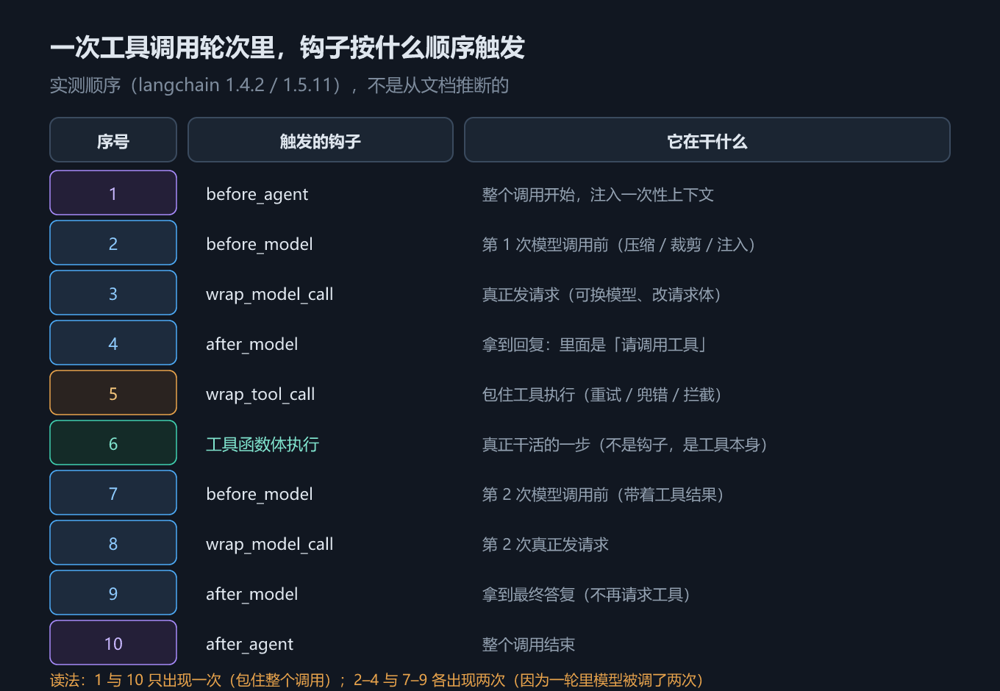
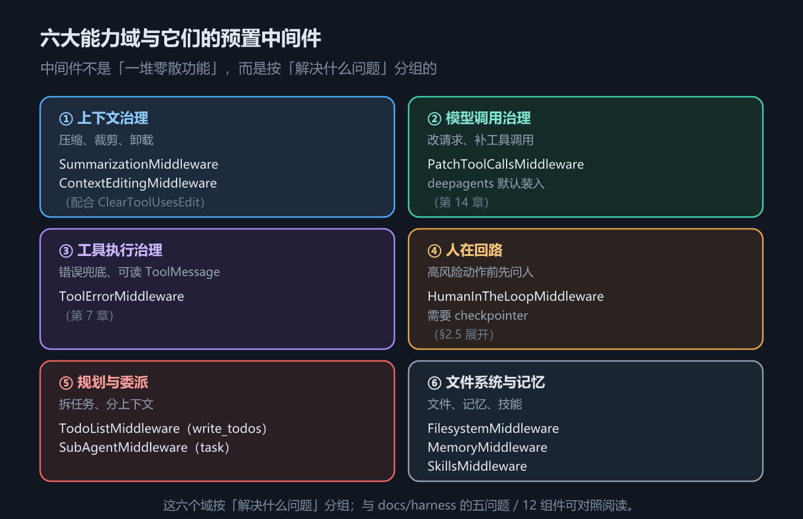
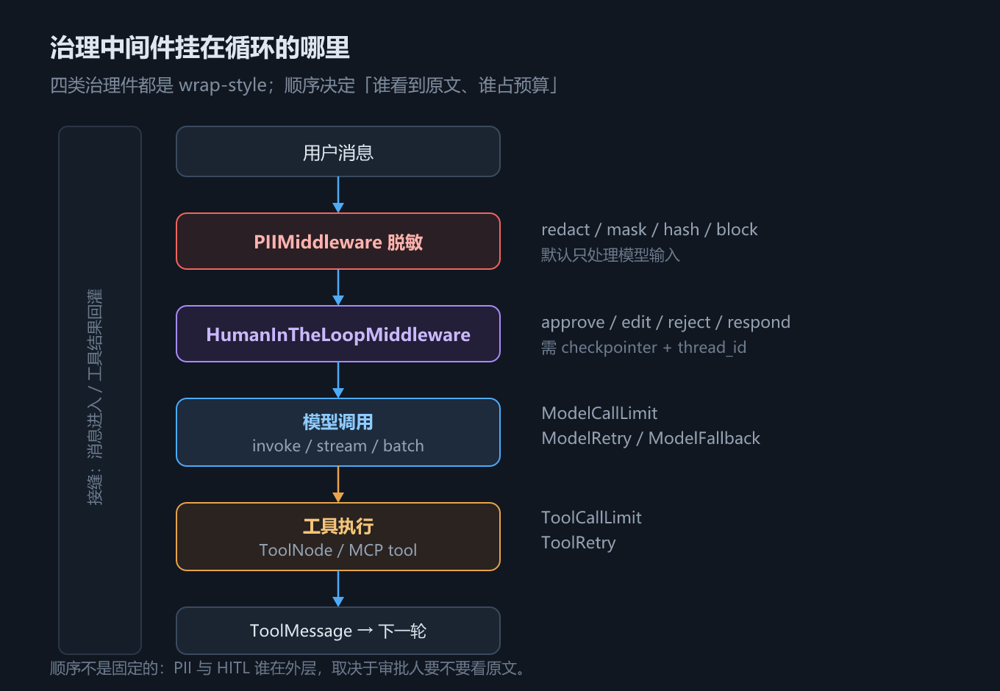

# 第 6 章 中间件：harness 的可插拔扩展点

## 一、这一章要解决的问题

第 5 章的循环是固定的：调模型、执行工具、回灌、再调。但真实项目马上会提出一堆循环之外的需求——历史太长要压缩、危险工具要人审、简单问题换便宜模型、跨会话要注入记忆、工具报错要重试。

这些需求**都不该去改框架源码**。LangChain v1 把它们统一收进一个扩展点：**中间件（middleware）**。回到第 1 章的定义，harness 是「围绕循环的一切」，而中间件就是这「一切」在 v1 里的**落点**。

这一章要解决四个问题：

1. 中间件到底能挂在循环的哪些位置，**执行顺序**是什么；
2. 两类中间件（node-style / wrap-style）能力差在哪；
3. 官方预置了哪些中间件，各自属于哪个包；
4. 常见的治理需求（人审、脱敏、限额、重试、回退）有没有现成件，怎么组合。

**本章回答：中间件是什么、挂在哪、怎么排队、能干什么、现成的有哪些、自己怎么写。**顺序是：先用一次真实轮次把六个钩子的触发顺序打出来（2.1），再按能力把钩子分成 node-style / wrap-style 两类（2.2），然后看官方预置的六大能力域（2.3），落到两种语言各自怎么写（2.4），最后用 2.5–2.8 把四类治理件（HITL / PII / 限额 / 重试回退）逐个跑通并给出组合顺序。学完这一章，「循环之外的需求」就都有了统一的插法。

## 二、机制与原理

### 2.1 六个钩子与它们的实测触发顺序

第 5 章的循环图上留了一排挂载点（见第 5 章 2.1 节图 8），这一节回答三个问题里的第一个：**这六个钩子挂在循环的哪些位置、一次含工具调用的轮次里按什么顺序触发。**顺序空口争不出来，直接看实测。

一次含工具调用的完整轮次里，六个钩子的真实触发顺序如下（**实测，`langchain` 1.4.2**——官方文档只给出「模型调用前后」的示意，没有给出可执行顺序，这里以实测为准）：

```text
 1. before_agent
 2. before_model
 3. wrap_model_call
 4. after_model
 5. wrap_tool_call
 6.         └─ 工具函数体真正执行
 7. before_model
 8. wrap_model_call
 9. after_model
10. after_agent
```

> 示例打印的是 **10 行**，其中第 6 行不是钩子、是**工具函数体真正执行的位置**（`wrap_tool_call` 的 `handler` 在里面被调用）。本章早前的版本把它删掉、重编成 9 步——读的时候要注意：**六个钩子**是 9 个位置，**整条链**是 10 步。

读法（这三句是理解全部中间件行为的关键）：

- `before_agent` / `after_agent` **包住整个 agent 调用**，各只触发一次；
- `before_model` → `wrap_model_call` → `after_model` 是**每一次模型调用**都走一遍；
- 上面出现了**两次** `before_model`，因为这一轮调了两次模型——第一次决定「要调 `get_weather`」，第二次拿到工具结果后给最终答案；
- `wrap_tool_call` 只在工具真正执行时出现一次，**夹在两次模型调用之间**；工具函数体是在 `wrap_tool_call` 之内执行的。


*图 10　六个钩子在一次工具调用中的真实触发顺序*

看到「`before_model` 出现两次」不要以为是 bug——**钩子的触发次数取决于这一轮调了几次模型，而不是调用了几次 agent**。这条认知能解释一大半「我的钩子为什么跑了两次」的疑问。

### 2.2 node-style 与 wrap-style：两类中间件

顺序问题解决了，接着问能力：**同样是钩子，为什么有的只能读写状态，有的却能拦下整个模型调用？**六个钩子分成两类，能力完全不同。

下表回答的问题是：**我这个需求该用哪一类钩子？**

| 维度 | node-style（`before_*` / `after_*`） | wrap-style（`wrap_model_call` / `wrap_tool_call`） |
|---|---|---|
| 钩子 | `before_agent`、`before_model`、`after_model`、`after_agent` | `wrap_model_call`、`wrap_tool_call` |
| 函数签名 | `(state, runtime)` | `(request, handler)` |
| 能否改写请求 | **不能直接改 `request` 对象**；但返回状态更新**可以改变模型看到的输入**（如改 `messages`） | **能**，改完 `request` 再交给 `handler` |
| 能否拦截响应 | 不能 | **能**，可以选择不调 `handler` 直接返回 |
| 组合方式 | 多个中间件：`before_*` 按注册顺序执行，`after_*` 反向执行 | 层层**包裹**（洋葱模型），注册靠前的在外层 |
| 典型用途 | 审计、记账、往状态里注入数据、消息裁剪 | 换模型、重试、超时、脱敏、缓存、工具错误兜底 |

一句话判据：**只想「看」和「改状态」→ node-style；想「改请求」或「拦结果」→ wrap-style。**

wrap-style 的名字来源就是它的形态：`handler` 是「链条剩下的部分」，你不调它，后面的钩子和真正的模型调用就都不会发生——这是实现拦截、缓存、短路的地方。

「洋葱模型」说的是多个 wrap-style 的**叠加形态**：请求像穿进洋葱，从最外层逐层穿到中心（真正的模型 / 工具调用）；响应再从中心逐层穿出来。每一层都能在**进**的路上改写请求、在**出**的路上加工响应。注册靠前的中间件裹在外层——先进后出，和函数调用栈的直觉一致。没写过 Express / Koa 的读者可以想象「层层套娃的快递包装：拆的时候从外到内，装回去从内到外」。

「node-style 不能改 request，但能改变模型看到的输入」这半句容易读成空话，看一个 3 行的最小示意就明白了——`before_model` 钩子里**返回状态更新**，而不是碰 `request`：

```python
from langchain_core.messages import SystemMessage   # 与 2.4 节示例同一环境

@before_model
def inject_notice(state, runtime):
    return {"messages": [SystemMessage("今日库存以临时表为准")]}  # 返回值经 reducer 并入状态
```

模型下一轮看到的 `messages` 里多了这条系统消息——请求没被「改」，但请求的**原料**（状态）变了。这就是「绕一层」的路径：node-style 改状态，wrap-style 改请求。（此段为写法示意；「返回状态更新可改变模型输入」这一行为的实测证据见第 9 章 `SummarizationMiddleware`——它正是走 `before_model` 写回状态实现的。）

### 2.3 六大能力域 × 预置中间件

两类钩子的能力边界清楚了，下一个问题自然是：**日常那几种循环之外的需求，官方有没有现成的件？**有——而且已经按能力域铺成了一张地图。

下表回答的问题是：**我想要的能力，官方是不是已经有现成的了？**

| 能力域 | 预置中间件 | 归属包 | 详见 |
|---|---|---|---|
| 上下文治理 | `SummarizationMiddleware`、`ContextEditingMiddleware`（配合 `ClearToolUsesEdit`） | `langchain.agents.middleware` | 第 9 章 |
| 模型调用治理 | `PatchToolCallsMiddleware` | **`deepagents`**（默认装入 Deep Agent 图） | 第 14 章 |
| 工具执行治理 | `ToolErrorMiddleware` | `langchain.agents.middleware` | 第 7 章 |
| 人在回路 | `HumanInTheLoopMiddleware` | `langchain.agents.middleware` | **§2.5**（底层仍是第 13 章的 `interrupt` 路线） |
| 规划与委派 | `TodoListMiddleware` / `SubAgentMiddleware` | `langchain.agents.middleware` / **`deepagents`** | 第 16 章 |
| 文件系统与记忆 | `FilesystemMiddleware`、`MemoryMiddleware`、`SkillsMiddleware` | **`deepagents`** | 第 15 / 17 章 |


*图 11　六大能力域 × 预置中间件*

「归属包」这一列是**本机实测**的结论，务必记住：官方文档把 `FilesystemMiddleware`、`SubAgentMiddleware` 列在 LangChain 的 middleware 清单里，但实测 `langchain.agents.middleware`（1.4.2）**没有这两个类**，它们在 `deepagents` 里。同样，`SkillsMiddleware` 须从 `deepagents.middleware` 导入，`deepagents` 顶层不导出它（实测）。

另外提醒：本矩阵只列**本教程后续章节会真正用到**的预置件。实测该包在 1.4.2 有 64 个导出，完整清单以你所用版本的 `__all__` 为准——不要在教程里背清单，要在代码里查。

### 2.4 自定义中间件：两种语言两种形态

预置件覆盖的是常见需求，每个项目却都有自己的规矩——比如「消息数变多就换更强模型」。自己写中间件不难，难在两种语言的形态处处不一样，对照着写最稳。

最小例子（在每次模型调用前打印消息数）：

```python
from langchain.agents.middleware import before_model

@before_model
def log_messages(state, runtime):
    print("模型调用前，消息数:", len(state["messages"]))
```

把这个函数放进 `create_agent(..., middleware=[log_messages])` 即可生效；完整版见第三节。

下表回答的问题是：**同一种自定义中间件，Python 与 TypeScript 各自怎么写？**

| 维度 | Python | TypeScript |
|---|---|---|
| 装饰器 / 工厂 | `@before_model`、`@after_model`、`@wrap_tool_call` … | `createMiddleware({ beforeModel, wrapModelCall, ... })` |
| 类 / 对象 | 继承 `AgentMiddleware`，覆写同名方法 | 传一个对象字面量，字段名用 camelCase |
| 改写模型请求 | `handler(request.override(model=...))` | `handler({ ...request, model })` |

**改写请求的写法差异是最容易在两边复制粘贴时写错的一行**：

- Python 侧是 `request.override(model=...)`——官方推荐写法。直接改 `request.model` 也能跑，但 `override` 会保留链上其它中间件的语义；
- JS 侧**没有** `request.override()`，约定是**展开原请求、覆盖要改的字段**：`handler({ ...request, model })`。

两边共同的纪律：**不要直接改 `request` 对象本身**，链上还有别的中间件在等它。

> ⚠️ 上面两条 bullet 的口径**是互斥的，别混着读**：Python 侧示例实测「直接改 `request.model` 也能跑」（`06_middleware.py` 里就这么试过并打印了这句话），只是不推荐；JS 侧**没有 `override()` 可用**，展开写法是唯一约定，直接改对象会污染链。把两句合成一句「两边都不要直接改」会丢掉这个差别。

### 2.5 人在回路：`HumanInTheLoopMiddleware`

2.4 讲的是「怎么写中间件」；从这一节开始看「官方已经写好的治理件」。第一个是不可逆操作前的人工审批。它回答的问题是：**工具调用怎么停下来等人、人能做什么决策、恢复时怎么把决策送回去**。

它把第 13 章的 `interrupt` 封装成**工具级审批**：命中 `interrupt_on` 的工具调用会被拦下，图停在检查点；人审完之后用 `Command(resume={"decisions": [...]})` 恢复。

| 决策 | Python | TypeScript | 含义 |
|---|---|---|---|
| 同意 | `{"type": "approve"}` | `{ "type": "approve" }` | 原样执行 |
| 编辑 | `{"type": "edit", "edited_action": {"name": ..., "args": ...}}` | `{ "type": "edit", "editedAction": { "name": ..., "args": ... } }` | 改参数/工具后执行 |
| 拒绝 | `{"type": "reject", "message": "..."}` | `{ "type": "reject", "message": "..." }` | 不执行，把理由回给模型 |
| 代答 | `{"type": "respond", "message": "..."}` | **无** | 不执行工具，直接把人工答复当工具结果 |

> 关键差异：**Python 的 `allowed_decisions` 默认四种，JS 只支持前三种**（本机导出/类型核对）。载荷字段也是 snake_case vs camelCase：Python `action_requests` / `review_configs`，JS `actionRequests` / `reviewConfigs`。

最小例子（3 步）：
1. `create_agent(..., middleware=[HumanInTheLoopMiddleware(interrupt_on={"refund": True})], checkpointer=InMemorySaver())`。
2. 第一次 `invoke` 返回 `__interrupt__`，工具还没执行。
3. 用同一 `thread_id` 调 `invoke(Command(resume={"decisions": [{"type": "approve"}]}), cfg)`，工具执行一次。

> 口径：approve / reject 两条路径为**示例实测**；edit / respond 只做了**类型与源码核对**，示例未构造。HITL 必须有 checkpointer 与 `thread_id`，否则中断无处落盘。

### 2.6 脱敏：`PIIMiddleware` 的四种策略

审批解决「要不要执行」；脱敏解决「模型该看到什么」。它回答的问题是：**邮箱、卡号、IP 这些敏感信息，在到达模型之前怎么处理**。

内置五类：`email` / `credit_card` / `ip` / `mac_address` / `url`；四种策略：

| 策略 | 效果 | 典型场景 |
|---|---|---|
| `redact` | 替换成 `[REDACTED_EMAIL]` 这类占位符 | 默认；保留结构、去掉值 |
| `mask` | 保留尾号（Python `**** **** **** 1111`；JS `****-****-****-1111`） | 客服、对账 |
| `hash` | 确定性哈希（`<email_hash:...>`） | 需要关联同一用户但不可还原 |
| `block` | 直接拒绝（抛 `PIIDetectionError`） | 合规红线 |

三个开关：`apply_to_input=True`（默认）、`apply_to_output=False`（默认）、`apply_to_tool_results=False`（默认）——**模型输入默认脱敏，模型输出与工具结果默认不脱敏**（本机源码核对）。

最小例子（3 行）：

```python
agent = create_agent(model=model, tools=[], middleware=[
    PIIMiddleware("email", strategy="redact"),
    PIIMiddleware("credit_card", strategy="mask"),
])
# 模型实际收到：'联系 [REDACTED_EMAIL]，卡号 **** **** **** 1111'
```

> 口径：email redact 与 credit_card mask 为**示例实测**；`hash` / `block` 与流式跨 chunk 检测为**源码核对 / 未实测**。掩码分隔符两语言不同（Python 空格、JS 连字符），要断言就断言「尾号还在、前缀被替换」。

### 2.7 限额、重试与回退：把失控成本关进中间件

脱敏管「看到什么」，限额管「最多花多少」，重试管「失败了再试几次」，回退管「主模型整体不可用」。它们回答的是同一类问题：**agent 失控时，谁来踩刹车**。

| 能力 | Python | TypeScript | 关键默认值 / 边界 |
|---|---|---|---|
| 模型调用限额 | `ModelCallLimitMiddleware(thread_limit=None, run_limit=None, exit_behavior="end")` | `modelCallLimitMiddleware({ threadLimit, runLimit, exitBehavior: "end" })` | `exit_behavior` 只有 `end` / `error` |
| 工具调用限额 | `ToolCallLimitMiddleware(tool_name=None, run_limit=None, exit_behavior="continue")` | `toolCallLimitMiddleware({ toolName, runLimit, exitBehavior: "continue" })` | 默认 `continue`；`end` 对多工具调用会抛 `NotImplementedError`（源码核对） |
| 工具重试 | `ToolRetryMiddleware(max_retries=2, initial_delay=1.0, jitter=True, on_failure="continue")` | `toolRetryMiddleware({ maxRetries: 2, initialDelayMs: 1000, jitter: true, onFailure: "continue" })` | Python 秒 / JS 毫秒 |
| 模型重试 | `ModelRetryMiddleware(...)` | `modelRetryMiddleware(...)` | 同上 |
| 模型回退 | `ModelFallbackMiddleware(first, *rest)` | `modelFallbackMiddleware(first, ...rest)` | 主模型异常时按顺序换 |

最小例子（3 步）：
1. `ModelCallLimitMiddleware(run_limit=1)` → 第二次模型调用被拦，返回 `Model call limits exceeded...`。
2. `ToolCallLimitMiddleware(tool_name="get_weather", run_limit=1)` → 第二次同名工具调用被换成一条 `ToolMessage`，模型继续。
3. `ToolRetryMiddleware(max_retries=2)` + 前两次失败的工具 → 工具总共执行 3 次，第三次成功。

> 口径：三类限额的拦截消息、重试次数、fallback 切换为**示例实测**；`on_failure` / `exit_behavior="end"` 的多工具边界为**源码核对**。两语言的限额文案不同（Python `run limit (1/1)`、JS `run level call limit reached...`），不要按文案断言。

### 2.8 治理件的组合顺序

单件都会用之后，最后一个问题是：**它们叠在一起时谁在外层**。wrap-style 是洋葱，顺序会改变语义；node-style 的顺序则按注册顺序/反向执行。

| 你想要的效果 | 推荐顺序（从外到内） | 为什么 |
|---|---|---|
| 先脱敏再审批 | PII → HITL → 模型/工具 | 审批人看到的是脱敏后的参数 |
| 审批人看到原文 | HITL → PII → 模型/工具 | 审批载荷保留原文，模型侧才脱敏 |
| 限额优先于重试 | 限额 → 重试 → 模型 | 重试次数也算进限额，避免「重试把预算打穿」 |
| 重试优先于限额 | 重试 → 限额 → 模型 | 限额只数成功调用，失败重试不占额度 |

这张表没有「唯一正确答案」——它取决于你的合规与成本口径。**先定口径，再排顺序**，并把顺序写进测试。



*图 12　治理中间件栈：HITL / PII / 限额 / 重试在模型与工具调用上的位置*

> 口径：HITL / PII / 限额 / 重试的单独行为为示例实测；**组合顺序的语义为架构判断**，本机未做「交换顺序」的对照实验。

## 三、代码：Python 与 TypeScript

下面的代码按机制顺序给出：① 把六个钩子的触发顺序打出来；② 用 `wrap_model_call` 按消息数动态换模型；③ HITL 审批；④ PII 脱敏；⑤ 模型/工具限额；⑥ 重试与回退。完整版见 `code/` 下对应文件。

Python 侧：

```python
from langchain.agents import create_agent
from langchain.agents.middleware import (AgentMiddleware, after_agent, after_model,
                                         before_agent, before_model, wrap_model_call,
                                         wrap_tool_call)
from langchain.tools import tool

TRACE: list[str] = []

@tool
def get_weather(city: str) -> str:
    """查询某个城市的天气。"""
    TRACE.append("        └─ 工具函数体真正执行")
    return f"{city}: 22°C，晴"

@before_agent
def hook_before_agent(state, runtime):
    TRACE.append("before_agent")

@wrap_model_call
def hook_wrap_model_call(request, handler):
    TRACE.append("wrap_model_call")
    return handler(request)          # 不调 handler 就等于拦下这次模型调用

# before_model / after_model / after_agent / wrap_tool_call 同形，此处略
agent = create_agent(model=..., tools=[get_weather], middleware=[hook_before_agent, hook_wrap_model_call, ...])
agent.invoke({"messages": [{"role": "user", "content": "上海天气？"}]})

# 改写模型请求：长上下文换强模型
class SwitchModelMiddleware(AgentMiddleware):
    def wrap_model_call(self, request, handler):
        if len(request.state["messages"]) > self.threshold:
            return handler(request.override(model=self.strong))   # ← Python 写法
        return handler(request)
```

TypeScript 侧：

```typescript
import { createAgent, createMiddleware, tool, HumanMessage } from "langchain";
import { z } from "zod";

const TRACE: string[] = [];
const getWeather = tool(async (args: { city: string }) => {
  TRACE.push("        └─ 工具函数体真正执行");
  return args.city + ": 22°C，晴";
}, { name: "get_weather", description: "查询某个城市的天气。", schema: z.object({ city: z.string() }) });

const traceMiddleware = createMiddleware({
  name: "TraceMiddleware",
  beforeAgent: () => { TRACE.push("before_agent"); },
  beforeModel: () => { TRACE.push("before_model"); },
  afterModel: () => { TRACE.push("after_model"); },
  afterAgent: () => { TRACE.push("after_agent"); },
  wrapModelCall: async (request: any, handler: any) => {
    TRACE.push("wrap_model_call");
    return handler(request);       // 不调 handler 就等于拦下这次模型调用
  },
  wrapToolCall: async (request: any, handler: any) => {
    TRACE.push("wrap_tool_call");
    return handler(request);
  },
});

const agent = createAgent({ model: ..., tools: [getWeather], middleware: [traceMiddleware] as any });
await agent.invoke({ messages: [new HumanMessage("上海天气？")] });

// 改写模型请求：JS 侧没有 request.override()，用展开覆盖
const switchModel = createMiddleware({
  name: "SwitchModelMiddleware",
  wrapModelCall: async (request: any, handler: any) =>
    request.state.messages.length > 2
      ? handler({ ...request, model: strong })    // ← JS 写法
      : handler(request),
});
```

实测输出（Python，2026-09-24）：

```text
  1. before_agent
  2. before_model
  3. wrap_model_call
  4. after_model
  5. wrap_tool_call
  6.         └─ 工具函数体真正执行
  7. before_model
  8. wrap_model_call
  9. after_model
 10. after_agent

wrap_* 钩子能改写请求：动态切换模型
  第一次调用：消息数 1 ≤ 2 → 用便宜模型
  最终回复：'便宜模型的回答'
  第二次调用：消息数 3 > 2 → 换用强模型
  最终回复：'强模型的回答'
```

两段输出合起来说明一件事：**钩子顺序由「这一轮调了几次模型、有没有执行工具」决定。**

> 但「改写请求不影响钩子顺序」这半句**没有实测支撑**——第二次运行（换强模型那次）**没有再挂 trace 中间件**，所以顺序根本没被打印第二遍。它是从「`wrap_model_call` 只换 `request.model`、不改变循环结构」推出来的合理结论，属**源码核对 / 推断**，不是跑出来的。要自己验：把 trace 中间件挂上、跑两轮以上，比较两次的顺序。

**③ HITL：工具调用前停下来等人**——载荷里带 `action_requests`，恢复用 `decisions`：

```python
agent = create_agent(
    model=ScriptedChatModel(script=[tool_call("refund", {"order_id": "A-1"}, "c1"), reply("已处理。")]),
    tools=[refund],
    middleware=[HumanInTheLoopMiddleware(interrupt_on={"refund": True})],
    checkpointer=InMemorySaver(),
)
cfg = {"configurable": {"thread_id": "refund-approve"}}
first = agent.invoke({"messages": [{"role": "user", "content": "把 A-1 退款"}]}, cfg)
print(first["__interrupt__"][0].value["action_requests"][0]["name"])   # refund
agent.invoke(Command(resume={"decisions": [{"type": "approve"}]}), cfg)
```

```typescript
const agent = createAgent({
  model: new ScriptedChatModel({ script: [toolCall("refund", { order_id: "A-1" }, "c1"), reply("已处理。")] }) as any,
  tools: [refund],
  middleware: [humanInTheLoopMiddleware({ interruptOn: { refund: true } })],
  checkpointer: new MemorySaver(),
});
const first: any = await agent.invoke({ messages: [new HumanMessage("把 A-1 退款")] }, cfg);
console.log(first.__interrupt__[0].value.actionRequests[0].name);      // refund
await agent.invoke(new Command({ resume: { decisions: [{ type: "approve" }] } }), cfg);
```

**④ PII：模型侧只看到脱敏文本**——两个开关按内置类型分开配：

```python
pii_agent = create_agent(model=pii_model, tools=[], middleware=[
    PIIMiddleware("email", strategy="redact"),
    PIIMiddleware("credit_card", strategy="mask"),
])
pii_agent.invoke({"messages": [{"role": "user", "content": "联系 alice@example.com，卡号 4111 1111 1111 1111"}]})
print([str(m.content) for m in pii_model.seen[-1]])
# ['联系 [REDACTED_EMAIL]，卡号 **** **** **** 1111']
```

```typescript
const piiAgent = createAgent({
  model: piiModel as any,
  tools: [],
  middleware: [
    piiMiddleware("email", { strategy: "redact" }),
    piiMiddleware("credit_card", { strategy: "mask" }),
  ],
});
```

**⑤ 限额：模型与工具各有一个计数器**——超限后 `end` 直接收工，`continue` 换成错误消息：

```python
create_agent(model=model, tools=[get_weather],
             middleware=[ModelCallLimitMiddleware(run_limit=1, exit_behavior="end")])
create_agent(model=model, tools=[get_weather],
             middleware=[ToolCallLimitMiddleware(tool_name="get_weather", run_limit=1, exit_behavior="continue")])
```

```typescript
createAgent({ model, tools: [getWeather],
  middleware: [modelCallLimitMiddleware({ runLimit: 1, exitBehavior: "end" })] });
createAgent({ model, tools: [getWeather],
  middleware: [toolCallLimitMiddleware({ toolName: "get_weather", runLimit: 1, exitBehavior: "continue" })] });
```

**⑥ 重试与回退**——重试解决偶发失败，回退解决主模型整体不可用：

```python
ToolRetryMiddleware(max_retries=2, initial_delay=0.01, jitter=False)
ModelRetryMiddleware(max_retries=2, initial_delay=0.01, jitter=False)
ModelFallbackMiddleware(fallback_model)          # 第一个参数是备选模型
```

```typescript
toolRetryMiddleware({ maxRetries: 2, initialDelayMs: 10, jitter: false })
modelRetryMiddleware({ maxRetries: 2, initialDelayMs: 10, jitter: false })
modelFallbackMiddleware(fallbackModel)
```

## 四、常见坑与边界条件

**1. `before_model` 触发两次不是 bug。** 一轮里调了几次模型，它就触发几次。要「整个 agent 只跑一次」的逻辑，放 `before_agent` / `after_agent`。

**2. `after_model` 改不动模型已经产出的话。** 它拿到的是模型返回后的状态，改状态不会让模型重跑。要「干预模型看到的输入」，得用 `before_model`（改状态里的消息）或 `wrap_model_call`（改请求）。

**3. wrap-style 是洋葱，顺序容易想反。** 多个 `wrap_*` 中间件按注册顺序**外层在前**：靠前的先进入、后退出。排查顺序问题时要按「进栈 / 出栈」两侧分别看。

**4. 不调 `handler` 就是静默拦截。** 拦截是能力也是陷阱——忘了调 `handler`，表现为「模型好像没被调用」，而且不报错。写 wrap-style 时先确认每个分支都调了 `handler`。

**5. 改写请求不要直接改 `request` 对象。** Python 用 `request.override(...)`，JS 用 `handler({ ...request, model })`。直接改对象本身会污染链上其它中间件的语义。

**6. 包归属与导入路径。** `FilesystemMiddleware`、`SubAgentMiddleware` 在 `deepagents` 而不是 `langchain.agents.middleware`；`SkillsMiddleware` 从 `deepagents.middleware` 导入（**均为本机核对 / 源码核对**——靠 `import` 试探确认，不在示例输出里）。

**7. 上下文类中间件的参数形状两语言不同。** Python 是位置参数（`trigger=("messages", 8)`），JS 是对象（`trigger: { messages: 8 }`）——第 9 章会用到。

**8. 治理件的实测范围。** 本章实测覆盖：六个钩子顺序、`wrap_model_call` 换模型、HITL approve/reject、PII email/credit_card、Model/Tool 限额、ToolRetry/ModelRetry/ModelFallback（脚本化假模型 + `langchain` 1.4.2 / JS 侧 `langchain` 1.5.11）。真实模型下的工具选择倾向、提示词遵从度、跨供应商行为**未实测**。
**9. HITL 必须有 checkpointer 与 `thread_id`。** 没有检查点，中断无处落盘；没有 `thread_id`，恢复找不到线程。一次中断里如果有多个工具调用，`decisions` 的数量必须与 `action_requests` 一一对应，否则抛 `ValueError`。
**10. HITL 决策两语言不对等。** Python 默认允许 `approve/edit/reject/respond` 四种；JS 只支持前三种（**类型定义核对**）。载荷字段也是 snake_case vs camelCase（`action_requests` vs `actionRequests`）。
**11. PII 默认只脱敏「模型输入」。** `apply_to_input=True`、`apply_to_output=False`、`apply_to_tool_results=False`（源码核对）——模型输出与工具结果默认不脱敏。要覆盖这两处，显式打开开关，并自己测流式跨 chunk 的漏检。
**12. 限额的 `thread_limit` 依赖线程历史。** 它统计整条线程的调用数，通常要配 checkpointer 才有意义（**源码核对/未实测**）；`run_limit` 只统计本轮。`ToolCallLimitMiddleware` 的 `end` 在多工具调用下会抛 `NotImplementedError`。
**13. 重试参数单位不同。** Python `initial_delay` / `max_delay` 以**秒**计，JS `initialDelayMs` / `maxDelayMs` 以**毫秒**计；照抄数字会差 1000 倍。
**14. 回退不是重试的替代品。** `ModelFallbackMiddleware` 只在主模型**抛异常**时切换；主模型正常返回但答得烂，它不会切。重试与回退叠加时，顺序决定「先重试再换」还是「先换再重试」。

## 五、关键结论

1. **中间件是 harness 在 v1 里的落点**：循环之外的一切——提示词、工具、行为塑造——都从这里插进去。
2. **实测触发顺序（`langchain` 1.4.2）**：`before_agent → before_model → wrap_model_call → after_model → wrap_tool_call → before_model → wrap_model_call → after_model → after_agent`。
3. **两类中间件**：node-style 只能读写状态（要影响模型输入得绕一层——改状态里的 `messages`）；wrap-style 能直接改请求、能拦结果、能短路（不调 `handler`）。
4. **四类治理件都能用中间件解决**：HITL（工具级审批，必须有 checkpointer + `thread_id`）、PII（默认只脱敏模型输入）、限额（模型/工具各有 run/thread 两级）、重试与回退（Python 秒 / JS 毫秒；回退只在异常时触发）。组合顺序按合规与成本口径定，没有唯一答案。
5. **改写模型请求**：Python `handler(request.override(model=...))`（直接改 `request.model` 也能跑但不推荐），JS `handler({ ...request, model })`（没有 `override()`，必须展开）。

> 口径：钩子顺序、`wrap_model_call` 换模型、HITL approve/reject、PII email/credit_card、Model/Tool 限额、ToolRetry/ModelRetry/ModelFallback 为**示例实测**（`06_middleware.*`）；归属包、PII 默认开关、JS 决策集合、`thread_limit` 依赖为**源码/类型核对**；真实模型下的工具选择、提示词遵从度与跨供应商行为**未实测**。

## 本章要点回顾

- **中间件 = 循环上的挂载点**，见**图 10**；六大能力域与预置件见**图 11**。
- **实测顺序（1.4.2）**：`before_agent → before_model → wrap_model_call → after_model → wrap_tool_call → before_model → wrap_model_call → after_model → after_agent`。
- **钩子次数跟着模型调用次数走**：`before_model` 在一轮里出现两次是正常的。
- **两类中间件**：node-style（`(state, runtime)`，只能改状态，间接影响模型输入）/ wrap-style（`(request, handler)`，可直接改请求、可拦截、可短路）。
- **改写请求两语言写法不同**：Python 推荐 `request.override(model=...)`（直接改 `request.model` 也能跑）；JS 没有 `override()`，必须 `handler({ ...request, model })` 展开。
- **归属包**：`FilesystemMiddleware`、`SubAgentMiddleware`、`MemoryMiddleware` 在 `deepagents`；`SkillsMiddleware` 从 `deepagents.middleware` 导入。
- **预置清单别背**：`langchain.agents.middleware` 在 1.4.2 的 `__all__` 是 46 项、公开名 64 个；以你所用版本的 `__all__` 为准。
- **自定义中间件**：Python 用装饰器或 `AgentMiddleware` 子类；JS 用 `createMiddleware({...})`。
- **HITL**：`interrupt_on={"工具名": True}` 拦工具；恢复用 `Command(resume={"decisions": [...]})`；必须有 checkpointer + `thread_id`。Python 有 approve/edit/reject/respond，JS 只有前三种。
- **PII**：内置 email/credit_card/ip/mac_address/url；策略 redact/mask/hash/block；默认只脱敏**模型输入**。
- **限额/重试/回退**：`ModelCallLimit` / `ToolCallLimit` / `ToolRetry` / `ModelRetry` / `ModelFallback`；Python 重试间隔以秒计，JS 以毫秒计。
- **组合顺序**：PII 与 HITL 谁在外层、限额与重试谁在外层，取决于「审批人看原文还是脱敏文」「重试是否占预算」——先定口径再排顺序。
