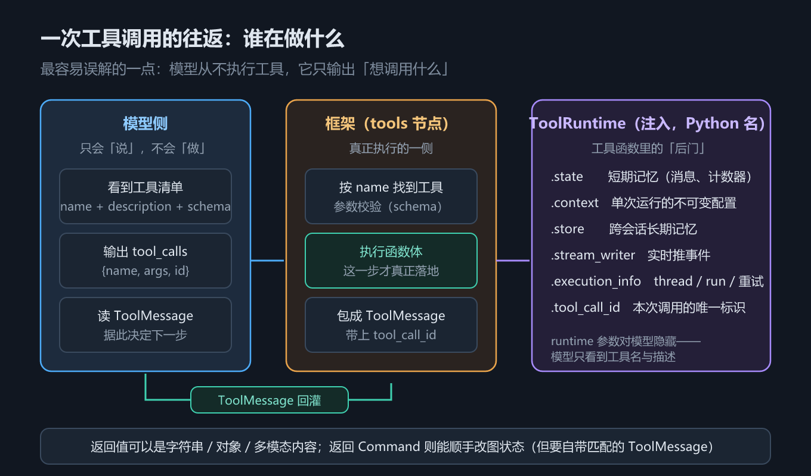
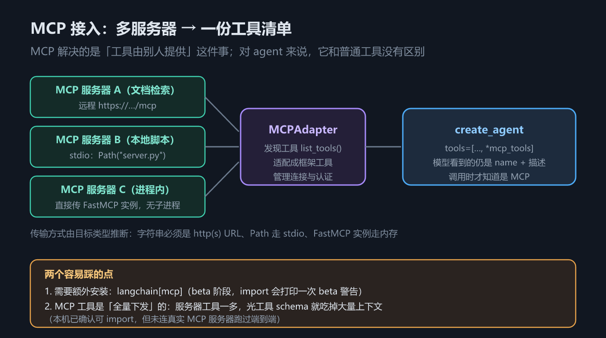
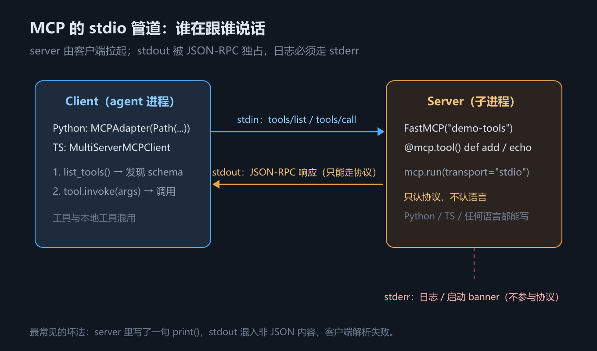

# 第 7 章 工具与运行时上下文：从 `@tool` 到 MCP

## 一、这一章要解决的问题

模型本身只会「说」。它输出一段结构化文本，声明「我想调用 `search_orders`，参数是 `{"query": "退款"}`」——**真正执行的是框架**。这句话听起来平淡，却是理解工具（Tool）的第一把钥匙：把模型当成一个只会说话、不会动手的组件，后面所有设计都顺了。



*图 13　工具调用往返与 ToolRuntime 注入*

本章要回答十个问题：① 一次工具调用怎么往返（2.1）；② 工具本身怎么定义、描述怎么写、调不调用谁说了算（2.2）；③ schema 三要素从哪来（2.3）；④ 工具怎么读到图状态、单次运行配置、长期记忆（2.4）；⑤ 老代码里的注入写法怎么改（2.5）；⑥ 工具怎么反过来改图状态、返回值有几类（2.6）；⑦ 工具执行失败怎么办（2.7）；⑧ 工具由别人提供（MCP）时客户端怎么接（2.8）；⑨ 怎么自己写一个 MCP server（2.9）；⑩ 接 MCP 的边界与坑（2.10）。

**本章回答：工具这条路，从自己写（2.1–2.7）到别人供给（2.8–2.10），每一环由什么机制兜底、各有什么坑。**十个问题按「跟着一次调用走一遍」的顺序排：先跟完全程，再逐个拆环节。

前七个**由 `code/` 示例覆盖**；2.8–2.10 是 MCP 的客户端、服务端与边界，本轮用本地 stdio server 做了端到端实测。但「覆盖」不等于「每条都是实测」——本节里 `@tool` 参数校验的报错文案、`tool_choice` 的请求载荷、`runtime` 保留参数名的报错、`execution_info` 五字段、迁移对照表等都属**源码核对 / 本机核对**，2.7 的「默认行为两语言相反」更是**没做过对照实验**（见该节标注）。读的时候按第 1 章的四级口径区分。至于「知识在外部」——也就是检索增强（RAG）——已独立成第 8 章。

## 二、机制与原理

### 2.1 一次工具调用的往返

第 5 章画了循环的四步骨架，这一节把其中「执行工具」那一步放成慢镜头：一次工具调用，模型侧和框架侧各发生了什么、两边靠什么缝合。

模型侧拿到工具清单（`name` + `description` + 参数 schema），输出 `tool_calls`，每项形如 `{name, args, id}`；框架的 `tools` 节点按 `name` 找到工具、用 schema 校验参数、执行函数体，再把返回值包成 `ToolMessage` 并把 `tool_call_id` 填成第 1 步里的 `id`；这条 `ToolMessage` 追加进历史再次进入模型，模型据此决定「继续调工具」还是「给最终答案」。`id` ↔ `tool_call_id` 是整条链路的接缝——2.6 节的 `Command` 坑、2.7 节的错误处理坑，本质都是这条接缝没对上。

### 2.2 工具怎么定义：三种方式、`@tool` 三参数与 `tool_choice`


这一节讲两件最靠前的事：**工具怎么定义**，以及**谁来决定调不调**。结论先给：`@tool` 只是三条定义路径里最省事的那条，不是唯一一条；`tool_choice` 则是把「调不调工具」的决定权从模型手里收回来（或彻底交出去）的开关。

**三种定义方式，按「能改哪一层」分**

下表回答：**同一个函数，三种交给模型的写法各自换来什么**。

| 方式 | 怎么用 | 名称 / 描述 / 参数从哪来 | 代价 |
|---|---|---|---|
| `@tool` 装饰器 | `@tool`、`@tool("getWeather")`、`@tool(description=..., args_schema=...)` | 函数名 + docstring + 类型注解，三者都可被参数覆盖 | 最省事；但只能包函数，参数校验复杂时要另传 `args_schema` |
| 直接传裸函数 | 把函数对象放进 `tools=[fn]` 或 `model.bind_tools([fn])` | 函数名 + docstring + 类型注解，**没有覆盖入口** | 最轻；改不了名字、描述、参数 schema |
| `StructuredTool` | `StructuredTool.from_function(...)` 或直接构造 | 全部显式传 | 最啰嗦；但能包装任意 callable，参数 schema 可精确控制 |

为什么这么分：**三者的差别不在「能不能用」，而在「能改哪一层」**。裸函数是「函数即工具」，一层都改不了；`@tool` 开了三个覆盖口（名字、描述、参数 schema），日常够用；`StructuredTool` 是底层类型——`@tool` 内部最终也是构造出它，需要把已有的 callable（比如第三方库函数）塞进工具列表时，走它最直接。

最小例子（一个能算加法的工具）：

```python
from langchain.tools import tool

@tool
def add(a: int, b: int) -> int:
    """两数相加。"""
    return a + b

print(add.invoke({"a": 2, "b": 3}))   # 5
```

三种方式本机实测（`langchain` 1.4.2）都成立：裸函数交给 `convert_to_openai_tool`（框架把工具翻译成 OpenAI 工具描述的函数）能正常产出 schema，描述取自 docstring；裸函数直接 `create_agent(tools=[fn])` 能跑通，因为 `create_agent` 会先把 callable 转成 `BaseTool` 再绑给模型（源码注释原话是 *"request.tools now only contains BaseTool instances (converted from callables)"*，即「此时 `request.tools` 里只剩 `BaseTool` 实例，callable 已被转换」）；`StructuredTool.from_function(func=..., name=..., description=...)` 与直接构造都能用，名字能被模型看到。

一个观测陷阱要说明：本教程的假模型记「模型被给了哪些工具」时只读 `.name`，而裸函数只有 `__name__`——所以 `fake.bind_tools([裸函数])` 会记成空列表。**这是假模型的观测局限，不是框架不收裸函数**：真实模型走 `convert_to_openai_tool` 的 callable 分支，照样拿到 schema（已用 `ChatOpenAI` 的载荷核对，见下）。

定义方式讲完了，日常默认用 `@tool`——把它接受的三个参数逐个摊开。

**`@tool` 的三个参数**

下表回答：**`@tool` 能覆盖哪三样东西，覆盖规则是什么**。

| 参数 | 覆盖什么 | 实测行为（1.4.2） |
|---|---|---|
| `description` | 工具描述 | 优先级**高于** docstring；两者都没有则直接报错 |
| `name_or_callable` | 工具名 | 可位置传参（`@tool("getWeather")`）也可关键字传；不传则取函数名 |
| `args_schema` | 参数 schema | 可传 Pydantic 模型或 JSON Schema 字典；字段级 `description` 会写进 schema |

实测细节：

- `@tool` + 无 docstring + 无 `description` → `ValueError: Function must have a docstring if description not provided.`（「未提供 `description` 时函数必须有 docstring」）。**`args_schema` 里的字段描述救不了这个错**——`@tool(args_schema=SomeModel)` 照样抛同一个错：参数描述和工具描述是两件事。
- `description=` 确实压过 docstring：给 `@tool(description="覆盖后的描述。")` 配 docstring「docstring 里原来的描述。」，最终 `description` 是前者。
- `name_or_callable` 位置传参后，`convert_to_openai_tool(...)["function"]["name"]` 就是 `"getWeather"`。
- `args_schema` 传 Pydantic 模型后：参数默认值进 `default`、字段描述进 `description`、`Literal[...]` 变成 `enum`。

一个容易踩的差异（实测）：**docstring 的 `Args:` 段，裸函数默认就解析，`@tool` 要显式开 `parse_docstring=True`**。同一段 Google 风格 docstring，裸函数下 `city` 的参数描述是 `"城市名称"`，`@tool` 下是 `None`，加上 `parse_docstring=True` 才补上。（`config` / `runtime` 是保留参数名，见 2.3 节。）

「怎么定义」到此为止；模型这次到底调不调，还有一半决定权在调用方手里。

**`tool_choice`：把「调不调」的决定权收回来**

`bind_tools(tools, tool_choice=...)` 控制的是**模型有没有得选**。下表回答：**四个取值分别把决定权放在哪、实测翻译成什么载荷**。

| 取值 | 含义 | 实测翻译成的载荷 |
|---|---|---|
| `"none"` | 一个工具都不许调 | 原样透传 `"none"` |
| `"auto"` | 默认值，模型自主决定调不调、调几个 | 原样透传 `"auto"` |
| `"required"` | 必须调，数量不限 | 原样透传 `"required"`；`"any"` 与布尔 `True` 都翻译成 `"required"` |
| `"<工具名>"` | 强制只调这一个 | 翻译成 `{"type": "function", "function": {"name": "<工具名>"}}` |

实测方法离线、不联网：构造 `ChatOpenAI(api_key="sk-fake-offline", model="gpt-4o-mini")`（`langchain-openai` 1.7.2）后调 `bind_tools(...)`，读 `.kwargs["tool_choice"]`——这一步只是拼请求载荷，不发请求。两个结论：**`tool_choice=None` 与 `False` 根本不会写进载荷**（源码是 `if tool_choice:` 的真值判断），所以「不传」和「传 `False`」都等于不设，**不是** `"none"`；传一个**不在工具列表里的名字**不会被拦，载荷里就是一个裸字符串——校验交给服务端，框架不做。

**agent 路径上怎么用**：`create_agent` 的签名里**没有** `tool_choice` 参数（实测签名只有 `model` / `tools` / `system_prompt` / `middleware` / `response_format` / `state_schema` / `context_schema` / `checkpointer` / `store` / `interrupt_before` / `interrupt_after` / `debug` / `name` / `cache` / `transformers`）。默认路径下 agent 每次调模型前会用 `tool_choice=None` 重新绑一次工具，**所以在模型上预先 `bind_tools(..., tool_choice="required")` 是无效的，会被 agent 自己的绑定覆盖**（实测：先手工绑 `"required"`，agent 跑完后最后两次绑定都是 `None`）。要改，得在 `wrap_model_call` 中间件里覆写：

```python
from langchain.agents.middleware import wrap_model_call

@wrap_model_call
def force_tools(request, handler):
    """把 tool_choice 改成 required 再交给下游。"""
    # request.override(...) 是 ModelRequest 的覆写入口：只改指定字段，其余原样带过去
    return handler(request.override(tool_choice="required"))
```

实测（用记录 `bind_tools` 入参的假模型子类）：不挂中间件时，agent 内部收到的 `tool_choice` 是 `[None, None]`（构造与调用各一次）；挂上后是 `["required", "required"]`；覆写成具体工具名时是 `["get_news", "get_news"]`。**值确实传到了 `bind_tools`。**

> ⚠️ **未实测**：以上只验证到「`tool_choice` 被正确拼进绑定与载荷」。**真实模型下这四个取值是否真的生效**——`"none"` 是否真的一次都不调、`"required"` 是否真的无视用户意图硬调、指定工具名是否真的只调那一个——**本轮没有测**（2026-10-16 已接入真实模型，但只测了流式分块、结构化输出载荷与 token 字段，没做 `tool_choice` 语义验证）。语义以 OpenAI / DeepSeek 官方文档为准（两家对 `tool_choice` 的取值规定一致）。要自己验：拿 `ChatOpenAI(base_url=...)` 接任一兼容端点，四种取值各跑一遍看 `tool_calls` 是否出现。

最后落到写法层面：描述和粒度怎么设计，模型才选得对。

**工具描述的写法要点**

与「怎么写工具」直接相关的几条经验，按重要性排：

- **描述要写清「什么时候用它」，不只是「它是什么」**。模型选工具的唯一依据就是描述——「查询航班」不够，要写清需要哪些参数、返回什么、什么场景该用。写法上用 Google 风格 docstring 的 `Args:` / `Returns:` 段，参数说明会直接进 schema（注意上面那条：`@tool` 下要开 `parse_docstring=True`）。
- **一个工具只做一件事**。`do_everything(action, data)` 这种大杂烩，描述里必然要写「当 `action` 为 weather 时……」，模型很难判断该不该选它；拆成 `get_weather` / `calculator` 之后每个描述都能一句话说清。**工具的粒度就是模型的选择粒度**。
- **优先返回字符串**。框架能把 dict 序列化进 `ToolMessage`（2.6 节），但序列化后的形态不受你控制。实测（1.4.2）：返回 `{"id": "u1", "name": "张三"}`, `ToolMessage.content` 就是 `'{"id": "u1", "name": "张三"}'`——**中文没有被转义成 `\uXXXX`**，旧版本里曾出现的乱码问题在当前版本没有复现；想完全掌控形态仍建议自己 `json.dumps(..., ensure_ascii=False)`。
- **同步 vs 异步按 IO 形态选**：CPU 密集用同步 `def`，IO 密集（API、数据库、文件）用 `async def`。实测异步工具经 `agent.ainvoke(...)` 正常；直接 `agent.invoke(...)` 也能跑通（框架内部搭了事件循环）。

工具执行失败怎么办见 2.7 节，这一节不重复。

### 2.3 schema 三要素：名称、描述、参数

2.2 反复出现「schema」这个词——`args_schema=`、`convert_to_openai_tool`、模型看到的「参数 schema」，这一节把它说透。模型看不到你的函数体，它只看到三样东西。下表回答：**同一个功能，两种语言分别怎么写，schema 从哪来**。

| 要素 | Python | TypeScript |
|---|---|---|
| 名称 | 函数名（`@tool("web_search")` 可覆盖） | `name` 字段，**必填** |
| 描述 | 函数 docstring | `description` 字段 |
| 参数 schema | 类型注解自动推导（也可 `args_schema=` 传 Pydantic / JSON Schema） | `schema` 字段，**必填**（通常用 zod） |

**保留参数名**：`config` 与 `runtime` 是框架占用的参数名，**不能**拿来当工具的业务参数，否则运行时直接报错。要访问运行时信息就用 `runtime` 参数，别自己造同名参数。

### 2.4 `ToolRuntime`：工具里的「后门」

2.3 讲的是模型能看到什么；这一节反过来，讲工具自己能看到什么。工具执行的那一刻，环境里有哪些信息可用？下表回答这个问题。

| 成员 | 含义 | Python | TypeScript |
|---|---|---|---|
| State | 短期记忆：本次会话的图状态（消息、计数器、自定义字段） | `runtime.state` | `runtime.state` |
| Context | 单次运行的不可变配置（user_id、tenant_id），**不进检查点** | `runtime.context` | `runtime.context` |
| Store | 长期记忆：跨会话持久化的键值存储 | `runtime.store` | `runtime.store` |
| Stream Writer | 执行过程中向外部实时推事件 | `runtime.stream_writer` | `runtime.writer` |
| Execution Info | 本次执行的元信息（文档口径：thread / run / 尝试次数） | `runtime.execution_info` | `runtime.executionInfo` |
| Tool Call ID | 本次调用的唯一标识，返回 `Command` 时要用 | `runtime.tool_call_id` | `runtime.toolCallId` |

这些成员合起来就是标题说的「后门」——打个比方（类比）：顾客只能看到端上桌的菜，厨师却能在后厨随手取用配料；模型属于前者，工具属于后者。但「后门」不是「法外之地」，两条实测补充（`langchain` 1.4.2 / JS 1.5.11）：**`runtime` 参数对模型完全隐藏**，模型只看到 `name` / `description` / 参数 schema；**JS 侧 `executionInfo` 的实际字段**是 `{checkpointId, checkpointNs, taskId, nodeAttempt, nodeFirstAttemptTime}`（本机未配 `thread_id`、无检查点），而文档口径为 `thread_id` / `run_id` / `node_attempt`（需 `deepagents>=0.5.0` 或 `langgraph>=1.1.5`）——字段名跨语言、跨版本都会变，别硬编码。

### 2.5 旧注入模式 → 新写法

2.4 里那个 `runtime` 参数不是凭空设计的，它是一次大扫除的结果。v1 之前，往工具里注入东西靠一组「魔法类型」；下表回答**老代码里的注入写法现在该怎么改**（本机实测：新写法统一走 `runtime: ToolRuntime` 参数，`langchain` 1.4.2）。

| 旧写法（v1 已不推荐） | v1 新写法 | 说明 |
|---|---|---|
| `InjectedState` 参数 | `runtime.state` | 一个 `runtime` 参数统一取代所有注入 |
| `InjectedStore` 参数 | `runtime.store` | 同上 |
| `get_runtime()` 调用 | `runtime: ToolRuntime` 形参 | 不再需要显式取 |
| `InjectedToolCallId` 参数 | `runtime.tool_call_id` | JS 侧为 `runtime.toolCallId` |

### 2.6 工具返回值的四类，与 `return_direct`

读环境的部分（2.4–2.5）到此为止，现在看工具怎么「写回去」——函数体 `return` 出去的东西，归宿不止一种。返回值会被框架怎么处理？会不会顺手改状态？下表回答这个问题。

| 返回类型 | 框架怎么处理 | 是否改图状态 |
|---|---|---|
| 字符串 | 直接转成 `ToolMessage` | 否 |
| 对象（dict 等） | 序列化后放进 `ToolMessage` | 否 |
| 多模态内容块列表（文本 + 图片等） | 转成 content 为多模态块的 `ToolMessage`；需模型支持该模态 | 否 |
| `Command` | **不会被自动转成 `ToolMessage`** | **是**，走 `update` 合并进状态 |

（`Command` 是 LangGraph 的指令对象——在节点里返回它，可以「同时更新状态 + 跳转节点」，第 11 章 2.7 节正式讲；工具里用它，图状态就被改掉了。）

返回 `Command` 有一条硬规则：**必须自带一条 `tool_call_id` 匹配的 `ToolMessage`**，否则 `ToolNode` 找不到对应关系，直接抛 `ValueError`——因为历史里每条 `AIMessage` 的 tool call 都必须有对应的 `ToolMessage` 才算闭合。（例外：`Command` 的 `graph` 指向父图时，执行离开了当前图，这条要求解除。）**`return_direct`** 则用来短路循环：工具执行完直接把结果作为最终答案返回，不再回模型加工；批量调用时语义很关键——同一批并行工具里，**只有当每一个都 `return_direct=True`**，整批跑完才会直接结束，只要有一个没设，就仍带着全部 `ToolMessage` 回到模型。

### 2.7 错误处理：v1 换了写法

2.6 讲的都是正常返回；工具跑到一半抛异常，是每个项目都会遇到的场面。这一节讲 v1 的错误处理路线，以及两语言默认行为的差异。

本机实测口径：**v1 的 agent 中间件路线已不再推荐 `ToolException` / `handle_tool_error` 这套旧 API**。注意措辞——它们**没有从包里删掉**：`langchain.tools` 仍导出 `ToolException`，`StructuredTool` 仍有 `handle_tool_error` 字段，`langchain` 自己的 MCP 适配器（`langchain/mcp/tools.py`）就还在用它。变的是**错误处理的入口**，不是 API 的存在。现在有两条路：**① 自己写 `@wrap_tool_call` 中间件**，捕获异常后返回一条内容可读的 `ToolMessage`（`tool_call_id` 从 `request.tool_call["id"]` 取）；**② 用内置中间件**——Python 侧为 `ToolErrorMiddleware`（本机示例未实测其构造参数，按官方文档），JS 侧为 `toolErrorMiddleware`，本机实测签名 `{ onError, tools? }`，`onError(error, request)` 返回内容则转成错误 `ToolMessage`，**什么都不返回就原样抛出**；它**不重试**，要重试得再叠一个 `toolRetryMiddleware({ onFailure: "error" })`。

**不加任何中间件时的默认行为，两个语言不一样**（⚠️ **本机未做无中间件对照实验**——下表是读 `ToolNode` 源码 + 官方文档得出的，属**源码核对**，别当实测结论抄）：

| 语言 | 工具抛异常时 | 后果 |
|---|---|---|
| Python | 异常**原样抛出**，整个 agent 调用失败 | 用户看到 500；调试时能直接拿到 traceback |
| JS | `ToolNode` **捕获**它，生成一条 error `ToolMessage`（内容形如 `<异常类名>: <消息>\n Please fix your mistakes.`）继续跑 | agent 不崩，但**真正的 bug 被掩盖成一次「模型自己会纠错」** |

实测的是**加了中间件之后**的行为，而且**两侧一致**：`07_tools.py` 与 `07_tools.ts` 都挂了捕获中间件，两边都打印「[中间件] 捕获到异常…转成 ToolMessage」并继续走到最终答复。

> 原先这里写「Python 侧抛 `ZeroDivisionError` 并终止；JS 侧产出 `ToolMessage`」——**Python 抛异常那半边从未跑过**，那句是脚本自己打印的假设性解说。JS 侧无中间件时的真实报错前缀是 `TypeError:`（示例里 `this.store.batch is not a function` 那条就是），不是 `Error:`。

所以在 Python 侧，`@wrap_tool_call` 的价值是**让 agent 不崩**；在 JS 侧，它的价值是**控制这条失败消息的措辞与分类**——让模型知道该换参数、还是该放弃。两边都建议：**调试期在 `@wrap_tool_call` 里加日志**，否则失败会被静默吞掉。

### 2.8 MCP：工具由别人提供

自己写工具的路到 2.7 走完了，最后一节换一种供给方式——工具不由自己写。模型上下文协议（MCP, Model Context Protocol）把「工具供给」标准化了：工具不是自己写的，而是别人以服务形式提供的。



*图 14　MCP 接入与多服务器聚合*

Python 侧的接入点是 `MCPAdapter`（`langchain.mcp`，需额外安装 `langchain[mcp]>=1.4.0`，**beta**，import 时打印一次 `LangChainBetaWarning`）。**传输方式由目标类型推断**：字符串必须是 `http(s)` URL；`Path` 走 stdio（每个适配器起一个子进程）；进程内 `FastMCP` 实例走内存；`MCPConfig` 字典可把多台服务器塞进一个适配器。**工具在 `list_tools()` 时被发现**，适配成框架工具后直接 `tools=[*自己的工具, *mcp_tools]`——对 agent 来说，MCP 工具与普通工具没有区别。两个必须记住的点：① 需要额外装包；② **MCP 工具是全量下发的**，服务器工具一多，光工具 schema 就吃掉大量上下文——这正是第 9 章要处理的问题。

> 口径：本轮已用 `fastmcp` 4.1.3 / `mcp` 2.3.0 在本地 stdio 上跑通端到端（`MCPAdapter(Path("07_mcp_server.py"))` → `list_tools()` → `ainvoke`）；**第三方远程 server 仍未实测**。`MCPAdapter` 的字符串目标必须是 `http(s)`，本地 server 要用 `Path`（**源码核对**）。

### 2.9 MCP 服务端：把工具暴露成 stdio server

2.8 是「用别人的 server」；这一节反过来，回答 **server 端怎么写**。MCP 是语言无关的协议：server 可以用 Python、TypeScript 或任何语言写，客户端只关心「有哪些工具、schema 是什么」。

`FastMCP` 把「注册工具 + 起传输」压成两步：

```python
from fastmcp import FastMCP

mcp = FastMCP("demo-tools")

@mcp.tool()
def add(a: int, b: int) -> int:
    """Return the sum of two integers."""
    return a + b

if __name__ == "__main__":
    mcp.run(transport="stdio")
```

三种传输要分清：**stdio**（客户端拉起子进程，本地开发最常用）、**streamable HTTP**（远程、可跨机器）、**SSE**（旧式远程流）。本章只实测 stdio。

stdio 有一条硬纪律：**server 的 stdout 只能走 JSON-RPC**。任何 `print()` 都会污染协议，日志必须写 stderr。FastMCP 的启动 banner 走 stderr，所以端到端能跑通；自己加调试输出时别用 `print`。



*图 15　MCP client–server 的 stdio 管道与工具发现*

### 2.10 MCP 接入的边界：工具预算、命名与失败隔离

2.9 让 server 跑起来了；最后一节回答「接上之后会撞到什么」。这些不是 API 问题，是规模化之后的工程边界：

| 边界 | 现象 | 处置 |
|---|---|---|
| 工具预算 | server 有多少工具就下发多少 schema，上下文会被吃满 | 只接需要的 server；用 `LLMToolSelectorMiddleware` 或第 9 章的上下文治理 |
| 命名冲突 | 两个 server 都有 `search` | Python `MCPAdapter` 给裸工具名；TS `MultiServerMCPClient` 给 `server__tool` 前缀（**本机实测**）；同名时 TS 会直接报错 |
| 进程生命周期 | stdio 子进程不关，客户端进程不退出 | Python 用 `async with MCPAdapter(...)`；TS 显式 `await client.close()`（必要时 `process.exit(0)`） |
| 信任边界 | 第三方 server 能返回任意内容、诱导模型调用别的工具 | 只接可信 server；对返回值做校验；不要把密钥放进 server 可读的环境 |
| 断连/超时 | 远程 server 挂了，工具调用卡住 | 设超时；把 MCP 工具当不可靠依赖，准备好降级路径 |

> 口径：Python / TS 两种命名规则、`async with` 与 `close()` 的生命周期为**示例实测**；工具预算与信任边界为**架构判断**；远程 server 的断连/超时**未实测**。

## 三、代码：Python 与 TypeScript

完整可运行版本见 `code/python/07_tools.py` 与 `code/typescript/07_tools.ts`。

**① schema 从哪来**——Python 靠函数名 + docstring + 类型注解，JS 三样都要显式写：

```python
from langchain.tools import tool

@tool
def search_orders(query: str, limit: int = 5) -> str:
    """按关键词搜索订单。query 是关键词，limit 是返回条数上限。"""
    return f"找到 {limit} 条与「{query}」相关的订单"
# name 取自函数名；description 取自 docstring；参数 schema 取自类型注解
```

```typescript
import { tool } from "langchain";
import { z } from "zod";

const searchOrders = tool(
  async (args: { query: string; limit?: number }) => `找到 ${args.limit ?? 5} 条`,
  {
    name: "search_orders",            // ⚠️ 必填
    description: "按关键词搜索订单。",  // ⚠️ 必填
    schema: z.object({                // ⚠️ 必填
      query: z.string().describe("搜索关键词"),
      limit: z.number().optional().describe("条数上限"),
    }),
  },
);
```

**② `ToolRuntime` 注入**——Python 用类型注解声明，JS 用第二个位置参数（`MyState` / `Ctx` 的定义、以及 `create_agent(..., state_schema=MyState, context_schema=Ctx, store=InMemoryStore())` 的接线见示例文件）：

```python
from langchain.tools import ToolRuntime, tool

@tool
def inspect_runtime(runtime: ToolRuntime[Ctx, MyState]) -> str:
    """读取运行时上下文并回报（runtime 参数对模型隐藏）。"""
    history = len(runtime.state["messages"])                     # 短期记忆
    tenant = runtime.context.tenant_id                           # 单次运行配置
    runtime.store.put(("audit",), "last_call", {"t": tenant})    # 长期记忆
    hit = runtime.store.get(("audit",), "last_call")
    return f"历史 {history} 条 | tenant={tenant} | store 回读={hit.value}"
```

```typescript
import { createAgent, tool } from "langchain";
import { InMemoryStore } from "@langchain/langgraph"; // ⚠️ 不能从 "langchain" 导入
import { z } from "zod";

const inspectRuntime = tool(
  async (_args: unknown, runtime: any) => {   // runtime 是第二个位置参数
    const tenant = runtime.context.tenantId;
    await runtime.store.put(["audit"], "last_call", { t: tenant });
    return `历史 ${runtime.state.messages.length} 条 | tenant=${tenant}`;
  },
  { name: "inspect_runtime", description: "读取运行时上下文。", schema: z.object({}) },
);

const agent = createAgent({ model, tools: [inspectRuntime],
  contextSchema: z.object({ tenantId: z.string() }), store: new InMemoryStore() });
```

**③ 返回 `Command` 直接改状态**——注意那条自己补的 `ToolMessage`：

```python
from langchain.messages import ToolMessage
from langgraph.types import Command

@tool
def set_user_name(new_name: str, runtime: ToolRuntime[None, MyState]) -> Command:
    """把用户名字写进会话状态。"""
    return Command(update={
        "user_name": new_name,
        # ⚠️ 必须自带 tool_call_id 匹配的 ToolMessage，否则 ToolNode 抛 ValueError
        "messages": [ToolMessage(content=f"已改为 {new_name}",
                                 tool_call_id=runtime.tool_call_id)],
    })
```

```typescript
import { ToolMessage } from "langchain";
import { Command } from "@langchain/langgraph";

const setUserName = tool(
  async (args: { newName: string }, runtime: any) =>
    new Command({ update: {
      userName: args.newName,
      messages: [new ToolMessage({ content: `已改为 ${args.newName}`,
                                  tool_call_id: runtime.toolCallId })],  // camelCase
    }}),
  { name: "set_user_name", description: "把用户名字写进会话状态。",
    schema: z.object({ newName: z.string() }) },
);
```

**④ 错误处理用中间件，不用 `ToolException`**：

```python
from collections.abc import Callable
from langchain.agents.middleware import wrap_tool_call
from langchain.messages import ToolMessage
from langchain.tools.tool_node import ToolCallRequest

@wrap_tool_call
def handle_tool_errors(request: ToolCallRequest,
                       handler: Callable[[ToolCallRequest], ToolMessage]):
    """把工具异常翻译成模型能读懂的失败消息。"""
    try:
        return handler(request)
    except ZeroDivisionError as exc:
        return ToolMessage(content=f"工具执行失败：{exc}。请换个参数再试。",
                           tool_call_id=request.tool_call["id"])
```

```typescript
import { createMiddleware, ToolMessage } from "langchain";

const handleToolErrors = createMiddleware({
  name: "HandleToolErrors",
  wrapToolCall: async (request: any, handler: any) => {
    try {
      return await handler(request);
    } catch (exc: any) {
      return new ToolMessage({ content: `工具执行失败：${exc.message}。请换个参数再试。`,
                               tool_call_id: request.toolCall.id });  // camelCase
    }
  },
});
```

**⑤ MCP：客户端连接本地 stdio server**——server 端见 `07_mcp_server.py`，两种语言连同一个 server：

```python
import asyncio
from pathlib import Path
from langchain.mcp import MCPAdapter

async def mcp_demo() -> None:
    server = Path(__file__).with_name("07_mcp_server.py")
    async with MCPAdapter(server) as adapter:
        tools = await adapter.list_tools()
        print([t.name for t in tools])          # ['add', 'echo']（Python 侧裸名）
        add_tool = next(t for t in tools if t.name == "add")
        result = await add_tool.ainvoke({"a": 2, "b": 3})
        print(result[0]["text"])                # '5'

asyncio.run(mcp_demo())
```

```typescript
import { MultiServerMCPClient } from "@langchain/mcp-adapters";
import { dirname, join } from "node:path";
import { fileURLToPath } from "node:url";

const pythonDir = join(dirname(fileURLToPath(import.meta.url)), "..", "python");
const pythonExe = join(pythonDir, ".venv", "Scripts", "python.exe");   // Windows
const mcpServer = join(pythonDir, "07_mcp_server.py");

const client = new MultiServerMCPClient({
  servers: {
    demo: {
      transport: "stdio",
      command: pythonExe,
      args: [mcpServer],
      env: { PYTHONUTF8: "1", PYTHONIOENCODING: "utf-8" },
      stderr: "ignore",
    },
  },
});
try {
  const tools = await client.listTools();
  console.log(tools.map((t) => t.name));       // ['demo__add', 'demo__echo']（带 server 前缀）
  const addTool = tools.find((t) => t.name.endsWith("add"))!;
  console.log(await addTool.invoke({ a: 2, b: 3 }));   // '5'
} finally {
  await client.close();
}
```

## 四、常见坑与边界条件

- **JS 侧 `InMemoryStore` 的导入源**（实测）：`langchain` 也导出了一个同名 `InMemoryStore`，但它**没有** `batch` / `put`；传给 `createAgent({store})` 后，`runtime.store.put` 报 `TypeError: this.store.batch is not a function`。**修复办法是改从 `@langchain/langgraph` 导入**——示例代码已按此修正，② 节的 `store 回读` 就是实测证据；错误导入的报错形态保留在差异清单 #16。Python 侧从 `langgraph.store.memory` 导入。
- **不传 `store` 就没有 `runtime.store`**：JS 侧为 `undefined`，Python 侧为 `None`。工具里先判空，或构造 agent 时一定传入。
- **返回 `Command` 忘了 `ToolMessage`**：`ToolNode` 抛 `ValueError`，两种语言都一样。
- **工具异常的默认行为两语言不同**（**源码核对，未做对照实验**）：**Python 直接抛出**、整个调用失败（好处是 bug 藏不住，坏处是用户看到 500）；**JS 被 `ToolNode` 吞成一条 error `ToolMessage`**、流程继续（好处是不崩，坏处是**真正的 bug 被掩盖成一次「模型自己会纠错」**）。示例实测的部分是「**加了中间件后两侧行为一致**」。两边都建议在 `@wrap_tool_call` 里加日志。
- **`runtime` 不是安全边界**：模型看不到 `runtime`，不等于用户影响不到它。`context` 由调用方传入，`state` 由消息驱动，敏感数据不要仅靠「模型看不见」来保护。
- **工具描述含糊 → 选错工具**：真实模型才暴露的行为（本教程用脚本模型，**未实测**），但机制上很直接——描述是模型唯一的判断依据；同理，工具 schema 每个都占上下文，MCP 是**全量下发**，接三台服务器可能一下多出几十个工具。
- **`return_direct` 只在整批都设置时才短路**；`Command` 的 `graph` 指向父图时才免除 `ToolMessage` 要求。
- **Python 的 `MCPAdapter` 需要额外装 `fastmcp`**（`langchain[mcp]` 的 extra 要求 `fastmcp>=4.0.1,<5`），且 import 时会打一次 `LangChainBetaWarning`；本地 server 要用 `Path`，字符串目标必须是 `http(s)`（**源码核对**）。
- **MCP 工具名两语言不同**：Python `MCPAdapter` 给裸名（`add` / `echo`），TS `MultiServerMCPClient` 给 `server__tool` 前缀（`demo__add` / `demo__echo`，**示例实测**）。同名工具在 TS 侧会冲突报错，接多个 server 时要规划命名。
- **stdio server 的 stdout 只能走协议**：任何 `print()` 都会污染 JSON-RPC，表现为「客户端能连上但工具列表为空/解析失败」。日志一律写 stderr。
- **TS 的 MCP 客户端要显式 `close()`**：stdio 子进程句柄会拖住 Node 事件循环；`await client.close()` 后仍不退，就在脚本末尾 `process.exit(0)`（**示例实测**）。
- **第三方 MCP server 是信任边界**：它能返回任意内容、诱导模型调用别的工具、读取你传给它的环境变量。只接可信 server；不要把长期密钥放进 server 的环境。远程 server 的断连/超时**未实测**。

## 五、关键结论

1. **模型只输出 tool call，执行永远由框架完成**；工具对模型可见的只有名称、描述、参数 schema——`config` 与 `runtime` 是保留参数名，`id` ↔ `tool_call_id` 是整条链路的接缝。
2. **`ToolRuntime` 是工具访问环境的唯一入口**：`.state` / `.context` / `.store` / `.stream_writer`（JS 为 `.writer`）/ `.execution_info` / `.tool_call_id`（JS camelCase）；它对模型隐藏。旧的 `InjectedState` / `InjectedStore` / `get_runtime()` / `InjectedToolCallId` 已统一迁移到它。
3. **返回值四类**：字符串 / 对象 / 多模态 / `Command`；只有 `Command` 会改状态，且必须自带匹配 `tool_call_id` 的 `ToolMessage`。
4. **错误处理换写法**：v1 不再推荐 `ToolException` / `handle_tool_error`（API 仍在包里），改用 `@wrap_tool_call` 或 `ToolErrorMiddleware`（JS 为 `toolErrorMiddleware`）。
5. **MCP 客户端与服务端都已本地跑通**：server 用 `FastMCP` 起 stdio，客户端 Python 用 `MCPAdapter(Path(...))`、TS 用 `MultiServerMCPClient`；工具经 `list_tools()` 发现后与本地工具混用。Python 侧工具名是裸名、TS 侧带 `server__tool` 前缀；第三方远程 server 与断连/超时**未实测**。

> 口径：工具定义、`ToolRuntime` 注入、`Command` 状态更新、错误处理中间件、MCP 本地 stdio 端到端为**示例实测**（`07_tools.*`、`07_mcp_server.py`）；`tool_choice` 只验证到载荷，真实语义未实测；第三方 MCP server 未实测；其余源码 / 本机核对见各节。

## 本章要点回顾

- 模型只「说」，框架才「做」——`tool_calls` 与 `ToolMessage` 靠 `id` / `tool_call_id` 缝合；工具对模型可见的只有 **名称 + 描述 + 参数 schema**，`config` / `runtime` 是保留参数名。
- **`ToolRuntime` 一个参数管全部注入**：`state` / `context` / `store` / `stream_writer` / `execution_info` / `tool_call_id`（JS 侧 camelCase，`stream_writer` 在 JS 叫 `writer`）；迁移对照见 2.5 节。**其中 `state` / `context` / `tool_call_id` 与 JS 侧的 `store` 回读均为示例实测**；`stream_writer` / `execution_info` 属源码核对。
- 返回值四类：字符串 / 对象 / 多模态 / `Command`；**返回 `Command` 必须自带匹配 `tool_call_id` 的 `ToolMessage`**，否则 `ValueError`；`return_direct` 只在**整批工具**都设置时才短路循环。
- 错误处理：v1 不再推荐 `ToolException` / `handle_tool_error`（**未删除**，只是换了入口），改用 `@wrap_tool_call` 或 `ToolErrorMiddleware`；**默认行为两语言相反**——Python 异常**原样抛出**、JS 才被 `ToolNode` 吞成 error `ToolMessage`（见 2.7 节对照表）。
- JS 侧 `InMemoryStore` 要从 `@langchain/langgraph` 导入，否则 `runtime.store.put` 报 `this.store.batch is not a function`（实测；示例已修正并回读成功）。
- MCP：server 用 `FastMCP` + `mcp.run(transport="stdio")`；Python 客户端 `MCPAdapter(Path(...))`、TS 客户端 `MultiServerMCPClient`；**本地 stdio 已实测**。工具名 Python 侧裸名、TS 侧 `server__tool`；stdout 只能走协议；第三方 server 未实测。外部知识怎么接（RAG）见第 8 章。
- **定义工具不止 `@tool`**：裸函数（`tools=[fn]`，`create_agent` 会自动转成 `BaseTool`）与 `StructuredTool` 都行；三者的差别是「能改哪一层」。`@tool` 的三个参数 `description` / `name_or_callable` / `args_schema` 分别覆盖描述、名字、参数 schema，**`description` 压过 docstring，且两者必须有一个**（见 2.2 节）。
- **`tool_choice` 决定模型有没有得选**：`"none"` / `"auto"` / `"required"` / 指定工具名；`"any"` 与 `True` 都等价 `"required"`，`None` 与 `False` **不写进载荷**。`create_agent` **没有** `tool_choice` 参数，预绑定会被它覆盖，只能在 `wrap_model_call` 里 `request.override(tool_choice=...)`；**真实模型下的实际效果未实测**（见 2.2 节）。
