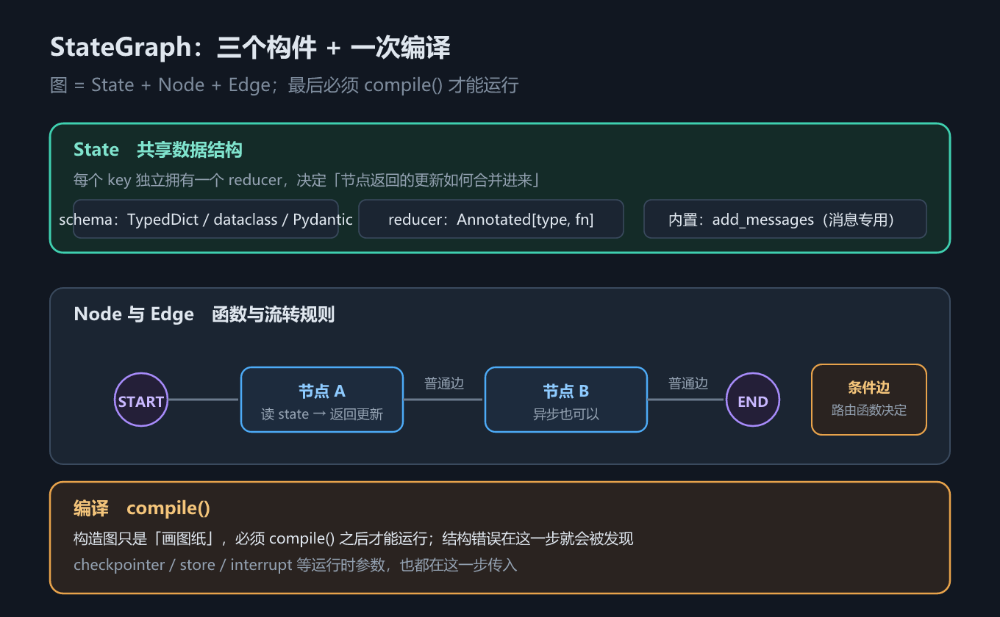
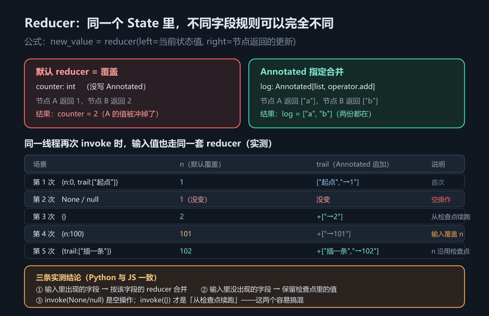
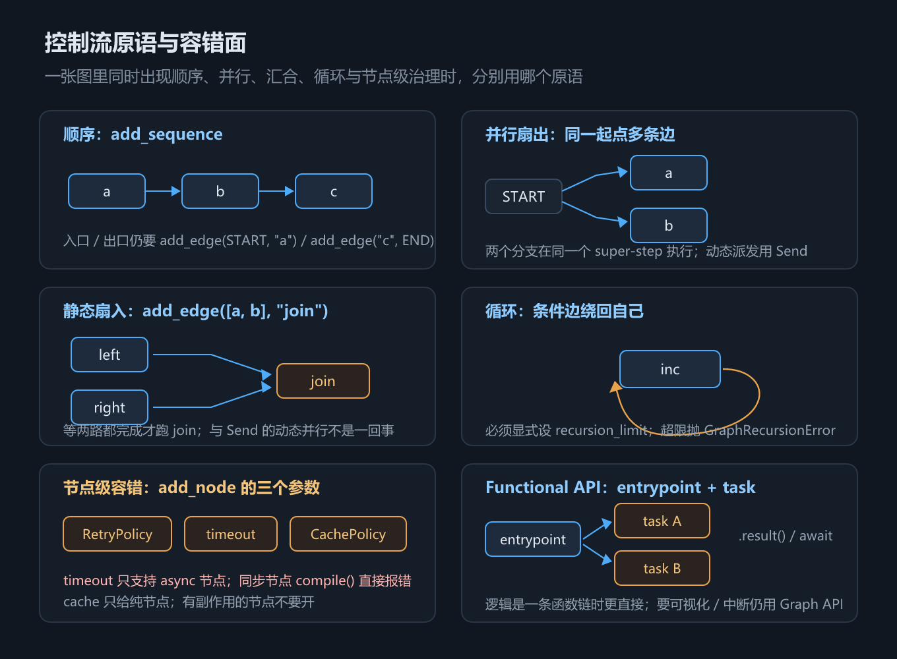

# 第 11 章 LangGraph 图与状态：Reducer、条件边与 Send

## 一、这一章要解决的问题

第 5–9 章都活在 `create_agent` 里。它很好用，但流程形状是固定的：模型 → 工具 → 模型 → …… 直到模型不再请求工具。第 6 章的中间件能往这个循环上挂钩子，却改不了循环本身的形状。

一旦需求不是这个形状——先分类再分流、把 100 个文件并行处理再汇总、加一道人工审批、跑一条多阶段流水线——就得自己画图。LangGraph 就是干这个的：**图 + 状态 + 持久化**。

先回收一个伏笔：**第 5 章的 `AgentState` 就是一张最小图的状态，`create_agent` 编译出来的本来就是一张 LangGraph 图**（第 1 章的分层图说过这句话，这里兑现）。本章把「图」这层黑盒打开：你自己画一张图时，状态、合并、流转、并行各由什么说了算。



*图 21　图的基本构件*

**一句话主线：本章回答「自己画一张图」的四个落点——状态长什么样（schema）、多个节点的贡献怎么合（reducer）、流程怎么表达（节点 / 边 / 条件边 / `Send`）、同一线程再次 `invoke` 会发生什么。** 顺着这条线，要回答五个问题：

1. State 怎么定义（schema 有哪几种形态）；
2. 节点返回的更新**怎么合并进**当前状态（reducer）；
3. 流程怎么表达（节点 / 边 / 条件边 / 入口点）；
4. 并行怎么派发（`Send`）；
5. **同一线程再次 `invoke` 会发生什么**——这是本章最反直觉、也最容易踩的一处。

2.9–2.13 再把「一次 `invoke` 内部」的控制流与健壮性补齐：顺序与扇入、循环上限、节点重试/超时/缓存、Functional API。

## 二、机制与原理

### 2.1 `StateGraph` 与 State schema

从这一节开始正式画图。画图之前先定一件事：**这张图里共享的数据长什么样**——节点读它、写它，边围着它转，schema 是整张图的地基，后面每一节都建立在它上面。

图 = **State（共享数据）+ Node（函数）+ Edge（流转规则）**，最后必须 `compile()` 才能运行。构造图只是「画图纸」；结构错误在编译这一步就会被发现，`checkpointer` / `store` 等运行时参数也在这一步传入。

State schema 就是「共享数据长什么样」。它回答的问题是：**用哪种方式描述状态字段**——三种形态在两种语言里的写法，看下表：

| 形态 | Python | TypeScript |
|---|---|---|
| 字典式 | `TypedDict`（最常用） | `Annotation.Root({...})` |
| 类式 | `dataclass` | 同上（JS 没有等价的 dataclass 写法） |
| 校验式 | Pydantic `BaseModel` | zod schema（作为**整体 state** 传给 `StateGraph` / `StateSchema`；不能塞进 `Annotation.Root` 的字段里） |
| 默认值 | 字段可给默认值，也可在 `invoke` 时传入 | 每个字段用 `default: () => 值` 显式给 |

要点：**每个字段各管各的**。同一个 State 里，`counter` 可以是覆盖语义、`log` 是追加语义、`messages` 是消息专用语义，互不影响。

schema 只回答了「字段是什么类型」；还有一个它回答不了的问题：两个节点都往同一个字段写东西，听谁的？这就是下一节的 reducer。

最小例子（一张只有一个节点的图）：

```python
from typing import TypedDict
from langgraph.graph import START, END, StateGraph

class State(TypedDict):
    n: int

graph = StateGraph(State)
graph.add_node("inc", lambda s: {"n": s["n"] + 1})
graph.add_edge(START, "inc")
graph.add_edge("inc", END)
print(graph.compile().invoke({"n": 1}))   # {'n': 2}
```

### 2.2 Reducer：默认是覆盖，`Annotated` 才合并

schema 定了字段，reducer 定「合并规则」。它回答的问题是：**节点返回的更新，怎么和当前状态里的旧值合并**。

```text
new_value = reducer(left = 当前状态值, right = 节点返回的更新)
```



*图 22　Reducer 合并语义*

可以把 reducer 类比成一块共享白板旁的两种约定（类比，只帮助理解，机制以上文公式和下表为准）：**覆盖式**约定「后写的人把整块板擦掉重写」；**追加式**约定「后写的人接着往下写」。字段没有显式声明 reducer 时，LangGraph 取前一种。

两个节点先后写入同一个字段，字段写法不同，最终状态差多少？下表回答的正是这个问题：

| 字段写法 | reducer | 两个节点分别返回 | 最终值 |
|---|---|---|---|
| `counter: int`（无 `Annotated`） | **覆盖** | A 返回 `1`，B 返回 `2` | `2`（A 的值被冲掉） |
| `log: Annotated[list, operator.add]` | 追加 | A 返回 `["a"]`，B 返回 `["b"]` | `["a", "b"]` |
| `messages: Annotated[list, add_messages]` | 消息专用 | A、B 各返回一条 AI 消息 | 起点 + a + b |

**默认 reducer 就是覆盖**——这是最容易忘的一条。想让两个节点的贡献都留下，必须显式写 `Annotated[type, reducer]`。JS 侧同理：`Annotation<T>({ reducer: (a, b) => ... })` 不写 `reducer` 就是覆盖。

### 2.3 `add_messages`

reducer 讲的是通用规则；这一节看最常用的那个合并型字段——消息。消息不是普通列表，它需要按 ID 去重更新：同一条消息（同一个 `id`）再次出现应该是**替换**，而不是重复追加。`add_messages` 就是内置的消息专用 reducer——第 5 章 2.3 节「`AgentState.messages` 只追加」就是它在 agent 状态上的样子，那里给了实测证据，这里给出形式化定义。

> ⚠️ 口径：**「追加」是示例实测的，「按 ID 去重 / 替换」不是**。`11_state_graph.py` 与第 5 章示例里每条消息的 `id` 各不相同，从未构造过「同 ID 再来一次」的用例，所以去重行为属**源码核对**。要自己验：手工传两条 `id` 相同、`content` 不同的消息，看状态里剩几条。JS 侧对应的是 `messagesStateReducer`（另有预置 schema `MessagesAnnotation`）——注意本章 JS 示例为了与 Python 对照，`messages` 用的是普通 `concat`，所以行为上只追加、不去重。

### 2.4 `Overwrite`：合并型 reducer 的逃生舱

合并型 reducer 好用，但逼出一个新问题：**想清空一个追加型字段，怎么办？** 直接返回空列表行不行？答案有点反直觉。

如果一个字段有合并型 reducer（例如 `operator.add`），那「返回空列表」是**清不掉**它的：空列表会被拼上去，旧值还在。要强制覆盖，得包一层显式指令 `Overwrite([])`。

> 示例实测的是**包了 `Overwrite` 之后清空成功**（`log = []`）那一半；「不包就清不掉、旧值还在」这一半在 `11_state_graph.py` 里是**直接 print 的字面量**，不包 `Overwrite` 的分支从未真正执行过（JS 侧更是完全没有这一节）。结论本身按 reducer 语义成立，但别当成两边都跑过的实测。

### 2.5 节点、边、条件边、入口点

「状态怎么合」讲完了，接下来讲另一半：**流程怎么表达**——图从哪开始、经过哪些节点、靠什么规则走到下一步。


*图 23　条件边与 `Send` 并行*

- **入口点**：`START`（Python）/ `START`（JS）——图的起点。
- **节点**：一个函数，读 state、返回更新字典；异步函数也可以。
- **普通边**：`add_edge("a", "b")`，从 a 无条件走到 b。
- **条件边**：`add_conditional_edges("classify", 路由函数, 映射表)`。路由函数返回一个**节点名**，图就走那条分支——**一次只走一条**，适合分类、分流、按条件重试。

这些构件不是「逐个函数调用」那么执行的——图按**超步（super-step）**推进：**一轮里所有就绪的节点同时执行，轮末统一结算（reducer 合并进状态），再进入下一轮**。可以类比游戏里的回合制（类比）：一回合内所有就绪角色同时出手，回合结束时统一结算伤害，然后开下一回合。你写普通图时一回合通常只有一个节点，感觉不到它；但两件事全靠这个概念才说得通：`Send` 派发的多个并行任务跑在**同一个超步**里（下节），第 12 章的检查点**逐超步存一份快照**。

### 2.6 `Send`：一条边派发 N 个并行分支

条件边解决的是「二选一」；可实际需求常常是「全都跑」——100 个文件每个起一个任务，跑完再汇总。`Send` 就是为这种形状准备的。

条件边是「选一条路」，`Send` 是「**同时走多条路**」。路由函数不再返回节点名，而是返回一个 `Send` 列表：`[Send("worker", {"item": it}) for it in state["items"]]`。LangGraph 会为每一项起一个并行任务，它们在**同一个 super-step**（超步——上节 2.5 已讲：一轮里同时执行、轮末统一结算的节点集合）里执行，结果靠目标字段的 reducer 汇总——这就是 map-reduce（派发一批并行任务、再把各自结果汇总起来的模式）。

注意：`Send` 携带的 payload 是**给目标节点的输入**，不是完整状态。所以 worker 节点读的是 `state["item"]`（单数、当前那一项），而不是 `state["items"]`。

### 2.7 `Command` 与子图

边与 `Send` 覆盖了「流程往哪走」的常见形状；还有两种更灵活的组织方式——节点自己决定去哪，以及把整张图当零件复用。

- **`Command`**：在节点里返回它，可以**同时**做两件事——`update` 更新状态、`goto` 跳转到指定节点。它是「动态路由 + 状态更新」的合一。第 13 章会讲它的另一种形态 `Command(resume=...)`。
  - **JS 侧返回 `Command` 的节点建议显式声明去向** `addNode(name, fn, { ends: [...] })`；Python 靠类型注解 `Command[Literal[...]]`。「不写就报 `UnreachableNodeError`」是**源码核对**（图编译时的校验），本机未做「不写 ends」的编译对照实验。
- **子图**：编译好的图可以直接当节点用。Python 的 `create_agent` 返回 `CompiledStateGraph`，可直接 `add_node("x", agent)`；JS 的 `createAgent` 返回 `ReactAgent` 包装对象，要取 `agent.graph` 再当节点——第 18 章的 JS 示例就是这么做的。11 号示例本身没有 agent 节点，不要把它当作「不必取 `.graph`」的证据。

### 2.8 同一线程再次 `invoke` 的语义

最后一节回答本章最反直觉的问题：图带上检查点之后，**同一个线程再次 `invoke`，第二次的输入和检查点里存的状态怎么合？**

**前置说明**：这一节要用到下一章的检查点（checkpointer）——只需知道一件事：**图 `compile()` 时带上 checkpointer 后，同一个 `thread_id` 的多次 `invoke` 会共享一条状态历史**；不配则每次调用都是失忆重来。checkpointer 本身是第 12 章的主题。

这一条官方文档只讲 reducer 本身，没讲「同一线程再次 `invoke` 时输入如何进入状态」。本机实测（`langgraph` 1.2.12 / JS 1.4.17，两侧一致）给出如下结果——图只有一个节点 `bump`：`n = n + 1`，`trail` 追加 `f"→{n}"`；`n` 无 reducer（覆盖），`trail` 有 `operator.add`（追加）。

五次调用、两种字段、两种命运——下表逐次列出传入与结果：

| 调用 | 传入 | 结果 `n` | 结果 `trail` | 为什么 |
|---|---|---|---|---|
| 第 1 次 | `{"n": 0, "trail": ["起点"]}` | `1` | `["起点", "→1"]` | 首次执行 |
| 第 2 次 | `None` | `1` | 不变 | **空操作**：已跑完的线程没有待执行任务，直接返回当前状态 |
| 第 3 次 | `{}` | `2` | `+["→2"]` | **从检查点续跑**：节点读到检查点里的 `n=1`，+1 得 2 |
| 第 4 次 | `{"n": 100}` | `101` | `+["→101"]` | 输入里的 `n` 按默认 reducer（覆盖）冲掉检查点里的 2 |
| 第 5 次 | `{"trail": ["插一条"]}` | `102` | `+["插一条", "→102"]` | 输入里没有 `n` → 沿用检查点的 101；`trail` 按 `operator.add` **追加** |

三条结论：

1. 输入字典里**出现**的字段 → 按**该字段自己的 reducer** 合并进检查点状态；
2. 输入字典里**没出现**的字段 → **保留检查点里的值**；
3. `invoke(None, cfg)` **不注入新输入**——线程已跑完时表现为**空操作**；`invoke({}, cfg)` 注入一个空字典，才是「从检查点续跑」——这两个极容易搞混。

第 1、2 条是最阴的坑：以为「同一线程会累积」，结果标量字段被输入悄悄重置了。

### 2.9 顺序与扇入：`add_sequence` 与多起点边

2.8 讲的是「同一线程再次 `invoke`」；这一节回到「一次 `invoke` 内部」，补齐两种最常见的固定形状：**顺序链**与**并行汇合**。它们回答的问题是：**多个节点按固定顺序串起来、或从多个起点并行跑再汇合，代码怎么写**。

- **顺序链**：`add_sequence([a, b, c])` 一次声明 a→b→c，比三次 `add_edge` 少写两行；入口仍要自己 `add_edge(START, "a")`，出口仍要 `add_edge("c", END)`。
- **静态扇入**：`add_edge(["left", "right"], "join")` 表示「等 left、right **都**完成后再跑 join」。它是**静态**的（起点在编译期写死），与 2.6 的 `Send`（运行期按数据派发 N 个分支）不是一回事——前者是「固定的几路汇合」，后者是「按列表长度动态并行」。

最小例子（3 步）：先顺序、再两路扇出、最后汇合。

```python
class Flow(TypedDict):
    trail: Annotated[list[str], operator.add]

sequence = (StateGraph(Flow).add_sequence([seq_a, seq_b])
            .add_edge(START, "seq_a").add_edge("seq_b", END).compile())
# sequence.invoke({"trail": []}) → {'trail': ['a', 'b']}

fan_in = (StateGraph(Flow)
          .add_node("left", left).add_node("right", right).add_node("join", join)
          .add_edge(START, "left").add_edge(START, "right")
          .add_edge(["left", "right"], "join")
          .add_edge("join", END).compile())
# fan_in.invoke({"trail": []}) → {'trail': ['left', 'right', 'join<-left,right']}
```

下图把顺序、扇出、扇入、循环放进同一张控制流面板——**只画原语，不画具体业务**：



*图 24　控制流原语与容错面*

### 2.10 循环与递归上限：`recursion_limit` 与 `RemainingSteps`

条件边既可以分流，也可以**绕回自己**形成循环。循环必须有人踩刹车：LangGraph 用 `recursion_limit` 限制单次运行最多走多少个 super-step。它回答的问题是：**循环什么时候被强行停下、默认上限是多少、还剩几步能不能在节点里读到**。

三个实测/核对事实（`langgraph` 1.2.12）：

1. 本机默认上限是 **10007**（`langgraph._internal._config.DEFAULT_RECURSION_LIMIT`，**源码核对**）；讲义里的 25、官方旧文档的 1000、课程包在 1.1.2 上量到的 10000，都不是本机值——**这个默认值随版本变化，生产代码请显式传**。
2. 超过上限抛 `GraphRecursionError`，**示例实测**；报错文本会带上当前 limit。
3. `RemainingSteps` 是 LangGraph 注入的 managed 值：在状态里声明 `remaining_steps: RemainingSteps`，节点里就能读到「进入本节点时还剩几步」，**示例实测**（`recursion_limit=5` 时进入节点看到 4）。Python 从 `langgraph.managed` 导入；JS 1.4.17 的导出表里没有同名值（**本机核对**）。

最小例子（3 步）：

```python
def keep_going(state: Loop) -> str:
    return "inc" if state["n"] < 3 else END

loop = (StateGraph(Loop).add_node("inc", inc).add_edge(START, "inc")
        .add_conditional_edges("inc", keep_going, {"inc": "inc", END: END}).compile())
loop.invoke({"n": 0}, {"recursion_limit": 5})   # {'n': 3}

class StepState(TypedDict):
    n: int
    remaining_steps: RemainingSteps

def report(state: StepState) -> dict:
    print(state["remaining_steps"])    # recursion_limit=5 时进入节点看到 4
    return {"n": state["n"] + 1}
```

### 2.11 节点级容错：`RetryPolicy`、timeout 与 `error_handler`

循环会反复执行同一个节点，节点失败怎么办？图提供了**节点级**的容错三件套，回答的问题是：**失败重试几次、单次执行最多多久、重试仍失败后走哪条路**。

| 能力 | Python | TypeScript | 关键默认值 / 边界 |
|---|---|---|---|
| 重试 | `RetryPolicy(max_attempts, retry_on, initial_interval, ...)` | `retryPolicy: { maxAttempts, initialInterval, ... }` | Python `max_attempts=3`、`initial_interval=0.5` 秒；JS `maxAttempts=3`、`initialInterval=500` **毫秒**（JS 重试日志实测） |
| 超时 | `timeout=0.05` 或 `TimeoutPolicy(...)` | `timeout: 50` 或 `TimeoutPolicy` | **只支持 async 节点**；同步节点 `compile()` 直接抛 `ValueError`（**示例实测**） |
| 错误处理 | `error_handler=fn` | `errorHandler` | 重试耗尽后接管；与重试策略分开配置（**源码核对**，示例未构造耗尽用例） |

最小例子（重试 3 次）：

```python
graph.add_node("flaky", flaky, retry_policy=RetryPolicy(max_attempts=3, retry_on=ValueError))
# 前两次抛 ValueError，第三次成功；节点总共执行 3 次
```

> 口径：重试次数、`retry_on`、超时异常是**示例实测**；`error_handler` 的签名与继承规则只做了**源码核对**，示例未构造「重试耗尽后交给 error_handler」的用例。

### 2.12 节点缓存：`CachePolicy` 与 `InMemoryCache`

重试解决「失败」；缓存解决「重复」：同一个纯节点、同一份输入，第二次能否直接复用上次结果。它回答的问题是：**缓存键是什么、TTL 多久、哪些节点不能缓存**。

- `CachePolicy(ttl=60)` 挂在节点上（ttl 单位：秒）；`compile(cache=InMemoryCache())` 给整张图提供缓存实现。
- 缓存键默认由节点输入生成；有副作用（写库、发消息、扣款）的节点**不要**开缓存。
- JS 侧 `cachePolicy: { ttl: 60 }`，`InMemoryCache` 在 `@langchain/langgraph-checkpoint` 包里，不在 `@langchain/langgraph` 顶层（**本机核对**导出表）。

最小例子（同输入两次，节点只跑一次）：

```python
graph.add_node("pure", pure, cache_policy=CachePolicy(ttl=60))
graph = graph.compile(cache=InMemoryCache())
graph.invoke({"n": 1}); graph.invoke({"n": 1})   # 节点执行 1 次
```

### 2.13 Functional API：`@entrypoint` 与 `@task`

前面各节都在用 Graph API（节点 + 边）。如果工作流本身就是一条函数链，用 Graph API 描述会显得绕。Functional API 回答的问题是：**能不能用普通函数调用写同一类工作流**。

- `@task` 把一个函数变成可并行、可重试、可缓存的「任务」；调用它返回一个 future，`.result()` / `await` 取结果。
- `@entrypoint` 把一组任务调用包成一个入口；它本身也是一张可编译、可带 checkpointer/store 的图。
- 选型：需要**可视化、中断、子图**时用 Graph API；逻辑就是**一条函数链**时 Functional 更直接。

最小例子（3 步）：

```python
@task
def add_one(x: int) -> int:
    return x + 1

@entrypoint()
def pipeline(x: int) -> int:
    return add_one(x).result()

pipeline.invoke(3)   # 4
```

## 三、代码：Python 与 TypeScript

完整可运行版本见 `code/python/11_state_graph.py` 与 `code/typescript/11_state_graph.ts`。下面按机制顺序给出：① schema 与 reducer、② 同线程多次 `invoke`、③ `Send` 并行、④ `Overwrite` 清空，以及**顺序/扇入、循环、容错、Functional API** 四段（脚本中对应 ⑥–⑨ 节，因为脚本前五节还含条件边）。

**① State schema 与 reducer**——一个字段覆盖、一个字段合并：

```python
import operator
from typing import Annotated, TypedDict
from langgraph.graph import END, START, StateGraph, add_messages

class State(TypedDict):
    counter: int                                   # 无 Annotated → 覆盖
    log: Annotated[list[str], operator.add]        # 追加
    messages: Annotated[list, add_messages]        # 消息专用：追加 + 按 ID 去重

def node_a(state: State) -> dict:
    return {"counter": 1, "log": ["a 跑过"], "messages": [AIMessage(content="a")]}

def node_b(state: State) -> dict:
    return {"counter": 2, "log": ["b 跑过"], "messages": [AIMessage(content="b")]}

g = (StateGraph(State).add_node("a", node_a).add_node("b", node_b)
     .add_edge(START, "a").add_edge("a", "b").add_edge("b", END).compile())
# counter = 2（最后写的赢）；log = ["a 跑过", "b 跑过"]（合并）
```

```typescript
import { Annotation, END, START, StateGraph } from "@langchain/langgraph";

const State = Annotation.Root({
  counter: Annotation<number>({ default: () => 0 }),   // 无 reducer → 覆盖
  log: Annotation<string[]>({ reducer: (a, b) => a.concat(b), default: () => [] }),
  messages: Annotation<unknown[]>({ reducer: (a, b) => a.concat(b), default: () => [] }),
});

const g = new StateGraph(State)
  .addNode("a", () => ({ counter: 1, log: ["a 跑过"], messages: ["a"] }))
  .addNode("b", () => ({ counter: 2, log: ["b 跑过"], messages: ["b"] }))
  .addEdge(START, "a").addEdge("a", "b").addEdge("b", END)
  .compile();
```

**② 同一线程再次 `invoke`**——5 次调用，两种字段两种命运：

```python
g2 = (StateGraph(Acc).add_node("bump", bump)
      .add_edge(START, "bump").add_edge("bump", END)
      .compile(checkpointer=InMemorySaver()))
cfg = {"configurable": {"thread_id": "t-1"}}

for label, inp in [("第 1 次", {"n": 0, "trail": ["起点"]}),
                   ("第 2 次", None),          # ⚠️ 空操作
                   ("第 3 次", {}),            # ⚠️ 续跑
                   ("第 4 次", {"n": 100}),    # ⚠️ 覆盖 n
                   ("第 5 次", {"trail": ["插一条"]})]:
    r = g2.invoke(inp, cfg)   # n=1 → 1 → 2 → 101 → 102
```

```typescript
const g2 = new StateGraph(Acc)
  .addNode("bump", (state: any) => {
    const n = state.n + 1;
    return { n, trail: [`→${n}`] };
  })
  .addEdge(START, "bump").addEdge("bump", END)
  .compile({ checkpointer: new MemorySaver() });   // Python 侧叫 InMemorySaver
const cfg = { configurable: { thread_id: "t-1" } };

for (const [label, inp] of rows) {
  const r: any = await g2.invoke(inp, cfg);        // null 是空操作、{} 才是续跑
  console.log(`n=${r.n} trail=${JSON.stringify(r.trail)}`);
}
```

**③ `Send`：map-reduce 并行**：

```python
class FanState(TypedDict):
    items: list[str]
    results: Annotated[list[str], operator.add]

def split(state: FanState) -> list[Send]:
    """返回 Send 列表而不是节点名——每一项起一个并行任务。"""
    return [Send("worker", {"item": it}) for it in state["items"]]

def worker(state: dict) -> dict:
    return {"results": [f"{state['item']} 处理完毕"]}

fan = (StateGraph(FanState).add_node("worker", worker)
       .add_conditional_edges(START, split, ["worker"])
       .add_edge("worker", END).compile())
```

```typescript
const fan = new StateGraph(FanState)
  .addNode("worker", (s: any) => ({ results: [`${s.item} 处理完毕`] }))
  .addConditionalEdges(
    START,
    (s: any) => s.items.map((it: string) => new Send("worker", { item: it })),
    ["worker"],
  )
  .addEdge("worker", END)
  .compile();
```

**④ `Overwrite`：清空合并型字段**：

```python
def reset_log(state: State) -> dict:
    # 直接返回 [] 没用：operator.add 会把 [] 拼上去，旧值还在
    return {"log": Overwrite([])}
```

```typescript
new StateGraph(State)
  .addNode("reset", () => ({ log: new Overwrite([]) as any }))
  .addEdge(START, "reset").addEdge("reset", END)
  .compile();
```

**⑤ 顺序与静态扇入**——`add_sequence` 省掉中间边，`add_edge([a, b], "join")` 等两路都完成：

```python
class Flow(TypedDict):
    trail: Annotated[list[str], operator.add]

sequence = (StateGraph(Flow).add_sequence([seq_a, seq_b])
            .add_edge(START, "seq_a").add_edge("seq_b", END).compile())

fan_in = (StateGraph(Flow)
          .add_node("left", left).add_node("right", right).add_node("join", join)
          .add_edge(START, "left").add_edge(START, "right")
          .add_edge(["left", "right"], "join")
          .add_edge("join", END).compile())
```

```typescript
const sequence = new StateGraph(Flow)
  .addSequence([["seq_a", seqA], ["seq_b", seqB]])
  .addEdge(START, "seq_a").addEdge("seq_b", END).compile();

const fanIn = new StateGraph(Flow)
  .addNode("left", left).addNode("right", right).addNode("join", join)
  .addEdge(START, "left").addEdge(START, "right")
  .addEdge(["left", "right"], "join")
  .addEdge("join", END).compile();
```

**⑥ 循环、`recursion_limit` 与 `RemainingSteps`**——循环要显式设上限；Python 能在节点里读到剩余步数：

```python
def keep_going(state: Loop) -> str:
    return "inc" if state["n"] < 3 else END

loop = (StateGraph(Loop).add_node("inc", inc).add_edge(START, "inc")
        .add_conditional_edges("inc", keep_going, {"inc": "inc", END: END}).compile())
loop.invoke({"n": 0}, {"recursion_limit": 5})   # {'n': 3}

class StepState(TypedDict):
    n: int
    remaining_steps: RemainingSteps

def report(state: StepState) -> dict:
    print(state["remaining_steps"])    # recursion_limit=5 时看到 4
    return {"n": state["n"] + 1}
```

```typescript
const loop = new StateGraph(Loop)
  .addNode("inc", (s: any) => ({ n: s.n + 1 }))
  .addEdge(START, "inc")
  .addConditionalEdges("inc", (s: any) => (s.n < 3 ? "inc" : END), { inc: "inc", [END]: END })
  .compile();
await loop.invoke({ n: 0 }, { recursionLimit: 5 });   // 注意是驼峰 recursionLimit
// JS 1.4.17 未导出 RemainingSteps；剩余步数的 managed 值只在 Python 侧演示
```

**⑦ `RetryPolicy` / async timeout / `CachePolicy`**——三个都是 `add_node` 的编译参数：

```python
retry_graph = (StateGraph(Loop)
    .add_node("flaky", flaky, retry_policy=RetryPolicy(max_attempts=3, retry_on=ValueError))
    .add_edge(START, "flaky").add_edge("flaky", END).compile())

async def slow(state: Loop) -> dict:
    await asyncio.sleep(0.2)
    return {"n": 1}

timeout_graph = (StateGraph(Loop)
    .add_node("slow", slow, timeout=0.05)   # 只支持 async 节点
    .add_edge(START, "slow").add_edge("slow", END).compile())

cache_graph = (StateGraph(Loop)
    .add_node("pure", pure, cache_policy=CachePolicy(ttl=60))
    .add_edge(START, "pure").add_edge("pure", END).compile(cache=InMemoryCache()))
```

```typescript
const retryGraph = new StateGraph(Loop)
  .addNode("flaky", flaky, { retryPolicy: { maxAttempts: 3, initialInterval: 1, jitter: false } })
  .addEdge(START, "flaky").addEdge("flaky", END).compile();

const timeoutGraph = new StateGraph(Loop)
  .addNode("slow", slow, { timeout: 50 })   // 毫秒
  .addEdge(START, "slow").addEdge("slow", END).compile();

const cacheGraph = new StateGraph(Loop)
  .addNode("pure", pure, { cachePolicy: { ttl: 60 } })
  .addEdge(START, "pure").addEdge("pure", END)
  .compile({ cache: new InMemoryCache() });   // 从 @langchain/langgraph-checkpoint 导入
```

**⑧ Functional API**——同一件事，用普通函数调用表达：

```python
@task
def add_one(x: int) -> int:
    return x + 1

@entrypoint()
def pipeline(x: int) -> int:
    return add_one(x).result()

pipeline.invoke(3)   # 4
```

```typescript
const pipeline = entrypoint("pipeline", async (x: number) => {
  const a = await task("add_one", async (v: number) => v + 1)(x);
  return a;
});
await pipeline.invoke(3);   // 4
```

## 四、常见坑与边界条件

下面各条可以分三类读：**合并语义**（默认 reducer、`Overwrite`、`Send` 汇总）、**线程语义**（2.8 的三种 `invoke` 输入）、**跨语言差异**（`ends` 声明、`.graph`、`messages` reducer、节点名）。

- **默认 reducer 是覆盖，不是合并**：**顺序执行**的两个节点都写同一个标量字段时，留下的是**最后执行的那个**。但**同一 super-step 的并行分支写同一个无 reducer 字段会直接报错**——**源码核对**抛 `InvalidUpdateError: At key 'x': Can receive only one value per step.`（示例未构造过这个用例：④ 的 `Send` 写的是带 `operator.add` 的字段）。不是「不确定地覆盖」，而是**编译能过、跑起来抛异常**。凡可能被并发写入的字段，必须给 reducer。
- **`invoke(None)` 与 `invoke({})` 完全不同**：前者不注入输入，线程已跑完时什么都不做、直接返回当前状态；后者注入空字典，才是「从检查点续跑」。实测第 2、3 次调用就是这两个。
- **输入字典里的字段会被自己的 reducer 处理**：标量字段传了值就覆盖检查点里的值（实测第 4 次 `n=100` → `101`）。想「续跑但不动状态」就传 `{}`。
- **`Overwrite` 只对合并型字段有意义**：无 reducer 的字段本来就是覆盖，包不包都一样。
- **`Send` 的 payload 是目标节点的输入**：worker 里读的是 `state["item"]`（当次那一项），不是完整的 `state["items"]`。
- **`Send` 的汇总靠 reducer**：`results` 必须是 `Annotated[list, operator.add]` 这类合并型字段，否则并行分支互相覆盖。
- **JS 返回 `Command` 的节点应声明 `ends`**（**源码核对**），否则类型层报错；本机 `tsc` 未复现出 `UnreachableNodeError` 这个具体错误名。
- **JS 把 agent 当节点要取 `agent.graph`**（实测）；Python 可以直接 `add_node("x", agent)`。
- **没有 checkpointer 就没有跨 `invoke` 的记忆**：2.8 节的所有结论都建立在 `compile(checkpointer=...)` 之上。Python 用 `InMemorySaver`，JS 用 `MemorySaver`（实测）。
- **JS 示例的 `messages` 用的是普通 `concat`**：与 Python 的 `add_messages` 不完全等价（少了按 ID 去重更新）。要消息语义就用 `messagesStateReducer` 或 `MessagesAnnotation`。
- **节点名是内部实现细节**：**跨语言会变（实测**，见第 13 章 `model` vs `model_request`）；「跨版本也会变」是合理推断，本机只跑过 `langgraph` 1.2.12 / `@langchain/langgraph` 1.4.17 一个版本，**未实测**。别硬编码。
- **同步节点不能设 `timeout`**：`compile()` 会抛 `ValueError: Node timeouts are only supported for async nodes...`（**示例实测**）。这不是配置问题，是 Python 无法安全取消同步执行；要么把节点改成 `async`，要么在节点内部自己做超时。
- **`recursion_limit` 的默认值不可背**：本机 1.2.12 是 **10007**（源码核对），课程包 1.1.2 量到 10000，旧文档写 1000/25。凡是循环图，显式传 `{"recursion_limit": N}`（JS：`{ recursionLimit: N }`）。
- **重试参数的单位两语言不同**：Python `initial_interval` 以**秒**计，JS `initialInterval` 以**毫秒**计（JS 重试日志实测）。照抄数字会差 1000 倍。
- **`RemainingSteps` 只有 Python 侧有**：从 `langgraph.managed` 导入；JS 1.4.17 没有同名导出（**本机核对**），TS 示例只演示 `recursionLimit`。
- **缓存只给纯节点**：`CachePolicy` 按节点输入做键，有副作用的节点（写库、发消息、扣款）开了缓存会跳过真实副作用。JS 的 `InMemoryCache` 要从 `@langchain/langgraph-checkpoint` 导入。
- **`add_sequence` 不接入口/出口**：它只负责中间的顺序边；`START → 首节点` 与 `末节点 → END` 仍要自己写。
- **静态扇入 ≠ `Send`**：`add_edge([a, b], "join")` 是编译期固定的几路汇合；`Send` 是运行期按数据长度动态派发。两者都能并行，但适用场景不同。
- **Functional API 的 `@task` 只能在 `@entrypoint` 或图里调用**：调用返回的是 future/`_TaskFunction` 结果，Python 忘记 `.result()`、JS 忘记 `await`，拿到的是任务对象而不是值。

## 五、关键结论

1. **图 = State + Node + Edge**，必须 `compile()` 才能运行；`checkpointer` / `store` 在编译时传入。
2. **默认 reducer = 覆盖**（顺序执行时后者覆盖前者；并行写同一无 reducer 字段会抛 `InvalidUpdateError`）；`Annotated[type, reducer]` 才是合并。消息用 `add_messages`（JS：`messagesStateReducer`）。
3. **`Overwrite` 是合并型 reducer 的逃生舱**：返回空列表**不会**清空字段，要包 `Overwrite([])`。
4. **控制流原语各管一段**：条件边选一条路；`Send` 运行期动态并行；`add_sequence` 固定顺序；`add_edge([a, b], "join")` 静态扇入；`Command` 同时更新与跳转；子图可直接当节点（JS 取 `.graph`）。循环图必须显式设 `recursion_limit`（本机默认 10007，随版本变化）。
5. **同线程 `invoke` 与节点级治理都是「编译参数」**：输入里出现的字段按各自 reducer 合并、没出现的保留检查点值（`None` 空操作、`{}` 续跑）；`RetryPolicy` / `timeout`（仅 async）/ `CachePolicy` 挂在 `add_node` 上，Functional API 用 `@entrypoint` + `@task` 表达同一条链。

> 口径：Reducer 行为、并行写同键报错、同线程 invoke 序列、顺序/扇入、循环报错、`RemainingSteps`、重试/超时/缓存、Functional API 均为**示例实测**（`11_state_graph.*`）；`recursion_limit` 默认 10007 与 `error_handler` 为**源码核对**；JS 取 `.graph` 的结论见 2.7，`RemainingSteps` 无导出见 2.10。

## 本章要点回顾

读完自检，下面是可勾选的清单：

- **图 = State（数据）+ Node（函数）+ Edge（流转）**，`compile()` 之后才可运行。
- **默认 reducer 是覆盖**——`counter` 两个节点都写，最后只剩 `2`；要合并必须写 `Annotated[type, reducer]`。
- `add_messages` 是消息专用 reducer（追加 + 按 ID 去重）；JS 侧为 `messagesStateReducer`。
- **`Overwrite([])` 才能清空合并型字段**，直接返回 `[]` 没用。
- 条件边 = 路由函数返回节点名，一次走一条；`Send` = 返回 `Send` 列表，同一 super-step 并行，靠 reducer 汇总（map-reduce）。
- `Command` 可同时更新状态与跳转；JS 侧要在 `addNode` 里声明 `ends`。
- **同一线程再次 invoke 的三条实测结论**：出现的字段按自己的 reducer 合并 / 没出现的沿用检查点 / **`None` 是空操作而 `{}` 才是续跑**。
- 记住那串数字：`n` 走 **1 → 1 → 2 → 101 → 102**，`trail` 一路追加到 `["起点","→1","→2","→101","插一条","→102"]`。
- `add_sequence([a, b])` 只补中间的顺序边，入口/出口仍要自己接；`add_edge([a, b], "join")` 是**静态扇入**，等所有起点完成。
- 循环图显式设 `recursion_limit`（本机默认 **10007**）；超限抛 `GraphRecursionError`；Python 可用 `RemainingSteps` 读剩余步数。
- 节点级治理三件套：`RetryPolicy`（重试）、`timeout`（**仅 async**）、`CachePolicy`（只给纯节点）；JS 的重试间隔单位是毫秒。
- 逻辑是一条函数链时可用 Functional API：`@entrypoint` 包入口、`@task` 包任务；Python `.result()`、JS `await` 取结果。
