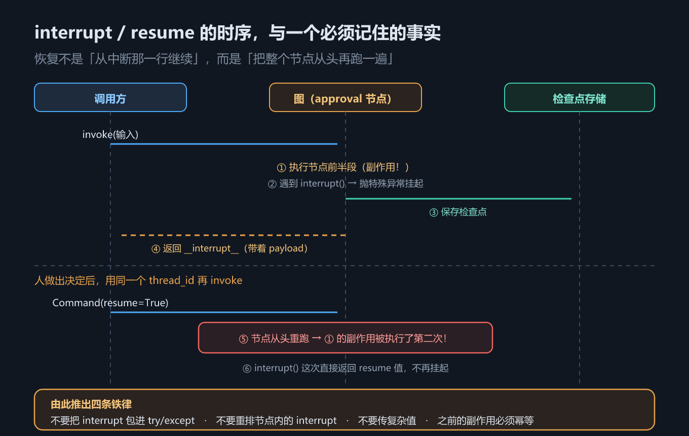
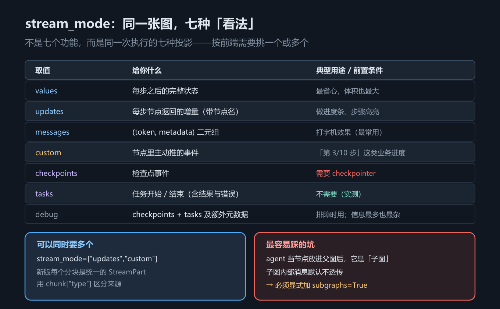
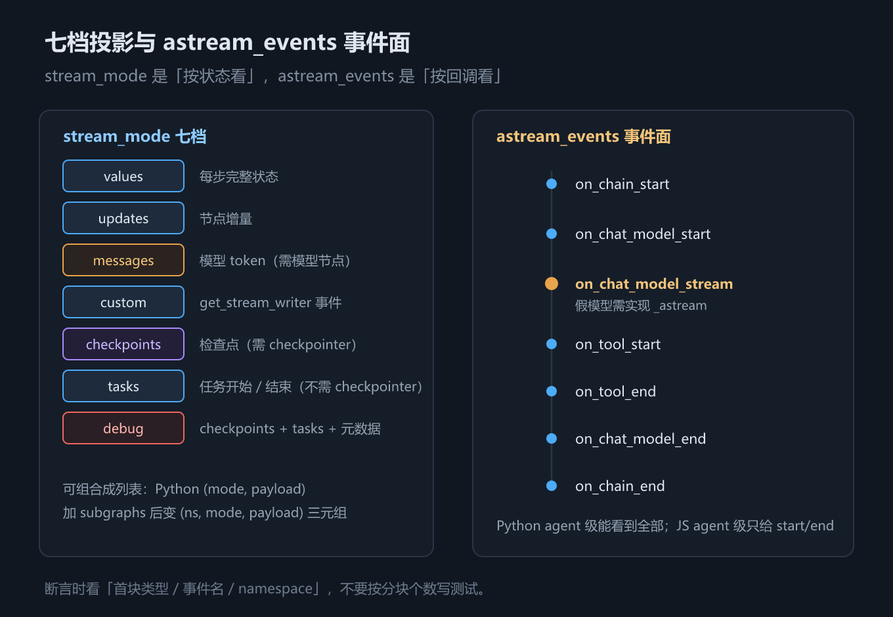

# 第 13 章 人在回路与流式：interrupt / resume / stream_mode

## 一、这一章要解决的问题

上一章解决了「状态存得下来」。这一章解决两个建立在它之上的问题：

1. **agent 要干一件不可逆的事**——扣款、发邮件、删数据。你不能让它自己决定，必须停下来等人点头，等完再接着跑。这叫**人在回路（human-in-the-loop, HITL）**。
2. **前端要看到过程**——不是等 30 秒后一次性蹦出一整段回答，而是逐字往外吐。这叫**流式（streaming）**。

两件事看着不相关，但**暂停与恢复**共用同一个底层事实：它们建立在检查点之上。所以本章的第一条硬性前置条件就是上一章的 checkpointer。（**流式本身不需要 checkpointer**——`stream_mode` 里只有 `checkpoints` 这一档要求 checkpointer；`tasks` 不配也能产出 `task` / `task_result`，3.2 节那个父图流式示例就没配。）

**一句话主线：本章回答「怎么让图停下来等人、怎么把过程投影给前端」——`interrupt` / `resume` 与静态中断是两种暂停方式，`stream_mode` 的七档投影与 `subgraphs=True` 是流式的两个控制面。**

> 版本锚点：本章结论在 `langgraph` **1.2.12**（Python）与 `@langchain/langgraph` **1.4.17**（JS）上实测；示例源码见 `code/python/13_hitl_stream.py` 与 `code/typescript/13_hitl_stream.ts`。

## 二、机制与原理

### 2.1 `interrupt()` 与 `Command(resume=...)`：一次完整的暂停与恢复

让图「停下来等人」，API 只有一对：节点里调 `interrupt()`，外面用 `Command(resume=...)` 把它叫醒。这一节走一遍完整往返，再数清三个前置条件。

导入路径两边不同，先记住：

- Python：`from langgraph.types import Command, interrupt`
- TypeScript：`import { Command, interrupt } from "@langchain/langgraph"`

一次往返分两步：

1. **第一次 `invoke(input, cfg)`**。图正常跑，直到节点里调用 `interrupt(payload)`。此时图不是「返回值」，而是**抛出一个特殊的挂起异常**，LangGraph 捕获它、存下检查点、把控制权交回调用方。返回结果里多出一个 `__interrupt__` 键，里面装着 payload。
2. **第二次 `invoke(Command(resume=值), cfg)`**。用**同一个 `thread_id`** 再调一次，`interrupt()` 这次不再挂起，而是**直接返回 resume 值**，节点继续往下走。



*图 29　interrupt / resume 的时序，以及「恢复时整个节点从头重跑」这个必须记住的事实*

三个前置条件缺一不可，少任何一个都会得到「中断没生效」或「恢复找不到线程」：

| # | 前置条件 | 缺了会怎样 |
|---|---|---|
| 1 | 图必须带 checkpointer | 中断状态无处落盘，图根本停不住 |
| 2 | 调用必须带 `thread_id` | 恢复时定位不到这条线程 |
| 3 | payload 与 resume 值都必须**可序列化** | 写不进检查点，直接报错 |

> `Command(resume=...)` 是**唯一**可以当作 `invoke` / `stream` 输入的 `Command` 形态。像 `Command(goto=...)` 那种跳转形态只能在**节点内部**返回，不能从外面喂进去——这是新手最容易混的一处。

最小例子（三步）：
1. 节点里调用 `value = interrupt({"question": "批准吗？"})`。
2. 第一次 `invoke` 返回 `__interrupt__`，状态停在检查点。
3. 用同一 `thread_id` 调 `invoke(Command(resume="批准"), cfg)`；节点从头重跑，`value` 拿到 resume 值。

### 2.2 最核心的实测结论：恢复时整个节点从头重跑

往返跑通了，但有一个行为细节不知道，后面所有坑都会变成玄学：**恢复执行时，节点内部到底从哪一行继续？** 这是本章唯一必须记死的一条，也是理解后面一切坑的钥匙：

> **恢复不是「从中断那一行继续」，而是把整个节点从头再执行一遍。**

为什么会这样？因为**检查点只落在超步边界**（第 11 章 2.5 节：一轮节点执行完、状态结算后才落盘）——它存得住「这一轮开始前的状态」，存不住**节点内部执行到了哪一行**。`interrupt()` 的工作方式是：恢复时从上一个检查点把节点**重跑一遍**，跑到 `interrupt()` 那一行时发现「这里之前断过、且带了 resume 值」，于是把值交还给你，继续往下走。重跑就是它定位断点的手段——不是缺陷，是检查点粒度决定的必然设计。

可以用「没有即时存档、只有关卡存档」的老游戏打个比方（类比，只帮助理解，机制以上文为准）：你在 Boss 房暂停，回来时是从关卡开头重跑，跑到 Boss 房那一刻，系统认出「这里断过」，把你之前的选择还给你。`interrupt()` 正是这个逻辑——所谓存档粒度，就是检查点的粒度。

本机实测的副作用日志说明了这一点：在 `interrupt()` 之前往列表里 append 一行「节点开始，读到 amount=199」，跑完一轮之后，**这行出现了两次**——第一次是原始执行，第二次是恢复时的重跑。**两语言都复现了「两次」**，这是本章最硬的一条双语言一致结论。

> 但**完整日志的条数不一致**：Python 侧 3 行（第 3 行是「调用扣款接口：199 元」），**JS 侧只有 2 行**——`13_hitl_stream.ts` 的 charge 节点根本没写日志。所以「真副作用要拆成独立节点、且只执行一次」这半条**只有 Python 证据**。

由此推出**四条铁律**——每条都对应上面那条机制的一个直接后果：

| # | 铁律 | 为什么 |
|---|---|---|
| 1 | **不要把 `interrupt()` 包进 `try/except`** | 它靠抛异常来挂起；吞掉异常，暂停就失效了 |
| 2 | **不要重排节点内的 `interrupt()`** | 同一个节点里的多个中断按**调用顺序**依次对应 resume 值，顺序一变就配错 |
| 3 | **不要传复杂值** | payload 要能序列化进检查点，对象、函数、句柄都会失败 |
| 4 | **`interrupt()` 之前的副作用必须幂等** | 那段代码注定被执行两次 |

第 4 条的正确解法不是「让副作用幂等」，而是**把它挪出去**：把真正的副作用（扣款）拆成一个**独立的节点**，放在 `interrupt()` 之后。这样重跑的是审批节点，扣款节点只会执行一次——示例里的 `approval` 与 `charge` 就是这么分的。

### 2.3 静态中断：`interrupt_before` / `interrupt_after`

节点内的 `interrupt()` 要改代码；还有一种不动节点、编译时就能声明的暂停方式——在指定节点的前 / 后停。

除了节点内的 `interrupt()`，编译时还能声明「在某个节点前/后停下来」：

- Python：`graph.compile(checkpointer=..., interrupt_before=["charge"])`
- TypeScript：`graph.compile({ checkpointer, interruptBefore: ["charge"] })`

它的问题是**只会在节点边界停**，停不到节点中间，也拿不到结构化的人工输入（恢复时是再 `invoke(None)` 续跑，人工决定得另外写进状态）。所以它适合**调试时观察中间状态**，**不推荐用来做审批流**——审批流请用节点内的 `interrupt()`。

### 2.4 stream_mode：同一张图，七种投影

暂停与恢复讲完了，转到第二个问题：执行过程怎么送给前端。同一张图、同一次执行，`stream_mode` 决定给你看哪种投影。

这张表回答「我该用哪个 `stream_mode`」。注意它不是七个功能，而是**同一次执行的七种看法**。

| 取值 | 给你什么 | 典型用途 / 前置条件 |
|---|---|---|
| `values` | 每步之后的**完整状态** | 最省心，体积也最大 |
| `updates` | 每步节点返回的**增量**（带节点名） | 做进度条、步骤高亮 |
| `messages` | `(token, metadata)` 二元组 | 打字机效果（最常用） |
| `custom` | 节点里主动推的事件 | 「第 3/10 步」这类业务进度 |
| `checkpoints` | 检查点事件 | 需要 checkpointer |
| `tasks` | 任务开始 / 结束（含结果与错误） | 不需要 checkpointer（实测） |
| `debug` | `checkpoints` + `tasks` 及额外元数据 | 排障；信息最多也最杂 |

> 口径：本章示例现在**七档全跑**（Python 与 JS 各 7 档）。`values/updates/custom/checkpoints/tasks/debug` 用同一张 `talk` 图；`messages` 用带模型节点的 agent。`checkpoints` 需要 checkpointer，`tasks` 不需要（实测）。`debug` 的实际事件序列是 `checkpoint → checkpoint → task → task_result → checkpoint`——里面有 `task_result`，不是「checkpoints + tasks」两个词能概括的。

各档首块长什么样？下表是 **Python 1.2.12 的实测形状**（JS 形状一致，数组/对象类型略有差异）——它回答「拿到一个分块，先看什么」：

| 档位 | 分块数（本例） | 首块类型 | 首块里有什么 |
|---|---|---|---|
| `values` | 2 | `dict` | 第一步之前的完整状态（输入回显） |
| `updates` | 1 | `dict` | `{'step': {'n': 1, 'note': ...}}` |
| `messages` | 1（一次模型调用） | `AIMessage` | 模型这次吐出的消息块（假模型一消息一块） |
| `custom` | 1 | `str` | 节点里 `get_stream_writer()` 推的字符串 |
| `checkpoints` | 3 | `dict` | `config` / `values` / `next` 等检查点字段 |
| `tasks` | 2 | `dict` | `id` / `name` / `input` / `triggers` |
| `debug` | 5 | `dict` | `type` / `timestamp` / `payload` |

> ⚠️ **别把分块数当语义**：它是这张图、这个假模型的产物；真实模型 token 多、节点多，数字都会变。要断言就断言**首块类型、字段、事件名**。



*图 30　stream_mode 各档投影分别给你什么，以及 agent 当子图时最容易踩的坑*

**可以同时要多种**：传一个列表即可（Python `stream_mode=["updates","custom"]`，JS `streamMode: ["updates","custom"]`）。此时每个分块要自己分辨来源——Python 侧是 `(mode, payload)` 二元组，JS 侧是 `[mode, payload]` 数组；加了 `subgraphs=True` 之后，形状变成 `(namespace, mode, payload)` / `[namespace, mode, payload]`（下一节展开）。

> 口径：list-mode 与 subgraphs 形状均为**示例实测**（见 3.3）；`(ns, (mode, payload))` 这种「namespace 包着二元组」的写法**不成立**，实际是三元组/三元素数组。

`custom` 档需要节点里主动推：Python 用 `get_stream_writer()`，JS 用 `getWriter()`。

### 2.5 坑：agent 当子图后，内部消息默认不透传

最后一类坑不在参数，而在结构：把 `create_agent` 的产物直接挂进父图当节点之后，流式行为会悄悄变。

`create_agent` 返回的是**一张已编译的图**。把它直接当节点加进父图，它就变成了**子图**——而子图的内部输出默认不往上传。

三组对比回答同一个问题：同一条子 agent、同一种 `stream_mode="messages"`，分别能看见什么。

| 组 | 怎么流 | 能看见什么 |
|---|---|---|
| A | 直接 `stream` 子 agent | 内部消息**一览无余**（模型调用、工具消息全在） |
| B | 父图 `stream`，**不加** `subgraphs` | 只剩跨边界的少数几条，模型内部的 token 全没了 |
| C | 父图 `stream`，**加** `subgraphs=True` | 只恢复子图的最终模型输出（本例 1 条 `AIMessage`），工具消息仍未透出；分块**带 namespace**，能区分来自哪个子图 |

这就是「图能跑、结果也对，但打字机效果莫名其妙没了」的根因。要透传，就显式加 `subgraphs=True`。

### 2.6 组合与 namespace：list-mode + subgraphs 的分块形状

2.4 的单档流已经够用；这一节回答「同时要多种投影、还要看子图内部」时，分块到底长什么样、解析代码怎么写。

分块形状有四种组合，先看表再写解析：

| 配置 | Python | TypeScript | 解析要点 |
|---|---|---|---|
| 单档 | `payload` | `payload` | 直接读 |
| list-mode | `(mode, payload)` | `[mode, payload]` | 先看 `mode`，再解 payload |
| list + subgraphs | `(namespace, mode, payload)` | `[namespace, mode, payload]` | `namespace` 是元组/数组；空元组表示父图 |
| 事件流 | `{"event", "name", "data", ...}` | 同左 | 按 `event` 名分流，不看条数 |

`namespace` 不是「子图名字符串」，而是一条路径：`("child:<uuid>",)`。取 `ns[0].split(":")[0]` 得到 `child`，就能判断「这块来自哪个子图」。父图自己产生的事件 `namespace` 为空元组/空数组。

最小例子（3 步）：
1. `talk.stream(..., stream_mode=["updates","custom"])` → 每块 `(mode, payload)`。
2. 把 `talk` 当子图挂进父图，再加 `subgraphs=True` → 每块 `(ns, mode, payload)`。
3. 解析时先按 `mode` 分支，再按 `ns` 分流父图/子图。

> 口径：四种形状为**示例实测**；事件流的 `version` 默认值与支持版本见 2.7。

### 2.7 astream_events：事件流与双语言差异

`stream_mode` 是按状态投影；`astream_events` 是按**回调事件**流。它回答的问题是：**除了状态，还能不能看到模型 token、工具开始/结束、链的嵌套关系**。

- Python：`agent.astream_events(input, version="v2")`，事件名如 `on_chat_model_stream` / `on_tool_start` / `on_tool_end` / `on_chain_start`；`version` 支持 `v1/v2/v3`，默认 `v2`（**源码核对**）。
- `on_chat_model_stream` 要求模型真正走流式路径；假模型必须实现 `_astream`（本章已加），否则只有 start/end。
- JS 差异（**示例实测**）：`model.streamEvents` 会出 `on_chat_model_stream`；但 `agent.streamEvents` 在 1.4.17 只出 start/end，逐 token 要用 `agent.stream({streamMode:"messages"})`。
- 事件数量不是语义：同一次模型调用可能重复出现 stream 事件；按事件名与 payload 判断，不按条数断言。



*图 31　七档投影与 astream_events 事件面*

> 口径：Python 事件名与 `on_chat_model_stream` 为**示例实测**；`version` 支持范围为**源码核对**；JS 的 agent 级差异为**示例实测**（`model.streamEvents` 有 stream、`agent.streamEvents` 只有 start/end）。

### 2.8 子图流式的解析契约

2.5 的坑是「看不见」；2.6 的形状是「看见了怎么解」。这一节把两者收成一张契约表，回答「拿到一个分块，按什么顺序判断」。

| 你先看到 | 说明 | 下一步 |
|---|---|---|
| `AIMessage` / `ToolMessage` 等消息对象 | 单档 `messages` 的 `(msg, metadata)` | 读 `metadata["langgraph_node"]` 判断来自哪个节点 |
| `(mode, payload)` 二元组 / `[mode, payload]` 数组 | list-mode | 先按 `mode` 分支，再解 payload |
| `(ns, mode, payload)` 三元组 / 三元素数组 | list + subgraphs | `ns[0]` 是子图路径；空 ns 是父图 |
| `{"event": ...}` 字典 | `astream_events` | 按 `event` 名分流；`data` 里才是 chunk/输入/输出 |

最后一条最重要的判断：**不要按「分块个数」写断言**。假模型一消息一块、真实模型一 token 一块、不同版本还可能重复发事件；个数天生不稳定。要断言就断言「哪些消息可见 + namespace + 事件名」——这也是 2.5 的 A/B/C 对比真正想说明的事。

> 口径：三种流形状与 `astream_events` 事件名为**示例实测**；事件重复为**本机核对**（Python 侧 2 次模型调用共出现 4 条 `on_chat_model_stream`）。

## 三、代码：Python 与 TypeScript

### 3.1 interrupt / resume 的完整往返

下面这段代码把 2.1 的往返与 2.2 的重跑结论跑成一次完整演示——Python 侧的关键是看副作用日志：`interrupt()` 之前那行会被执行两次。

```python
from langgraph.checkpoint.memory import InMemorySaver
from langgraph.graph import END, START, StateGraph
from langgraph.types import Command, interrupt

SIDE_EFFECTS: list[str] = []

def approval(state: Order) -> Command:
    SIDE_EFFECTS.append(f"节点开始，读到 amount={state['amount']}")   # ⚠️ 恢复时会再跑一次
    decision = interrupt({"question": f"确认扣款 {state['amount']} 元？",
                          "amount": state["amount"]})
    return Command(goto="charge") if decision else Command(goto="cancelled")

def charge(state: Order) -> dict:
    SIDE_EFFECTS.append(f"调用扣款接口：{state['amount']} 元")        # 真正的副作用，放在 interrupt 之后
    return {"status": "已扣款"}

hitl = (StateGraph(Order)
        .add_node("approval", approval).add_node("charge", charge)
        .add_node("cancelled", lambda s: {"status": "已取消"})
        .add_edge(START, "approval").add_edge("charge", END).add_edge("cancelled", END)
        .compile(checkpointer=InMemorySaver()))          # 前置条件 ①
cfg = {"configurable": {"thread_id": "order-1"}}         # 前置条件 ②

r1 = hitl.invoke({"amount": 199, "status": "待审批"}, cfg)
print(r1["__interrupt__"][0].value)      # {'question': '确认扣款 199 元？', 'amount': 199}
print(hitl.get_state(cfg).next)          # ('approval',) —— 停在半路

r2 = hitl.invoke(Command(resume=True), cfg)   # 唯一能当输入用的 Command 形态
print(r2["status"])                      # 已扣款
print(SIDE_EFFECTS)                      # 「节点开始」出现了两次 → 整个节点从头重跑
```

TypeScript 侧有一处**必须显式声明**的差异：节点返回 `Command` 时，要在 `addNode` 的第三个参数里声明可能的去向。

```typescript
import { Annotation, Command, END, MemorySaver, START, StateGraph, interrupt } from "@langchain/langgraph";

const SIDE_EFFECTS: string[] = [];
const Order = Annotation.Root({
  amount: Annotation<number>({ default: () => 0 }),
  status: Annotation<string>({ default: () => "" }),
});

const approval = (state: any): Command => {
  SIDE_EFFECTS.push(`节点开始，读到 amount=${state.amount}`);      // ⚠️ 恢复时会再跑一次
  const decision = interrupt({ question: `确认扣款 ${state.amount} 元？`, amount: state.amount });
  return decision ? new Command({ goto: "charge" }) : new Command({ goto: "cancelled" });
};

const hitl = new StateGraph(Order)
  // ⚠️ JS 侧要求：返回 Command 的节点必须声明 ends，否则编译期报 UnreachableNodeError
  //    Python 侧靠类型注解 Command[Literal["charge","cancelled"]] 表达同一件事
  .addNode("approval", approval, { ends: ["charge", "cancelled"] })
  .addNode("charge", () => ({ status: "已扣款" }))
  .addNode("cancelled", () => ({ status: "已取消" }))
  .addEdge(START, "approval").addEdge("charge", END).addEdge("cancelled", END)
  .compile({ checkpointer: new MemorySaver() });
const cfg = { configurable: { thread_id: "order-1" } };

const r1: any = await hitl.invoke({ amount: 199, status: "待审批" }, cfg);
console.log(r1.__interrupt__?.[0]?.value);        // payload
console.log((await hitl.getState(cfg)).next);     // 停在半路

const r2: any = await hitl.invoke(new Command({ resume: true }), cfg);   // 同一 thread_id
console.log(r2.status, SIDE_EFFECTS);             // 日志里「节点开始」出现两次
```

> **JS 侧返回 `Command` 的节点必须用 `ends` 声明去向**，Python 侧靠类型注解表达。忘了写就是编译期报错，不是运行期。

### 3.2 子图流式：A / B / C 三组对比

Python 侧把 agent 直接当节点挂进父图，然后三种流法各跑一次。回答的问题是：同一条子 agent，三种流法分别能看见什么。

```python
sub_agent = create_agent(model=ScriptedChatModel(script=[...]), tools=[lookup])
parent = (StateGraph(dict)
          .add_node("agent", sub_agent)        # 已编译的图可以直接当节点
          .add_edge(START, "agent").add_edge("agent", END).compile())
inp = {"messages": [{"role": "user", "content": "查 x"}]}

a = list(sub_agent.stream(inp, stream_mode="messages"))                   # A 直接 stream 子 agent
b = list(parent.stream(inp, stream_mode="messages"))                      # B 父图，不加 subgraphs
c = list(parent.stream(inp, stream_mode="messages", subgraphs=True))      # C 父图，加 subgraphs

for ns, (msg, meta) in c:                    # C 的分块带 namespace，能区分来自哪个子图
    print(ns[0].split(":")[0] if ns else "()", meta.get("langgraph_node"))
```

TypeScript 侧有两处差异：要取 `agent.graph`（`createAgent` 返回的是包装对象，不是 `Runnable`），并且 `stream` 返回的是异步迭代器。

```typescript
const subAgent = createAgent({ model: new ScriptedChatModel({ script: [...] }) as any, tools: [lookup] });
const parent = new StateGraph(Parent)
  // ⚠️ JS 侧：createAgent 返回 ReactAgent 包装对象，要当节点用必须取 .graph
  .addNode("agent", (subAgent as any).graph)
  .addEdge(START, "agent").addEdge("agent", END).compile();
const inp = { messages: [new HumanMessage("查 x")] };

async function collect(stream: AsyncIterable<any>, tagged: boolean) {
  const lines: string[] = [];
  for await (const chunk of stream) {                     // 异步迭代器
    const [msg, meta] = tagged ? chunk[1] : chunk;        // 带 subgraphs 时多一层 namespace
    const ns = tagged ? String(chunk[0]?.[0] ?? "()").split(":")[0] : "()";
    lines.push(`${ns} node=${meta?.langgraph_node} [${msg.constructor.name}]`);
  }
  return lines;
}
const a = await collect(await subAgent.stream(inp, { streamMode: "messages" }), false);
const b = await collect(await parent.stream(inp, { streamMode: "messages" }), false);
const c = await collect(await parent.stream(inp, { streamMode: "messages", subgraphs: true }), true);
```

> ⚠️ **别把 A/B/C 的「分块个数」当结论**：示例用的是脚本化假模型，它一次吐一条完整消息，不是逐 token 吐，所以个数不可比（Python 侧实测 B 是 2 条，JS 侧是 1 条，会随版本变）。真正要看的是**哪几条消息能看见**：A 能看到模型调用与工具消息；B 只剩跨边界的少数几条；C 只恢复子图的最终模型输出，工具消息仍未透出，但分块会带 namespace 标出来源。
> 完整可跑版本：`code/python/13_hitl_stream.py`、`code/typescript/13_hitl_stream.ts`。

### 3.3 七档、list-mode 与事件流

这一段把 2.4–2.7 的四种形状跑成一次演示：先单档、再 list-mode、再加 subgraphs、最后事件流。

```python
for mode in ("values", "updates", "custom", "checkpoints", "tasks", "debug"):
    chunks = list(talk.stream({"n": 0, "note": ""},
                              {"configurable": {"thread_id": f"shape-{mode}"}},
                              stream_mode=mode))
    print(mode, len(chunks), type(chunks[0]).__name__)

message_chunks = list(message_agent.stream(
    {"messages": [{"role": "user", "content": "查 x"}]}, stream_mode="messages"))
print("messages", len(message_chunks), type(message_chunks[0][0]).__name__)

combined = list(talk.stream({"n": 0, "note": ""},
                            {"configurable": {"thread_id": "list-1"}},
                            stream_mode=["updates", "custom"]))
print(combined)          # [('custom', '进度：正在处理第 1 步'), ('updates', {'step': {...}})]

for namespace, mode, payload in talk_parent.stream(
        {"n": 0, "note": ""},
        {"configurable": {"thread_id": "sub-list-1"}},
        stream_mode=["updates", "custom"], subgraphs=True):
    print(namespace[0].split(":")[0] if namespace else "()", mode, payload)
```

```python
async for event in event_agent.astream_events(
        {"messages": [{"role": "user", "content": "查 x"}]}, version="v2"):
    if event["event"] in {"on_chat_model_stream", "on_tool_start", "on_tool_end"}:
        print(event["event"], str(event["data"].get("chunk", ""))[:20])
```

TypeScript 侧一一对应，注意 `talkParent.stream(..., { subgraphs: true })` 的每块是**三元素数组**：

```typescript
for (const mode of ["values", "updates", "custom", "checkpoints", "tasks", "debug"] as const) {
  const chunks: any[] = [];
  for await (const c of await talk.stream(
    { n: 0, note: "" },
    { configurable: { thread_id: `shape-${mode}` }, streamMode: mode },
  )) chunks.push(c);
  console.log(mode, chunks.length, Array.isArray(chunks[0]) ? "array" : typeof chunks[0]);
}

for await (const chunk of await talkParent.stream(
  { n: 0, note: "" },
  { configurable: { thread_id: "sub-list-1" }, streamMode: ["updates", "custom"], subgraphs: true },
)) {
  const [ns, mode, payload] = chunk;      // 三元素：namespace / mode / payload
  console.log(String(ns?.[0] ?? "()").split(":")[0], mode, payload);
}

for await (const ev of eventModel.streamEvents([new HumanMessage("hi")], { version: "v2" })) {
  if (ev.event.includes("chat_model")) console.log(ev.event);   // model 级才有 stream 事件
}
```

实测形状（Python 1.2.12 / JS 1.4.17 一致，仅容器类型不同）：

```text
values 2 / updates 1 / messages 1 / custom 1 / checkpoints 3 / tasks 2 / debug 5
list-mode       → [('custom', '进度：正在处理第 1 步'), ('updates', {'step': {...}})]
list+subgraphs  → (('child:<uuid>',), 'custom', '进度：正在处理第 1 步')
                  ((), 'updates', {'child': {'n': 1, 'note': '第 1 步完成'}})
astream_events  → on_chat_model_stream ×4 / on_tool_start ×1 / on_tool_end ×1
```

## 四、常见坑与边界条件

十二条坑可以分两组读：前六条围绕中断与恢复（第 1 条是总根源），后六条围绕流式（子图透传、分块形状、档位前置条件、事件流与 JS 类型定义）。

1. **恢复时节点从头重跑**——所有坑的总根源。凡 `interrupt()` 之前的代码，都要假设它会跑两次。
2. **别用 `try/except` 包 `interrupt()`**。它靠抛异常挂起，吞掉异常等于取消暂停；确实要 catch，必须把异常原样重抛。
3. **同一个节点里多个 `interrupt()` 靠调用顺序对应 resume 值**，重排顺序会串位。
4. **payload 和 resume 值都要可序列化**，别塞对象、函数、数据库连接。
5. **恢复必须用同一个 `thread_id`**，并且要带上 checkpointer；换线程就是换了一张白纸，`interrupt()` 会当成第一次执行。
6. **`Command(resume=...)` 是唯一能当输入用的 `Command` 形态**；`Command(goto=...)` 只能在节点里返回。
7. **`subgraphs=True` 忘了加**，表现是「后端日志正常、前端打字机不动」。判断方法：看流出来的分块里有没有 `langgraph_node` 是子图内部节点。
8. **`stream_mode` 传列表后分块形状变了**。Python 变成 `(mode, payload)`、JS 变成 `[mode, payload]`，再加 `subgraphs=True` 则前面多一层 namespace——升级或改配置后要同步改解析代码。
9. **JS 类型定义里 `StreamMode` 还多一个 `"tools"`**（**源码核对**——读 `@langchain/langgraph` 1.4.17 的 `dist/pregel/types.d.ts`；示例未使用、本章不展开），Python 侧 `types.py` 的七值里没有 `tools`。**这是读类型定义读出来的，不是跑出来的。**
10. **`messages` 档需要图里真有模型节点**：拿一张纯函数图去跑 `stream_mode="messages"`，什么也拿不到。另外假模型要实现 `_astream`（或 JS 的 `_streamResponseChunks`），否则只会出 `on_chat_model_start/end`，没有 `on_chat_model_stream`。
11. **`list + subgraphs` 的形状是三元组/三元素数组**，不是「namespace 包着 `(mode, payload)`」的二元组。Python 解包写 `for ns, mode, payload in chunks`；JS 写 `const [ns, mode, payload] = chunk`。
12. **JS 的 `agent.streamEvents` 在 1.4.17 只有 start/end**：要逐 token 用 `agent.stream({streamMode:"messages"})`；要看模型级事件，直接 `model.streamEvents(...)`。这是本机实测差异，不是写法问题。

## 五、关键结论

1. **HITL 建立在检查点之上**：三个前置条件是 checkpointer、`thread_id`、可序列化 payload。**流式不在此列**——它不需要 checkpointer；`stream_mode` 里只有 `checkpoints` 要求 checkpointer，`tasks` 不要求（实测）。
2. **`interrupt()` 靠抛异常挂起**，因此不能被 `try/except` 吞掉；`Command(resume=...)` 是唯一能当 `invoke` 输入的 `Command` 形态。
3. **恢复时整个节点从头重跑**（副作用日志实测出现两次）——由此推出四条铁律：不包 `try/except`、不重排、不传复杂值、之前的副作用必须幂等。**真正的副作用要拆成独立节点**放在 `interrupt()` 之后，而不是想办法让副作用幂等。
4. **静态中断只适合调试**：它只能在节点边界停，且恢复时拿不到结构化的人工输入。
5. **流式有三个控制面**：`stream_mode` 七档（本章**七档全跑**）、list-mode / `subgraphs` 的分块形状（二元组 → 三元组）、`astream_events` 的事件流。子图要透出内部消息必须 `subgraphs=True`；JS 的 `agent.streamEvents` 在 1.4.17 只给 start/end，逐 token 用 `agent.stream({streamMode:"messages"})`。

> 口径：中断恢复重跑、七档 `stream_mode`、list/subgraphs 形状、Python `astream_events` 为**示例实测**（`13_hitl_stream.*`）；静态中断与 JS `tools` 档未实跑/未使用；`tasks` 不要求 checkpointer 为实测结论；JS agent 级 `streamEvents` 差异为示例实测。

## 本章要点回顾

读完自检，下面是可勾选的清单：

- **导入路径**：Python `from langgraph.types import Command, interrupt`；JS `import { Command, interrupt } from "@langchain/langgraph"`。
- **HITL 三个前置条件**：checkpointer、`thread_id`、可序列化 payload（**流式不需要 checkpointer**）。
- **一次往返**：第一次 `invoke` 返回 `__interrupt__`，第二次用 `Command(resume=值)` + 同一 `thread_id` 恢复。
- **核心事实**：恢复 = **整个节点从头重跑**（实测副作用日志出现两次）。
- **四条铁律**：不包 `try/except`、不重排 `interrupt()`、不传复杂值、之前的副作用必须幂等。
- **正确姿势**：把真副作用（扣款）拆成独立节点，放在 `interrupt()` 之后。
- **静态中断**（`interrupt_before` / `interrupt_after`，JS 是 `interruptBefore` / `interruptAfter`）只用于调试，不推荐做审批流。
- **`stream_mode` 七档**（Python）：`values` / `updates` / `messages` / `custom` / `checkpoints` / `tasks` / `debug`，可组合成列表；JS 类型定义里多一个 `"tools"`（源码核对）。
- **子图坑**：agent 当节点后内部消息默认不透传，必须显式 `subgraphs=True`（Python 可直接 `add_node`，JS 要取 `.graph`）。**JS 特有**：返回 `Command` 的节点必须声明 `ends`，否则编译期报 `UnreachableNodeError`。
- **七档全跑**：`values` / `updates` / `messages` / `custom` / `checkpoints` / `tasks` / `debug`；`messages` 要模型节点、`checkpoints` 要 checkpointer、`tasks` 不要。
- **list-mode 形状**：Python `(mode, payload)`、JS `[mode, payload]`；加 `subgraphs=True` 后是 `(ns, mode, payload)` / `[ns, mode, payload]` **三元组**，不是嵌套二元组。
- **`astream_events`**：Python agent 级能看到 `on_chat_model_stream`；JS agent 级只给 start/end，逐 token 用 `stream({streamMode:"messages"})`，模型级 `streamEvents` 才有 stream 事件。
