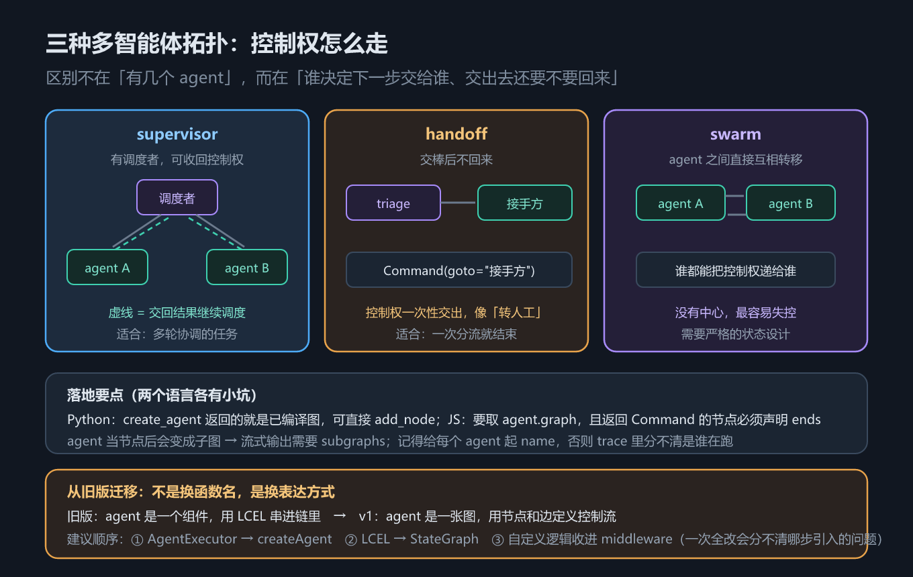

# 第 18 章 多智能体协作：三种拓扑与搭法

## 一、这一章要解决的问题

前面 17 章讲的都是「一个 agent 怎么搭」。真实系统里常常不止一个：查库的、发邮件的、管账单的，各管一摊。这一章只回答一个问题：**多个 agent 怎么组织**——谁调度谁？交出去的控制权还要不要收回来？三种拓扑各有适用场景，也各有失控风险。

> 老代码怎么迁过来、上线前要确认什么，是第 19 章的话题。

> 版本锚点：本章结论在 `langchain` **1.4.2** / `langgraph` **1.2.12**（Python）与 `langchain` **1.5.11** / `@langchain/langgraph` **1.4.17**（JS）上实测；示例源码见 `code/python/18_multiagent.py` 与 `code/typescript/18_multiagent.ts`。

## 二、机制与原理

### 2.1 三种拓扑

先给结论：**拓扑不是「哪个更高级」，而是「控制权怎么流动」**。这张表回答「我该选哪种」。

| 拓扑 | 控制权怎么流 | 适合 | 风险 |
|---|---|---|---|
| **supervisor** | 有一个中心**调度者**，反复决定下一步交给谁，**交出去还能收回来** | 需要多轮协调的任务 | 调度者成为瓶颈 / 单点；调度逻辑写不好会来回踢皮球 |
| **handoff** | 交棒后**不回来**，接手的 agent 负责到底 | 一次分流就结束的场景（像「转人工」） | 交错了没人兜底；链路一长就难追 |
| **swarm** | **没有中心**，agent 之间互相转移，谁接手谁往下传 | 任务边界模糊、需要互相接力的场景 | 最容易失控：可能循环转圈、可能没人收尾 |



*图 32　多智能体拓扑：supervisor 有调度者、handoff 交棒不回头、swarm 互相转移*

三者的关系可以这样理解：**handoff 是 supervisor 去掉「收回来」这一步，swarm 是 handoff 去掉「中心」。** 去掉的东西越多，越省事，也越难管。

> 本章示例实现了 supervisor 与 handoff 两种（`code/python/18_multiagent.py`）；**swarm 没有实现**——它需要更严格的状态设计才能避免转圈，本章只讲机制与风险，不贴不可信的代码。

### 2.2 把 agent 当节点：supervisor 的搭法

`create_agent` / `createAgent` 返回的就是**一张已编译的图**。在 LangGraph 里，**已编译的图可以直接当节点**塞进父图——于是「一个 agent」和「一个普通节点」在图里没有区别。

supervisor 拓扑于是就是：父图里放一个 `supervisor` 节点做路由，再放若干 agent 节点做具体工作，用条件边把调度结果连过去。实测两个结论：

- **agent 当节点后就变成了子图**。子图的内部输出默认不透传——要流式看到里面的 token，父图 `stream` 时必须加 `subgraphs=True`（第 13 章那条坑，在多智能体里会原样重演）。
- **一定要给每个 agent 起 `name=`**。否则 trace 里所有 agent 都叫同一个默认名，你分不清是哪一路在跑——这正是第 10 章 trace 的用途。

两边的写法有一处硬差异：**Python 侧可以直接 `add_node("db", db_agent)`；JS 侧 `createAgent` 返回的是包装对象，必须取 `.graph`**（实测）。

### 2.3 handoff：用 `Command` 交棒

handoff 不需要调度者节点反复介入，交棒动作发生在**节点内部**：节点返回 `Command(goto=...)`，控制权直接跳到目标节点，且**不会再回来**。

- Python：`from langgraph.types import Command`，节点返回 `Command(goto=target, update={...})`。
- TypeScript：`import { Command } from "@langchain/langgraph"`，返回 `new Command({ goto: target, update: {...} })`。

这里有一条 JS 侧特有的硬约束：**返回 `Command` 的节点必须在 `addNode` 的第三个参数里用 `ends` 声明可能的去向**，否则**编译期**就报 `UnreachableNodeError`。Python 侧靠类型注解 `Command[Literal[...]]` 表达同一件事（实测）。

还有一个容易混的点：**`Command(goto=...)` 只能在节点内部返回，不能当 `invoke` 的输入**；能当输入用的只有 `Command(resume=...)`（第 13 章）。handoff 属于前者。

## 三、代码：Python 与 TypeScript

### 3.1 supervisor：把 agent 当节点

Python 侧直接把两个编译好的 agent 当节点加进父图，用条件边做路由。注意 **db / mail 完成后的边不是指向 END，而是指回 `supervisor`**——「交出去还能收回来」正是 supervisor 区别于 handoff 的定义性特征（见 2.1 节三种拓扑）。

```python
from langchain.agents import create_agent
from langgraph.graph import END, START, StateGraph, add_messages

db_agent = create_agent(model=ScriptedChatModel(script=[...]), tools=[query_db], name="db_agent")
mail_agent = create_agent(model=ScriptedChatModel(script=[reply("邮件已发。")]),
                          tools=[send_email], name="mail_agent")

class TopState(TypedDict):
    messages: Annotated[list, add_messages]
    route: str

def supervisor(state: TopState) -> dict:
    """极简路由：真实项目里这里通常是一次模型调用。"""
    last = str(state["messages"][-1].content)
    if "查到" in last or "已发" in last:      # 子代理干完活的标志 → 收回控制权并结束
        return {"route": "end"}
    return {"route": "mail" if "邮件" in last else "db"}

top = (
    StateGraph(TopState)
    .add_node("supervisor", supervisor)
    .add_node("db", db_agent)      # ← 已编译的 agent 直接当节点
    .add_node("mail", mail_agent)
    .add_edge(START, "supervisor")
    .add_conditional_edges("supervisor", lambda s: s["route"],
                           {"db": "db", "mail": "mail", "end": END})
    .add_edge("db", "supervisor")  # ← 回边：干完活把控制权交还 supervisor
    .add_edge("mail", "supervisor")
    .compile()
)
out = top.invoke({"messages": [{"role": "user", "content": "帮我查一下数据库"}]})
print(out["route"], out["messages"][-1].content)     # end 查到 3 行。
```

实测输出（supervisor 被调用两次，中间夹着 db 的一整轮 agent loop）：

```text
输入 '帮我查一下数据库' → route=end  最终回复='查到 3 行。'
  supervisor 决策序列 = ['db', 'end']   ← 派出去 → 收回来 → 结束
```

TypeScript 侧唯一的结构差异：**`createAgent` 返回的是包装对象，要当节点必须取 `.graph`**。

```typescript
import { createAgent, HumanMessage } from "langchain";
import { Annotation, END, START, StateGraph } from "@langchain/langgraph";

const dbAgent = createAgent({ model: model1 as any, tools: [queryDb], name: "db_agent" });
const mailAgent = createAgent({ model: model2 as any, tools: [sendEmail], name: "mail_agent" });

const TopState = Annotation.Root({
  messages: Annotation<any[]>({ reducer: (a, b) => a.concat(b), default: () => [] }),
  route: Annotation<string>({ default: () => "" }),
});

const top = new StateGraph(TopState)
  .addNode("supervisor", (s: any) => ({
    route: String(s.messages[s.messages.length - 1].content).includes("查到")
        || String(s.messages[s.messages.length - 1].content).includes("已发")
      ? "end"
      : String(s.messages[s.messages.length - 1].content).includes("邮件") ? "mail" : "db",
  }))
  // ⚠️ JS 侧要把 agent 的 .graph 拿出来当节点（Python 侧可直接传 agent）
  .addNode("db", (dbAgent as any).graph)
  .addNode("mail", (mailAgent as any).graph)
  .addEdge(START, "supervisor")
  .addConditionalEdges("supervisor", (s: any) => s.route, { db: "db", mail: "mail", end: END })
  .addEdge("db", "supervisor")   // ← 回边：干完活把控制权交还 supervisor
  .addEdge("mail", "supervisor")
  .compile();
const out: any = await top.invoke({ messages: [new HumanMessage("帮我查一下数据库")] });
console.log(out.route, out.messages.at(-1).content);
```

### 3.2 handoff：用 `Command` 交棒

Python 侧接待员节点返回 `Command(goto=...)`，直接跳到目标，不再回来。

```python
from langgraph.types import Command

class HandState(TypedDict):
    messages: Annotated[list, add_messages]
    owner: str

def triage(state: HandState) -> Command:
    """接待员：判断该谁处理，然后交棒。"""
    text = str(state["messages"][-1].content)
    target = "billing" if "账单" in text else "tech"
    return Command(goto=target, update={"owner": target})     # 交棒后不回来

hand = (
    StateGraph(HandState)
    .add_node("triage", triage)
    .add_node("billing", lambda s: {"messages": [{"role": "assistant", "content": "[账单组] 已处理"}]})
    .add_node("tech",    lambda s: {"messages": [{"role": "assistant", "content": "[技术组] 已处理"}]})
    .add_edge(START, "triage").add_edge("billing", END).add_edge("tech", END)
    .compile()
)
print(hand.invoke({"messages": [{"role": "user", "content": "我要问账单"}]})["owner"])   # billing
```

TypeScript 侧必须**在 `addNode` 里声明 `ends`**，否则编译期报错。

```typescript
const triage = (s: any): Command => {
  const target = String(s.messages.at(-1).content).includes("账单") ? "billing" : "tech";
  return new Command({ goto: target, update: { owner: target } });
};

const hand = new StateGraph(HandState)
  // ⚠️ 返回 Command 的节点必须声明 ends，否则编译期报 UnreachableNodeError
  //    Python 侧靠类型注解 Command[Literal["billing","tech"]] 表达同一件事
  .addNode("triage", triage, { ends: ["billing", "tech"] })
  .addNode("billing", () => ({ messages: [{ role: "assistant", content: "[账单组] 已处理" }] }))
  .addNode("tech", () => ({ messages: [{ role: "assistant", content: "[技术组] 已处理" }] }))
  .addEdge(START, "triage").addEdge("billing", END).addEdge("tech", END)
  .compile();
const out: any = await hand.invoke({ messages: [{ role: "user", content: "我要问账单" }] });
console.log(out.owner);        // billing
```

## 四、常见坑与边界条件

1. **agent 当节点后就是子图**，流式要加 `subgraphs=True`，否则「图能跑、结果也对，但打字机不动」（第 13 章的坑在这里重演）。
2. **忘了给 agent 起 `name=`**，trace 里分不清谁在跑——多智能体下这个问题比单 agent 严重得多。
3. **JS 侧 agent 不能直接当节点**，必须取 `.graph`；Python 侧可以直接传。
4. **JS 侧返回 `Command` 的节点必须声明 `ends`**，否则是**编译期**报 `UnreachableNodeError`，不是运行期。
5. **`Command(goto=...)` 不能当 `invoke` 输入**，只有 `Command(resume=...)` 可以——handoff 属于节点内部行为。
6. **swarm 最容易失控**：没有中心就没人保证收尾。要用就先把「终止条件」和「最大转移次数」设计死。

## 五、关键结论

1. **三种拓扑的差别是「控制权怎么流」**：supervisor 有调度者、交完能收回；handoff 交棒不回头；swarm 没有中心、互相转移。
2. **`create_agent` 返回的就是已编译的图，可以直接当节点**——agent 与普通节点在图里没有区别。副作用是它变成子图，流式需 `subgraphs=True`。
3. **务必给每个 agent 起 `name=`**，否则 trace 分不清是谁在跑（第 10 章）。

## 本章要点回顾

- **三种拓扑**：supervisor（有调度者、交完能收回）/ handoff（交棒不回头，像转人工）/ swarm（无中心、最易失控）。
- **agent 当节点**：`create_agent` 返回已编译的图，可直接 `add_node`；JS 侧要取 `.graph`。
- **两个副作用**：变成子图（流式需 `subgraphs=True`）、trace 里需要 `name=` 才分得清。
- **`Command(goto=...)` 是节点内部行为**，不能当 `invoke` 输入；JS 侧必须声明 `ends`。
- 老代码迁移与生产部署见第 19 章。
