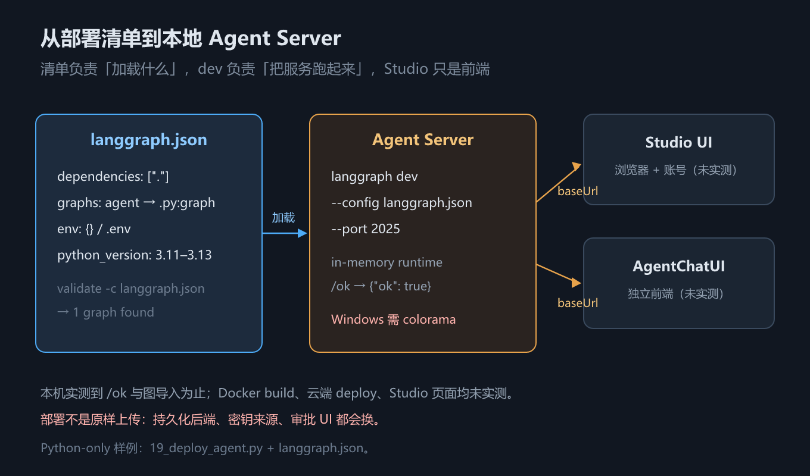

# 第 19 章 迁移与部署：一张映射表与上线前检查

## 一、这一章要解决的问题

前面 18 章讲的都是「怎么把一个 agent 搭出来、组织好」。这一章是全书收尾，处理两个工程问题——它们有同一个现场特征：**代码在本地跑得好好的，一换环境就散架**：

1. **老代码怎么迁过来**——很多团队手上是 LCEL / `AgentExecutor` 写的 agent。v1 不是换个函数名，而是换了一套控制流的表达方式。症状很具体：按老样子传 `input` 不再被认、返回值里找不到 `output` 字段、原来挂在 hook 里的逻辑没处安放、state 必须改成 `TypedDict`、按节点名过滤流式事件的代码抓不到 `agent` 了——这五处都是破坏性变更，2.2 节会逐条列清。
2. **上线前要确认什么**——本地跑通不等于能上生产：进程一重启所有会话丢失、agent 陷入循环时账单和延迟同时失控、扣款 / 发邮件 / 删文件这类不可逆操作没有审批就执行。有三件事必须在上线前定死。

> **给从没用过 v0.x 的读者**：LCEL 是旧版用 `|` 管道把组件串成一条链的编排方式；`AgentExecutor` 是旧版创建 agent 的类；`ConversationBufferMemory` 是旧版管理对话历史的记忆组件。v1 用 `create_agent` + 图 + middleware 替换了它们——这一章讲的迁移，就是把这三样旧东西换成新表达。

**一句话主线：本章回答老代码怎么迁（一张 11 行映射表 + 三步顺序）、上线前定什么（两种部署形态 + 三件必查事）、托管形态在本地怎么起（`langgraph.json` + `langgraph dev`）；作为全书最后一章，末尾用一节把 19 章的主线串成一条线。**

> 版本锚点：本章结论在 `langchain` **1.4.2** / `langgraph` **1.2.12**（Python）与 `langchain` **1.5.11** / `@langchain/langgraph` **1.4.17**（JS）上实测；迁移映射表的打印见 `code/python/18_multiagent.py` 与 `code/typescript/18_multiagent.ts`（与第 18 章共用）；部署样例为 `code/python/19_deploy_agent.py` + `code/python/langgraph.json`（**Python-only**，原因见 3 节）。

## 二、机制与原理

### 2.1 从 LCEL / AgentExecutor 迁移到 v1：一张映射表

迁移最容易死在「边改边发现」——改到一半才发现输出字段没了、hook 没处挂了。所以第一步不是动手改代码，而是先把全貌摊开：哪些行只是改名，哪些行是机制替换。很多团队手上是旧版代码。下面这张表回答「我以前那样写，现在该怎么写」。旧版指 LCEL 编排 + `AgentExecutor`（Python）/ 旧版 JS 写法。

| 能力 | 旧版写法 | v1（Python） | v1（TypeScript） |
|---|---|---|---|
| 建 agent | `AgentExecutor(agent=..., tools=...)` | `create_agent(model, tools)` | `createAgent({ model, tools })` |
| 调用 | `executor.invoke({"input": "..."})` | `agent.invoke({"messages": [...]})` | `agent.invoke({ messages })` |
| 输入形态 | 字符串 `input` | 消息列表 `messages` | 消息列表 `messages` |
| 输出形态 | `{"output": "..."}` | `{"messages": [...]}`，取 `messages[-1]` | 同左，取 `messages.at(-1)` |
| 提示词 | prompt 模板字符串 | `system_prompt=` + middleware | `prompt` / `systemPrompt` + middleware |
| 记忆 | `memory=ConversationBufferMemory()` | checkpointer + `thread_id` | checkpointer + `thread_id` |
| 工具错误 | `handle_tool_error` / `ToolException` | `@wrap_tool_call` 或 `ToolErrorMiddleware` | `wrapToolCall` 或 `toolErrorMiddleware` |
| 运行时注入 | `InjectedState` / `InjectedStore` | `runtime: ToolRuntime` | `runtime` 参数 |
| 链式拼装 | LCEL 的 `|` 管道 | `StateGraph` 的 `add_node` / `add_edge` | `StateGraph` 的 `addNode` / `addEdge` |
| 扩展点 | 自定义 Agent / 继承 | middleware 的六个钩子 | middleware 的六个钩子 |
| 流式节点名 | 编译图里 agent 节点叫 `agent`（旧 `create_react_agent` 路径） | 改叫 `model`（按节点名过滤流式事件时受影响） | 改叫 `model_request`（节点名两语言本就不同：Python 侧叫 `model`、JS 侧叫 `model_request`，中间件节点名也各有一套大小写，完整对照见 [`code/README.md`](code/README.md) 的双语言差异清单） |

这张表里有两行是**机制替换**，不是「换了个名字」：**工具错误**（v1 的 agent 路线**不再推荐** `ToolException` / `handle_tool_error`——注意这两个 API **仍在包里**，只是入口换成了中间件，实测结论）与**运行时注入**（`InjectedState` / `InjectedStore` 统一收口到 `runtime: ToolRuntime`，实测结论）。这两处照抄旧代码在 v1 上都不成立，得改写法。

> ⚠️ **「旧版写法」一列未在本机重跑**：本机只装了 v1（`langchain` 1.4.2 / `langgraph` 1.2.12），旧版 LCEL / `AgentExecutor` 环境没有安装，这一列来自官方迁移文档与示例中的对照表，**不是实测结论**；v1 侧那一列是实测的。

最小例子（迁移三步）：
1. 建 agent：`AgentExecutor(agent=..., tools=...)` → `create_agent(model=..., tools=...)`。
2. 输入：`{"input": "..."}` → `{"messages": [{"role": "user", "content": "..."}]}`。
3. 输出：`{"output": "..."}` → `result["messages"][-1].content`。

### 2.2 迁移的心智转变与三步顺序

表看完了，照着逐行改还是会踩坑——因为真正变的不是 API 名字。**比记 API 更重要的是心智模型换了**：

- **旧版：agent 是一个「组件」**。你有一个 executor，用 LCEL 的 `|` 把它串进一条链里，链的形状是**线性的**。
- **v1：agent 是一张「图」**。你用节点和边定义控制流，用 middleware 扩展行为，图可以**有分支、有循环、有并行**。

所以「迁移」不是换函数名，而是**把控制流从「链式表达」改成「图表达」**。这也是为什么迁移完代码结构往往要变——旧版表达不了的东西（条件分支、循环、人工审批），新版才表达得了。

心智变了，顺序也就有了——**三步建议顺序**（一次全改，出了问题分不清是哪一步引入的）：

1. **先换 `AgentExecutor` → `create_agent`**。这一步**只动构造与调用形态，不动流程结构**——但**不是「行为等价」**：对照 2.1 的映射表，输入从 `input` 变成 `messages`、输出不再有 `output` 字段、流式节点名从 `agent` 变成 `model`（Python）/ `model_request`（JS）。把它当成一次**接口迁移**来做，改完先确认功能没变，再往下走。
2. **再改 LCEL → `StateGraph`**。这一步才真正动结构，是风险最大的一步；只有你要自定义状态字段时，才需要把 state 写成 `TypedDict`/`StateSchema`，默认 `AgentState` 不需要。
3. **最后把 hook 与自定义逻辑收进 middleware**。前两步稳定之后，再把横切逻辑（日志、限流、错误处理）从业务代码里抽出来。

### 2.3 两种部署形态

代码迁完了，下一个问题是「跑在哪儿」——agent 最终要跑到某个地方。两种形态的差别不只是部署位置，更是「哪些事平台替你管、哪些事你自己扛」。这张表回答「托管还是自托管」。

| 维度 | 托管（Agent Server） | 自托管 |
|---|---|---|
| 持久化 | 服务端自动提供（checkpointer / store 不用自己配） | 自己接 Postgres 等 |
| 可观测 | 自带 trace、评测、人工审批 UI | 自己接观测后端 |
| 自由度 | 受平台约束 | 最高 |
| 代价 | 绑定平台，本地与线上差异要自己盯 | 持久化必须**一开始就做对** |

打个比方（类比）：**托管像精装房交付**——水电物业都接好了，拎包入住，但户型不能砸；**自托管像毛坯房**——想怎么改怎么改，可水电出了问题没人兜底，而且水管走向（存储结构）一旦埋错，搬家时搬不走。

自托管里最要命的是最后那句。**中途从 `InMemorySaver`（JS `MemorySaver`）换成 `PostgresSaver`，历史数据是搬不过去的**——两种 saver 的存储结构不同，已经产生的会话找不回来。这不是「换个类」就完事，而是**上线前就要定死**的事。

### 2.4 上线前必查三件事

部署形态定了，还有三件事不管选哪种形态都必须在事前确认——它们的共同点是「事后补救成本远高于事前确认」。这张表回答「上线前还有哪些坑没堵」。

| # | 检查项 | 不做的后果 |
|---|---|---|
| 1 | **检查点有没有持久化** | 进程一重启，所有会话丢失；多副本部署时同一用户请求落到不同副本，上下文对不上 |
| 2 | **有没有调用次数上限** | agent 可能陷入循环，模型调用和工具调用都要设上限，否则账单和延迟同时失控 |
| 3 | **高风险操作有没有人在回路** | 扣款、发邮件、删文件这类不可逆操作，必须有 `interrupt()` 审批（第 13 章） |

### 2.5 `langgraph.json`：部署清单的核心字段

2.3 说了「托管形态」，但托管的第一步不是点按钮，而是交一份**部署清单**。`langgraph.json` 就是这份清单，它回答的问题是：**从哪加载图、装什么依赖、注入什么环境变量、用哪个 Python 版本**。

| 字段 | 作用 | 本机示例 / 注意 |
|---|---|---|
| `dependencies` | 依赖来源：`"."` 表示本地包/requirements，也可写包名或相对路径 | 本机用 `["."]`，会读取同目录 `requirements.txt` |
| `graphs` | 图 ID → 模块路径与变量名 | `{"agent": "./19_deploy_agent.py:graph"}` |
| `env` | 环境变量文件或键值映射 | 示例用 `{}`；生产用 `.env` 或平台密钥管理 |
| `python_version` | 构建镜像用的 Python 版本 | CLI 只接受 `3.11` / `3.12` / `3.13`；**本机 3.14.2 只用于本地 dev，不代表镜像版本** |
| `dockerfile_lines` | 追加到 Dockerfile 的构建行 | 安装系统依赖时用；本机未实测 |
| `http` / `auth` | HTTP 服务与鉴权配置 | 托管平台使用；本机未实测 |

最小例子（本机真实文件）：

```json
{
  "dependencies": ["."],
  "graphs": { "agent": "./19_deploy_agent.py:graph" }
}
```

> 口径：`dependencies` / `graphs` / `env` 与 `validate` 通过为**示例实测**；`python_version` 的合法值来自 `langgraph validate --help`（**本机核对**）；`http` / `auth` / `dockerfile_lines` **未实测**。

### 2.6 本地起服务：`langgraph dev`、Studio 与 AgentChatUI

清单有了，下一步是在本地把 Agent Server 跑起来。它回答的问题是：**不买托管、不写 FastAPI，怎么先得到一个能调用的 agent 服务**。

```bash
pip install -U "langgraph-cli[inmem]==0.4.37"
langgraph validate -c langgraph.json
langgraph dev --config langgraph.json --no-browser --no-reload --port 2025
```

三个命令的分工：
- `validate -c`：只校验清单。注意：**`validate` 用 `-c`，`dev` 用 `--config`**，两者不通用（本机实测踩过）。
- `dev`：起一个**内存版** API server（`langgraph-runtime-inmem`），带热重载；`/ok` 返回 200 就绪。
- `build` / `up` / `deploy`：构建镜像 / 起容器 / 推到托管平台；本机未实测 Docker 与云端。

Studio 与 AgentChatUI 是前端：`dev` 启动日志会给出 `https://smith.langchain.com/studio/?baseUrl=http://127.0.0.1:2025` 这类地址。本机**只验证了服务端 `/ok` 与图导入，没有打开 Studio 页面**（需浏览器与账号，标注未实测）；AgentChatUI 同理。



*图 38　`langgraph.json` → Agent Server → Studio / AgentChatUI 部署链路*

> 口径：`validate`、`dev`、`/ok`、图导入为**示例实测**（Windows + Python 3.14.2 + `langgraph-cli` 0.4.37）；Studio / AgentChatUI 页面、Docker、云端部署**未实测**。Windows 上还需 `pip install colorama`，否则 `structlog` 的彩色 ConsoleRenderer 会让 `dev` 在日志配置阶段直接崩（本机实测）。

### 2.7 部署配置与运行时治理的对接

服务能起来之后，最后一步是把前面章节的治理件映射到部署清单。它回答的问题是：**本地验证过的 checkpointer、限额、人审，上线时分别落到哪个配置项**。

| 本地能力 | 本地写法 | 上线时的落点 |
|---|---|---|
| 持久化 | `compile(checkpointer=InMemorySaver())` | 托管：平台自动接 Postgres；自托管：`langgraph-checkpoint-postgres` + 连接串 |
| durability | `invoke(..., durability="sync")` | 写进运行配置 / 平台默认；不要依赖默认 `async` 做关键流程 |
| 调用限额 | `ModelCallLimitMiddleware` | 仍在 agent 代码里；平台侧再配预算告警 |
| 人审 | `HumanInTheLoopMiddleware` / `interrupt()` | 平台审批 UI 是前端；后端仍是检查点 + resume |
| 密钥 | `.env` / 环境变量 | 平台 Secret；**不要**写进 `langgraph.json` 的 `env` 明文 |
| 观测 | 回调 / LangSmith 环境变量 | 平台 trace；自托管接 OTel / LangSmith |

一句话：**部署不是「把本地代码原样上传」**——持久化后端、密钥来源、审批 UI 都会换；换的是接线，不是 agent 逻辑。

> 口径：映射关系为架构判断；持久化 / 限额 / 人审的本地行为见第 6、12、13 章；平台侧配置**未实测**。

## 三、代码：Python 与 TypeScript

迁移映射仍复用第 18 章的示例（`code/python/18_multiagent.py` / `code/typescript/18_multiagent.ts`）；部署新增一个 **Python-only** 样例：

- `code/python/19_deploy_agent.py`：一张两节点的最小图，导出 `graph` 变量。
- `code/python/langgraph.json`：部署清单，`graphs.agent` 指向上面的 `graph`。

```json
{
  "dependencies": ["."],
  "graphs": { "agent": "./19_deploy_agent.py:graph" }
}
```

```python
from typing import TypedDict
from langgraph.graph import END, START, StateGraph

class DeployState(TypedDict):
    question: str
    answer: str

def answer(state: DeployState) -> dict:
    return {"answer": f"echo: {state['question']}"}

graph = (StateGraph(DeployState).add_node("answer", answer)
         .add_edge(START, "answer").add_edge("answer", END).compile())
```

```bash
cd code/python
langgraph validate -c langgraph.json
# Configuration file ... is valid. (1 graph found)

langgraph dev --config langgraph.json --no-browser --no-reload --port 2025
# API: http://127.0.0.1:2025
curl http://127.0.0.1:2025/ok
# {"ok":true,"services":{}}
```

> **为什么是 Python-only**：`langgraph-cli` 与 Agent Server 的本地 dev 运行入口由 Python 侧分发；TS 侧本教程没有等价的 `langgraph dev` 运行样例。这是双语言对照表里的一处显式例外，不是「TS 不支持部署」。

## 四、常见坑与边界条件

以下七条分别对应前面的机制、顺序与部署：前三条是迁移与持久化，后四条是 `langgraph.json` / `dev` 的实测坑。

1. **`ToolException` / `handle_tool_error` / `InjectedState` / `InjectedStore` 在 v1 都不是推荐写法**（实测结论）——前两者的 API 仍在包里、只是 agent 路线换了入口；后两者被 `runtime: ToolRuntime` 取代。迁移时这两处是机制替换，不是改名。
2. **别一次全改**。三步顺序（executor → 图 → 中间件）是为了让每一步都可单独验证；跳过第一步直接改结构，出问题会同时面对两套变量的干扰。
3. **`InMemorySaver` → `PostgresSaver` 搬不了历史数据**，持久化方案必须在上线前定死。
4. **`validate` 用 `-c`，`dev` 用 `--config`**：两个子命令的选项名不通用，照抄会得到 `Error: No such option: -c`（本机实测）。
5. **Windows 上先装 `colorama`**：`langgraph dev` 的 `structlog` 彩色 ConsoleRenderer 在 Windows 上缺它会在日志配置阶段直接抛 `SystemError`，表现为「服务还没起就退出」（本机实测）。
6. **`python_version` 只能是 3.11 / 3.12 / 3.13**：本机 3.14.2 只用于本地 `dev`；本地能跑不代表镜像能构建。`dev` 用当前解释器，`build` 用清单里的版本。
7. **`dependencies: ["."]` 会读取同目录的 `requirements.txt`**：清单路径与 `graphs` 的模块路径都相对于 `langgraph.json` 所在目录；把 `env` 写成明文密钥会进镜像/仓库，生产用平台 Secret 或 `.env`。

> 另：Studio 页面与 AgentChatUI 本机未打开（需浏览器与账号），只验证了服务端 `/ok` 与图导入——不要把它们当成已实测。

## 五、关键结论

1. **迁移的 11 行映射表**里，有两处是机制替换而非改名：工具错误（走中间件）与运行时注入（统一 `ToolRuntime`）。
2. **迁移的心智转变**：旧版 agent 是一个组件、用 LCEL 串进链；v1 agent 是一张图、用节点和边定义控制流。
3. **三步顺序**：先 `AgentExecutor` → `create_agent`（**接口迁移，非行为等价**），再 LCEL → `StateGraph`（动结构），最后收进 middleware。
4. **部署两形态 + 本地起服务**：托管省持久化与 UI，代价是绑定平台；自托管自由但持久化必须一开始就做对。本地可用 `langgraph.json` + `langgraph dev` 先起一个内存版 Agent Server（`/ok` 实测），Studio / AgentChatUI / Docker / 云端未实测。
5. **上线前必查三件事**：检查点持久化、调用次数上限、高风险操作的人在回路；再补一条——**部署不是原样上传**，持久化后端、密钥来源、审批 UI 都会换。

> 口径：迁移映射与三步顺序来自官方 v1 迁移文档 + 本教程实测（v1 侧）；旧版写法未在本机重跑；`langgraph.json` / `validate` / `dev` / `/ok` 为**示例实测**（Python-only）；Studio / AgentChatUI / Docker / 云端**未实测**；部署形态与检查项为工程建议。

## 本章要点回顾

- **迁移 11 行映射**：建 agent / 调用 / 输入 / 输出 / 提示词 / 记忆 / 工具错误 / 运行时注入 / 链式拼装 / 扩展点 / **流式节点名**。
- **两处机制替换**：工具错误走中间件；运行时注入统一 `ToolRuntime`。
- **心智转变**：组件 + LCEL → 图 + 节点 / 边 + middleware。
- **三步顺序**：`AgentExecutor` → `create_agent`；LCEL → `StateGraph`；逻辑收进 middleware。
- **部署**：托管（自动持久化 + UI，绑定平台）vs 自托管（自由，但 `InMemorySaver` → `PostgresSaver` 搬不了历史数据）。
- **上线三查**：检查点持久化 / 调用次数上限 / 高风险操作的人在回路。
- **部署清单**：`langgraph.json` 的 `dependencies` / `graphs` / `env` / `python_version`；`graphs` 指向 `模块:变量`。
- **本地起服务**：`langgraph validate -c langgraph.json` → `langgraph dev --config langgraph.json` → `/ok` 200；`validate` 与 `dev` 的选项名不通用。
- **Python-only 例外**：部署样例是 `19_deploy_agent.py` + `langgraph.json`；TS 侧无等价的本地 `langgraph dev` 运行样例。Windows 另需 `colorama`。
- **部署不是原样上传**：持久化后端、密钥来源、审批 UI 都会换；`langgraph.json` 的 `env` 别写明文密钥。

## 全书回顾

到这里 19 章走完，主线其实只有一条：**把「模型 + 循环」做成一个可控、可观测、能上生产的系统**。按章顺序串起来是：

- **第 1 章**先立坐标：**基础层**（模型、消息、提示词、结构化输出）是三件套的共同地基；其上 LangChain 是构建块、LangGraph 是运行时、Deep Agents 是成品 harness——分层决定了后面每一章在讲哪一层。
- **第 2–4 章**是地基：模型怎么造（第 2 章）、话怎么说（第 3 章）、结果怎么收（第 4 章）——它们不碰循环，但决定了循环里每句话的形态。
- **第 5–9 章**在 LangChain 层：先用 `create_agent` 拿到 **agent loop**（第 5 章），再用 **middleware** 把循环各阶段打开成插槽（第 6 章），接着把**工具与上下文注入**接上（第 7 章），用 **RAG 全链路**把外部知识接进来（第 8 章），最后系统化地做**上下文工程**（第 9 章）。
- **第 10 章**是可观测：trace / 数据集 / 成本——它只依赖第 5 章，却是排查后面一切「模型不听话」的眼镜。
- **第 11–13 章**下沉到 LangGraph：**图与状态**定义控制流（第 11 章），**持久化**让状态存得下来、能续跑（第 12 章），**人在回路与流式**建立在检查点之上（第 13 章）。
- **第 14–17 章**升到 Deep Agents：**全景**看预装了哪些能力（第 14 章），再逐块展开**虚拟文件系统与执行环境**（第 15 章）、**规划与委派**（第 16 章）、**技能与记忆**（第 17 章）。
- **第 18–19 章**是工程收尾：**多智能体**回答「多个怎么组织」（第 18 章），**迁移与部署**回答「老的怎么过来、上线的边界在哪」（第 19 章）。

一句话概括：**第 5–9 章教你把一个 agent 搭出来，第 10 章让你看得见它，第 11–13 章教你把它的状态与中断管住，第 14–17 章给你一套开箱的成品，第 18–19 章把它送进生产。**

- **全书主线**：搭出来（5–9）→ 看得见（10）→ 管住状态（11–13）→ 开箱成品（14–17）→ 送进生产（18–19）。
