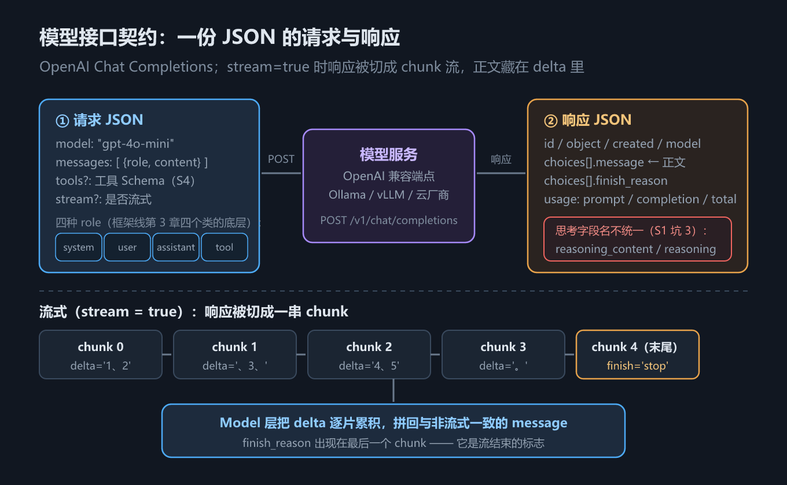

# S1 模型接口契约：一切从一份 JSON 开始

> 手写线第 1 章｜配套代码：`code/s01_model_contract.py`｜配图：`assets/h01_chat_contract.png`

## 一、这一章要解决的问题

在框架线里，你在 LangChain 中写下 `llm.invoke("你好")`（框架线第 2 章），一行代码，回答就回来了。很方便，但也很难受：**这行代码底下，网络上实际跑的是什么？**

答案是：一份 JSON。准确地说，是 **OpenAI Chat Completions** 这个 HTTP 接口约定——请求长什么样、响应长什么样、出错时返回什么，全部写在一份公开的接口契约里。LangChain 的 `invoke`、`stream`，本质上都是在帮你拼这份 JSON、收这份 JSON。

本教程的手写线（S1–S10）**全部建立在这份契约上**。框架线用类和中间件把契约包起来，手写线反其道而行：把契约摊开在你面前，一行行自己拼。理由有两个：

1. **契约是稳定的**。它从 2023 年公布至今基本没变，所有主流厂商都兼容它。学会一次，处处能用。
2. **契约是透明的**。框架出问题时（比如响应里多了一个奇怪的字段），只有看得懂契约的人才排查得动。

读完本章，你应该能回答四个问题：请求 JSON 里有什么？响应 JSON 里有什么？流式响应和普通响应差在哪？以及——为什么本章的示例脚本**不联网也能跑**？

## 二、机制与原理

### 2.1 请求侧：三件套加一个开关

一次 Chat Completions 调用，请求体长这样：

```json
{
  "model": "qwen3-vl",
  "messages": [
    {"role": "system", "content": "你是终端里的编码助手"},
    {"role": "user", "content": "帮我看看这个报错"}
  ],
  "tools": [],
  "stream": false
}
```

核心字段只有三个加一个开关：

| 字段 | 必填 | 作用 |
| --- | --- | --- |
| `model` | 是 | 模型名，服务端靠它路由 |
| `messages` | 是 | **`{role, content}` 字典的数组**，对话的全部上下文 |
| `tools` | 否 | 工具 Schema 列表（S4 展开） |
| `stream` | 否 | 是否流式，默认 `false`（2.3 节） |

`messages` 里每条消息必须带 **`role`**，契约定义了四种：

| role | 谁在说话 | 典型内容 |
| --- | --- | --- |
| `system` | 应用/开发者 | 行为规则、环境信息（S2 整章都在讲它） |
| `user` | 用户 | 提问、指令 |
| `assistant` | 模型 | 上一轮的回复；请求调工具时还带 `tool_calls` |
| `tool` | 工具执行方 | 工具结果，回灌给模型（S4） |

眼熟吗？框架线第 3 章的 `SystemMessage` / `HumanMessage` / `AIMessage` / `ToolMessage` 四个类，一一对应这四种 role。区别在于：框架线用**类**包装，手写线**刻意只用 dict**——没有任何中间层，你在 IDE 里打印一下，看到的就是网络上跑的东西。这不是偷懒，是教学设计：先见到裸契约，再回头看框架的抽象，才知道框架到底替你做了什么。

### 2.2 响应侧：choices、usage 和 finish_reason

响应也是一份 JSON，顶层结构和每个字段的作用如下（`usage` 数值随提问而变）：

| 字段 | 作用 |
| --- | --- |
| `id` | 本次调用的唯一 id，排障时用它对日志 |
| `object` / `model` / `created` | 类型标识、模型名、时间戳 |
| `choices` | 候选回复数组；默认只有一条，取 `choices[0]` |
| `choices[].message` | **正文所在**：`{role, content, …}` |
| `choices[].finish_reason` | 停止原因：`stop` 或 `tool_calls`（2.4 节） |
| `usage` | token 消耗：`prompt_tokens` / `completion_tokens` / `total_tokens` |

下面是一个**真实响应的结构摘录**，来自《Agents底层逻辑》课程课件——Ollama 本地跑 `qwen3-vl` 的返回（取值有删节，字段结构原样）：

```json
{
  "id": "chatcmpl-…",
  "object": "chat.completion",
  "model": "qwen3-vl",
  "choices": [
    {
      "index": 0,
      "finish_reason": "stop",
      "message": {
        "role": "assistant",
        "reasoning": "…思考过程…",
        "content": "…最终回答…"
      }
    }
  ],
  "usage": { "…": "…" }
}
```

注意 `message` 里多出来的 **`reasoning`** 字段——思考型模型（reasoning model）会把它推理时的"草稿"也返回给你。坑在这儿：**不同厂商对思考字段的命名不统一**：

| 厂商 | 思考字段名 |
| --- | --- |
| DeepSeek 系 | `reasoning_content` |
| qwen3 系部分端点（如课件中的 Ollama qwen3-vl） | `reasoning` |

手写线的 `agent/model.py` 在 `_normalize_message` 里两者都兼容，摘录如下：

```python
# agent/model.py
def _normalize_message(msg) -> dict:
    """把 SDK 的 message 对象归一化成纯 dict。

    兼容两种思考字段命名：reasoning_content（DeepSeek 等）与 reasoning（部分厂商）。
    """
    reasoning = getattr(msg, "reasoning_content", None) or getattr(msg, "reasoning", None)
    message: dict = {"role": "assistant", "content": getattr(msg, "content", None)}
    if reasoning:
        message["reasoning_content"] = reasoning
    …  # tool_calls 的处理见 S4
    return message
```

统一归一成 `reasoning_content` 之后，上层代码不用再关心厂商差异——这是"在边界处消化不一致"的典型做法。

归一化的效果与响应的原始形状，看 s01 的实测输出（`s01_model_contract.py` 第 1、2 节）：

```text
== 1. 非流式：归一化后的 message（可直接进入会话历史）==
{
  "role": "assistant",
  "content": "我是手写教程里的假模型，替你演示模型接口契约。",
  "reasoning_content": "用户在问我是谁，直接自我介绍即可。"
}

== 2. 响应的原始形状（顶层结构即契约）==
顶层字段     : ['choices', 'created', 'id', 'model', 'object', 'usage']
choices[0]   : ['finish_reason', 'index', 'message']
message 字段 : ['content', 'reasoning_content', 'role', 'tool_calls']
usage        : {'prompt_tokens': 10, 'completion_tokens': 20, 'total_tokens': 30}
finish_reason: stop
```

两个细节值得咀嚼：其一，message 字段里出现了 `tool_calls`——FakeClient 的 message 总是带这个属性（没有工具调用时为 `None`），`_normalize_message` 靠 `getattr` 判空，真 SDK 行为相同；其二，usage 数值是 FakeClient 的固定演示值（10/20/30），真实服务返回的数值随请求长度变化，但**字段名与嵌套位置是契约的一部分，不会变**。

### 2.3 流式：同一个契约的另一种响应形态

`stream: true` 时，响应不再是单个 JSON，而是被切成一串 **chunk**，逐个推给你。两个关键变化：

1. 正文不再在 `choices[].message`，而是藏在每个 chunk 的 **`choices[].delta`** 里，一片一片到；
2. `finish_reason` 不再每条都有，**只在最后一个 chunk 出现**，标志流结束。

s01 脚本手动迭代了一次 chunk 流，实测输出（`s01_model_contract.py`）：

```text
== 3. 流式：逐 chunk 的 delta（手动迭代原始 chunk）==
chunk 0: delta.content='1、2' finish=None
chunk 1: delta.content='、3、' finish=None
chunk 2: delta.content='4、5' finish=None
chunk 3: delta.content='。' finish=None
chunk 4: delta.content=None finish='stop'
```

正文 `'1、2'`、`'、3、'`……一片片到达，最后一个 chunk 的 `delta.content` 是 `None`，只带来 `finish='stop'`。这和你平时在聊天界面看到的"打字机效果"是同一件事：前端逐片渲染 `delta`。

那谁来把这些碎片拼回完整消息？手写线的答案是 `agent/model.py` 里的 **`_StreamAssembler`**：三条通道（思考、正文、工具调用）各自累积，流结束后拼出一个**与非流式完全同形**的 message dict。看实测（`s01_model_contract.py` 第 4 节）：

```text
== 4. 拼装后的 message（与非流式形状完全一致）==
{
  "role": "assistant",
  "content": "（假模型：没有匹配到脚本）"
}
```

形状确实一致（`role` + `content`），但内容是假模型的默认文案——原因是剧本规则默认 `once=True`，"从 1 数到 5" 这条响应在第 3 节手动迭代 chunk 时已经被消费掉了，第 4 节再调一次自然落到默认回复。**形状一致性**才是这节要验证的东西：上层代码拿到的 message 不需要区分它来自流式还是非流式。

### 2.4 client 可注入：离线也能跑的原理

手写线的 `Model` 有一个看似不起眼、实则贯穿全教程的设计：

```python
# agent/model.py
class Model(EventEmitter):
    """模型调用器。session 提供 messages（必需）与 tools（可选）。"""

    def __init__(self, client: Any | None = None) -> None:
        super().__init__()
        self.client = client if client is not None else make_default_client()

    def invoke(self, session, stream: bool = False) -> InvokeResult:
        kwargs: dict[str, Any] = {
            "model": settings.model,
            "messages": list(session.messages),
        }
        if session.tools:
            kwargs["tools"] = session.tools
        if stream:
            return self._invoke_stream(session, **kwargs)
        return self._invoke(session, **kwargs)
```

`client` 是注入的。不注入时按环境变量创建真的 OpenAI SDK client；注入时给什么都行——**只要形状和 SDK 一样**。`_fake_llm.py` 里的 FakeClient 就是这么造的：

| 真实 OpenAI SDK | FakeClient | 形状 |
| --- | --- | --- |
| `client.chat.completions.create(...)` | 同名方法 | 一致 |
| 返回带 `.choices[0].message` 属性的对象 | 返回带同名属性的 `SimpleNamespace` | 一致 |
| `stream=True` 时返回可迭代的 chunk | 同样返回 chunk 迭代器 | 一致 |

这就是 **duck-typing**：走起来像鸭子、叫起来像鸭子，那就是鸭子。`Model` 只依赖形状，不依赖类型——所以 s01 不联网、不装 SDK 也能跑，而且**恰好证明了契约的稳定性**：只要响应形状符合契约，真模型和假模型对上层完全不可区分。

FakeClient 的核心是**剧本（script）**——一张「看到什么说什么」的应答规则表，每条规则三个键：

| 键 | 作用 |
|---|---|
| `match` | 命中条件。字符串 = 与**最后一条 user 消息**做子串匹配；函数 = 接收全部消息自己判断（s03 会话章会用到） |
| `resp` | 命中后返回的剧本：`content`（正文）/ `reasoning`（思考）/ `tool_calls`（请求工具），按需给 |
| `once` | 默认 `True`：匹配后**消费一次**，再问同样的内容就轮到下一条规则，或回落默认回复 |

所有规则都没命中时返回 `default_content`（默认文案「（假模型：没有匹配到脚本）」）。第三节示例代码的第一行就是 `client = FakeClient([...])`——整条手写线的离线可跑性都建立在这张表上。它还会用 `calls` 字段记下每次请求，供你检视「模型实际收到了什么」。

再看一眼请求侧实际发出了什么（`s01_model_contract.py` 第 5 节，FakeClient 会记录每次收到的请求）：

```text
== 5. 请求侧：发给模型服务的 JSON（第 1 次调用）==
{
  "model": "gpt-4o-mini",
  "messages": [
    {
      "role": "user",
      "content": "你是谁"
    }
  ]
}
```

`model` 是 `gpt-4o-mini`，因为它来自 `agent/config.py` 里 `OPENAI_MODEL` 环境变量的默认值（本机未设置该变量）——真实使用时它就是你在服务方申请的模型名。

### 2.5 会用一份契约 = 会用几乎所有模型服务

OpenAI 公布这份契约后，生态里几乎所有人都选择了兼容它：Ollama 在 `http://localhost:11434/v1` 暴露同样端点，vLLM 自托管服务同样如此，各家云厂商则直接提供 OpenAI 兼容模式。切换服务商只需要改两个环境变量（见 `agent/config.py`）：`OPENAI_BASE_URL` 指向新地址、`OPENAI_MODEL` 换个模型名，代码一行不动。

所以"手写一遍 SDK 调用"的性价比极高：你写的不是"调用某个厂商的代码"，而是"调用几乎所有模型服务的代码"。



*图 h1　Chat Completions 契约：请求、响应与流式 chunk 流*

## 三、代码：Python

完整示例见 `code/s01_model_contract.py`。先注册假模型剧本，再依次演示非流式、流式、请求检视：

```python
# s01_model_contract.py（节选）
client = FakeClient([
    {
        "match": "你是谁",
        "resp": {
            "reasoning": "用户在问我是谁，直接自我介绍即可。",
            "content": "我是手写教程里的假模型，替你演示模型接口契约。",
        },
    },
    {
        "match": "从 1 数到 5",
        "resp": {"content": "1、2、3、4、5。"},
    },
])
model = Model(client=client)          # 注入假 client；不传则走真实 SDK

session = Session()
session.add_message({"role": "user", "content": "你是谁"})
resp = model.invoke(session)          # 非流式
print(json.dumps(resp.message, ensure_ascii=False, indent=2))
```

`invoke` 内部对非流式与流式分两条路径，但终点相同——一个归一化的 message dict：

```python
# agent/model.py（节选）
def _invoke(self, session, **kwargs) -> InvokeResult:
    resp = self.client.chat.completions.create(**kwargs)
    message = _normalize_message(resp.choices[0].message)
    session.add_message(message)      # 响应自动进会话历史（S3 详谈）
    return InvokeResult(message=message, raw=_to_plain(resp))

def _invoke_stream(self, session, **kwargs) -> InvokeResult:
    kwargs["stream"] = True
    chunks = self.client.chat.completions.create(**kwargs)
    message = _StreamAssembler(self).consume(chunks)
    session.add_message(message)
    return InvokeResult(message=message, raw=None)
```

两个值得注意的细节：

1. `raw=_to_plain(resp)`：`_to_plain` 把 SDK 返回的对象递归转成纯 dict（优先走 pydantic 的 `model_dump`），否则你连 `json.dumps` 都做不了——原因见第四节的坑 4。
2. 流式路径里 `raw=None`：chunk 流被消费后就不存在"原始响应"这个整体了，这是流式与非流式的本质差异。

## 四、常见坑与边界条件

**坑 1：`finish_reason` 的两种值语义不同。** `stop` 表示模型直接给出了最终回答；`tool_calls` 表示模型想调工具，此时 `message.content` 往往是 `None`、`tool_calls` 字段才有内容。判断"这轮结束没有"不能看 content 是否为空，要看 `finish_reason`——手写线只处理 `stop` 和 `tool_calls` 两种值，遇到 `length`（达到 max_tokens 被截断）等其他值时应显式报错而不是静默继续。

**坑 2：多候选被静默丢弃。** 请求参数 `n > 1` 时响应会有多条 choices，但绝大多数应用（包括手写线）只取 `choices[0]`，其余候选直接消失。这不是 bug 而是取舍，但你要知道自己丢了什么。

**坑 3：思考型模型默认"边想边说"。** qwen3 系等思考模型默认开启思考模式，响应里会多出思考字段（字段名见 2.2 节表格）；某些场景（追求低延迟）需要通过 `extra_body` 传厂商私有关闭思考的参数——具体字段名随厂商而异，参见《Agents底层逻辑》课件中 qwen3-vl 的示例。反过来，思考字段也是宝贵的：S3 会讲为什么必须把它留在上下文里。

**坑 4：SDK 返回的不是 dict，是对象。** OpenAI SDK 用 pydantic 模型包装响应，`resp["choices"]` 会直接报 `TypeError`，`json.dumps(resp)` 也不行。要么按属性访问（`resp.choices[0].message`），要么先归一化——`agent/model.py` 的 `_to_plain` 用 `model_dump()` 递归转换， FakeClient 用 `SimpleNamespace` 模拟同样的属性访问形状。**在边界处归一化**，内层代码就只面对 dict。

顺带一个前瞻：流式下的 `tool_calls` 更阴险——`arguments` 是跨 chunk 的分片，必须按 `index` 累积拼接，流结束后才是完整 JSON。细节在 S6（ReAct 循环的流式分片一节）展开。

## 五、关键结论

1. **框架的 `invoke` 底层就是一份 JSON 契约**：请求 `{model, messages, tools?, stream?}`，响应 `{id, choices[].message, usage, finish_reason}`。
2. **messages 是 `{role, content}` dict 数组**，四种 role：`system` / `user` / `assistant` / `tool`。框架线第 3 章的四个 Message 类只是这四种 role 的类包装。
3. **思考字段名不统一**（`reasoning_content` vs `reasoning`），归一化要放在模型层边界（`_normalize_message`）。
4. **流式只是把响应切碎**：正文在 `delta` 里、`finish_reason` 在最后一个 chunk；Model 层负责把 chunk 拼回与非流式同形的 message。
5. **client 可注入 + duck-typing = 契约稳定性的直接红利**：假模型与真 SDK 对上层不可区分，全教程得以离线运行。
6. **一份契约兼容整个生态**：改 `OPENAI_BASE_URL` 和 `OPENAI_MODEL` 就能切换 Ollama / vLLM / 云厂商。

## 本章要点回顾

- 请求侧三件套：`model` 必填、`messages` 是对话的全部上下文、`tools` 留给 S4；`stream` 是响应形态的开关。
- 响应侧取 `choices[0]`：正文在 `.message.content`，停止原因在 `.finish_reason`，消耗在 `.usage`。
- 四种 role 与框架线第 3 章四个 Message 类一一对应；手写线只用 dict，契约透明。
- 思考字段两套名字，`_normalize_message` 统一收编成 `reasoning_content`。
- 流式 chunk 的正文在 `delta`、终点在最后一个 chunk 的 `finish_reason`；拼装后与非流式同形。
- 下一步：messages[0] 位置上的 system 消息值得单独一章——S2 讲怎么写好它。
