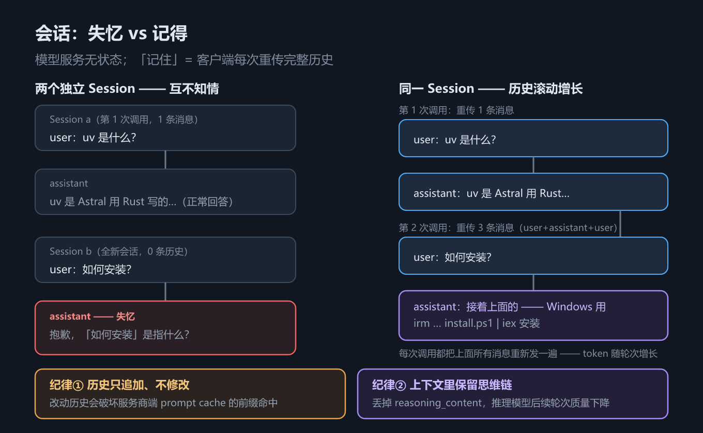

# S3 会话：无状态模型上的记忆工程

> 手写线第 3 章｜配套代码：`code/s03_session.py`｜配图：`assets/h03_session_compare.png`

## 一、这一章要解决的问题

先做一个思想实验：你问模型"uv 是什么？"，它答了；紧接着你问"如何安装？"——模型回你一句"抱歉，你说的『如何安装』是指什么？"。

模型不是装的，它是真的**不记得**。HTTP 请求一发一收即告结束，服务端不为任何"对话"保留状态——你上一轮发过什么、它上一轮答过什么，模型服务一概不知。所谓"对话"，只是客户端把历史消息**每次都重新塞进 `messages` 数组**发过去，模型每次都是"第一次读到全文"。

这一点框架线第 3 章 2.4 节讲过原理（LangChain 的 memory / checkpointer 替你做了重传），但手写线的原则是自己实现一遍。理由与前两章一致：只有亲手维护过"每轮重传"这件事，你才能真正理解 token 账单的构成、prompt cache 为什么值钱、上下文窗口为什么会溢出——这些在框架里都被 `MemorySaver` 之类的名字遮住了。

顺带校准一个预期：这一章的代码量是三章里最小的（Session 类不过几十行），但它是唯一一处"写错了会直接烧钱"的地方——历史管理的每一条纪律都对应真金白银，值得慢读。

它也是手写线真正的分水岭：S1 的契约是"每次调用"的规则，本章的会话是"跨调用"的规则——从这里开始，我们写的东西才有了**时间维度**。

本章解决四件事：

1. 用对照实验亲眼看到"失忆"与"续答"的差别；
2. 理解**每次调用重传完整历史**——这就是 token 费用随轮次增长的原因；
3. 写一个最小的 `Session` 类：消息历史 + JSON 持久化 + 行车记录仪；
4. 记住两条会话纪律——它们直接决定你的账单和推理模型的质量。

## 二、机制与原理

### 2.1 对照实验：失忆 vs 续答

s03 用同一个假模型剧本跑了两组实验。剧本的匹配逻辑很妙：`match` 是函数，检查的是**全部消息历史**——历史里出现过"uv"的讨论就续答"如何安装"，历史里只有孤立的"如何安装"就承认失忆。假模型变成了一台"上下文检测仪"，让失忆与续答成为可观测的事实。

顺带说为什么用假模型做这个实验：真模型的回答措辞随机，你没法稳定断言"它失忆了"；剧本把"模型行为"固化成确定性规则，断言才能写。这也是测试 Agent 的通用手法——**想测什么属性，就把它做进假模型的剧本里**。

s03 主脚本的前两节走事件监听器输出（本例未挂监听器，所以不打印回答），为便于对照，用与 s03 完全相同的剧本写了个探针直接打印每轮回答，实测输出：

（探针只做打印：剧本、调用顺序、`stream` 参数与 s03 逐行一致，仅把每次 `invoke` 的返回值 `message["content"]` 打了出来。）

```text
== 探针 A：两个独立 Session ==
会话 a 回答: uv 是 Astral 用 Rust 写的 Python 包管理器，极快。
会话 b 回答: 抱歉，你说的「如何安装」是指什么？我们之前没有聊过别的话题。

== 探针 B：同一 Session 追问 ==
第 1 问回答: uv 是 Astral 用 Rust 写的 Python 包管理器，极快。
第 2 问回答: 接着上面的：Windows 用 powershell -c "irm https://astral.sh/uv/install.ps1 | iex" 安装。
```

两组实验，唯一的变量是**第二次提问时 messages 里有没有历史**：

| 实验 | Session a/b | Session s | 第 2 问时模型看到的 | 结果 |
| --- | --- | --- | --- | --- |
| A | 两个独立 Session | — | 只有 1 条孤立的 user 消息 | 失忆 |
| B | — | 同一个 Session | user + assistant + user，共 3 条 | 续答 |

「失忆」不是模型能力问题，是上下文缺失问题。**记住对话 = 维护 messages 数组**，如此而已。

换个角度确认：真实 API 上这个实验同样成立，只是"失忆回答"由模型生成、措辞各异。凡是**指代上文**的追问（"它怎么装？""刚才那个再详细点"）都会暴露——这类词本身就是"历史缺失"的信号。

### 2.2 每次调用重传完整历史

把每次请求实际发出的 messages 长度打出来（`s03_session.py` 第 5 节，FakeClient 记录了每次请求）：

```text
== 5. 每次请求的 messages 长度（历史是客户端自己重传的）==
第 1 次调用：1 条消息 ['user']
第 2 次调用：3 条消息 ['user', 'assistant', 'user']
```

（`client.calls` 是 FakeClient 专门提供的检视装置；真实场景没有这个属性，要看服务端日志或计费面板。）

第 1 次只发 1 条，第 2 次发了 3 条——把上一轮的 user 和 assistant 消息也原样重传了。往后每一轮都如此增长（示意，非实测）：

| 轮次 | 该次请求的 messages | 新增的内容 |
| --- | --- | --- |
| 第 1 轮 | 1 条 user | 本轮提问 |
| 第 2 轮 | 3 条 user+assistant+user | 上一轮问答 + 本轮提问 |
| 第 3 轮 | 5 条 user+assistant+user+assistant+user | 又一对问答 + 本轮提问 |

这就是你的 **token 账单随轮次线性增长**的原因：每轮的输入 token ≈ 之前所有轮次的总量 + 本轮新增。对话内容越多、工具输出越长（S4 之后每个工具结果都是一大段），增速越猛。

粗算一下量级：假设一轮问答新增 500 token，到第 10 轮时，单次请求的输入已包含前 9 轮约 4500 token——同样的内容，你为它付了 10 次钱（命中缓存的前缀打折，未命中的全价）。

对短对话无所谓，对长对话很快变得昂贵。服务商为此提供 **prompt cache**：请求的前缀若与近期请求完全相同，命中部分按大幅折扣计价。而"前缀完全相同"这个条件，直接引出本章最重要的纪律（2.4 节）。

顺带解开一个常见的错觉：模型"越聊越进入状态"，不是它在学习，而是你的历史越来越长，它的"人设"越来越被 system 提示词和历史锁定——锁定它的材料，正是你每次重传的那些内容。

还有一件事你无法直接观测：缓存命中是服务商端计算的，你看不到命中率，只能从计费面板的平均单价间接推断。**单价没有随轮次下降，多半是纪律①被违反了**——这是 2.4 节的伏笔。

### 2.3 Session 类设计

手写线的会话层就是一个普通的 Python 类（`agent/session.py`），没有任何魔法：

| 成员 | 作用 |
| --- | --- |
| `id` | 随机 uuid，用于持久化文件名与日志关联 |
| `messages` | **契约形状的消息 dict 列表**（S1 的四种 role） |
| `tools` | 绑定给模型的工具 Schema 列表（S4 启用） |
| `add_message(msg)` | 追加一条消息——只追加，不修改 |
| `save(directory=None) / load(path)` | JSON 持久化，默认存系统临时目录 |
| `print_friendly()` | 人类可读的会话概览，截断长文本 |

设计上有两点值得说。其一，**直接用契约形状存消息**：不定义 Message 类、不做序列化层，存进 `messages` 的 dict 与发给模型的 dict 是同一个东西，`save` 落盘的就是网络上传的 JSON——所见即所传，跨语言、跨进程读取零转换，省掉一整层转换 bug 的可能。其二，**不引入持久化依赖**：JSON 文件 + 系统临时目录，`load` 时用 `cls.__new__` 跳过 `__init__` 原样恢复——对教程而言"能存能取"就是持久化的全部需求；生产项目可以升级 SQLite / Redis，接口不变。

（小细节：`id[:8]` 只用于显示，完整 hex 作文件名，避免截断碰撞。）

持久化方案也要知道边界：临时目录 + JSON 文件是**单进程**方案——两个进程同时写同一个会话文件会互相覆盖，且没有任何锁。个人 Agent 够用；多人或多进程场景请升级到数据库。

`system_prompt` 通过构造参数注入——渲染一次的模板结果（S2）在构造时就成为 `messages[0]`。持久化的实测输出（`s03_session.py` 第 3、4 节；会话 id 与临时目录路径随运行变化）：

```text
== 3. 会话全文（print_friendly）==
=== 会话 c6b0c201…（4 条消息）===
[用户] uv 是什么？
[助手] uv 是 Astral 用 Rust 写的 Python 包管理器，极快。
[用户] 如何安装？
[助手] 接着上面的：Windows 用 powershell -c "irm https://astral.sh/uv/install.ps1 | iex" 安装。

== 4. 已保存到 C:\Users\ADMINI~1\AppData\Local\Temp\agent-sessions\c6b0c2017afb4090b4c879c583bbd262.json ==
恢复后会话 c6b0c201… 共 4 条消息：
=== 会话 c6b0c201…（4 条消息）===
[用户] uv 是什么？
[助手] uv 是 Astral 用 Rust 写的 Python 包管理器，极快。
[用户] 如何安装？
[助手] 接着上面的：Windows 用 powershell -c "irm https://astral.sh/uv/install.ps1 | iex" 安装。
```

`save` 存到系统临时目录（默认不污染工程），`load` 从文件恢复出结构完全相同的 Session——进程重启、跨日续聊都靠它。注意输出里恢复后的消息与 `== 3 ==` 逐条一致：契约形状直存直取，不转换、不丢失。`print_friendly` 是"行车记录仪"：排障时先看它，一眼确认模型到底看到了什么历史。

### 2.4 两条纪律（本章重点）

会话怎么管理历史，决定你的账单和模型质量。前两条写在 `agent/session.py` 的模块 docstring 里，是**纪律**不是建议。

**纪律①：历史只追加、不修改。**

服务商端 prompt cache 的命中逻辑是**前缀匹配**：本次请求的 messages 与缓存里的历史逐条比对，公共前缀命中折扣——匹配精确到 token，少一个字节都算 miss。把三种历史操作放在一起看后果：

| 历史操作 | 前缀命中 | 计费后果 |
| --- | --- | --- |
| 末尾追加新消息 | 旧前缀原封不动，命中 | 正常折扣 |
| 中间插入/删除一条 | 从改动处起全部错位 | 后续轮次全价 |
| 修改某条消息内容 | 同上 | 后续轮次全价 |

手写线把 `add_message` 写成只 `append`，就是从接口层面杜绝误操作。框架线第 9 章的上下文工程（裁剪历史、压缩摘要）看似在"修改"历史——其实那些框架都把裁剪当成**一次重建**来处理，重建后的新序列从头重新累积缓存，代价要有意识地付。

常见的"我就是要改"场景——用户发现上一句话打错了：正确姿势不是回去改那条 user 消息，而是**追加**一条更正消息。历史是档案，不是草稿。

**纪律②：上下文里保留思维链（reasoning_content）。**

S1 讲过，思考模型的响应里带思考字段，`_normalize_message` 把它归一成 `reasoning_content` 存进历史。为什么不在回传历史时把它删掉、省点 token？因为对推理模型而言，上一轮的思考过程是本轮推理的**上下文锚点**——课件明确给出的最佳实践：丢了它，模型在后续轮次里的推理质量会下降。省一点输入 token，换来的是更差的回答，得不偿失。

边界说明：如果应用天然只有单轮请求（每问独立、无追问），reasoning 留不留影响不大；两条纪律都是为**多轮 Agent** 服务的。

质量下降的具体机制（模型把上一轮思考当"自己的记忆"来锚定推理方向）各厂商仍在探索，但工程结论已被课件与实践收敛：**存下来，传回去**——至于为什么有效，可以留给读者当课后问题。

两条纪律合起来就是 S2"保持静态"的会话版：**系统提示词启动时冻结（S2），历史只追加（本章），共同保住那条最长可命中的缓存前缀。**

### 2.5 前瞻：工具循环里的会话

S4 之后，"一轮对话"不再是一问一答：模型可能请求调工具，工具结果回灌后模型再答——一次用户输入对应**多组追加**（assistant(tool_calls) → tool → assistant）。会话层对此毫无感知：还是只追加。两条纪律在工具循环里同样成立，而且更关键——工具结果回灌的位置错一点，就是第四节坑 2 的 400 报错。

换句话说，S3 的抽象在 S4 之后不换血、只增量：会话层从今天起不再变化，后面所有章（工具、ReAct、Agent、MCP、子代理）都是往这份只追加的历史里放**形状合法**的新消息——Session 的 API 到此定型，再没改过。



*图 h3　两个独立 Session vs 同一 Session 共享历史*

## 三、代码：Python

三个代码片段对应 Session 的三个职责：维护历史、持久化、观测。

`agent/session.py` 的核心结构，值得逐行读：

```python
# agent/session.py（节选）
class Session:
    def __init__(self, system_prompt: str | None = None, tools: list | None = None) -> None:
        self.id = uuid.uuid4().hex
        self.messages: list[dict] = []
        self.tools: list[dict] = tools or []
        if system_prompt:
            self.add_message({"role": "system", "content": system_prompt})

    def add_message(self, message: dict) -> dict:
        """追加一条消息。只追加，不修改历史——保住 prompt cache 前缀。"""
        self.messages.append(message)
        return message
```

持久化部分——JSON 直存契约形状的 dict，恢复时原样读回：

```python
# agent/session.py（节选）
    def save(self, directory: str | None = None) -> str:
        """保存为 JSON 文件，返回文件路径。默认存到系统临时目录，不污染工程。"""
        directory = directory or os.path.join(tempfile.gettempdir(), "agent-sessions")
        os.makedirs(directory, exist_ok=True)
        path = os.path.join(directory, f"{self.id}.json")
        with open(path, "w", encoding="utf-8", newline="") as f:
            json.dump(
                {"id": self.id, "tools": self.tools, "messages": self.messages},
                f, ensure_ascii=False, indent=2,
            )
        return path

    @classmethod
    def load(cls, path: str) -> "Session":
        data = json.load(open(path, encoding="utf-8"))
        session = cls.__new__(cls)
        session.id = data["id"]
        session.tools = data.get("tools", [])
        session.messages = data.get("messages", [])
        return session
```

行车记录仪 `print_friendly`——排障时最常用的方法：

```python
# agent/session.py（节选）
    def print_friendly(self) -> None:
        """人类可读的会话概览（截断长文本）。"""
        print(f"=== 会话 {self.id[:8]}…（{len(self.messages)} 条消息）===")
        for m in self.messages:
            role = m.get("role", "?")
            head = {"system": "[系统]", "user": "[用户]", "tool": "[工具]"}.get(role, "[助手]")
            if m.get("tool_calls"):
                calls = ", ".join(tc["function"]["name"] for tc in m["tool_calls"])
                print(f"{head} 请求调用工具: {calls}")
                continue
            text = m.get("content")
            if role == "tool":
                text = (text or "").replace("\n", " ")
                print(f"{head}({m.get('name', '')}) {text[:80]}{'…' if len(text) > 80 else ''}")
            elif text:
                text = str(text).replace("\n", " ")
                print(f"{head} {text[:80]}{'…' if len(text) > 80 else ''}")
            else:
                print(f"{head}（无文本内容）")
```

注意它对四类消息的区别处理：带 `tool_calls` 的 assistant 消息只打印工具名（参数往往一大坨），`tool` 消息标注来源工具名并截断到 80 字符——截断是为了"概览"，完整内容永远在 `messages` 里。

`load` 用 `cls.__new__` 跳过 `__init__` 是刻意的：走构造函数会重新生成 id、重新注入 system_prompt，与文件里的状态冲突。反序列化的黄金法则——**从数据重建，不重新初始化**。

示例脚本 `s03_session.py` 的对照组部分——两个独立 Session 与同一 Session，各调两次：

```python
# s03_session.py（节选）
# 对照组 A：两个独立 Session
model = Model(client=make_client())
a = Session()
a.add_message({"role": "user", "content": "uv 是什么？"})
model.invoke(a, stream=True)

b = Session()                                  # 全新会话：没有 a 的任何历史
b.add_message({"role": "user", "content": "如何安装？"})
model.invoke(b, stream=True)                   # → 失忆

# 对照组 B：同一 Session
model2 = Model(client=make_client())
s = Session()
s.add_message({"role": "user", "content": "uv 是什么？"})
model2.invoke(s, stream=True)
s.add_message({"role": "user", "content": "如何安装？"})
model2.invoke(s, stream=True)                  # → 续答（历史里有 uv 的讨论）
```

注意 `Model.invoke`（S1 见过）会自动把响应 message `add_message` 进 session——**调用即追加**，历史因此始终是完整的，调用方无须手工维护 assistant 回复。

还有一个容易忽略的实验设计：对照组 A 和 B 各自 `make_client()` 造了一个**剧本完全相同**的新 client，保证两组实验除了"历史有无"之外一切相同——控制变量，结论才干净。

## 四、常见坑与边界条件

**坑 1：在历史中间插入/删除消息。** 比如想"悄悄修正"用户的某句口误、删掉一段不想要的对话再继续——缓存前缀从改动处起全部失效，之后每一轮都付全价。另外服务商缓存还有 **TTL**（分钟级），间隔太久本来也会 miss，改历史只是让 miss 从"偶发"变"必然"。确需裁剪历史时，按"一次重建"处理并接受缓存重建成本（框架线第 9 章）。

**坑 2：tool 消息必须紧跟对应的 assistant(tool_calls) 消息。** 这是契约的硬性校验：模型请求调工具（`finish_reason="tool_calls"`），下一个 message 必须是带匹配 `tool_call_id` 的 `tool` 消息，否则 API 直接报 400。中间隔了别的消息、或把 tool 消息发给了别的会话，都会触发。遇到 400 先数消息顺序：`tool` 消息前面是不是紧挨着带 `tool_calls` 的 assistant。这也是为什么工具循环里"回灌"必须发生在下一次 invoke 之前——S4 的循环骨架会反复用到这一点。

**坑 3：会话文件比想象的大。** `save` 把 `tools` Schema 也一起存了——工具定义动辄几 KB，工具多了会话文件体积可观。更隐蔽的是 `messages` 里长文本（大段代码、工具输出）会原样落盘，`reasoning_content`（模型的内部草稿）也一并随消息落盘。会话文件含完整对话与 Schema，**不要把它当日志分享**——里面可能有敏感信息。

**坑 4：上下文窗口溢出。** 只追加不删除 + 每次全量重传，历史迟早超过模型的上下文窗口上限，API 直接拒绝请求。这不是"万一"，是只追加策略的**必然终点**——区别只是来得早还是来得晚（工具输出会大幅加速）。应对手段（截断、摘要压缩、把长内容外置到文件）属于**上下文工程**，框架线第 9 章有系统讨论，原理篇 `docs/harness/` 有对应实现细节；S8 的渐进式披露也是同一问题域的解法。手写线在这一章只负责"诚实地溢出"，让你先见到问题。

## 五、关键结论

1. **模型服务无状态**：所有"记忆"都是客户端重传历史制造的假象；失忆 = messages 里没带历史。
2. **每次调用重传完整历史**（实测 1 条 → 3 条），token 费用随轮次线性增长，prompt cache 是服务商给的折扣机制。
3. **Session = messages + tools + 持久化**：JSON 直存契约形状，`load` 原样恢复；`print_friendly` 用来核对模型实际看到的历史。
4. **纪律①：历史只追加、不修改**——修改破坏前缀命中，让后续所有轮次全价计费。
5. **纪律②：保留 reasoning_content**——思维链是推理模型后续轮次的上下文锚点，删了省小钱、亏大质量。
6. **调用即追加**：`Model.invoke` 自动把响应写回 session，历史完整性由模型层保证。
7. **历史是档案不是草稿**：发现打错话，追加更正消息，不要回头修改。
8. **会话文件是契约的镜像**：里面就是发给模型的 JSON，看它 = 看模型看到的。

## 本章要点回顾

- 模型每次都是"第一次读到全文"：会话状态完全由客户端的 `messages` 数组承载。
- 对照实验：两个独立 Session 第二问失忆，同一 Session 第二问续答——唯一变量是历史。
- token 账单随轮次增长是重传机制的直接后果；S2 的静态系统提示词 + 本章的只追加历史，共同保住最长可命中前缀。
- `Session.add_message` 只追加；`save/load` 用系统临时目录存取 JSON（路径与 id 随运行变化）；`print_friendly` 是排障第一入口。
- tool 消息必须紧跟对应的 assistant(tool_calls)，顺序错位 API 报 400。
- 上下文溢出是只追加策略的必然终点，解法见框架线第 9 章与 `docs/harness/`。
- 工具循环是"多组追加"，会话层与两条纪律原样适用（S4）。
- 命中率不可见，只能从计费单价间接推断；单价异常先查是否违反纪律①。
- 下一章 S4：历史里出现 `tool_calls` 之后该干什么——工具调用与回灌循环。
