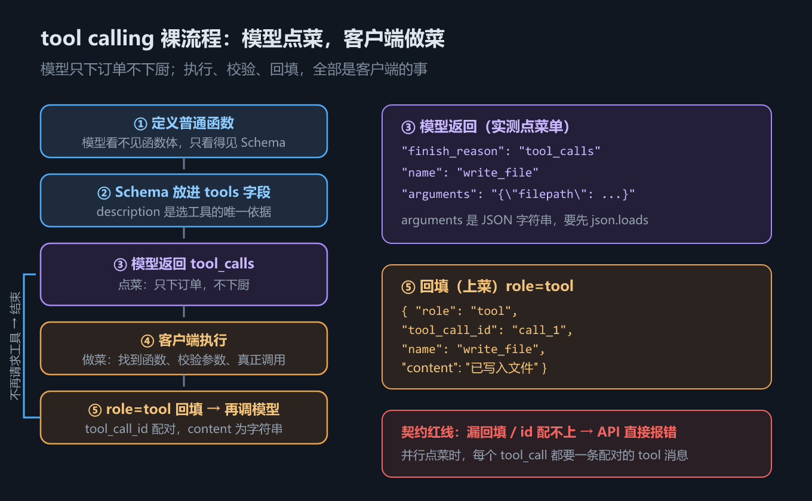

# S4 tools：让模型「点菜」，你来「做菜」

## 一、这一章要解决的问题

前三章里，模型已经能稳定地「说话」了：我们调它，它回一段文本。但把目光从聊天框挪到你真正的开发需求上，问题立刻暴露——

**模型只会输出文本**。让它读一个文件？它做不到。执行一条命令？它做不到。联网搜索、查数据库、调用你公司内部 API？统统做不到。它唯一的能力是把 token 排列成文字。你遇到的是一个天堑：**语言能力在云上，执行能力在你机器上，中间没有任何通道**。

**tool calling（工具调用）就是这座唯一的桥**。它的思想朴素得惊人：模型说不出结果没关系，它可以**请求**结果——「如果有人能帮我执行 `write_file`，参数是这些……」。而执行这件事，由你的代码完成。

这一章把这座桥拆开给你看：不封装、不抽象，用最裸的方式手拼一次完整的 tool calling。看清楚裸流程之后，S5 的封装才不是魔法，S6 的循环才不是黑盒。

一句话先剧透整个机制：**模型只「点菜」，从不下厨——它返回的只是一张写着菜名和配料的订单，真正把菜做出来的始终是你的代码**。

## 二、机制与原理

### 2.1 裸流程五步

tool calling 的完整流程只有五步，一步都省不掉：

| 步骤 | 谁来做 | 做什么 |
|---|---|---|
| ① 定义函数 | 你 | 写普通的 Python 函数，模型**看不见**函数体，只看得见 Schema |
| ② 上报 Schema | 你 | 把工具的 JSON Schema 放进请求的 `tools` 字段 |
| ③ 返回 tool_calls | 模型 | 「点菜」：返回工具名 + JSON 参数字符串，**不执行** |
| ④ 执行 | 你 | 客户端（你的代码）按名字找到函数、校验参数、真正调用 |
| ⑤ 回填 | 你 | 结果以 `role=tool` 消息追加进上下文，再调一次模型 |

图 h4 画的就是这五步的流转：



*图 h4　tool calling 裸流程：模型点菜，客户端做菜*

为什么模型不直接执行？不是厂商偷懒，而是**职责边界**：模型在云端，你的函数、文件系统、数据库在你机器上。云端进程根本摸不到你的磁盘。这个「分工」是刻意的——它同时意味着：**执行与否、怎么执行、执行失败怎么办，决定权全部在你手里**。理解了这一点，后面所有设计（校验、异常兜底、权限确认）才有位置可放。

### 2.2 JSON Schema：模型选工具的唯一依据

第 ② 步里塞进 `tools` 字段的东西，长这样（摘自 `s04_tools.py`）：

```python
tools = [
    {
        "type": "function",
        "function": {
            "name": "write_file",
            "description": "写入文件",
            "parameters": {
                "type": "object",
                "properties": {
                    "filepath": {"type": "string",
                                 "description": "文件的绝对路径，或相对于cwd的路径"},
                    "content": {"type": "string",
                                "description": "要写入的内容，该内容会完全覆盖文件原本内容"},
                },
                "required": ["filepath", "content"],
            },
        },
    },
]
```

逐字段拆解：

| 字段 | 作用 | 备注 |
|---|---|---|
| `type: "function"` | 工具类型 | 当前 OpenAI 契约基本只有这一种 |
| `function.name` | 工具名 | 模型「点菜」时报的菜名，必须唯一 |
| `function.description` | 工具描述 | **模型决定选不选它的唯一依据** |
| `parameters.type` | 参数容器 | 固定 `object` |
| `parameters.properties` | 各参数的类型与说明 | 描述写得越清楚，模型填参越准 |
| `parameters.required` | 必填参数列表 | 缺了这些参数的调用可直接拒绝 |

要特别强调 `description` 的分量。模型看不到你的函数体，看不到 `with open(...)` 那几行代码，它对工具的**全部认知**就是 Schema 里的文字。description 写「写入文件」和写「要写入的内容会完全覆盖文件原本内容」，模型的行为差异是实实在在的——前者模型可能以为追加，后者模型知道要重写。**对模型来说，Schema 不是接口文档，它就是工具本身**。

### 2.3 模型侧视角：tools 变成了「追加在系统提示词里的类型签名」

「点菜」这个比喻还有一层更底层的解释。厂商收到带 `tools` 的请求后，并不是把 JSON Schema 原样塞给底层模型——而是把它**转成 TypeScript 风格的类型签名，追加在系统提示词的末尾**。以 Qwen 系列为例，翻译之后大致长这样：

```text
<|im_start|>system
...系统提示词...

    # Tools

    namespace functions {

    // 写入文件
    type write_file = (_: {
    // 要写入的内容，该内容会完全覆盖文件原本内容
    content: string,
    }) => any;

    } // namespace functions
<|im_end|>
```

所以从模型自己的视角看，它并没有调用什么「工具接口」——它只是在一段很长的提示词里读到了一些「可用函数的签名」，然后在生成文本时写出了类似 `{"name": "write_file", "arguments": {...}}` 的**标记**。厂商的推理服务解析出这个标记，包装成响应里的 `tool_calls` 字段返回给你。

「点菜」由此而来：模型读到菜单（Schema），写下一张订单（tool_calls）。订单是文本，菜没人做。**下厨永远是客户端的事**。

### 2.4 回填：role=tool 消息的格式

第 ⑤ 步的回填消息是契约里约定死的形状，四个字段一个不能少：

```python
session.messages.append({
    "role": "tool",            # 消息角色：工具结果
    "tool_call_id": tc["id"],  # 与请求配对的凭据
    "name": tc["function"]["name"],  # 工具名（冗余，便于排查）
    "content": "已写入文件",    # 结果正文——必须是字符串
})
```

注意两点：`tool_call_id` 是模型发出的调用与你的执行结果之间的**配对凭据**，对不上号直接 API 报错（2.4 节的坑里细说）；`content` 必须是**字符串**——就算你的工具返回 dict、返回数字，也要先转成字符串再回填。

### 2.5 契约速查表

把五步流程涉及的所有字段收进一张表，S5、S6 讲封装与循环时随时回来对照：

| 位置 | 字段 | 类型 | 说明 |
|---|---|---|---|
| 请求 | `tools` | `list[dict]` | 工具 Schema 列表，见 2.2 节 |
| 请求 | `messages` | `list[dict]` | 会话历史，含 `role=tool` 消息 |
| 响应 | `finish_reason` | `"tool_calls" \| "stop"` | 点菜信号与收工信号 |
| 响应 | `tool_calls[].id` | `str` | 配对凭据，如 `call_1` |
| 响应 | `tool_calls[].function.name` | `str` | 菜名 |
| 响应 | `tool_calls[].function.arguments` | `str` | **JSON 字符串**，不是对象 |
| 回填 | `role` | `"tool"` | 固定值 |
| 回填 | `tool_call_id` | `str` | 必须与请求的 `id` 配对 |
| 回填 | `name` | `str` | 工具名（冗余，便于排查） |
| 回填 | `content` | `str` | 执行结果，必须是字符串 |

这张表就是 tool calling 的全部契约。后面两章的所有封装代码，产出的都是这张表里的形状；所有坑，踩的也都是这张表里的字段。

## 三、代码：Python

代码在 `handwritten/code/s04_tools.py`，完整跑一遍只需 140 行。逐段讲。

### 3.1 定义普通函数

```python
def read_file(filepath: str) -> str:
    """读取文件内容并以字符串形式返回"""
    with open(filepath, "r", encoding="utf-8") as f:
        return f.read()


def write_file(filepath: str, content: str) -> None:
    """将内容写入文件"""
    with open(filepath, "w", encoding="utf-8", newline="") as f:
        f.write(content)
```

（摘自 `s04_tools.py`）

这就是两个**再普通不过的 Python 函数**。没有任何装饰器、基类、注册调用。第 ① 步的核心事实是：函数本身与「模型」没有任何关系——模型看不见它们，只能看见 2.2 节那两坨手写的 Schema。这也是 S5 要解决的问题雏形：函数和 Schema 是两份独立维护的东西，人肉保证它们一致。

### 3.2 第一次调用：模型「点菜」

把 Schema 挂上 `session.tools`，发一句话：

```python
session = Session()
session.tools = tools  # 绑定工具：放进请求的 tools 字段
session.add_message({"role": "user", "content": "请在临时目录新建一个 uv.md 文件，写入 UV 的安装教程。直接新建就好"})

resp = model.invoke(session)
```

（摘自 `s04_tools.py`）

实际运行 `s04_tools.py`，第一步打印的就是模型的原始响应（实测输出，临时路径随运行变化）：

```text
== 1. 模型返回的原始响应（注意 tool_calls 与 finish_reason）==
{
  "finish_reason": "tool_calls",
  "message": {
    "role": "assistant",
    "content": null,
    "tool_calls": [
      {
        "id": "call_1",
        "type": "function",
        "function": {
          "name": "write_file",
          "arguments": "{\"filepath\": \"C:\\\\Users\\\\...\\\\Temp\\\\agent-s04-ruh8zxo0\\\\uv.md\", \"content\": \"# UV 安装教程\\n\\nUV 是一个用 Rust 编写的极速 Python 包管理器。\"}"
        }
      }
    ]
  }
}
```

三个值得盯住的细节：

1. **`finish_reason` 是 `"tool_calls"` 而不是 `"stop"`**——这是响应层面的信号：模型没有说完话，它在请求工具。上一章见过 `"stop"`，两者是判断「要不要执行工具」的第一道开关。
2. **`content` 是 `null`**。模型这次一个字的正文都没说，全部输出花在了点菜上。所以上面的事件序列里不会有 content 消息，消息序列会直接跳到「请求调用工具」。
3. **`arguments` 是 JSON 字符串，不是对象**。看引号和转义——整个参数是**一段文本**。模型生成的是流式 token，拼出来天然是字符串；契约就把这个形状保留到了响应里。你拿它当字典用之前必须 `json.loads`。这是 tool calling 里最容易绊倒新手的第一个坑。

### 3.3 手动执行：原始做法及其四个问题

从消息里抠出菜名和参数，用 `globals().get` 找到函数（`agent-core` 课件里的原始做法）：

```python
msg = session.messages[-1]
tc = msg["tool_calls"][0]

func = globals().get(tc["function"]["name"])  # 按名字在全局找函数
if callable(func):
    arguments = json.loads(tc["function"]["arguments"])
    func(**arguments)
```

（摘自 `s04_tools.py`）

实测输出（路径随运行变化）：

```text
== 2. 手动执行（演示原始做法）==
tool id : call_1
tool name: write_file
arguments: {"filepath": "C:\\Users\\...\\Temp\\agent-s04-ruh8zxo0\\uv.md", "content": "# UV 安装教程\n\nUV 是一个用 Rust 编写的极速 Python 包管理器。"}
-> 已执行 write_file，文件已生成
```

文件确实生成了，流程能跑通。但这个原始做法埋了四个雷，一个一个数：

| # | 问题 | 后果 |
|---|---|---|
| 1 | 函数必须在 `globals()` 里 | 工具函数被迫定义在同一个模块顶层；拆模块、放类里、闭包里全失效 |
| 2 | 名字对不上**静默失败** | 模型点了不存在的菜，`globals().get` 返回 `None`，`if callable` 直接跳过——不报错、不提示，流程悄悄走歪 |
| 3 | 无参数校验 | `json.loads` 出来的 dict 直接 `**` 进函数；模型填错类型、缺参数，要么运行时炸，要么更糟——悄悄写出错误结果 |
| 4 | 异常直接炸 | 文件不存在、路径非法……异常从工具里一路抛到你的循环外，整个 Agent 进程崩溃 |

第 2 条和第 4 条尤其致命：一个让错误**无声通过**，一个让错误**爆炸传播**。理想的中间态是第三条路——错误被捕获、格式化成文本、**回给模型看**，让模型有机会自我修正。这正是 S5 `Tool` 类的核心设计，先埋个伏笔。

### 3.4 回填与第二次调用

执行完，结果以 `role=tool` 回填（见 2.4 节格式），再调一次模型：

```python
session.messages.append({
    "role": "tool",
    "tool_call_id": tc["id"],
    "name": tc["function"]["name"],
    "content": "已写入文件",
})

resp2 = model.invoke(session)
```

（摘自 `s04_tools.py`）

第二次调用，模型看到上下文里的工具结果，给出最终回答。实测输出：

```text
== 3. 回填后的最终回答 ==
已创建 uv.md，内容是 UV 安装教程的一句话简介。

== 4. 完整消息序列 ==
=== 会话 eb7de9d5…（4 条消息）===
[用户] 请在临时目录新建一个 uv.md 文件，写入 UV 的安装教程。直接新建就好
[助手] 请求调用工具: write_file
[工具](write_file) 已写入文件
[助手] 已创建 uv.md，内容是 UV 安装教程的一句话简介。
```

完整的消息链：user → assistant(tool_calls) → tool → assistant(content)。模型「说不出但能要到」的结果，就这样经由一张订单、一次执行、一条回填消息，最终融进了它的回答里。

## 四、常见坑与边界条件

**坑一：`arguments` 忘了 `json.loads`。** 模型返回的参数永远是 JSON **字符串**。直接 `tc["function"]["arguments"]["filepath"]` 会得到 `TypeError: string indices must be integers`。同理，自己构造响应的测试代码（如本教程的 `FakeClient`）也要记得 `json.dumps` 回去，保持形状一致。

**坑二：`tool_call_id` 配不上，直接 API 报错。** 每条 `role=tool` 消息必须携带上一条 assistant 消息里对应调用的 `id`。如果手动构造消息时 id 写错、写丢，或者回填了两个 tool 消息却只对应一个调用，下一次请求会被服务端以 4xx 拒绝。id 是契约级的配对凭据，不是可有可无的备注。

**坑三：执行了工具却忘了回填，再调模型 → 报错。** 只要上一条 assistant 消息带 `tool_calls`，服务端就要求接下来紧跟配对的 `role=tool` 消息。执行完函数直接 `model.invoke()`，等于告诉服务端「我点了菜但没上菜」——请求直接被拒。反过来，「没有 tool_calls 却塞了 tool 消息」同样是非法序列。

**坑四：一次 `tool_calls` 可以包含多个调用——每个都要有对应的 tool 消息。** 模型可以并行点菜：一条 assistant 消息里同时出现 `read_file` 和 `get_time` 两个调用（`id` 分别是 `call_1`、`call_2`）。执行端必须逐个执行、逐条回填，两条 `role=tool` 消息各带各的 `tool_call_id`。漏掉任何一条，下一次请求报错。这也是 S5 里 `registry.invoke` 返回**列表**而不是单个结果的原因。

**边界：`content` 必须是字符串。** 你的工具返回 dict？返回 `None`？回填前一律 `str()` 或序列化。`json.dumps(result, ensure_ascii=False)` 是最常用的选择——既保住结构信息，又满足契约。

**边界：模型可能「先说后点」。** `content` 与 `tool_calls` 可以在同一条 assistant 消息里并存——模型先解释一句「我需要先读一下文件」，再点菜。不要假设二者互斥。

## 五、关键结论

1. **tool calling 是模型连接真实世界的唯一桥梁**，它的分工原则是：模型只「点菜」（返回 `tool_calls`），执行永远是客户端的事。
2. 裸流程五步：**定义函数 → 上报 Schema → 模型返回 tool_calls → 客户端执行 → role=tool 回填再调**。五步缺一不可，顺序不可乱。
3. **Schema 就是模型的全部工具认知**。`description` 不是注释，是模型选工具的唯一依据，值得认真写。
4. 模型侧的实现真相：tools 被厂商转成**类型签名追加进系统提示词**，tool_calls 本质是模型生成的文本标记。
5. `finish_reason=tool_calls` 与 `role=tool` 回填、`tool_call_id` 配对、`arguments` 为 JSON 字符串——这四件事构成了 tool calling 的**契约骨架**，记牢它们，后面所有框架的工具机制都能一眼看穿。
6. `globals().get` 的原始做法暴露了四个问题（查找范围受限、静默失败、无校验、异常炸），每一个都指向同一个方向：**这层苦力活该封装**。

## 本章要点回顾

- 模型只能输出文本，tool calling 是它「请求执行」的唯一通道：**模型点菜，你来做菜**。
- 请求侧：`tools` 字段携带 JSON Schema，`name/description/parameters` 各司其职，description 决定模型选不选。
- 响应侧：`finish_reason=tool_calls` + `tool_calls[]`（`id` + `name` + `arguments` 字符串）。
- 执行侧：`json.loads` 参数 → 调函数 → 以 `role=tool`（`tool_call_id` 配对、content 为字符串）回填 → 再调模型。
- 一次可能多个调用并行，回填必须一一对应、一条不缺。
- `globals().get` 原始做法的四个雷，是 S5 封装（`@tool` 装饰器 + Pydantic 校验 + 注册表）的全部动机。下一章，把苦力活全部自动化。
