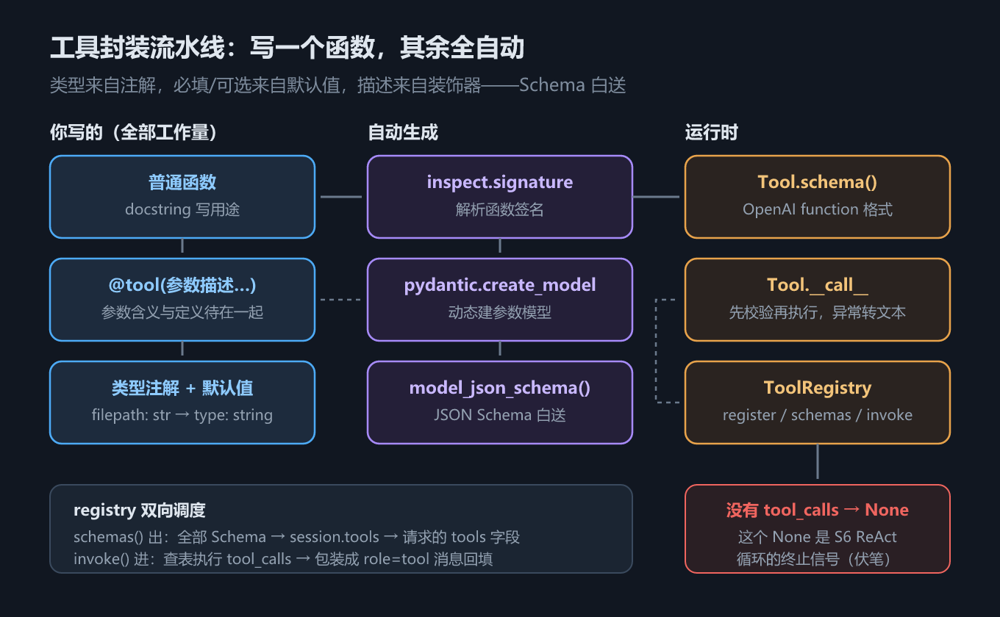

# S5 封装 tools：把苦力活交给 `inspect` + Pydantic

## 一、这一章要解决的问题

上一章我们手拼了一次完整的 tool calling，五步流程每一步都是手动档：Schema 一行一行写、函数按名字在 `globals()` 里捞、参数不校验、异常直接炸。跑通一次没问题，但它离「能用的工程代码」差得远——

把 S4 的四个雷换算成日常成本：每加一个工具，你要**同步维护两份东西**（函数 + Schema），人肉保证名字、参数、类型一致；模型点错菜（传错参数、点了不存在的工具），你要么静默吞掉要么程序爆炸；错误信息回不到模型那里，Agent 永远学不会自我修正。

这一章的目标是用一个装饰器把全部苦力活自动化。**先看最终形态**——定义一个工具的全部工作量：

```python
@tool(filepath="文件的绝对路径，或相对于当前工作目录的路径")
def read_file(filepath: str) -> str:
    """读取文件内容并以字符串形式返回"""
    with open(filepath, "r", encoding="utf-8") as f:
        return f.read()
```

（摘自 `agent/tool/builtin.py`）

装饰器注明参数含义，docstring 说明工具用途，类型注解声明参数类型——**写完这三样，Schema 生成、参数校验、异常兜底、注册查找全部自动完成**。这一章就拆解这个自动化是怎么做到的。

S4 → S5 的改进对照，也是本章的内容地图：

| S4 的裸做法 | S5 的封装 | 依靠什么 |
|---|---|---|
| 手拼 JSON Schema | 自动生成 | `inspect.signature` + `pydantic.create_model` |
| `globals().get` 找函数 | 注册表查表 | `ToolRegistry._tools` 字典 |
| 名字对不上静默失败 | 返回「没有名为 xx 的工具」错误文本 | `invoke` 的兜底分支 |
| 参数不校验 | 先过 Pydantic 模型再执行 | `Tool.__call__` |
| 异常直接炸 | 返回完整堆栈文本 | `try/except` + `traceback` |
| 手动 append tool 消息 | `invoke` 直接返回可回填的消息列表 | 统一的包装逻辑 |

## 二、机制与原理

整条封装流水线如图 h5：



*图 h5　工具封装流水线：inspect → Pydantic → schema()，registry 双向调度*

三个核心部件，各管一段：

| 部件 | 职责 | 解决 S4 的哪个雷 |
|---|---|---|
| `create_params_model` | 函数签名 → Pydantic 参数模型 → JSON Schema | Schema 人肉维护 |
| `Tool` | 校验参数再执行；异常转成堆栈文本返回 | 无校验、异常炸、静默失败 |
| `ToolRegistry` | 统一注册、出 Schema、执行 tool_calls | 函数必须在 `globals()` 里 |

### 2.1 核心机制一：`create_params_model`

这是整个封装里最「巧」的一步（摘自 `agent/tool/core.py`）：

```python
def create_params_model(func, param_descriptions=None) -> type[BaseModel]:
    param_descriptions = param_descriptions or {}
    fields: dict[str, tuple] = {}
    for name, param in inspect.signature(func).parameters.items():
        py_type = param.annotation if param.annotation is not inspect.Parameter.empty else Any
        desc = param_descriptions.get(name, "")
        if param.default is inspect.Parameter.empty:
            fields[name] = (py_type, Field(description=desc))          # 必填
        else:
            fields[name] = (py_type, Field(default=param.default, description=desc))  # 可选
    return create_model(f"{func.__name__}_params", **fields)
```

信息来源一共有三处，**全部来自你已经写过的东西**：

| Schema 里的字段 | 信息来源 |
|---|---|
| 参数类型 `type: string` | 函数签名的**类型注解**（`filepath: str`） |
| 必填 / 可选（`required`） | 有没有**默认值**（`encoding="utf-8"` → 可选） |
| 参数 `description` | 装饰器关键字参数（`@tool(filepath="...")`） |

`inspect.signature` 把函数签名解析成参数列表；`pydantic.create_model` 按这些信息**现场造一个 Pydantic 模型类**。Pydantic 模型天生自带 `model_json_schema()`，JSON Schema 就白送了——不需要任何手写。

### 2.2 核心机制二：`Tool` 类——校验、执行、异常兜底

`Tool` 把函数包起来，提供两个行为（摘自 `agent/tool/core.py`）：

```python
def schema(self) -> dict:
    param_schema = self.param_model.model_json_schema()
    # ...组装成 OpenAI function calling 格式...
    return {
        "type": "function",
        "function": {
            "name": self.name,
            "description": self.description,      # 来自 docstring
            "parameters": { "type": "object", "properties": properties,
                            "required": param_schema.get("required", []) },
        },
    }

def __call__(self, **kwargs) -> str:
    try:
        validated = self.param_model(**kwargs)    # 校验 + 类型转换
        kwargs = validated.model_dump()
        return str(self.func(**kwargs))           # 统一返回字符串
    except Exception:
        return "".join(traceback.format_exception(*sys.exc_info())).rstrip()
```

三处设计值得停下来想：

1. **`schema()` 的产出与 S4 手写的形状完全一致**。`type/description/parameters/required` 一个不缺——封装没有改变契约，只是自动化了契约的生产。
2. **`__call__` 先校验再执行**。模型传来的参数先过 Pydantic 模型这一关，类型不对、缺必填项，在真正的函数被调用之前就拦下来。
3. **异常不外抛，返回完整堆栈文本**。这是最反直觉也最关键的一条：工具出错时，`Tool.__call__` 把整个 traceback 格式化成字符串返回。为什么？因为**模型看得见错误，才能自我修正**——它传错了路径，下一轮看到 `FileNotFoundError: no such file: xxx`，就会换个路径重试。S4 里「异常直接炸」和「静默失败」的两难，被这第三条路化解了。这是 Agent 容错体系的基石。

### 2.3 核心机制三：`ToolRegistry`——调度中心

注册表只有三个方法（摘自 `agent/tool/__init__.py`）：

```python
class ToolRegistry:
    def register(self, tool: Tool) -> Tool:
        self._tools[tool.name] = tool
        return tool

    def schemas(self) -> list[dict]:
        return [t.schema() for t in self._tools.values()]   # 出：给 session.tools

    def invoke(self, message: dict) -> list[dict] | None:
        tool_calls = message.get("tool_calls") or []
        if not tool_calls:
            return None                                    # ← 没有点菜
        # ...逐个查表、json.loads、执行、包装成 role=tool 消息...
```

`invoke` 内置了 S4 手动执行的所有兜底，逐个 tool_call 处理的完整逻辑（摘自 `agent/tool/__init__.py`）：

```python
def invoke(self, message: dict) -> list[dict] | None:
    tool_calls = message.get("tool_calls") or []
    if not tool_calls:
        return None                                    # ← 没有点菜
    results = []
    for tc in tool_calls:
        name = tc["function"]["name"]
        try:
            args = json.loads(tc["function"]["arguments"] or "{}")
        except json.JSONDecodeError:
            args = None
        tool = self._tools.get(name)
        if args is None:
            result = f"错误：arguments 不是合法 JSON：{...!r}"
        elif tool is None:
            result = f"错误：没有名为 {name} 的工具，请检查工具名拼写"
        else:
            result = tool(**args)                      # 走 Tool.__call__
        results.append({"role": "tool", "tool_call_id": tc["id"],
                        "name": name, "content": result})
    return results
```

`invoke` 把 S4 的四个雷逐一排掉：查表不限于 `globals()`（雷 1）；工具不存在返回错误文本而非静默跳过（雷 2）；参数先过 `Tool.__call__` 的 Pydantic 校验（雷 3）；任何异常都被 `Tool.__call__` 兜住转成文本（雷 4）。

特别注意 `invoke` 的返回值设计：**没有 `tool_calls` 时返回 `None`**。这个 `None` 不是边角处理，它是 S6 ReAct 循环的**终止信号**——「模型不再点菜 = 任务完成」。这里是伏笔，下一章兑现。

### 2.4 对照框架线第 7 章

这套封装思想在 LangChain 里有工业化版本。框架线第 7 章讲过：`@tool` 装饰器同样从函数名、docstring、类型注解自动推断 Schema，并提供覆盖口（自定义名字、描述、`args_schema`）；底层是 `StructuredTool`，执行时通过 `ToolRuntime` 注入运行时上下文。差别只在工程化程度：我们的手写版少了覆盖口和运行时注入，但「**函数即工具、注解即 Schema、装饰器收集元信息**」的核心思想一模一样。

## 三、代码：Python

代码在 `handwritten/code/s05_tool_package.py`，按脚本的四步实测。

### 3.1 生成的 Schema 长什么样

对 `write_file(filepath: str, content: str, encoding: str = "utf-8")` 跑 `create_params_model`（实测输出）：

```text
== 1. create_params_model 生成的 JSON Schema ==
{
  "properties": {
    "filepath": { "description": "文件的绝对路径或相对于cwd的路径", "type": "string" },
    "content":  { "description": "待写入的文件内容", "type": "string" },
    "encoding": { "default": "utf-8", "description": "文件编码", "type": "string" }
  },
  "required": [ "filepath", "content" ],
  "title": "write_file_params",
  "type": "object"
}
```

（为节省篇幅压缩了 `title` 行。）对照 2.1 节的来源表验证：`encoding` 有默认值 `"utf-8"`，出现在 `default` 里、**不在** `required` 里；`filepath`/`content` 没有默认值，进 `required`。类型、必填性、描述三者自动就位，一分苦力没花。

`Tool.schema()` 再包一层，就是 S4 手写过的 OpenAI 格式（实测输出，结构与 S4 逐字段一致）：

```text
== 2. Tool.schema()（OpenAI function calling 格式）==
{
  "type": "function",
  "function": {
    "name": "write_file",
    "description": "将内容写入文件",
    "parameters": { ...同上 properties 与 required... }
  }
}
```

`description` 的值「将内容写入文件」来自函数 docstring——`inspect.getdoc(func)` 一行拿走。

一个 `Tool` 对象拿到手后，各属性的来源可以收进一张解剖表：

| 属性 | 来源 | 例子 |
|---|---|---|
| `tool.name` | 函数名（或装饰器/构造参数覆盖） | `write_file` |
| `tool.description` | `inspect.getdoc(func)`，即 docstring | 「将内容写入文件」 |
| `tool.param_model` | `create_params_model` 动态生成的 Pydantic 模型 | `write_file_params` |
| `tool.schema()` | `param_model.model_json_schema()` 组装成 OpenAI 格式 | 见上面实测 |
| `tool(**kwargs)` | 先 `param_model(**kwargs)` 校验，再执行函数 | 见 3.2 节实测 |
| `tool.func` | 原始函数本体 | 你的 `write_file` |

### 3.2 校验失败的实测：错误变成了模型看得见的文本

给声明为 `str` 的 `filepath` 传一个 int（实测输出）：

```text
== 3. 参数校验：类型错误会得到可读的堆栈文本（而不是炸掉程序）==
    For further information visit https://errors.pydantic.dev/2.14/v/string_type
```

脚本只打印了最后一行；完整堆栈的**关键行**是（另跑一次验证所得，路径随运行变化）：

```text
pydantic_core._pydantic_core.ValidationError: 1 validation error for write_file_params
filepath
  Input should be a valid string [type=string_type, input_value=12345, input_type=int]
    For further information visit https://errors.pydantic.dev/2.14/v/string_type
```

堆栈顶部还有 `Traceback` 与 `core.py` 中 `self.param_model(**kwargs)` 的出错位置——整个 traceback 原样变成了返回值。程序没炸，模型（如果这份文本被回填）下一轮就能读到「filepath 应该是字符串，你传了个 12345」——它完全有能力改对。**这就是「异常转文本」设计的全部意义**。

### 3.3 注册表 + 完整流程实测

`@tool` 装饰器把函数原地变成 `Tool` 对象，注册进全局 `registry`：

```python
registry.register(read_file)   # @tool 返回的 Tool 对象
registry.register(tool_obj)    # 直接构造的 Tool 对象也可以
session.tools = registry.schemas()   # 出：Schema 交给 session
```

之后是 S4 同款的完整流程：模型请求 `read_file` → `registry.invoke` 执行 → 回填 → 最终回答。实测输出：

```text
== 4. 注册表：schemas() 交给 session.tools，invoke() 替你执行 ==
已注册工具: ['read_file', 'write_file']
registry.invoke 返回: [
  {
    "role": "tool",
    "tool_call_id": "call_1",
    "name": "read_file",
    "content": "# 角色\n你是运行在用户终端里的编码助手，..."
  }
]

最终回答: system.j2 的开头是角色设定：「你是运行在用户终端里的编码助手」。
```

对比 S4：同样一条 `role=tool` 消息，`tool_call_id` 配对、content 是字符串——但这一次，`json.loads`、查表、执行、包装**全部由 `registry.invoke` 一行完成**。最终的消息序列：

```text
== 5. 完整消息序列（注意 role=tool 的消息格式）==
=== 会话 a45c6175…（4 条消息）===
[用户] 帮我读取 agent/prompt/system.j2 的开头
[助手] 请求调用工具: read_file
[工具](read_file) # 角色 你是运行在用户终端里的编码助手，...
[助手] system.j2 的开头是角色设定：「你是运行在用户终端里的编码助手」。
```

## 四、常见坑与边界条件

**坑一：忘写 docstring → description 为空 → 模型不选它。** `Tool.__init__` 里 `inspect.getdoc(func) or ""`，没有 docstring 就得到空描述。Schema 里 `description` 为空的工具，模型几乎无法判断它是干嘛的，表现通常是**永远不选它**，或者乱选。定义工具时把 docstring 当作必需品。

**坑二：参数没写类型注解 → `Any` → Schema 弱化。** `create_params_model` 对没有注解的参数回退到 `Any`，生成的 Schema 里没有 `type` 字段。模型失去类型约束，传参自由发挥，校验也拦不住（Pydantic 对 `Any` 什么都放行）。给每个参数写注解，是工具质量的下限。

**坑三：Pydantic 默认 lax 模式的类型转换边界。** Pydantic v2 默认模式是宽容的：`"123"` 能转成 `int`，`123` 能转成 `str` 吗？实测不能（见 3.2 节的 `string_type` 错误）。数组和自定义类型的转换规则更复杂。**不要依赖隐式转换**——模型传什么就是什么，类型声明写准才是正道。

**坑四：返回值统一 `str()`，dict 返回值要先序列化。** `Tool.__call__` 最后一行是 `str(self.func(**kwargs))`。如果你的工具返回 dict，`str()` 会得到 Python 字面量（单引号、`True`/`False` 大写），模型勉强能读但不规范；更好的做法是在函数内部就 `json.dumps(result, ensure_ascii=False)` 再返回。工具返回值永远面向模型阅读，字符串化是最后防线。

**坑五：`registry` 是全局单例。** 整个进程共享一个注册表（`agent/tool/__init__.py` 末尾 `registry = ToolRegistry()`）。两个含义：**注册顺序影响 `schemas()` 的顺序**（dict 保持插入序，实测 `['read_file', 'write_file']` 就是注册顺序），后注册的**同名工具直接覆盖**先注册的（`self._tools[tool.name] = tool`，无警告）。多次 import 或测试中重复注册时要心里有数；需要隔离时，另建一个 `ToolRegistry()` 实例即可。

**坑六：注册顺序与 Schema 顺序会影响模型选择。** `schemas()` 按注册序输出，工具越多、越相似，排在前面的越容易被模型优先考虑。把最核心的工具先 `register`，是零成本的引导手段。

**边界：MCP 工具不走 Pydantic。** `Tool.from_mcp` 直接采用服务器返回的 `inputSchema`，跳过本地建模（工具名规范为 `server__tool` 防冲突）。这条路径在 S9 展开，此处只需知道：`schema()` 和 `__call__` 对两种来源一视同仁。

## 五、关键结论

1. **封装目标**：定义工具 = 写一个带 docstring 和类型注解的普通函数 + 装饰器注明参数含义，其余全自动。
2. **`create_params_model`**：`inspect.signature` 提取签名，`pydantic.create_model` 动态建模——类型来自注解、必填/可选来自默认值、描述来自装饰器，JSON Schema 白送。
3. **`Tool` 类**：`schema()` 产出 OpenAI 格式（契约不变，只是自动化）；`__call__` 先校验再执行；**异常不外抛而是返回堆栈文本**——模型看得见错误才能自我修正，这是 Agent 容错的关键设计。
4. **`ToolRegistry`**：`register/schemas/invoke` 三方法；`invoke` 把「非法 JSON、未知工具」都转成错误文本进上下文；**没有 tool_calls 返回 `None`**——这是 S6 循环的终止信号。
5. 与框架线第 7 章 LangChain 的 `@tool` 同源同构：函数即工具、注解即 Schema，工业版只是多了覆盖口和运行时注入。
6. 定义工具的三条纪律：**docstring 必写、类型注解必写、返回值必字符串化**。

## 本章要点回顾

- 目标 API 形态：`@tool(参数描述...)` + docstring = 完整工具定义。
- 流水线三件套：`create_params_model`（签名 → Pydantic → Schema）、`Tool`（校验 + 异常兜底）、`ToolRegistry`（注册 + 调度）。
- 异常转文本是设计而非妥协：错误回给模型，模型自我修正，进程不炸。
- `registry.invoke` 返回值语义：有调用 → `role=tool` 消息列表；没调用 → `None`（记住这个 `None`）。
- 三个坑对应三条纪律：docstring、类型注解、返回值序列化。
- Schema 自动化的思想与框架线第 7 章 LangChain `@tool` 一脉相承。
- 单次工具调用已经封装完毕，但「读文件 → 加工 → 写回」这种多步任务怎么办？下一章 S6，把五步流程跑成一个循环。
