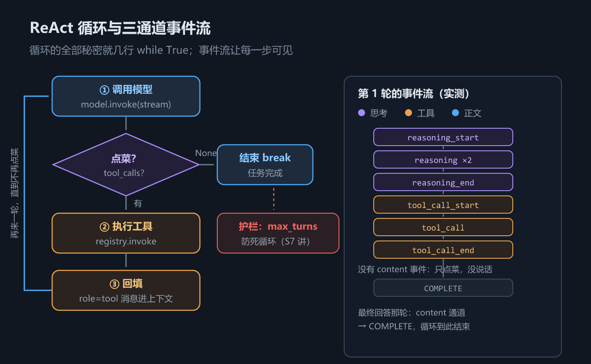

# S6 ReAct：把五步流程跑成循环，Agent 的心脏

## 一、这一章要解决的问题

S4、S5 已经把**一次**工具调用打磨得足够好了：模型点菜，`registry.invoke` 做菜并回填。但很多任务一次调用根本做不完——「读这个文件，总结要点，把摘要写回去」至少要三步：**读文件 →（模型加工）→ 写文件 →（模型汇报）**。每一步执行完，都得把结果交给模型看一眼、再决定下一步。手动写五步流程写三轮？代码会膨胀成一坨复制粘贴。

答案是显而易见的：**循环**。执行完工具就再调一次模型，模型还要点菜就再做，直到它不再点菜为止。这个「思考 → 行动 → 观察 → 再思考」的交替结构，就是 2022 年论文《ReAct: Synergizing Reasoning and Acting in Language Models》提出的模式，也是今天几乎所有 Agent 框架（LangChain、LangGraph、DeepAgents）的内核。

对照一下两个规模的任务，差距一目了然：

| 任务 | 需要几次模型调用 | 靠什么完成 |
|---|---|---|
| 「新建一个 uv.md 写入教程」 | 2 次（点菜、汇报） | S4 的五步手动流程 |
| 「读 notes.txt、总结、把摘要写回 summary.txt」 | 3 次起步，每次之间夹工具执行 | **循环** |
| 「排查这个报错并修复」 | 不可预知，可能十几次 | 循环 + 护栏 |

任务一在 S4 里是写死的两段代码：第一次 `invoke`、手动执行、回填、第二次 `invoke`。任务二如果把这套流程手写三遍，代码就是复制粘贴；任务三根本没法手写——**你不知道要几轮，只有模型每次看完结果才知道**。所以唯一的出路是把「调模型 → 执行 → 回填」包进循环，把「什么时候停」交给一个判断条件。

这一章做三件事：先把**事件系统**竖起来（模型调用过程的实时广播），再手写一个**最小 ReAct 循环**（你会发现全部秘密就几行 `while True`），最后跑一个真实的多步任务看完整轨迹。

## 二、机制与原理

### 2.1 ReAct 循环：全部秘密就这么几行

先给结论。图 h6 是 ReAct 循环的完整形状：



*图 h6　ReAct 循环：调模型 → 点菜？→ 执行 → 回灌，右侧为三通道事件流*

循环本体（摘自 `s06_react.py`）：

```python
rounds = 0
while True:
    rounds += 1
    model2.invoke(session, stream=True)          # 调模型
    call_msg = registry.invoke(session.messages[-1])  # 有 tool_calls 就执行
    if call_msg is None:
        break                                    # 模型不再点菜：任务完成
    session.messages.extend(call_msg)            # 回填 tool 消息
    print(f"第 {rounds} 轮：执行 {', '.join(m['name'] for m in call_msg)}")

print(f"循环共 {rounds} 轮结束")
```

值得留意的是循环之外还有什么：循环前只有两行准备——`session.tools = registry.schemas()`（把工具 Schema 交给 session，S5 的产出）和一条用户消息；循环后没有任何收尾代码，因为每一轮里 `invoke` 和 `extend` 已经把上下文维护完整了。**循环没有自己的状态，全部状态都在 `session.messages` 里**——这是上下文即状态的最直接体现。

对照 S4 的五步流程：① 定义函数（S5 已完成）和 ② 上报 Schema（`session.tools` 已绑定）是**循环外的准备**；③④⑤ ——调模型、执行、回填——就是循环体内的三行。**Agent 的「智能」全部来自模型，循环只负责把「点菜-做菜-上菜」自动化地转下去**，直到模型不再点菜。

终止条件只有一个：`registry.invoke` 返回 `None`（S5 埋的伏笔在这里兑现）。这个 `None` 语义极其干净——它不是超时、不是出错，而是模型用行为表明「我不需要工具了」。

### 2.2 事件系统：三通道广播

循环要能观察、能调试、能接 UI，就得看见模型调用过程的每一步。`agent/events.py` 用一个极简的发布-订阅实现（摘自 `agent/events.py`）：

```python
class Event:
    REASONING_START = "reasoning_start"; REASONING = "reasoning"; REASONING_END = "reasoning_end"
    CONTENT_START = "content_start";     CONTENT   = "content";    CONTENT_END   = "content_end"
    TOOL_CALL_START = "tool_call_start"; TOOL_CALL = "tool_call";  TOOL_CALL_END = "tool_call_end"
    COMPLETE = "complete"

class EventEmitter:
    def on(self, event: str, callback: Callable) -> None:
        self._handlers[event].append(callback)

    def emit(self, event: str, **data) -> None:
        for callback in list(self._handlers[event]):
            callback(event, **data)
```

事件按**三条通道**组织，各配 START / 正文 / END 三个阶段，外加一个总的 `COMPLETE`：

| 通道 | 事件 | 对应内容 |
|---|---|---|
| 思考 | `reasoning_start / reasoning / reasoning_end` | 思考型模型的思维链 |
| 正文 | `content_start / content / content_end` | 面向用户的回答文本 |
| 工具 | `tool_call_start / tool_call / tool_call_end` | 工具调用的名字与参数 |
| 收尾 | `complete` | 本次调用结束，携带拼装完成的完整 message |

前三组各管一条流式通道，`COMPLETE` 则是总收尾——无论走了哪条通道，它都最后触发，并把归一化后的 message 一并带出。

`Model` 继承 `EventEmitter`，调用过程中把三条通道的内容以事件广播出去。**为什么模型层要发事件？** 三个理由：

1. **展示逻辑与调用逻辑解耦**。`Model` 不需要知道有谁在听：打印器、日志、UI、计费统计，任何组件 `model.on(...)` 接入即可，模型层一行代码不用改。
2. **可观测性的地基**。S3 的 `print_friendly` 只能看静态消息序列；事件流能看到**过程**——模型什么时候在思考、思考了多久、什么时候切到点菜。没有事件，流式调用的内部就是黑盒。
3. **一次实现，处处受益**。事件在装配器解析 chunk 时发出，监听器拿到的是实时片段：做「打字机效果」的 UI 只需要监听 `content` 事件，做工具调用提醒只需要监听 `tool_call` 事件。

`EventEmitter` 本体只有十行，但它划出的边界很重要：**事件是广播，不是回调地狱**——发布者不知道订阅者存在，这正是发布-订阅模式的价值。S7 的 Agent 打印器就挂在这套事件上。

### 2.3 流式装配器：三通道各自累积

事件从哪来？从流式响应里逐 chunk 解析出来。`agent/model.py` 的 `_StreamAssembler` 干这件事（摘自 `agent/model.py`）：

```python
def _feed(self, delta) -> None:
    # 1) 思考通道：reasoning_content 逐片累积，首片发 START
    # 2) 正文通道：content 逐片累积
    # 3) 工具通道：
    for piece in pieces:
        index = getattr(piece, "index", 0) or 0
        slot = self.tool_calls.setdefault(index, {"id": "", "type": "function",
                                                  "function": {"name": "", "arguments": ""}})
        if getattr(piece, "id", None):
            slot["id"] = piece.id
        if getattr(fn, "name", None):
            slot["function"]["name"] = fn.name
        if getattr(fn, "arguments", ""):
            slot["function"]["arguments"] += fn.arguments   # 跨 chunk 分片拼接！
```

流结束时 `_finalize` 收口：未关闭的通道补发 END 事件，三条通道各自累积的内容**拼成与非流式 message 完全一致的归一化 dict**（摘自 `agent/model.py`）：

```python
def _finalize(self) -> dict:
    # ...补发 reasoning/content/tool 通道的 END 事件...
    message: dict = {"role": "assistant", "content": "".join(self.content) or None}
    if self.reasoning:
        message["reasoning_content"] = "".join(self.reasoning)
    if self.tool_calls:
        message["tool_calls"] = [self.tool_calls[i] for i in sorted(self.tool_calls)]
    self._emit(Event.COMPLETE, message=message)
    return message
```

两个关键设计：

**思考通道结束的判定**。流式响应不会显式告诉你「思考完了」，装配器用两条启发式规则：同一个 chunk 里既出现 reasoning 又出现 content/tool_calls（混合）；或后续 chunk 出现了 content/tool_calls（更常见）。此时立即补发 `reasoning_end`，切换通道。

**tool_calls 的 `arguments` 跨 chunk 分片拼接**。这是流式 tool calling **最容易踩的坑**：`arguments` 不是一次给全的，它被拆成若干片（甚至工具名一片、参数前半一片、后半一片），分散在多个 chunk 里，靠 `index` 标识归属、靠字符串拼接复原。`consume()` 结束后拼出来的 message，与非流式响应的形状**完全一致**——上层代码（包括 ReAct 循环）感知不到流式与非流式的差别。

### 2.4 行车记录仪：轨迹回放与上下文纪律

循环跑完，上下文里留下的是完整的任务轨迹。把它打印出来（`session.print_friendly()`），就是 Agent 的**行车记录仪**——调试 Agent 的第一手段永远是回放轨迹：模型在哪一轮、看到了什么工具结果、然后做了什么决定。

这份轨迹同时是 S3 章两条上下文纪律的实战检验：

| 纪律 | 在循环里的体现 |
|---|---|
| 历史只追加、不修改 | 循环里对 `session.messages` 只有 `extend`（回填）和 `invoke` 内部的 `add_message`，没有任何改写或删除 |
| 保留思维链 | `reasoning_content` 随 assistant 消息进入历史，S7 讲推理模型时是质量关键 |

反过来说，循环**没有自己的私有状态**：没有独立的「计划表」「步骤队列」，一切决策依据都在消息历史里。这也解释了为什么上下文工程（框架线第 9 章）对 Agent 如此重要——上下文就是 Agent 的全部记忆与视野。

## 三、代码：Python

代码在 `handwritten/code/s06_react.py`，脚本分三节：第 1 节看事件流（模型调用的内部视角），第 2 节手写 ReAct 循环，第 3 节回放完整轨迹。准备阶段只有三件事：在临时目录写一个 `notes.txt` 演示文件（路径随运行变化）、把内置的 `read_file`/`write_file` 注册进 `registry`、按场景配置 `FakeClient` 响应脚本。运行方式与前几章一致：

```bash
cd "docs/agent开发教程/handwritten/code" && python s06_react.py
```

从 S4 到 S6，同样的「读文件并总结」任务，代码量的变化很说明问题：

| 版本 | 核心代码 | 能处理的任务 |
|---|---|---|
| S4 手动流程 | 两段 `invoke` + 手动执行 + 手动回填，约 20 行 | 固定一轮工具调用，轮数写死 |
| S5 封装后 | `registry.invoke` 一行替代手动执行 | 同上，但苦力活消失 |
| S6 循环 | `while True` 五行 | **任意轮数**，由模型行为决定 |

按脚本三节实测。

### 3.1 事件序列实测：一次「点菜」调用的内部视角

监听器的注册只需要十行——9 个事件共用一个回调（摘自 `s06_react.py`）：

```python
events_seen: list[str] = []

def recorder(event: str, **data) -> None:
    events_seen.append(event)

for e in (Event.REASONING_START, Event.REASONING, Event.REASONING_END,
          Event.CONTENT_START, Event.CONTENT, Event.CONTENT_END,
          Event.TOOL_CALL_START, Event.TOOL_CALL, Event.TOOL_CALL_END):
    model.on(e, recorder)
```

注册好监听器后，让模型读文件，实测输出：

```text
== 1. 一次调用的完整事件序列 ==
reasoning_start -> reasoning -> reasoning -> reasoning_end -> tool_call_start -> tool_call -> tool_call_end
```

逐段读：模型先思考（`reasoning_start`，思考文本分成两片，所以 `reasoning` 出现两次），思考完切到工具通道（`tool_call_start` → `tool_call` 报出工具名 → `tool_call_end`）。

**注意：整个序列里没有 `content` 事件**。模型这次只点了菜、没说话——和 S4 见到的 `content: null` 是同一件事的事件侧影子。三条通道在一次调用里通常只有一两条有内容。

### 3.2 三轮 ReAct 实测：读文件 → 写摘要 → 汇报

任务设定：临时目录里有一个 `notes.txt`，让模型读取、总结、把摘要写进 `summary.txt`。这个任务**至少需要两轮工具调用**——读和写是两个动作，中间还夹着模型自己的加工（总结）。模型怎么决定下一步？它只能看上下文：`FakeClient` 脚本按「上一轮工具结果里出现了什么」匹配响应（摘自 `s06_react.py`）：

```python
client2 = FakeClient([
    {   # 第 1 轮：读文件
        "match": "并总结",
        "resp": {"tool_calls": [{"name": "read_file", "arguments": {"filepath": notes}}]}},
    {   # 第 2 轮：拿到文件内容后写摘要
        "match": lambda msgs: "会话要只追加不修改" in tool_text(msgs),
        "resp": {"tool_calls": [{"name": "write_file", "arguments": {...}}]}},
    {   # 第 3 轮：写入成功后汇报
        "match": lambda msgs: "已写入" in tool_text(msgs),
        "resp": {"content": "已把 3 条要点写进 summary.txt：..."}},
])
```

这个脚本本身就是 ReAct 的注解：**每一轮模型看到什么，决定它下一轮做什么**。注册内置工具后跑 2.1 节的循环，实测输出：

```text
== 2. 手写 ReAct 循环：读文件 → 写摘要 → 汇报 ==
第 1 轮：执行 read_file
第 2 轮：执行 write_file
循环共 3 轮结束
```

逐轮拆解：

| 轮次 | 模型动作 | 事件通道 | 执行的工具 | 回填内容 |
|---|---|---|---|---|
| 1 | 请求 `read_file` | 思考 + 工具 | `read_file` | 文件原文 |
| 2 | 看到内容，请求 `write_file` | 工具 | `write_file` | 「已写入 …（22 字符）」 |
| 3 | 确认写入成功，输出最终回答 | **正文** | 无（`invoke` 返回 `None`，break） | —— |

第 3 轮没有工具执行，但仍占一轮 `invoke`——`rounds` 计到 3 就是这个原因。注意第 2 轮回填的内容「已写入 …（22 字符）」来自 `write_file` 工具的返回值设计——**回填给模型的结果要具体到可核验**，模型才敢在下一轮宣布完成。

`print_friendly` 回放完整轨迹（实测输出，临时路径随运行变化）：

```text
== 3. 完整轨迹 ==
=== 会话 2817c036…（6 条消息）===
[用户] 读取 C:\...\Temp\agent-s06-znz35au5\notes.txt 并总结，把摘要写到 C…
[助手] 请求调用工具: read_file
[工具](read_file) 会话要只追加不修改；上下文要保留思维链；工具异常要回给模型。
[助手] 请求调用工具: write_file
[工具](write_file) 已写入 C:\...\Temp\agent-s06-znz35au5\summary.txt（22 字符）
[助手] 已把 3 条要点写进 summary.txt：历史只追加、保留思维链、异常回给模型。
```

六条消息正好构成三轮循环的完整上下文：user → assistant(tool_calls) → tool → assistant(tool_calls) → tool → assistant(content)。和 S4 的四条消息相比，只是同样的形状**多绕了一圈**——循环不改变消息契约，只改变消息数量。

`print_friendly` 就是 Agent 的**行车记录仪**：出了问题，第一件事就是回放这段轨迹，看模型在哪一轮、看到什么之后做出了错误决定。

循环结束后 `summary.txt` 也真实落盘（实测输出）：

```text
summary.txt 内容: 核心：历史只追加、保留思维链、异常回给模型。
```

### 3.3 事件与循环的关系

把 3.1 的事件视角和 3.2 的循环视角叠起来看：**循环的每一轮 = 一次 `model.invoke` = 一串事件**。三轮任务里两种轮型的对比：

| 轮型 | 事件序列 | 循环里的走向 |
|---|---|---|
| 点菜轮（第 1、2 轮） | reasoning_start → … → tool_call_end | `invoke` 返回 tool_calls → 执行 → 回填 → 下一轮 |
| 收工轮（第 3 轮） | content_start → content × n → content_end → complete | `registry.invoke` 返回 `None` → break |

第 1 轮的事件序列是「思考 + 点菜」型（如 3.1 实测），第 3 轮则是纯 `content` 通道。事件系统让每轮内部纤毫毕现，循环让轮与轮之间自动衔接——两层视图合起来，才是 Agent 运行时的完整图景。

这也是为什么事件系统要做成**与循环解耦的旁路**：循环代码三行，事件监听可有可无、想接就接——打印、日志、计费、UI 各自独立演进，谁也不影响谁。

还有一层实用价值：事件流是**活体的**，轨迹是**事后的**。调试「Agent 卡住了」这类问题时，看事件流能立刻分辨是模型在长思考、还是在等工具执行、还是循环本身出了 bug——三种情况的处理路径完全不同。

## 四、常见坑与边界条件

**坑一：没有 `max_turns` 的死循环。** 终止条件「模型不再点菜」依赖模型行为，而模型可能陷入怪圈：反复读同一个文件、反复用同样的错误参数调用工具、或者永远「再确认一下」。真跑一次就知道这种事不罕见——工具返回的错误文本没有给出模型能理解的修正线索时，模型常常原样重试。本教程的循环是教学极简版，**生产实现必须加 `max_turns` 轮数上限**——超过就强制退出并告知模型。S7 会把这个护栏加进 Agent 类。

**坑二：模型先「说」后「点菜」，content 与 tool_calls 并存。** 一条 assistant 消息里可以同时有 `content`（「我先读一下这个文件」）和 `tool_calls`。两个推论：处理消息时不要假设二者互斥；展示层要明白这个 content 是**给用户看的说明**，不是最终回答——最终回答是后续某轮不再点菜时的 content。对应到事件上，就是一次调用里 content 通道和工具通道**先后都有事件**。

**坑三：多工具并行调用，id 一一对应。** 一轮里模型可能同时点两道菜（`tool_calls` 数组里有多个调用，`id` 各不相同），执行后必须**每个调用回填一条** `role=tool` 消息，`tool_call_id` 一一对应。S5 的 `registry.invoke` 返回列表、循环里用 `extend` 而不是 `append`，都是这个原因；漏回填一条，下一次请求直接 4xx。

**坑四：工具结果不回填就退出循环 → 上下文残缺。** 常见于初学者提前 `break`：模型刚点完菜（assistant 消息带 `tool_calls`）就退出循环或保存会话。这份上下文里有一条「悬空的订单」——下次继续对话时，服务端会要求紧跟配对的 tool 消息，直接报错。**要么执行并回填，要么在退出前把这条调用标记为已取消并补一条说明性的 tool 消息。** 正确的退出时机只有 `registry.invoke` 返回 `None` 之后——那时最后一条消息是纯 content，上下文是自洽的。

**边界：流式与非流式的 arguments 形状一致。** 只要装配器把分片拼对了，循环代码不需要感知 stream 开关。反过来，如果你自己手写流式解析，忘了按 `index` 拼接 `arguments`，拿到的就是半截 JSON，`json.loads` 必炸——这是 S4 坑一在流式场景下的进阶版。`FakeClient` 的流式模拟特意把 `arguments` 拆成「id+name → 参数前半 → 参数后半」三片，就是为了在离线环境复现这个坑。

**边界：思考通道不是所有模型都有。** 非思考型模型的响应里没有 `reasoning_content`，事件序列里整条思考通道不会出现——第一件事就是 `content_start` 而不是 `reasoning_start`。监听器不要假设思考事件一定先到。

## 五、关键结论

1. **ReAct = Reasoning + Acting**：模型在循环里交替思考、调工具、看结果，直到不再请求工具；一次工具调用解决不了的多步任务，循环补齐。
2. **循环的全部秘密就几行 `while True`**：调模型 → 执行 tool_calls → 回填 → 再调。智能在模型，循环只是自动化的「点菜-做菜-上菜」传送带。
3. **终止条件唯一**：`registry.invoke` 返回 `None` = 模型不再点菜 = 任务完成。但裸循环没有护栏，**死循环风险真实存在，`max_turns` 必不可少**（S7 兑现）。
4. **事件系统**是可观测性的地基：三通道（reasoning/content/tool_call）× START/正文/END + COMPLETE，`EventEmitter` 极简发布-订阅，展示逻辑与调用逻辑解耦。
5. **流式装配器**逐 chunk 消费：三通道各自累积、边解析边发事件；思考通道结束靠「同 chunk 混合或后续 chunk 出现 content/tool_calls」判定；`arguments` 跨 chunk 分片按 `index` 拼接——流式 tool calling 最容易踩的坑。
6. 实测轨迹验证了整个闭环：三轮循环、六条消息、文件真实落盘——Agent 没有任何超出「模型 + 循环 + 工具」之外的魔法。
7. **上下文即状态**：循环没有私有记忆，历史只追加、思维链保留两条纪律在循环里自然成立；轨迹回放是调试 Agent 的第一手段。

## 本章要点回顾

- 多步任务需要循环；ReAct 就是「思考 → 行动 → 观察」交替到模型不再点菜为止。
- 循环三行核心：`invoke` → `registry.invoke` → 回填；`None` 即终点。
- 事件三通道 × 三阶段 + COMPLETE；`on/emit` 十行实现，价值在于解耦与可观测。
- `_StreamAssembler`：通道切换判定 + arguments 按 index 分片拼接，最终 message 与非流式形状一致。
- 事件序列实测：`reasoning_start → reasoning ×2 → reasoning_end → tool_call_start → tool_call → tool_call_end`，无 content 事件（只点菜不说话）。
- 实测轨迹：3 轮循环、6 条消息、`summary.txt` 真实落盘——第 3 轮模型不再点菜，`registry.invoke` 返回 `None`，循环收工。
- 四个坑：死循环要 `max_turns`、content 与 tool_calls 可并存、并行调用 id 一一对应、退出前别留悬空订单。
- 两条边界：流式与非流式的 message 形状一致（分片拼接是前提）；思考通道并非所有模型都有，监听器别假设它先到。
- 至此，模型契约（S1）、系统提示词（S2）、会话（S3）、工具（S4/S5）、循环（S6）全部就位——下一章 S7 把它们装配成一个真正的 Agent 类。
