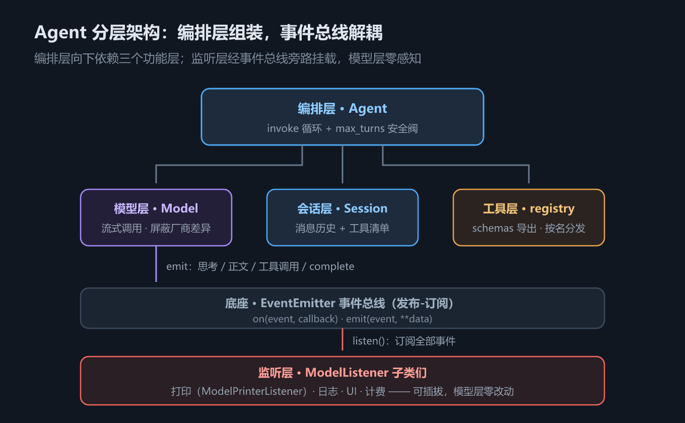

# S7 Agent：把循环装进盒子，让过程可观测

## 一、这一章要解决的问题

S6 里我们已经把 ReAct 循环跑通了：**调模型 → 请求工具 → 执行 → 回灌 → 再调模型**，直到模型给出最终回答。但回头审视那段代码，它是一个**脚本**，不是**组件**——

- **不可复用**：换一个模型客户端、换一组工具，就得复制粘贴整个循环再改一遍；
- **不可配置**：系统提示词、会话状态、工具清单全部硬编码在脚本里，组装方式没有收敛到一个入口；
- **不可观测**：过程信息靠散落的 `print` 输出，想换成写日志、渲染到 UI、按 token 计费，就得改动循环本身。

一句话概括这一章要做的事：**把模型、会话、工具、监听器组装成一个可直接对话、可复用、可观测的东西**。这个东西就是 **Agent**。

先给一个结论定调：Agent 不是新协议、不是新算法，**它就是一个装进盒子里的 while 循环**。盒子的价值不在循环本身（S6 已经证明循环只有几行），而在于：

| 维度 | S6 的手写脚本 | S7 的 Agent 组件 |
|------|--------------|-----------------|
| 组装方式 | 代码里逐个拼 | `Agent(...)` 一个构造入口 |
| 复用 | 复制粘贴 | 一个类，任意实例化 |
| 过程观测 | 散落的 print | **监听器**订阅事件流 |
| 死循环防护 | 没有 | `max_turns` 安全阀 |
| 工具注册 | 手工罗列 | registry 统一管理 |

那么什么时候该把脚本升级成 Agent？一个实用的判断表：

| 现状 | 判断 |
|------|------|
| 循环只跑一次、场景单一 | 脚本够用，别急着抽象 |
| 需要在多个入口（CLI / 服务 / 测试）复用同一套对话逻辑 | 该封装了 |
| 需要观测过程（调试、计费、审计） | 该封装了——先竖事件通道 |
| 模型可能陷入工具调用循环 | 该封装了——安全阀放进组件里，别靠人盯着 |

## 二、机制与原理

### 2.1 分层架构：编排层之下各司其职

参考《Agents底层逻辑》课件第 21 章的分层模型，我们的实现是同一套结构的极简版：



*图 h7　Agent 分层架构：编排层组装，事件总线解耦*

各层的职责与对应文件：

| 层 | 职责 | 代码位置 |
|----|------|---------|
| **编排层** Agent | 组装各层、跑 invoke 循环、设安全阀 | `agent/agent.py` |
| **模型层** Model | 屏蔽厂商 SDK 差异，流式调用并发出事件 | `agent/model.py` |
| **会话层** Session | 维护消息历史与工具清单 | `agent/session.py` |
| **工具层** registry | 工具注册、schema 导出、按名分发执行 | `agent/tool/` |
| **监听层** listener | 订阅事件，负责打印/日志/UI/计费 | `agent/listener.py`、`agent/printer.py` |
| 底座 EventEmitter | 发布-订阅事件总线 | `agent/events.py` |

分层的意义在于**依赖方向单一**：编排层向下依赖三个功能层，监听层通过事件总线旁路挂在模型层上——模型层不认识任何监听器，监听器也不侵入模型层。

与课件第 21 章的分层对照（名字不同，职责同构）：

| 本教程的层 | 课件第 21 章的对应物 | 一句话职责 |
|-----------|--------------------|-----------|
| 编排层 Agent | Agent / Runner | 决定「何时调模型、何时停」 |
| 模型层 Model | Model / LLM Client | 统一调用入口，发出事件 |
| 会话层 Session | Context / History | 管理上下文窗口里的消息 |
| 工具层 registry | Tool Registry | 声明能力、分发执行 |
| 监听层 listener | Hooks / Tracing | 旁路观测，不干扰主流程 |
| EventEmitter | Event Bus / Pub-Sub | 层间解耦的通信底座 |

### 2.2 `Agent.__init__`：组装即配置

看构造函数（摘自 `agent/agent.py`）：

```python
def __init__(self, client=None, model_listener=None, system_prompt=None,
             skills=None, max_turns=10, auto_builtin=True) -> None:
    self.max_turns = max_turns
    self.model = Model(client)
    if model_listener is not None:
        model_listener.listen(self.model)          # 监听器订阅模型事件

    if auto_builtin:                               # 内置工具：读文件/写文件/执行命令
        for t in (builtin_tools.read_file, builtin_tools.write_file,
                  builtin_tools.bash_command):
            registry.register(t)
    if skills is not None:                         # 可选：注册 load_skill 工具（S8）
        registry.register(make_load_skill_tool(skills))

    tools = list(registry.schemas())
    if system_prompt is None:
        system_prompt = render_prompt(skills=skills.list_skills() if skills else [])
    self.session = Session(system_prompt=system_prompt, tools=tools)
```

组装顺序是有讲究的，四步各干一件事：

1. **建模型层**，把监听器挂上去（此时事件通道就绪，之后每次调用的过程都能被观测）；
2. **注册内置工具**（`auto_builtin=True` 时自动注册读文件/写文件/执行命令三个）；
3. **可选注册 `load_skill`**——这是 S8 渐进式披露的钩子，Agent 只负责「如果给了技能注册表，就把加载工具装上」；
4. **渲染系统提示词、建 Session**——工具 schema 与系统提示词在会话创建时一次性定型。

注意参数表就是 Agent 的全部**配置面**：换模型、加监听器、改安全阀、开关内置工具，都不需要碰循环代码。这就是「脚本 → 组件」的核心收益。

顺带看清 `auto_builtin=True` 时自动注册的三个内置工具——它们让 Agent 一出生就能干活：

| 内置工具 | 参数 | 用途 |
|---------|------|------|
| `read_file` | `filepath` | 读本地文件进上下文 |
| `write_file` | `filepath`、`content` | 把模型产出写到磁盘 |
| `bash_command` | `command` | 执行命令行（真实环境里威力与风险并存） |

这三个工具与 S10 之后接入的 MCP 远程工具在 Agent 眼里地位完全平等——先记住这个伏笔。

### 2.3 invoke：与 S6 手写版逐行对照

再看循环本体（摘自 `agent/agent.py`）：

```python
def invoke(self, query: str) -> list[InvokeResult]:
    self.session.add_message({"role": "user", "content": query})
    results: list[InvokeResult] = []
    for _ in range(self.max_turns):
        resp = self.model.invoke(self.session, stream=True)
        results.append(resp)
        tool_results = registry.invoke(self.session.messages[-1])
        if tool_results is None:
            return results          # 模型不再请求工具：任务完成
        self.session.messages.extend(tool_results)
    print(f"[Agent] 已达最大轮次 {self.max_turns}，强制停止。", file=sys.stderr)
    return results
```

与 S6 的手写循环对照，逻辑完全同构，只有两处差异：

| 差异点 | S6 手写版 | S7 Agent |
|--------|----------|----------|
| 循环上限 | `while True` 靠人眼盯着 | `for _ in range(self.max_turns)` |
| 超限行为 | 不存在 | 打 stderr 警告，**返回**已得结果 |

`max_turns` 为什么**返回而不抛异常**？因为超限不等于失败：模型可能已经完成了大部分工作，只是没来得及收尾。把已产出的消息和结果还给调用方，调用方可以自行决定是续跑、换提示词还是报错；抛异常则会把这些中间状态全部丢掉。这也是为什么警告走 **stderr**——它是一条运维信号，不是任务结果的一部分，不应该污染正常输出流。

再把 3.1 节那次实测任务放进循环里逐轮追踪，看清状态如何流转（与 3.2 节的五条消息一一对应）：

| 轮次 | 循环动作 | 会话状态变化 |
|------|---------|-------------|
| 进入前 | `add_message(user)` | 系统提示词 + 用户消息（2 条） |
| 第 1 轮 | `model.invoke` → 请求 `web_search` | 追加助手消息（3 条） |
| 第 1 轮 | `registry.invoke` → 执行工具 | 追加 tool 消息（4 条） |
| 第 2 轮 | `model.invoke` → 纯文本回答 | 追加助手消息（5 条） |
| 第 2 轮 | `registry.invoke` → 返回 `None` | **循环结束，return** |

每一轮的分支只有两个：模型点菜（继续）或模型答复（终止）。所谓编排，就是维护这张状态表不出错。

### 2.4 监听器模式：可观测性的地基

观测能力来自三层极简机制。先是事件总线（摘自 `agent/events.py`）：

```python
class EventEmitter:
    def on(self, event: str, callback: Callable) -> None:
        self._handlers[event].append(callback)

    def emit(self, event: str, **data) -> None:
        for callback in list(self._handlers[event]):
            callback(event, **data)
```

模型层在流式调用中沿三条通道（**思考 / 正文 / 工具调用**）发事件，外加一个 `complete` 收尾事件。监听器基类则一次性订阅全部事件（摘自 `agent/listener.py`）：

```python
class ModelListener:
    def listen(self, model) -> None:
        for event in ALL_EVENTS:
            model.on(event, self._handler)

    def _handler(self, event: str, **data) -> None:
        raise NotImplementedError
```

子类只需要实现 `_handler`。`ModelPrinterListener`（`agent/printer.py`）就是一个约 40 行的实现：把 `content` 事件翻译成流式正文打印，把 `tool_call_end` 翻译成 `调用工具: xxx` 一行。事件全集在 S6 的 2.2 节已列成表——三条通道（思考/正文/工具调用）各配 START/正文/END，外加 `complete`，共十个事件名；`ModelListener.listen` 把它们**一次性全部订阅**，子类在 `_handler` 里按事件名分发即可。

**解耦的价值**在这里具象化：打印、日志、UI 渲染、token 计费，全都是不同的 `ModelListener` 子类；给 Agent 换一种观测方式，模型层**零改动**。反过来，模型层只在「发事件」这一个动作上付出成本，不知道也不关心谁在听。

几个典型的监听器形态，感受一下同一个接口能长出多少种东西：

| 监听器 | `_handler` 里做什么 |
|--------|--------------------|
| `ModelPrinterListener` | 流式打印思考/正文，工具调用打一行 |
| 日志监听器 | 把事件序列化写进日志文件/日志服务 |
| UI 监听器 | 推送到前端（WebSocket / SSE），渲染打字机效果 |
| 计费监听器 | 在 `complete` 事件里累计 usage token |
| 审计监听器 | 记录每次工具调用的参数与返回，供事后回放 |

## 三、代码：Python

实测脚本 `s07_agent.py`，运行命令：

```bash
cd "docs/agent开发教程/handwritten/code" && python s07_agent.py
```

脚本定义了一个教学版 `web_search` 工具（返回固定 JSON），并注入 `FakeClient` 按剧情驱动——这正是 S1 讲过的「模型接口契约」红利：假模型与真 SDK 返回形状一致，`Model` 层代码零改动。先看脚本骨架（摘自 `s07_agent.py`）：

```python
@tool(query="搜索关键字")
def web_search(query: str) -> str:
    """根据关键字搜索网络，返回结构化搜索结果（教学：固定样例）"""
    return ('{"results": ['
            '{"title": "WorkBuddy 发布 5.0", "snippet": "支持多智能体协作"},'
            '{"title": "Buddy 加油站上新", "snippet": "签到积分可兑权益"}]}')

registry.register(web_search)   # 内置工具由 Agent 自动注册，自定义工具要显式注册

client = FakeClient([
    {"match": "AI 领域最近有什么新闻",
     "resp": {"tool_calls": [{"name": "web_search", "arguments": {"query": "AI 最近新闻"}}]}},
    {"match": lambda msgs: any(m.get("role") == "tool" for m in msgs),
     "resp": {"content": "搜到两条：WorkBuddy 发布 5.0（多智能体协作）；…"}},
])

listener = ModelPrinterListener()
agent = Agent(client=client, model_listener=listener)
agent.invoke("AI 领域最近有什么新闻？")
```

### 3.1 组装与一次多步任务（实测输出）

```text
== 1. Agent 组装与一次多步任务 ==
--- 终端输出开始 ---
调用工具: web_search
内容：搜到两条：WorkBuddy 发布 5.0（多智能体协作）；Buddy 加油站上新（签到积分兑权益）。
--- 终端输出结束 ---
```

两行输出对应两次模型调用：第一次模型请求工具（监听器打印 `调用工具: web_search`），第二次模型给出最终回答（流式打印 `内容：…`）。中间的工具执行与结果回灌对用户完全透明——这就是编排层该有的样子。

> 实现备注：脚本第二条响应规则用**函数匹配**（检查上下文里是否已有 tool 消息）而非字符串匹配。`FakeClient` 的字符串匹配只对照最后一条 user 消息，而工具往返后 user 消息不变，字符串匹配会永远落空——这个小坑在写自己的测试脚本时同样会遇到。

### 3.2 行车记录仪：完整消息序列（实测输出）

把监听器换成（或加上）`session.print_friendly()`，就能事后回放完整轨迹：

```text
== 2. 行车记录仪：完整消息序列 ==
=== 会话 aecac5bc…（5 条消息）===
[系统] # 角色 你是运行在用户终端里的编码助手，通过工具完成实际操作。  ## 运行环境 - 工作目录：D:\ProjectCode\my-notes-and-uti…
[用户] AI 领域最近有什么新闻？
[助手] 请求调用工具: web_search
[工具](web_search) {"results": [{"title": "WorkBuddy 发布 5.0", "snippet": "支持多智能体协作"},{"title": "Bud…
[助手] 搜到两条：WorkBuddy 发布 5.0（多智能体协作）；Buddy 加油站上新（签到积分兑权益）。
```

（会话 ID 与系统提示词里的工作目录路径随运行环境变化。）五条消息就是一次完整任务的全部状态：系统提示词、用户输入、工具请求、工具结果、最终回答。调试 Agent 问题时的第一动作永远是看这份轨迹——**上下文里有什么，模型就看见什么**。

### 3.3 max_turns 安全阀（实测输出）

第三段脚本让模型**每一轮都请求工具**（`once: False` 的无限工具调用剧本），观察安全阀：

```text
== 3. max_turns 安全阀：模型疯起来时兜底 ==
模型每次都请求工具 → 第 3 轮被强制停止（消息数 8）
```

消息数 8 的构成：系统提示词 1 + 用户消息 1 + 三轮「助手请求工具 + 工具结果」共 6 条。第 3 轮结束后达到 `max_turns=3`，循环退出并打 stderr 警告。没有这个阀门，一次死循环就是真金白银的 token 消耗——**Loop Engineering 的第一条实践就是给循环上保险**。

### 3.4 外部 API 工具的真实形态

教学版 `web_search` 返回固定 JSON；真实接入只需换函数体（以 Tavily 为例，**需 API Key，未实测**）：

```python
# from tavily import TavilyClient
# resp = TavilyClient(api_key=...).search(query=query)
# return json.dumps(resp, ensure_ascii=False)
```

对 Agent 与模型而言，工具是真是假完全不可感知——**工具 schema + JSON 返回**的契约一旦稳定，实现可以随时替换：

| 对比项 | 教学版 | 真实接入（Tavily 等） |
|--------|--------|---------------------|
| 函数签名 | 完全相同 | 完全相同 |
| 返回内容 | 固定 JSON 样例 | 真实搜索结果 JSON |
| 依赖 | 无 | 第三方 SDK + API Key |
| 失败模式 | 不会失败 | 网络超时、限流、Key 失效（需补错误处理） |
| 模型侧感知 | 无差别 | 无差别 |

这也是 S10 MCP 要做的事：把这个「可替换」标准化成协议。

## 四、常见坑与边界条件

四个坑都来自实测代码本身，按「症状 → 根因 → 解法」整理。

**坑 1：监听器回调异常会沿 emit 传播，中断整个模型调用。**
- **症状**：某个监听器抛异常，整个 `invoke` 直接崩掉，报错栈里却找不到模型层的错。
- **根因**：`EventEmitter.emit` 对回调没有任何保护（见 2.4 节代码），异常沿 `emit` → 模型层 → invoke 循环一路穿透。本教学实现刻意未隔离，让你看清事件链路。
- **解法**：生产实现必须在 emit 里对每个回调 try/except——观测组件的故障不应该杀死业务调用。最少要打日志并继续调用下一个监听器。

**坑 2：全局 registry 的注册顺序影响 schemas 顺序。**
- **症状**：同样的问题，两次运行模型选了不同的工具。
- **根因**：`Agent.__init__` 里工具清单来自 `registry.schemas()`，而 schema 列表的顺序就是注册顺序。模型看到的工具顺序受此影响（先看到的工具在概率上更容易被选中）。
- **解法**：先注册高频核心工具，再做批量注册；保持注册顺序确定，行为才可复现。

**坑 3：`auto_builtin` 的重复注册是覆盖语义。**
- **症状**：你自定义的 `read_file` 行为悄悄变了。
- **根因**：registry 的 `register` 对同名工具是覆盖而非报错。创建两个 Agent、或先手动注册再让 Agent 自动注册同名内置工具，后者会无声顶掉前者。
- **解法**：给自定义工具起不同的名字；或传 `auto_builtin=False` 关掉自动注册，显式控制工具集。排查「我的工具怎么行为变了」时先查注册顺序。

**坑 4：system_prompt 缺省渲染依赖 cwd。**
- **症状**：模型拿着错误的路径调 `read_file`，返回「文件不存在」。
- **根因**：缺省系统提示词会把创建 Agent 时的当前工作目录注入「运行环境」节（见 3.2 实测输出）。如果脚本先 `os.chdir()` 再创建 Agent，注入的就是 chdir 后的目录——工具的工作路径与提示词声明不一致。
- **解法**：要么显式传 `system_prompt`，要么保证创建 Agent 之后再 chdir。

## 五、关键结论

1. **Agent = 装进盒子的 while 循环**。循环本体只有十行（2.3 节），组件化的收益全部来自组装入口、配置面与事件旁路。
2. **可观测性靠监听器，不靠 print**。事件总线 + `ModelListener` 让打印/日志/UI/计费成为可插拔的外围组件，模型层零改动。
3. **`max_turns` 返回而非抛异常**：超限时保住中间状态，把「下一步怎么办」的决定权交给调用方。
4. 这个约 200 行的 Agent 与框架线第 5 章 `create_agent` 的循环是**同一件事**——框架的价值在中间件与持久化，不在循环本身。理解了这一章，框架线的 `create_agent` 对你就是「换了名字的旧相识」。
5. 循环里唯一的新钩子是 `skills` 参数——它通向 S8 的渐进式披露，下一章展开。

## 本章要点回顾

- Agent 解决的是 S6 遗留的三个问题：**不可复用、不可配置、不可观测**。
- 分层架构：编排层（Agent）→ 模型层（Model）/ 会话层（Session）/ 工具层（registry）→ 监听层（listener），底座是 **EventEmitter 事件总线**，分层与《Agents底层逻辑》课件第 21 章同构。
- `__init__` 四步组装：建模型挂监听 → 注册内置工具 → 可选注册 load_skill → 渲染提示词建 Session。
- `invoke` 与 S6 同构，新增 `max_turns` 安全阀；超限**返回**结果并打 stderr，不抛异常。
- 监听器模式：`ModelListener` 订阅全部事件，`ModelPrinterListener` 把事件流翻译成终端输出；解耦让观测方式可插拔。
- 实测确认三件事：两行终端输出对应两次模型调用；`print_friendly` 回放完整五消息轨迹；`max_turns=3` 在模型死循环时以消息数 8 强制收场。
- 四个坑：监听器异常会穿透 emit、registry 注册顺序影响模型行为、`auto_builtin` 覆盖同名工具、缺省提示词依赖 cwd。
