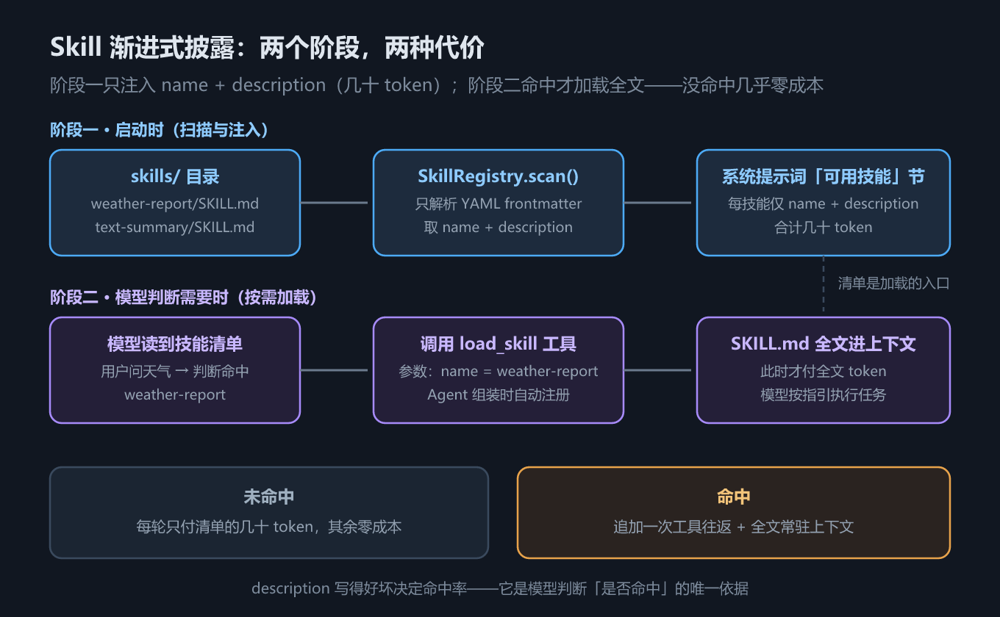

# S8 Skill：提示词按需加载，没命中几乎零成本

## 一、这一章要解决的问题

写过大一点的 Agent 系统你就会发现**提示词膨胀**（prompt bloat）：

- 智能客服要把产品手册、退换货规则写进系统提示词；
- 数据分析 Agent 要把指标口径、SQL 规范写进系统提示词；
- 天气播报 Agent 要把播报格式、着装建议规范写进系统提示词……

这些内容有个共同特征：**只在特定场景才用得上**。用户十次提问里九次不问天气，可天气播报规范每一轮都躺在系统提示词里——每一轮都在为它付费，占上下文窗口，还稀释模型对真正相关指令的注意力。

直观的解法是「需要时再给」：模型用到时才把指引读进上下文。问题是，**模型怎么知道「存在这份指引」？又怎么「读」它？**

S8 的答案叫 **Skill（技能）**，核心机制叫**渐进式披露**（progressive disclosure）：

| 阶段 | 时机 | 注入内容 | 代价 |
|------|------|---------|------|
| 一 | 启动时 | 每个技能的 name + description（几十 token） | 几乎为零 |
| 二 | 模型判断需要时 | 该技能的 SKILL.md 全文 | 才付全文代价 |

**没命中几乎零成本，命中才付全文价格**——这就是 Skill 相对「全塞进系统提示词」的本质优势。

把三种候选解法摆在一起，Skill 的位置就清楚了：

| 解法 | 思路 | 问题 |
|------|------|------|
| 全塞进系统提示词 | 一劳永逸，模型永远「知道」 | 每轮付费、稀释注意力（本节的问题） |
| 运行时检索（RAG） | 按相似度检索片段注入 | 引入向量库与切分工程；指引类内容短小完整，检索收益低 |
| **Skill（本节）** | 清单常驻，全文按需 | 只多一个工具往返；机制零新意 |

指引类内容的特点是**短小、完整、触发条件明确**（「用户问天气时」）——恰好不适合检索、恰好适合「清单 + 按名加载」。

## 二、机制与原理

### 2.1 渐进式披露的两阶段



*图 h8　Skill 渐进式披露的两个阶段*

**阶段一：启动时只交「目录」。**
`SkillRegistry` 扫描技能目录下的每个 `<name>/SKILL.md`，只解析头部 frontmatter，把 `name + description` 交给 Agent 渲染进系统提示词的「可用技能」节。每个技能在上下文里只占几十 token，模型由此知道「有哪些技能、分别在什么场景用」。

**阶段二：命中才读「全文」。**
模型判断用户需求与某个技能相关时，调用 `load_skill` 工具（Agent 在组装时自动注册，见 S7 的 2.2 节），工具返回 SKILL.md 全文。此时技能的操作指引才进入上下文，模型按指引执行任务。

两个阶段的接力点是一个普通的工具调用——**没有任何新机制**，Skill 是用「工具 + 提示词」这两个旧零件拼出来的新能力。

有人会问：为什么不让模型「自己读文件」？因为模型**不能主动发起任何动作**（S4 的核心事实）：它只能发出工具调用请求，由宿主执行后把结果回灌。所以「需要时才读」必须落成一个工具——`load_skill` 就是为此而生的。同时，模型必须先知道「有哪些文件可读」，这只能靠启动时注入清单——两阶段机制是被模型的被动性逼出来的，不是拍脑袋的设计。

### 2.2 SKILL.md 格式与 frontmatter 解析

先看技能目录的组织形式——**一个技能 = 一个目录 + 一个 SKILL.md**：

```text
skills/
├── text-summary/
│   └── SKILL.md
└── weather-report/
    └── SKILL.md
```

一个技能就是一个目录加一个文件。看实测用的天气技能（`skills/weather-report/SKILL.md`）：

```markdown
---
name: weather-report
description: 天气查询场景的工作指引：如何调用天气工具、如何组织回答
---

# 天气查询技能

## 步骤
1. 从用户消息中提取城市名；没有城市时先反问。
2. 调用 get_weather 工具（参数 city），获取天气数据。
3. 用一句话播报：城市 + 温度 + 天气现象 + 一条着装建议。

## 规则
- 工具返回的数据不得修改；查不到的城市明确说查不到，禁止编造。
- 回答不超过两句话。
```

头部是 **YAML frontmatter**（`name` / `description` 两行），正文是给模型看的操作指引。解析器是手写的（摘自 `agent/skill.py`）：

```python
def parse_frontmatter(text: str) -> dict:
    """只支持简单的 key: value 行（够 SKILL.md 用），不引入 PyYAML。"""
    meta: dict[str, str] = {}
    if not text.startswith("---"):
        return meta
    for line in text.split("\n")[1:]:
        if line.strip() == "---":
            break
        if ":" in line:
            key, _, value = line.partition(":")
            meta[key.strip()] = value.strip()
    return meta
```

**不引 PyYAML 的取舍**：frontmatter 只需要两个标量字段，13 行手写解析就够了；省一个依赖，也让「披露的入口只有几十 token」这件事看得见摸得着。代价是脆弱性——缩进、多行值、引号转义都不支持，见第四节坑 1。

### 2.3 技能注册表与 load_skill 工具

`SkillRegistry` 的三个方法正好对应三个角色：

| 方法 | 角色 | 返回内容 |
|------|------|---------|
| `scan()` | 启动时扫描目录 | 解析每个 SKILL.md 的 frontmatter |
| `list_skills()` | 供系统提示词渲染 | 只有 `name + description` 的清单 |
| `load(name)` | 供 load_skill 工具调用 | SKILL.md **全文** |

`load_skill` 工具本身由工厂函数生成（摘自 `agent/skill.py`）：

```python
def make_load_skill_tool(skills: SkillRegistry):
    @tool(name="要加载的技能名，来自系统提示词中的可用技能清单")
    def load_skill(name: str) -> str:
        """读取一个技能的完整说明（SKILL.md 全文），按说明执行该领域的任务"""
        return skills.load(name)
    return load_skill
```

工具描述里明确写了「按说明执行该领域的任务」——这句话是在告诉模型：**拿到的不是数据，是操作规程**。与 S7 对照：Agent 的 `__init__` 只要发现 `skills` 参数非空，就自动把这个工具注册进 registry，再让 `render_prompt` 把 `list_skills()` 的结果写进「可用技能」节。组装逻辑在 S7 已经讲过，这里看到的是它的第一次实战。

还有一个容易被忽略的细节——`load` 对**不存在的技能名**的容错（摘自 `agent/skill.py`）：

```python
def load(self, name: str) -> str:
    skill = self._skills.get(name)
    if skill is None:
        return f"错误：没有名为 {name} 的技能。可用技能：{', '.join(self._skills) or '无'}"
    with open(skill["path"], encoding="utf-8") as f:
        return f.read()
```

返回的是**一段错误提示文本**（列出可用技能），而不是抛异常。为什么？因为这条错误会作为 tool 消息回灌给模型——模型读到「可用技能：text-summary, weather-report」后可以**自己纠正重试**。把错误设计成模型可读、可行动的文本，是工具设计的基本功（S4 的 `isError` 思路在这里的延续）。

### 2.4 与框架线的对照

框架线第 16 章的 `SkillsMiddleware` 是同一机制的工程化版本，逐项对照：

| 环节 | 本教程手写版 | 框架线 SkillsMiddleware |
|------|------------|------------------------|
| 技能来源 | 本地目录（构造参数传入） | `sources` 配置（目录 / 包 / 远程） |
| 清单注入 | `render_prompt(skills=...)` 手动渲染 | 中间件自动注入系统提示词 |
| 加载工具 | Agent 组装时注册 `load_skill` | 中间件预装，开箱即用 |
| 上下文管理 | 无（全文常驻） | 提供裁剪钩子 |

**机制完全一致**，中间件只是帮你预装了这套组装。公共技能生态（如 skills.sh 的 `npx skills add` 一句话安装社区技能，参考《Agents底层逻辑》课件第 23 章）也建立在这个格式约定之上：**SKILL.md 是技能的通用货币**——正因为它足够简单（一个目录、一个文件、两行 frontmatter），才能长出跨框架流通的生态。

## 三、代码：Python

实测脚本 `s08_skill.py`，运行命令：

```bash
cd "docs/agent开发教程/handwritten/code" && python s08_skill.py
```

脚本五节的分工：第 1–2 节验证**阶段一**（扫描与清单注入），第 3–4 节验证**阶段二**（对话中的按需加载），第 5 节是**对照组**（无技能时的表现）——一个脚本把机制的两阶段和对照实验全部覆盖。

### 3.1 扫描出的技能清单（实测输出）

`skills/` 目录下有两个技能：

```text
== 1. 扫描到的技能（注入系统提示词的只有这些）==
- text-summary：文本摘要场景的工作指引：摘要的结构与长度要求
- weather-report：天气查询场景的工作指引：如何调用天气工具、如何组织回答
```

这就是阶段一的全部产出——两条 name + description，合计几十 token。

扫描逻辑有三个不起眼但值得记住的细节（见 2.2 节 `SkillRegistry`）：

1. **只看 `<目录>/SKILL.md`**：目录里放其他文件（脚本、数据）不影响扫描，但只有 SKILL.md 定义技能；
2. **按目录名排序**（`sorted(os.listdir(...))`）：清单顺序确定，注入提示词的顺序才稳定；
3. **name 缺省回落到目录名**（`meta.get("name", entry)`）：frontmatter 忘写 name 不会让技能消失，只是名字变成目录名——静默容错，好或坏取决于你是否知道这个语义。

### 3.2 系统提示词里的技能清单节（实测输出）

```text
== 2. 系统提示词中的技能清单节（截取）==
## 可用技能
以下技能提供特定领域的完整工作指引。当用户需求与某个技能相关时：
先调用 load_skill 工具读取该技能的完整说明，再按说明执行。

- text-summary：文本摘要场景的工作指引：摘要的结构与长度要求

- weather-report：天气查询场景的工作指引：如何调用天气工具、如何组织回答

…
```

注意这段提示词还教会了模型**使用姿势**：先 `load_skill` 读全文，再按说明执行。清单节的模板逻辑是通用的（「与需求相关时先读全文」），具体技能名与描述由扫描结果填充——**模板管流程，数据管内容**，这正是提示词工程里最值得复用的拆分方式。

### 3.3 三轮工具往返：模型自己走完全流程（实测输出）

用户问「今天天气怎么样？」，`FakeClient` 按剧本驱动。剧本本身值得一看（摘自 `s08_skill.py`）——三段响应规格各自用匹配条件锁定一个轮次：

```python
client = FakeClient([
    {   # 第 1 轮：模型看到技能清单，判断需要天气技能 → 先读全文
        "match": "天气",
        "resp": {"tool_calls": [{"name": "load_skill",
                                 "arguments": {"name": "weather-report"}}]},
    },
    {   # 第 2 轮：上下文里已出现技能全文 → 按指引调天气工具
        "match": lambda msgs: "weather-report" in tool_text(msgs),
        "resp": {"tool_calls": [{"name": "get_weather",
                                 "arguments": {"city": "哈尔滨"}}]},
    },
    {   # 第 3 轮：工具已返回天气数据 → 按技能的播报格式回答
        "match": lambda msgs: '"temperature"' in tool_text(msgs),
        "resp": {"content": "哈尔滨当前 -8°C，晴，西北风3级；建议穿羽绒服并注意防风。"},
    },
])
```

`tool_text` 是脚本里的辅助函数：把所有 tool 消息的文本拼起来供匹配——真实模型的决策机制与之类似（看上下文里有什么再决定下一步），只是判断发生在权重里而非 if 里。

完整轨迹（会话 ID 与工作目录路径随运行变化）：

```text
== 4. 完整轨迹（三次工具往返：load_skill → get_weather）==
=== 会话 748807d0…（7 条消息）===
[系统] # 角色 你是运行在用户终端里的编码助手，通过工具完成实际操作。  ## 运行环境 - 工作目录：D:\ProjectCode\my-notes-and-uti…
[用户] 今天天气怎么样？
[助手] 请求调用工具: load_skill
[工具](load_skill) --- name: weather-report description: 天气查询场景的工作指引：如何调用天气工具、如何组织回答 ---  # 天气查询技能 …
[助手] 请求调用工具: get_weather
[工具](get_weather) {"city": "哈尔滨", "temperature": "-8", "condition": "晴", "wind": "西北风3级"}
[助手] 哈尔滨当前 -8°C，晴，西北风3级；建议穿羽绒服并注意防风。
```

逐轮拆解这三步，每一步都是模型的自主决策：

1. **读技能**：模型看到技能清单，判断「天气」命中 `weather-report`，调用 `load_skill` 拿全文；
2. **调工具**：按技能指引的步骤 2，调用 `get_weather(city="哈尔滨")`；
3. **按规范回答**：按技能的播报格式——城市 + 温度 + 天气现象 + 着装建议，且不超过两句话。

没有任何一行代码写死「先读技能再调工具」，全靠阶段一注入的几十 token 清单 + 模型的工具调用能力完成。这就是渐进式披露的精妙之处：**机制在启动时布置，决策在运行时发生**。

### 3.4 对照实验：没有 Skill 会怎样（实测输出）

脚本第 5 节把 `skills=None` 传给 Agent——没有技能清单，剧本里也没有安排任何工具调用，模型面对同一个问题只能裸答：

```text
== 5. 对照：没有 Skill 时，模型对「怎么播报」一无所知 ==
(无技能清单、无天气工具 → 模型只能空泛回答或编造)
```

同一个问题「今天天气怎么样？」，模型既不知道有 weather-report 技能，也没有 `get_weather` 可调，只能给出空泛回答或直接编造天气数据。两组实测对照，技能的价值一目了然：**清单给模型「知道去哪找」的能力，全文给模型「知道怎么做」的能力**。

### 3.5 一笔 token 账（估算，未实测）

把两种方案在「100 轮对话、其中 5 轮问天气」场景下的开销列成表（数值为**量级估算，未实测**，取决于具体模板与指引长度）：

| 方案 | 每轮固定开销 | 命中轮额外开销 | 100 轮总账（估算） |
|------|------------|--------------|------------------|
| 全塞系统提示词 | 全文几百 token × 每轮 | 0 | 几万 token |
| Skill | 清单几十 token × 每轮 | 命中轮付一次全文 | 清单总账 + 5 次全文 |

差距随「非命中轮占比」放大——指引越专业、场景越窄，Skill 省得越多。反过来，如果一个指引**几乎每轮都会命中**，Skill 的两段式反而多付清单钱，直接写进系统提示词更划算。**机制没有优劣，只有与使用频率的匹配度**。

## 四、常见坑与边界条件

**坑 1：手写 frontmatter 解析的脆弱性。**
2.2 节的解析器只认 `key: value` 单行：**缩进、多行值（YAML 的 `|` 块）、引号转义一概不支持**。如果 description 里写冒号后跟复杂结构，解析结果会静默出错（不报错，但字段内容不对）。症状很隐蔽：技能扫描得到但 description 缺胳膊少腿，模型命中率莫名下降。**解法**：技能字段保持「一行一个简单值」，需要复杂结构时放正文而不是 frontmatter；对格式要求高的团队直接上 PyYAML，代价只是多一个依赖。

**坑 2：description 写不好 → 模型永不命中。**
description 是模型决定是否 `load_skill` 的**唯一依据**。写得含糊（「处理一些事情」）或与用户的措辞不重叠（用户说「退货」而描述写「售后流程」），模型就可能永远不触发加载——而且**不会有任何报错**，技能安静地躺在这里，仿佛不存在。**解法**：写 description 时问自己，**用户会用什么词提出这个场景的请求？** 把这些词写进去；上线后用真实问法做回归测试。

**坑 3：技能指引引用了不存在的工具。**
SKILL.md 里写「调用 get_weather 工具」，但组装 Agent 时忘了注册 `get_weather`——模型会忠实地尝试调用，然后收到「未知工具」错误，整个流程卡死或退化成编造。**技能与工具要配套交付**：技能目录与工具注册属于同一个功能包，拆开发布就会踩这个坑。**解法**：在 SKILL.md 开头列出本技能依赖的工具，组装时逐项核对；测试技能时故意断开工具，确认失败路径可控。

**坑 4：技能全文加载后常驻上下文。**
`load_skill` 返回的全文会作为 tool 消息留在会话历史里，**没有卸载机制**——长会话中多个技能全文累积，膨胀问题会换个形式回来：单轮省的钱，被长会话慢慢吃回去。这是本实现的刻意取舍（保持机制简单）。**解法**：生产系统可以用会话裁剪（框架线第 16 章的中间件有相关钩子）定期清理过期的技能消息；或在技能指引末尾提示模型「任务完成后无需再参考本指引」，为裁剪创造语义空间。

## 五、关键结论

1. **Skill 解决提示词膨胀**：特定场景才需要的指引，不该让所有轮次买单。
2. **渐进式披露两阶段**：启动时注入 name + description（几十 token），命中时才经 `load_skill` 加载全文——没命中几乎零成本。
3. **机制零新意**：技能 = 目录约定（SKILL.md）+ 清单注入（提示词）+ 按需加载（工具），全是 S1–S7 的旧零件；两阶段设计是被「模型不能主动发起动作」逼出来的。
4. **错误要设计成模型可读的文本**：`load` 不存在的技能返回「错误 + 可用技能清单」，模型能自己纠正重试。
5. **description 是命中率的一切**，技能引用的工具必须配套注册，全文常驻上下文是本实现的已知取舍。
6. 机制没有优劣，只有与使用频率的匹配度：几乎每轮命中的指引直接写进系统提示词，场景越窄 Skill 越划算。
7. 与框架线第 16 章 `SkillsMiddleware` 同机制；SKILL.md 格式是公共技能生态（skills.sh 等）的通用货币。S9 会看到另一条工具来源——MCP，届时两者定位之别会非常清晰。

## 本章要点回顾

- 问题：**提示词膨胀**——场景性指引每轮付费；解法：**渐进式披露**，没命中几乎零成本，命中才付全文代价。
- 阶段一：`SkillRegistry.scan()` 解析 frontmatter，`list_skills()` 注入系统提示词「可用技能」节；阶段二：模型调 `load_skill` 工具拿 SKILL.md 全文。
- 两阶段设计是被模型的被动性逼出来的：模型不能主动读文件，只能通过工具往返；也必须先有清单才知道该调哪个工具。
- SKILL.md = YAML frontmatter（name/description）+ 正文指引；`parse_frontmatter` 手写 13 行解析，不引 PyYAML。
- 实测走通三轮往返：`load_skill` → `get_weather` → 按技能规范播报（-8°C，晴，西北风3级，着装建议）；对照组无技能无工具，模型只能空泛或编造。
- Agent 侧零新增机制：S7 的 `skills` 参数自动注册 load_skill 并渲染清单。
- `load` 对不存在的技能返回「错误 + 可用技能清单」，模型可自纠——错误要设计成模型可读的文本。
- 四个坑：frontmatter 解析脆弱、description 决定命中率、技能与工具必须配套、全文常驻无卸载。
- 一句话带走：清单解决「知道有」，全文解决「知道怎么做」，而**命中与否，取决于 description 里有没有用户的词**。
