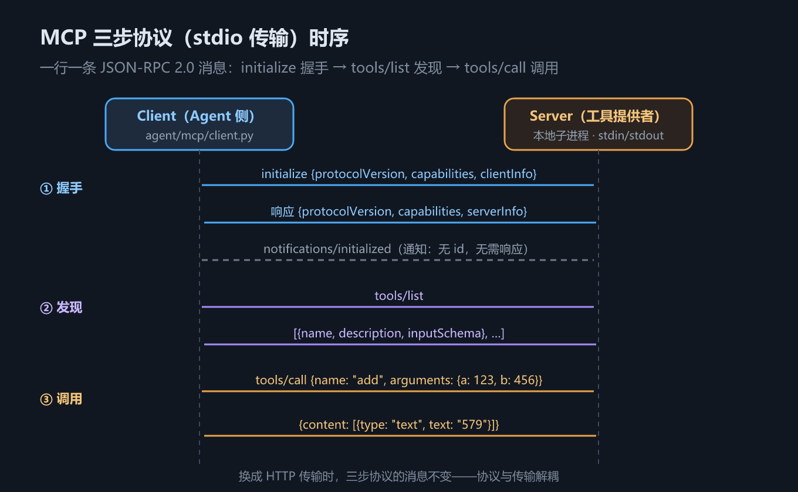

# S10 MCP：把工具来源标准化，一次实现两头复用

## 一、这一章要解决的问题

S7 的工具跑在自己进程里，S8 的技能写在本地目录里——它们都只在「我这个 Agent」里可用。设想一个更大的图景：

- **M 个应用**（编码助手、客服机器人、数据分析平台……）都想接工具；
- **N 个工具提供者**（搜索服务、文件系统、日历、数据库……）都想被接入。

没有标准时，这是 **M×N 集成问题**：每一对「应用 × 提供者」都要单独写接入代码，M=10、N=10 就是一百份胶水代码，且各自漂移、无人维护。

**MCP（Model Context Protocol，模型上下文协议）**的解法是把「Agent 与工具提供者」的通信标准化：

- 提供者实现一次 **Server**，任何 MCP 客户端都能用它；
- 应用实现一次 **Client**，任何 MCP 服务器都能接入；

M×N 塌缩成 **M + N**。一次实现，两头复用。

什么信号说明你需要 MCP 了？对照这张表：

| 现状 | 判断 |
|------|------|
| 工具全在自己进程里，一个 Agent 用 | S7 的 registry 够用，别上协议 |
| 想用别人写好的工具服务器（搜索、数据库、浏览器……） | 需要 **Client** |
| 想让自己的工具被任意 Agent 使用 | 需要 **Server** |
| 两种都要（多数平台的终态） | 两端都实现——本章正好两端都手写 |

这一章我们**手写**协议的两端：一个约 130 行的 stdio 服务器、一个同步的客户端封装，再把 MCP 工具注册进 S7 的 Agent——目标是让你看到：**协议内核小到可以徒手实现**。

## 二、机制与原理

### 2.1 协议内核：角色、传输、消息

| 概念 | 内容 | 本教程的实现 |
|------|------|-------------|
| **角色** | Client = Agent 侧；Server = 工具提供者 | `agent/mcp/client.py` / `mcp_servers/time_server.py` |
| **传输** | stdio（本地子进程）或 HTTP（远程） | 手写 **stdio** 版；HTTP 留作练习 |
| **消息格式** | **JSON-RPC 2.0**：`{jsonrpc, id, method, params}` | 一行一条 JSON，无帧头、无魔法 |

JSON-RPC 2.0 请求长这样：

```json
{"jsonrpc": "2.0", "id": 1, "method": "tools/call", "params": {"name": "add", "arguments": {"a": 123, "b": 456}}}
```

`id` 有值的是**请求**（需要响应），没有 `id` 的是**通知**（不需要响应）。stdio 传输下每个消息就是一行文本——**stdout 是协议通道，stderr 才是日志通道**，这条纪律后面会反复出现。

JSON-RPC 2.0 的消息一共四种形态，MCP 全用得上：

| 形态 | 识别特征 | 例子 |
|------|---------|------|
| 请求 | 有 `id` + `method` | `{"jsonrpc":"2.0","id":1,"method":"tools/list"}` |
| 成功响应 | 有 `id` + `result` | `{"jsonrpc":"2.0","id":1,"result":{"tools":[…]}}` |
| 错误响应 | 有 `id` + `error` | `{"jsonrpc":"2.0","id":9,"error":{"code":-32601,"message":"未知方法 …"}}` |
| 通知 | 有 `method`、**无 `id`** | `{"jsonrpc":"2.0","method":"notifications/initialized"}` |

双方靠 `id` 配对请求与响应：客户端发出带 `id` 的请求后，读到 `id` 相同的行才算收到答案。理解了这张表，后面服务端与客户端的每一行代码都只是在实现它。

### 2.2 三步协议

MCP 服务器的全部协议义务只有三步（握手 → 发现 → 调用）：



*图 h9　MCP 三步协议（stdio 传输）时序*

1. **initialize 握手**：客户端声明自己的 `protocolVersion`、`capabilities`、`clientInfo`；服务器回应自己支持的版本、能力与 `serverInfo`。双方由此确认「我们说的是同一种方言」。
2. **notifications/initialized**：客户端发一条通知（无 id、无响应），宣告初始化完成。
3. **tools/list 与 tools/call**：客户端拉取工具清单（每项含 `name` / `description` / `inputSchema`），随后按名调用，取回 `content` 文本。

注意 `inputSchema` 是**服务器给**的——客户端不需要知道工具的参数怎么定义，照单转述给模型即可。工具的「自我描述」集中在服务器一端，这正是标准化带来的分工。

为什么三步就够、不能再省？握手解决「方言对不对」（版本协商），发现解决「有什么可调」（模型需要 schema 才能点菜，这是 S4 定下的契约），调用解决「怎么调」。三步各对应一个不可省略的问题——协议设计的下限不是「越少越好」，而是「每个字段都有存在的理由」。

### 2.3 手写服务器走读

`mcp_servers/time_server.py` 全文约 130 行，主干三段。**主循环**（摘自 `time_server.py`）：

```python
def main() -> None:
    print(f"[{SERVER_INFO['name']}] 已启动，等待请求", file=sys.stderr)
    for line in sys.stdin:                       # stdin 逐行读
        line = line.strip()
        if not line:
            continue
        try:
            request = json.loads(line)
        except json.JSONDecodeError:
            print(f"[{SERVER_INFO['name']}] 非法 JSON 行已忽略", file=sys.stderr)
            continue
        response = handle(request)               # 分发处理
        if response is not None:
            sys.stdout.write(json.dumps(response, ensure_ascii=False) + "\n")
            sys.stdout.flush()                   # stdout 逐行写，记得 flush
```

**分发函数** `handle()` 是一个 if 链：`initialize` 返回版本与能力；`tools/list` 返回 TOOLS 表；`tools/call` 按名执行并包成 `{"content": [{"type": "text", "text": ...}]}`；未知方法返回 JSON-RPC 错误码 `-32601`。TOOLS 表里 `add` 工具的声明长这样（摘自 `time_server.py`）：

```python
{
    "name": "add",
    "description": "计算两个整数的和（确定性工具，用于验证协议）",
    "inputSchema": {
        "type": "object",
        "properties": {
            "a": {"type": "integer", "description": "第一个整数"},
            "b": {"type": "integer", "description": "第二个整数"},
        },
        "required": ["a", "b"],
    },
}
```

这份 inputSchema 与 S5 里 `@tool` 装饰器生成的 schema **形状完全一致**（JSON Schema 的 `type: object`）——所以它才能被 `Tool.from_mcp` 原样转发给模型。工具调用这条契约从 S4 一路贯穿到 S10，没有变过。

`tools/call` 的执行分支也值得看一眼——错误被包成**带 `isError` 的正常响应**而不是 JSON-RPC error：

```python
try:
    ...
    return _result(req_id, {"content": [{"type": "text", "text": text}]})
except TypeError as e:
    return _result(req_id, {
        "content": [{"type": "text", "text": f"参数错误：{e}"}],
        "isError": True,
    })
```

区分两级错误：**协议错误**（方法不存在、JSON 不合法）走 JSON-RPC `error`；**业务错误**（参数不对、工具执行失败）走 `isError` 标记的正常响应。前者是「我们没说同一种话」，后者是「话说明白了，但事情没办成」——模型的参数填错了该重试，通道坏了该重连，不能混为一谈。

**日志纪律**：所有运行信息（启动提示、非法行警告）一律走 **stderr**——如果混进 stdout，客户端会把日志当协议消息解析，JSON 解析立刻失败，整个通道错乱。`json.JSONDecodeError` 时选择「忽略脏行继续」而不是崩溃，也是对脏环境的容忍。

**两个工具的设计意图**：`get_current_time` 返回**动态结果**（时间随运行变化），`add` 返回**确定性结果**（`123 + 456 = 579` 永远不变）。一个验证「协议活着」，一个可精确复现——写协议示例时，确定性工具是验证的金标准。

### 2.4 传输层走读：StdioRpc 与 id 配对

客户端传输层 `agent/mcp/jsonrpc.py` 的核心是 `request()` 的读循环（摘自 `jsonrpc.py`）：

```python
def request(self, method: str, params: dict | None = None) -> dict:
    req_id = uuid.uuid4().hex[:8]
    self._send({"jsonrpc": "2.0", "id": req_id, "method": method, ...})
    while True:
        line = self.proc.stdout.readline()
        if not line:
            raise RpcError(-32000, "服务器提前退出（stdout 已关闭）")
        line = line.strip()
        if not line:
            continue
        try:
            msg = json.loads(line)
        except json.JSONDecodeError:
            continue                      # 不是 JSON 的行（脏输出）忽略
        if msg.get("id") == req_id:
            if "error" in msg:
                raise RpcError(...)       # JSON-RPC 错误 → 异常
            return msg.get("result", {})
        # 其他消息（服务器主动通知等）忽略
```

三处防御性设计，每处对应一种真实世界里的脏情况：

| 设计 | 防的是什么 |
|------|-----------|
| 脏行 `continue` 忽略 | 服务器日志/调试输出混进 stdout |
| id 不匹配的行忽略 | 服务器主动通知、迟到的旧响应 |
| `readline` 返回空 → 报错 | 子进程崩溃，stdout 关闭，避免死等 |

也要看到这个教学实现的边界：`readline` 是**阻塞读、没有超时**——服务器卡死时客户端会永远等下去。生产实现必须加超时与并发读（官方 SDK 用 asyncio 解决，见第四节坑 3）。子进程生命周期也很朴素：`close()` 关掉 stdin，服务器以 **stdin EOF** 为退出信号——「写完关灯」，协议之外的第三个约定。

### 2.5 Agent 接入：协议抹平工具来源

客户端封装 `MCPClient`（摘自 `agent/mcp/client.py`）把三步协议打包：

```python
def register_tools(self, registry) -> list[Tool]:
    tools: list[Tool] = []
    for server_name, infos in self.list_tools().items():
        for info in infos:
            call_fn = self._make_call_fn(server_name, info["name"])
            tools.append(registry.register(
                Tool.from_mcp(server_name, info, call_fn)))
    return tools
```

配套的 `Tool.from_mcp`（摘自 `agent/tool/core.py`）做了两件关键的事：

```python
tool.name = f"{server_name}__{info['name']}"   # time__add：防跨服务器同名冲突
tool._external_schema = {
    "type": "function",
    "function": {
        "name": tool.name,
        "parameters": info.get("input_schema") or {...},  # 直接用服务器给的
    },
}
```

- **命名规范 `server__tool`**：两个服务器都有 `search` 工具时不会互相覆盖；
- **参数 Schema 直接转发**服务器返回的 `inputSchema`，本地不做二次建模——服务器是工具的唯一事实源。

注册完成后，Agent 眼里的 `time__add` 与本地 `@tool` 装饰器注册的 `web_search` **没有任何区别**：同样的 schema 导出、同样的按名调用。模型层、编排层对「工具来自本进程还是子进程」**零感知**——这就是协议抹平工具来源的价值。

## 三、代码：Python

实测脚本 `s10_mcp.py`，运行命令：

```bash
cd "docs/agent开发教程/handwritten/code" && python s10_mcp.py
```

脚本先配置服务器（一个 stdio 子进程），三节依次验证：裸协议、客户端封装、Agent 接入（摘自 `s10_mcp.py`）：

```python
server_config = {
    "servers": {
        "time": {"type": "stdio",
                 "command": sys.executable,
                 "args": [os.path.join(here, "mcp_servers", "time_server.py")]},
    }
}

rpc = StdioRpc(server_config["servers"]["time"]["command"],
               server_config["servers"]["time"]["args"])
result = rpc.request("initialize", {...})    # 第 1 节：手动走三步
```

### 3.1 裸协议交互（实测输出）

先不封装，手动走一遍三步协议，看最原始的 JSON：

```text
== 1. 裸协议：initialize → tools/list → tools/call ==
initialize → {"protocolVersion": "2024-11-05", "capabilities": {"tools": {}}, "serverInfo": {"name": "handwritten-time", "version": "0.1.0"}}
tools/list  → {"tools": [{"name": "get_current_time", "description": "获取指定时区的当前时间", "inputSchema": {"type": "object", "properties": {"timezone": {"type": "string", "descripti …
tools/call  → {"content": [{"type": "text", "text": "579"}]}
```

三行对应三步：握手响应带回了协议版本与 `serverInfo`；`tools/list` 拉到两个工具（输出截断处是 `inputSchema` 的字段描述）；`tools/call` 对 `add(123, 456)` 返回确定性结果 **579**。

### 3.2 MCPClient 封装后（实测输出）

```text
== 2. MCPClient：list_tools / call_tool ==
[time] get_current_time：获取指定时区的当前时间
[time] add：计算两个整数的和（确定性工具，用于验证协议）
call_tool(add) → 579
call_tool(get_current_time) → 2026-10-12 11:54:31 CST （时间值随运行时刻变化）
```

`add` 依旧是 579（可复现），时间值随运行时刻变化（动态工具的预期行为）。封装层的价值：调用方只看到 `list_tools()` / `call_tool()` 两个方法，三步握手全部藏在 `_connect()` 里。

### 3.3 Agent 接入与三轮对话（实测输出）

把 MCP 工具注册进全局 registry，然后正常对话：

```text
== 3. Agent 接入 MCP ==
注册表现有工具: ['time__get_current_time', 'time__add']
=== 会话 912f15e1…（7 条消息）===
[系统] # 角色 你是运行在用户终端里的编码助手，通过工具完成实际操作。  ## 运行环境 - 工作目录：D:\ProjectCode\my-notes-and-uti…
[用户] 现在几点了？顺便算一下 123 + 456
[助手] 请求调用工具: time__get_current_time
[工具](time__get_current_time) 2026-10-12 11:54:33 CST
[助手] 请求调用工具: time__add
[工具](time__add) 579
[助手] 现在是上海时间（见工具返回）；另外 123 + 456 = 579。
```

（会话 ID、时间值与工作目录路径随运行变化。）模型在同一个循环里先调「远程」的时间工具、再调「远程」的计算工具——但从 Agent 的代码看，这就是 S7 那个再普通不过的 invoke 循环，**一行 MCP 特判都没有**。

### 3.4 Skill vs MCP：谁来做，与怎么做

MCP 与 Skill 最容易被混为一谈，实际定位互补（参考《Agents底层逻辑》课件第 28 章）：

> **MCP 告诉模型「谁来做」（确定性能力），Skill 告诉模型「怎么做」（流程知识）。**

| 维度 | MCP 工具 | Skill |
|------|---------|-------|
| 定位 | 能力：可执行的操作 | 知识：操作的方法论 |
| 上下文消耗（未命中） | 工具 schema 每轮都在（几十 token/个） | 清单几十 token/技能 |
| 上下文消耗（命中） | 返回结果一次性入上下文 | 全文加载后常驻（无卸载，S8 坑 4） |
| 接入成本 | 实现协议三步（或接现成 Server） | 写一个 SKILL.md |
| 确定性 | 高：同一输入同一输出 | 低：模型按指引自由发挥 |
| 越权风险 | 有：工具真执行，需权限管控 | 无：只有文字，不落地 |

**最佳实践**：用 MCP 定义底层工具（文件、命令、搜索、接口调用），用 Skill 定义业务流程（怎么订票、怎么退货——流程里可以引用 MCP 工具）。两者叠加才是完整形态：**Skill 指挥，MCP 落地**。以「帮用户订一张明天的机票」为例，两者在同一个循环里的分工：

| 步骤 | 由谁驱动 | 内容 |
|------|---------|------|
| 1 | Skill（`flight-booking` 全文） | 指引：先问出发地，再查航班，最后确认价格才能下单 |
| 2 | MCP 工具（`flight__search`） | 真正查询航班数据 |
| 3 | MCP 工具（`flight__book`） | 真正下单（权限管控在这层做） |
| 4 | Skill | 指引：按公司模板生成订票确认话术 |

抽掉 Skill，模型有工具却不知道流程顺序与确认红线；抽掉 MCP，模型背得出台词却办不成一件实事。

## 四、常见坑与边界条件

**坑 1：子进程 stdout 混入日志 → JSON 解析失败。**
手写 server 最大的坑。任何 `print()` 默认走 stdout，而 stdout 是协议通道——一行日志混进去，客户端按 JSON 解析立刻失败。两条防线：**日志纪律**（一律 `file=sys.stderr`，见 2.3 节）+ **客户端容忍脏行**（2.4 节的读循环里，解析失败的行忽略而不是崩溃，服务端主循环同样如此）。第三库尤其危险：import 时顺带打印 banner、依赖库往 stdout 写警告，都可能炸掉通道——接别人的 MCP server 前先跑一遍裸协议确认 stdout 干净。

**坑 2：Windows 上 zoneinfo 缺 tzdata。**
`get_current_time` 用的 `zoneinfo` 是标准库，但在 Windows 上没有系统时区数据库，`ZoneInfo("Asia/Shanghai")` 会抛异常。实测环境踩过这个坑：`requirements.txt` 里已加 `tzdata` 包。跨平台分发 MCP 服务器时，别假设「标准库就一定开箱能用」——标准库也可能依赖平台数据。

**坑 3：官方 SDK 是 asyncio 的，Jupyter / 同步代码里不能直接跑。**
官方 Python SDK 基于 asyncio + `ClientSession`，在 Jupyter 或纯同步代码里直接 await 会遇到「事件循环已在运行」或「无法嵌套」。课件的做法是起一个**独立线程跑事件循环**再桥接。本教程的同步手写实现天然规避了这个问题——教学场景下这是手写版的真实优势，不只是「为了教学而教学」。代价是 2.4 节说的：没有超时、没有并发读。

**坑 4：HTTP 传输未实现，但协议是同一套。**
`client.py` 遇到非 stdio 类型会显式报错（「手写客户端只实现了 stdio 传输」），留作练习。动手前先明确：**传输换 HTTP 时三步协议的消息一个字节都不用变**——变的只是「一行 JSON」变成「一个 HTTP 请求体」。协议与传输解耦，是 MCP 设计里最值得体会的一笔。

**边界：每次调用重连子进程。**
`MCPClient` 的 `list_tools` / `call_tool` 都是「连接 → 三步 → 关闭」，不复用连接。对教学演示无所谓，高频调用下进程启动开销会主导延迟。框架线第 7 章 `MCPAdapter` 管理连接生命周期（长连接、复用、异常重连），正是补上这一块。

## 五、关键结论

1. **MCP 解决 M×N 集成问题**：Server 实现一次、Client 实现一次，M×N 塌缩成 M + N。
2. **协议内核极小**：JSON-RPC 2.0 + 三步消息（initialize → tools/list → tools/call），stdio 传输就是「一行一条 JSON」，约 130 行可徒手实现。
3. **stdout 是协议通道**：日志必须走 stderr；客户端对脏行要有容忍。
4. **注册即抹平**：`Tool.from_mcp` 用 `server__tool` 命名 + 转发 `inputSchema`，Agent 对本进程工具与 MCP 远程工具零感知（3.3 节实测为证）。
5. **Skill 与 MCP 互补**：MCP 管「谁来做」，Skill 管「怎么做」；底层工具走 MCP，业务流程走 Skill。
6. 与框架线第 7 章 `MCPAdapter` 对照：框架帮你管**连接生命周期**（长连接、复用、重连），手写版每次调用重连子进程——这是教学取舍，不是协议要求。

## 本章要点回顾

- 问题：M 个应用 × N 个工具的两两接入不可维护；MCP 把「Agent 与工具提供者」通信标准化，一次实现两头复用。
- 内核：Client/Server 两角色、stdio/HTTP 两传输、JSON-RPC 2.0 消息（有 id 是请求，无 id 是通知）。
- 三步协议：initialize 握手（交换 protocolVersion/capabilities/serverInfo）→ notifications/initialized → tools/list 发现 → tools/call 调用（实测 `add(123,456)` 稳定返回 579）。
- 手写 server 主循环：stdin 逐行读 → handle 分发 → stdout 逐行写 + flush；**日志一律 stderr**；get_current_time 动态、add 确定性，一个验活一个复现。
- Agent 接入：`MCPClient.register_tools` + `Tool.from_mcp`（`server__tool` 命名、直接转发 inputSchema）；实测注册表出现 `time__get_current_time`、`time__add`，对话循环与 S7 完全同构。
- 四个坑：stdout 污染、Windows tzdata 缺失、官方 SDK 的 asyncio 与同步环境冲突、HTTP 传输留作练习（协议与传输解耦）。
- 最佳实践：MCP 定义「谁来做」，Skill 定义「怎么做」——上一章 S9 会看到，多 Agent 协作不过是把这个循环再套一层。
