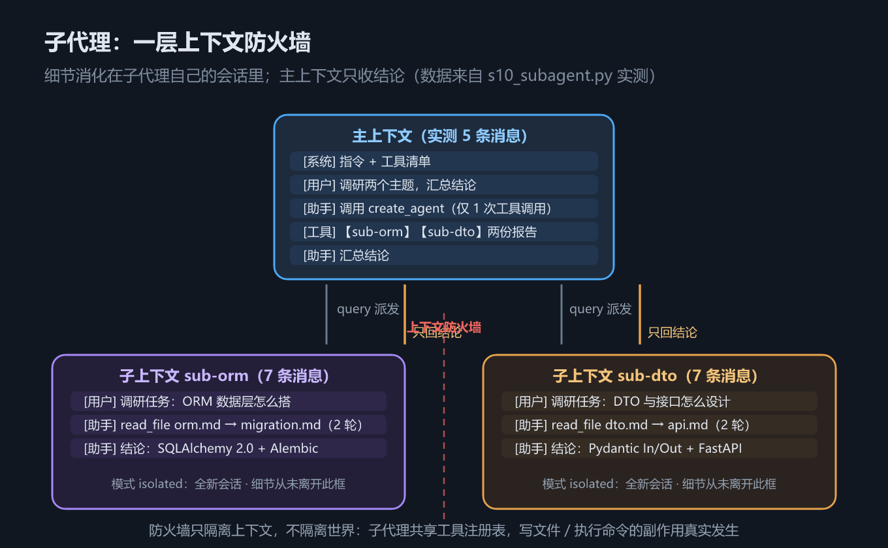

# S10 子代理：给每个子任务一个干净的上下文

> 手写线走到第十章，我们的 Agent 已经有了工具（S4）、ReAct 循环（S6）、事件系统与安全阀（S7）、技能（S8）和 MCP（S9）。但它始终只有一个会话——所有任务的细节都挤在同一条上下文里。这一章我们要给系统加上最后一层结构能力：**子代理（Sub Agent）**。

## 一、这一章要解决的问题

设想一个真实场景：用户说「给业务系统加一个订单导出功能」。如果把它整个塞进单个 ReAct 循环，会发生什么？

- **需求分析**：读代码、读文档，十几次 `read_file`，每次的文件内容都整段进入上下文；
- **建 ORM 模型**：写声明式模型、跑迁移，中间夹着报错与重试，每次报错的堆栈又是一大段；
- **写 DTO 与接口**：Pydantic 分层、路由注册，又是一轮读写往返；
- **写测试、修错误**：`bash_command` 反复执行，每条命令的输出——包括失败的——全部留在历史里。

几十次工具往返下来，会出现三个典型症状。

**症状一：注意力被稀释。** 模型的注意力要在全部上下文上分配。当上下文里有几十条工具输出时，最初那条用户需求只占其中很小一行——模型开始「忘记」最初的目标，后期决策质量肉眼可见地下降。

**症状二：费用滚雪球。** ReAct 循环每轮都把**全部历史**重新发给模型。上下文越长，单轮成本越高；轮次越多，历史越长——总费用随轮次接近平方级增长。S3 里我们说过会话只追加不删减，这在短任务里是纪律，在大任务里就成了负担。

**症状三：错误上下文污染。** 一次失败尝试的报错和废案会永久留在历史里。模型是有「惯性」的：它会被自己过去的失败经验带偏，后续步骤反复绕开本可用的方案，甚至为了「避开」根本不存在的坑而选择更差的路径。

《Agents底层逻辑》课件第 29 章把这个场景称为「单循环陷阱」。用一张表收拢三个症状：

| 症状 | 机理 | 后果 |
| --- | --- | --- |
| 注意力被稀释 | 上下文堆满工具输出，关键信息占比越来越低 | 后期决策偏离最初目标 |
| 费用滚雪球 | 每轮携带全部历史重新调用模型 | 总费用随轮次近平方增长 |
| 错误上下文污染 | 失败尝试永久留在历史 | 模型被自身废案「带偏」 |

问题的本质可以用一句话说清：**细节 ≠ 结论**。

调研「ORM 怎么搭」可能需要读十个文件、试两次迁移，但主代理真正需要的只是一句话结论：「用 SQLAlchemy 2.0 + Alembic」。让所有细节都挤占主上下文，等于用最贵的记忆干最杂的活。

更直观地算一笔账。上述功能的单循环消息增长大致是：

| 阶段 | 典型往返 | 累计消息数（含系统 / 用户） |
| --- | --- | --- |
| 需求分析 | 读 8 个文件 | 约 17 条 |
| 建 ORM 与迁移 | 写 2 次错 1 次 | 约 23 条 |
| DTO 与接口 | 写 3 次 | 约 30 条 |
| 测试与修复 | 跑命令 6 次 | 约 43 条 |

到第 30 条消息时，最初那句「加一个订单导出功能」缩在上下文第一行，四周是近三十条工具输出与报错——这就是注意力稀释的数学图景。而且这张表还是乐观估计：真实项目里的一次依赖冲突就能再加十几条往返。

## 二、机制与原理

解法出人意料地简单：**主代理只做宏观规划，把每个子任务派给一个拥有独立会话的子代理。**

子代理在自己的上下文里消化全部细节——读文件、试错、比对、汇总——最后只把一段**最终结论**回传给主代理。这层结构就像一道**上下文防火墙**：



*图 h10　子代理：一层上下文防火墙*

防火墙的规则只有三条：

1. **向下：只传任务**。主代理给子代理的只是一段任务描述（query），不附带自己的消息历史——子代理看不到、也不需要看到主代理聊过什么；
2. **向上：只回结论**。子代理返回的是最终报告，几十轮工具往返的细节全部留在防火墙另一侧；
3. **横向：互不可见**。两个子代理并行调研时，彼此的上下文完全隔离。

> 心智模型一句话：主上下文是「会议室」，子代理是「外勤组」——外勤组在外面跑断腿，回到会议室时只带一页纸的结论。会议记录（主会话）永远干净。

用一张表对比「不拆」与「拆」：

| 维度 | 单 ReAct 循环硬扛 | 主代理 + 子代理 |
| --- | --- | --- |
| 主上下文消息数 | 几十条（全部细节） | 5 条（见本章实测） |
| 注意力分配 | 结论被细节淹没 | 主上下文只剩任务与结论 |
| 费用曲线 | 每轮携带全部历史 | 子代理上下文短小且用完即弃 |
| 失败影响 | 报错永久污染主上下文 | 子代理内重试，废案不出防火墙 |
| 职责划分 | 一个循环干所有事 | 主代理规划，子代理执行 |

**防火墙不是唯一选项**，它和上下文治理的另外两手值得放在一起看：

| 手段 | 做的是什么 | 细节去了哪 |
| --- | --- | --- |
| 压缩 / 摘要（框架线第 9 章） | 把细节变成更短的细节 | 仍在本会话，只是变小了 |
| 裁剪 | 删掉旧细节 | 丢失，不可恢复 |
| 子代理（本章） | 细节从未进入主会话 | 在子会话里完整保留 |

压缩与裁剪是「事后止损」，子代理是「事前分流」。后者有个常被忽视的好处：细节在子会话里**完整无损**——如果调研方向错了，子代理的全部过程仍可回溯，主上下文却没有为之付出一分注意力。

实现上，子代理不需要任何新协议、新类、新循环——`create_agent` **就是一个普通工具**。它的三个关键性质：

- **独立会话**：每次派发都通过 `agent_factory` 闭包产出一个全新 `Agent`，拥有自己的 `Session`；
- **共享工具注册表**：子代理能用的工具与主代理相同（同一个全局 `registry`）；
- **不继承历史**：新 Agent 从零开始，主代理的消息一条都不带。

「是普通工具」这一点值得停下来想一想。它意味着：**模型不需要学任何新东西**——工具调用是它本来就会的动作；**框架不需要改一行循环代码**——子代理的运行复用同一个 ReAct 循环。整个子代理体系只靠「工厂 + 工具」两个既有概念组合而成。这是好设计的典型味道：新能力从旧概念里长出来，而不是另起炉灶。

顺带回答一个常见疑问：**为什么不做一个「自动拆解」机制，让框架自己决定何时派子代理？** 因为任务拆解本质上依赖对业务的理解，这正是模型在主上下文里擅长做的决策；框架如果把拆解规则写死，要么太僵（拆不出业务需要的粒度），要么太玄（黑盒魔法难以调试）。把拆解权交给模型、把派发能力交给工具——决策与机制分离，两边各做擅长的事。S10 之后的框架线会看到，成熟的实现（第 15 章）也是沿着这条边界走的。

返回值有**结构化约定**：每个子代理的报告以这样的前缀开头——

```text
【子代理名字】（N 轮调用，M 条消息，上下文独立）
<结论正文>
```

这个约定不是装饰，而是主子代理之间的**微型协议**：主代理要靠它把多份报告「对号入座」后汇总；`N 轮 / M 条消息` 给主代理提供了「这次调研花了多大代价」的可读信号。如果回传的是无结构自由文本，汇总就从「抄写题」退化成「理解题」——坑 2 会展开这一点。

这个前缀还有第二重价值：**它对代码同样可解析**。一个正则就能把报告拆成结构化条目，喂给监控面板、测试断言或费用归集——主代理读到的是文本，外围系统读到的是数据。接口设计成「人机双读」，是子代理系统的实用小技巧。

与 `docs/harness/` 原理篇的分工一句话：原理篇讲清「为什么必须做上下文隔离」（Agent = Model + Harness 中的记忆边界问题、五个必然问题里的「上下文从哪来到哪去」），本章给出「隔离的最小实现」——核心逻辑不到 30 行。

## 三、代码：Python

完整实现只有 39 行，核心是 `make_create_agent_tool` 这个工厂函数（代码摘自 `agent/subagent.py`，节选）：

```python
def make_create_agent_tool(agent_factory) -> object:
    """工厂：生成 create_agent 工具（闭包持有 agent_factory）。"""

    @tool(agents="子代理配置数组，每项包含 name（子代理名字）和 query（交给它的任务描述）")
    def create_agent(agents: list[dict]) -> str:
        """启动一个或多个子代理分别执行任务，返回每个子代理的最终结论"""
        reports = []
        for spec in agents:
            sub = agent_factory()          # 每个子代理都是全新 Agent
            results = sub.invoke(spec.get("query", ""))
            turns = len(results)
            final = results[-1].message.get("content") if results else ""
            reports.append(
                f"【{spec.get('name', 'sub-agent')}】（{turns} 轮调用，"
                f"{len(sub.session.messages)} 条消息，上下文独立）\n{final}"
            )
        return "\n\n".join(reports)

    return create_agent
```

逐个拆解关键点：

- **`agent_factory` 闭包**：`create_agent` 不直接 `Agent()`，而是调用外部传入的工厂。这让子代理的模型客户端、监听器等配置完全由组装方决定，工具本身保持无状态——同一个工具，装配出测试环境或生产环境的子代理；
- **`sub.invoke(...)`**：子代理内部跑的是**和主代理一模一样的 ReAct 循环**（见 `agent/agent.py` 的 `invoke`）。子代理不是新物种，只是又一个普通 Agent；
- **报告拼装**：`turns` 是 ReAct 轮数，`len(sub.session.messages)` 是子代理会话的消息总数；`results[-1]` 取的是最后一次模型输出——也就是子代理自己的「最终回答」；
- **参数 schema**：`@tool(agents=...)` 的描述字符串直接进入工具 schema，模型靠它理解「传一个数组、每项有 name 和 query」。工具描述质量就是子代理系统的 Prompt Engineering（下一章的五维之一）。

顺带回看子代理跑的循环本身（代码摘自 `agent/agent.py`，节选）：

```python
def invoke(self, query: str) -> list[InvokeResult]:
    """处理一条用户输入：跑完整个 ReAct 循环，返回每轮的调用结果。"""
    self.session.add_message({"role": "user", "content": query})
    results: list[InvokeResult] = []
    for _ in range(self.max_turns):
        resp = self.model.invoke(self.session, stream=True)
        results.append(resp)
        tool_results = registry.invoke(self.session.messages[-1])
        if tool_results is None:
            return results  # 模型不再请求工具：任务完成
        self.session.messages.extend(tool_results)
    print(f"[Agent] 已达最大轮次 {self.max_turns}，强制停止。", file=sys.stderr)
    return results
```

主代理调用它、子代理也调用它——同一个函数，两份独立的 `Session`，这就是「独立会话」的全部秘密。

把一次 `create_agent` 调用的完整时序摆出来：

1. 主代理模型输出工具调用：`create_agent({agents: [sub-orm, sub-dto]})`；
2. `registry.invoke` 执行工具体，进入 `for` 循环；
3. `agent_factory()` 产出 sub-orm 的**全新 Agent**——全新 `Session`，从零开始；
4. `sub.invoke(query)` 跑 3 轮 ReAct：读 `orm.md`、读 `migration.md`、给结论；
5. 拼装 sub-orm 的报告字符串；对 sub-dto 重复 3–5 步；
6. 两份报告 `join` 后作为一条 tool 消息回到主上下文，主代理汇总收尾。

注意第 4 步里发生的所有 `read_file` 都记在子会话的账上——主会话的账本里只有第 1、2、6 步。

组装方只需两行（代码摘自 `s10_subagent.py`，节选）：

```python
registry.register(make_create_agent_tool(
    agent_factory=lambda: Agent(client=client, auto_builtin=True)))

agent = Agent(client=client)
agent.invoke("调研数据层与 DTO/接口两个主题，汇总成结论给我。")
```

脚本让主代理调研两个独立主题（ORM 数据层、DTO 与接口设计），演示文件放在系统临时目录下；模型调用注入的是离线 `FakeClient`（剧本见 `s10_subagent.py` 顶部），因此输出确定、可复现。实际运行的输出（实测输出；系统提示词中的临时目录路径与会话 ID 随运行变化）：

```text
== 1. 主代理派发两个子代理 ==

== 2. 主代理的完整轨迹（注意：主上下文只有 1 次工具调用）==
=== 会话 b3a8f847…（5 条消息）===
[系统] # 角色 你是运行在用户终端里的编码助手，通过工具完成实际操作。  ## 运行环境 - 工作目录：C:\Users\ADMINI~1\AppData\Local…（路径随运行变化）
[用户] 调研数据层与 DTO/接口两个主题，汇总成结论给我。
[助手] 请求调用工具: create_agent
[工具](create_agent) 【sub-orm】（3 轮调用，7 条消息，上下文独立） 结论：用 SQLAlchemy 2.0 声明式模型 + Alembic 迁移，一个 migration…（打印截断，完整报告还含 sub-dto 段落）
[助手] 两个子代理已完成调研：数据层用 SQLAlchemy 2.0 + Alembic；DTO/接口用 Pydantic 分层 + FastAPI。
主上下文消息数：5

== 3. 上下文防火墙效果 ==
两个子代理各自的调研往返（读文件、比对、汇总）全部发生在独立会话里，
主上下文只收到一段汇总文本——这就是子代理的价值。
```

把实测数字逐项读一遍：

| 观测点 | 实测值 | 含义 |
| --- | --- | --- |
| 主上下文消息数 | 5 | 系统 + 用户 + 助手调用 + 工具结果 + 汇总，一个不多 |
| 主代理工具调用次数 | 1 | 只有一次 `create_agent`，两个子任务在同一参数里派发 |
| 工具结果内容 | 两份报告拼接 | `【sub-orm】…【sub-dto】…`，结构化前缀清晰可辨 |
| sub-orm 报告头 | 3 轮调用，7 条消息 | 读 `orm.md`、读 `migration.md`、给结论；1 用户 + 3 助手 + 3 工具 |
| sub-dto 报告头 | 同样 7 条消息 | 读 `dto.md`、读 `api.md`、给结论 |
| 子代理消息是否进主会话 | 否 | 主上下文的 5 条里没有一条是 `read_file` 的结果 |

做个反事实推演：假如不用子代理，把两个子代理各自的 7 条消息直接搬进主会话，主上下文将变成 5 − 1 + 14 = 18 条——看似不多，但其中 **12 条是 `read_file` 的文件内容**，是纯粹的「干细节」。主代理后续每一轮都要为这 12 条付注意力与费用，而它们对「汇总结论」这个目标的边际价值是零。子任务再复杂一点（每个子代理 20 条消息），差距就是数量级的。

**并发说明**：教学实现里两个子代理串行执行——好处是输出确定、剧本匹配简单、便于对照理解。生产实现完全可以用线程池或异步并发，在**一轮** `create_agent` 调用里同时发出多个子任务，报告拼装逻辑不变。两个子任务本就相互独立，串行纯属教学取舍。

与框架线第 15 章 Deep Agents 的 `task` 工具对照，派发有两种模式：

| 模式 | 子代理起点 | 适用场景 |
| --- | --- | --- |
| **isolated**（本实现） | 全新空上下文 | 子任务自包含，不依赖主代理的现场 |
| **fork** | 复制当前代理的上下文再分叉 | 子任务需要「继承现场」（已读文件、已定方案） |

选哪种，取决于子任务是否依赖主代理已有的背景——不是越「干净」越好。

## 四、常见坑与边界条件

**坑 1：防火墙只隔离上下文，不隔离世界。**

子代理与主代理**共享同一个工具注册表**，也就共享同一个真实世界。子代理写文件、执行命令，后果是真实发生的：主上下文看不到写文件的过程，但文件系统已经变了。把子代理当「沙箱」是危险的——它是**视野隔离**，不是**权限隔离**。

要限制子代理的能力，应当在工厂里给它装配更少的工具（比如只读、不写），而不是指望防火墙兜底：

```python
agent_factory=lambda: Agent(client=client, auto_builtin=False)  # 只读子代理：不装配写文件 / 执行命令
```

一个具体的翻车案例：你派两个子代理「分别调研 A、B 两个方案」，它们共享的 `bash_command` 都会真实执行——子代理 A 的试验脚本删了子代理 B 正要读的缓存文件，而两者的主代理对此一无所知。防火墙挡住了信息，挡不住副作用。

**坑 2：报告格式不约定，汇总变成猜谜。**

如果 `create_agent` 返回的是各子代理的自由文本，主代理拿到的就是一坨无结构信息：哪段属于哪个任务？调研了几轮？哪份结论更可信？全部要靠模型脑补。子代理一多、报告一长，脑补就会出错——而且错得悄无声息。

`【名字】（N 轮调用，M 条消息）` 这个前缀约定成本几乎为零，却让汇总从「理解题」变成「抄写题」。设计子代理系统时，**回传格式与任务描述同样重要**——前者是子代理对主代理的接口，后者是主代理对子代理的接口，两个方向都要设计。

一个最小的好实践：在 query 里就写明「最后给结论，结论里包含 X、Y、Z」。回传接口在派发时就被约定，而不是事后祈祷子代理自觉。

**坑 3：深度嵌套的上下文成本与失控风险。**

子代理还能再派子代理吗？技术上完全可以——子代理的注册表里同样有 `create_agent`。但要警惕三重代价：

- **规划精度**：每深一层，任务描述必须更精确，否则最底层拿到的是传了两次的「传话游戏」；
- **信息损耗**：每层回传都只保留结论，跨层传递时细节丢失不可逆；
- **费用相乘**：父代理一轮 + 子代理 N 轮 + 孙代理 M 轮，总调用量是乘积关系。

经验法则是：两层（主 → 子）覆盖绝大多数场景；三层以上应先怀疑任务拆分方式不对，而不是继续嵌套。

一个粗算：主代理 1 轮派发、两个子代理各 5 轮、某个孙代理再 5 轮——最坏路径上是 1 + 5 + 5 = 11 次模型调用，而每层报告回传都只保留结论。第三层看到的任务描述，已经经过两次「压缩转述」，偏差会被逐层放大。

**坑 4：父代理的 `max_turns` 不覆盖子代理。**

S7 里的安全阀 `max_turns` 是每个 Agent **各自独立计数**的：父代理 10 轮的上限，管不了子代理在自己的循环里跑多少轮——子代理有自己的 `max_turns`（`agent/agent.py` 中各自的构造参数）。

后果：一个子任务死循环时，父代理会**同步等它**撞上自己的安全阀才罢休。串行实现下这会放大成整体阻塞；并发实现下则表现为某个分支悄悄吞掉预算。给不同层级的代理显式配置轮次上限，是子代理系统的基本卫生：

```python
agent_factory=lambda: Agent(
    client=client, auto_builtin=True,
    max_turns=6,   # 子代理轮次独立设小：调研类任务不该跑太深
)
```

要点只有一句：**子代理的 `max_turns` 在工厂里显式给**，别吃默认值。

**边界条件：结论里必须自带主代理所需的事实。**

本实现里子代理的结果只以文本形式回传，**不回传它读过的文件内容**。如果子任务发现的信息需要主代理亲自处置（比如「这个文件必须改第 3 行」），结论里必须把必要细节**写清楚**——防火墙挡掉的是过程，不是主代理后续行动所需的事实。一句话：派发前想清楚「我最后要拿什么」，结论里就要求子代理写什么。

## 五、关键结论

1. **子代理 = 上下文防火墙**：主上下文只保留任务与结论（实测 5 条消息、仅 1 次工具调用），全部细节消化在子代理的独立会话里（各 7 条消息，从未进主会话）；
2. **`create_agent` 是普通工具**：以 `@tool` 装饰、参数为配置数组、经 `agent_factory` 闭包产出全新 Agent——独立会话、共享工具注册表、不继承历史；新能力从旧概念里长出来，不另起炉灶；
3. **它不是权限隔离**：子代理写文件、跑命令的后果真实存在，限权要在工厂里做；
4. **报告格式是协议**：`【名字】（N 轮调用，M 条消息）+ 结论` 的约定让汇总可依赖，回传接口与派发接口同等重要；
5. **两层为宜**：isolated 与 fork（框架线第 15 章）对应「从零开始」与「继承现场」两种拆分需求；深度嵌套前先怀疑拆分方式。

从工程视角看，S10 一次性落了两个维度：**Loop Engineering**（把一个长循环拆成多个短循环，让每个循环都可靠收敛）和 **Graph Engineering**（主代理与子代理构成一张显式的任务拓扑）。这正是下一章的主题——把这十章里散落的工程实践，收拢成五个维度。

## 本章要点回顾

- **为什么**：单 ReAct 循环扛大任务，会遭遇注意力稀释、费用滚雪球、错误上下文污染三大症状——细节 ≠ 结论；
- **是什么**：主代理只做规划，每个子任务派给拥有独立会话的子代理，只回传结论——上下文防火墙，规则三条：向下只传任务、向上只回结论、横向互不可见；
- **怎么实现**：`create_agent` 是普通工具，`agent_factory` 闭包每次产出全新 Agent（见 `agent/subagent.py`）；子代理复用同一个 ReAct 循环（见 `agent/agent.py`）；
- **实测**：主上下文 5 条消息、仅 1 次工具调用；子代理各 3 轮调用、7 条消息，全部留在防火墙内侧；
- **坑**：防火墙不隔离世界、报告格式要约定、嵌套宜浅、`max_turns` 各自独立计数、结论里要自带主代理所需事实；
- **延伸**：并发执行与 isolated / fork 两种派发模式，见框架线第 15 章；上下文隔离的原理推导见 `docs/harness/`。

最后留三道自测题，答得出才算真正掌握这一章：

1. 为什么子代理不能当沙箱用？要限制子代理能力，正确的位置在哪里？
2. 如果去掉报告的 `【名字】（N 轮调用，M 条消息）` 前缀约定，主代理的汇总环节会发生什么？
3. 父代理 `max_turns=10`、两个子代理各自默认 10 轮时，整条链路**最多**可能发生多少次模型调用？这个数字由谁决定？
4. 如果两个子任务有依赖（先定 ORM 才能写 DTO），本章的「一次派发两个子任务」还适用吗？你会怎么改派发方式？（提示：串行多次 `create_agent`，或让后一个子任务的 query 引用前一份结论。）
