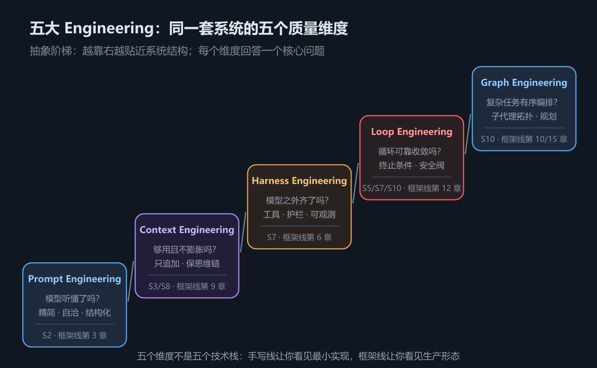

# S11 五大 Engineering：从会写到写好

> S1–S10 回答的是「怎么实现」——从模型契约一路写到子代理，我们的 Agent 跑起来了。但「跑起来」和「跑得好」之间隔着一条经验的鸿沟。这一章不写代码，而是把前面散落各章的实践收拢成五个工程维度，回答最后一个问题：**怎么做好**。

## 一、这一章要解决的问题

先交代两个背景事实。

第一，**Harness** 这个词并非本书生造。Mitchell Hashimoto 在记录自己的 AI 采纳历程时，把「围绕模型搭建的那圈脚手架」称为 harness——从马具「挽具」引申而来：模型是马，挽具决定这匹马能拉什么车、拉得稳不稳。OpenAI 随后的 Harness Engineering 博文让这个提法在业界流行开来（以上为《Agents底层逻辑》课件引用来源，一句话带过）。

第二，一个拼写勘误：课件原文将 Engineering 误拼为 **Engeering**，本教程统一使用正确拼写 **Engineering**——错字无伤大雅，但这五个名字会反复出现在你的工程文档与检索关键词里，值得写对。

现在看问题本身。S1–S10 的每一章都解决了一个「有没有」的问题：

| 「有没有」问题（前十章已解决） | 「好不好」问题（本章） |
| --- | --- |
| 提示词写进系统提示了吗？（S2） | 提示词是不是精简、自洽、结构化的？ |
| 会话保存历史了吗？（S3） | 历史在 50 轮后还能撑住吗？ |
| 工具注册进 registry 了吗？（S4） | 危险操作有护栏吗？出问题能观测吗？ |
| ReAct 循环能转了吗？（S6） | 循环保证收敛吗？死循环有安全阀吗？ |
| 子代理能派发了吗？（S9） | 任务拓扑是刻意设计的，还是随机长出来的？ |

左边一列问的是**存在性**，右边一列问的是**质量**。让系统从「存在」走向「高质量存在」，靠的不是更多代码，而是方法论。

这五个「好不好」也不是本书的私人发明，而是业界在 Agent 实践中沉淀下来的**方法论分层**——《Agents底层逻辑》课程第 30–34 章将它们命名为五个 Engineering：**Prompt、Context、Harness、Loop、Graph**。本章逐一拆解，并把每一维映射回本书手写线的章节与框架线章节。

它们的出场方式也很能说明问题：课程把五维安排在全部实现性内容（1–29 章）**之后**讲——方法论的命名总是晚于方法的实践，就像「面向对象」这个词出现在大量面向对象代码之后。本教程的手写线也是同样的顺序：先写出来，再回头看写的是什么。

为什么值得专门用一章做这件事？因为不收拢就会遗忘。学完 S1–S10 你手里有十几块积木，但如果没有一张全景图，下次遇到「我的 Agent 效果不好」时，你不会知道该从哪块积木查起。五个维度就是那张全景图：**任何 Agent 问题，都能定位到其中一维或几维的缺口。**

还有一个自然的追问：**为什么恰好是五个，不是三个或八个？** 因为五个维度各自对应一类独立失效模式，两两之间既不可互相替代、也无法合并：Prompt 错了 Context 救不了（指令自相矛盾，历史再多也没用）；Loop 不可收敛时 Harness 再稳也白搭（工具再好，循环停不下来就等于零）；而 Graph 解决的「多任务编排」在单任务系统里根本不会出现。五个问题彼此正交，又恰好覆盖「从一句话到一套系统」的全部层级——这大概就是它被业界普遍接受的原因。

## 二、机制与原理

五个维度可以排成一条**抽象阶梯**：越靠前越贴近模型本身，越靠后越贴近系统结构。

*图 h11　五大 Engineering 总览*

阶梯的读法有三层。

**第一层：自下而上是依赖关系。**

- **Prompt** 是模型直接的输入面——写什么，模型就按什么理解任务；
- **Context** 决定除 prompt 外还有什么进入模型视野——历史、检索结果、技能正文；
- **Harness** 提供工具与护栏等「模型之外的一切」——没有它，模型只会说话不会做事；
- **Loop** 把前三层装进一个可靠收敛的循环——让「说」变成「做、看结果、再做」；
- **Graph** 在循环之上编排多个循环——子代理拓扑、任务规划、显式状态机。

**第二层：每个维度回答一个核心问题。** 模型听懂了吗？上下文够用且不膨胀吗？模型之外的一切齐了吗？循环可靠收敛吗？复杂任务有序编排吗？——五个问题依次对应五维。漏掉任何一问，系统都会在对应层面失控，而且**失控的表现恰好暴露缺的是哪一维**：答非所问是 Prompt 缺口、越聊越糊涂是 Context 缺口、有手无脚是 Harness 缺口、停不下来是 Loop 缺口、一团乱麻是 Graph 缺口。

**第三层：五个维度不是五个技术栈。** 它们是**同一套系统的五个质量维度**。你写的每一行 Agent 代码都同时处于这五个维度上——一个 `@tool` 装饰器既是 Harness（工具供给），其描述质量又影响模型要不要调它（Prompt 面），好不好用还决定循环几轮收敛（Loop 面）。

先用一句话定义给五维各立一块牌子：

| 维度 | 一句话定义 | 类比 |
| --- | --- | --- |
| Prompt Engineering | 把任务说明写到模型能听懂 | 把话说明白 |
| Context Engineering | 把该看见的给模型，不该占位的挡在外面 | 整理桌面 |
| Harness Engineering | 供给做事的工具，管住做事的边界 | 装备与保险 |
| Loop Engineering | 保证「做—看—再做」能稳定走到终点 | 刹车与油门 |
| Graph Engineering | 多个循环之间的分工与协作 | 组织架构图 |

维度之间还存在**放大与抵消**关系，这是「逐项对照」比「依次专精」更有效的原因：

- **Context 放大 Loop**：历史失控让每轮输入变长变脏，模型更容易在噪声里做出错误工具调用，循环被拖向死循环——反过来，干净的历史让每一轮决策更果断，轮数下降；
- **Harness 放大 Prompt**：工具描述写得好，模型对「什么时候用什么工具」的理解就准，系统提示里的任务描述压力也随之减轻——工具 schema 本身就是提示词的一部分；
- **Graph 抵消 Context 压力**：S9 的防火墙本质上是 Graph 结构（主 + 子拓扑）替 Context 维度扛住了膨胀；
- **Loop 抵消 Graph 风险**：每个子循环各自带安全阀，才敢放心把任务拆成拓扑——没有 Loop 兜底的 Graph 是把风险乘以节点数。

用一张映射表把前十章放到五维坐标系里（框架线对应章见第三节总表）：

| 章节 | 主要落点维度 | 次要落点维度 |
| --- | --- | --- |
| S2 系统提示词 | Prompt | — |
| S3 会话 | Context | — |
| S4 工具包 | Harness | Prompt（工具描述） |
| S5 错误回喂 | Loop | Context（错误进历史） |
| S6 ReAct 循环 | Loop | — |
| S7 事件系统与安全阀 | Harness + Loop | Context（轨迹可回放） |
| S8 技能 | Context（渐进式披露） | Prompt（清单注入） |
| S10 MCP | Harness（工具生态） | — |
| S9 子代理 | Graph + Loop | Context（防火墙） |

两个容易误解的地方需要提前澄清。

**误解一：维度之间是学习顺序。** 并非「先学好 Prompt 再学 Graph」——它们更像体检指标，应当**逐项对照、整体改善**。实践中最常见的组合拳是 Context 治理（裁剪历史）与 Loop 收敛（安全阀）同时做，因为两者互相放大：历史失控会把循环拖向死循环，循环失控又让历史疯长。

**误解二：维度与代码量正相关。** Graph Engineering 听起来最「高级」，但它的最小实现（S9 的子代理）只有 30 行；Prompt Engineering 听起来最「基础」，做好它需要的迭代次数往往最多。**维度的高度衡量的是抽象层级，不是难度或工作量。**

**误解三：五维只属于「大系统」。** 恰恰相反，小项目从五维获益更直接——大厂有平台组兜底 Harness、有评测体系兜底 Loop，而独立开发者身兼数职时，五维总表就是你的外包清单：哪一维没人管，哪一维迟早爆雷。S1–S10 每章几十行代码就是证明：质量维度的落实从来不取决于团队规模，只取决于有没有人记得它。

## 三、五个维度逐一拆解

每个维度按统一结构展开：**回答什么问题 → 核心手段 → 本书哪里实践了它 → 框架线哪里对应**，末尾附一条反模式与三问自查清单——读完可以直接拿去对照自己的项目。

### 1. Prompt Engineering——让模型听懂

- **回答什么问题**：模型听懂了吗？同样的底层能力，指令写法不同，表现可以差出一个量级。
- **核心手段**：
  - **精简**——删掉不产生行为差异的话，每一句都在争夺模型的注意力预算；
  - **自洽**——指令之间不互相打架（「要详细」与「要简短」同时出现，模型只能掷硬币）；
  - **全局约束**——放系统提示一次生效，而不是每轮对话里重复叮嘱；
  - **静态**——用模板渲染，运行时只换变量，提示词主体不随对话漂移；
  - **结构化**——角色 / 环境 / 规则 / 输出格式分节，让模型的「阅读理解」有路标。
- **本书哪里实践了它**：S2 提炼的**系统提示词五原则**正是这套手段的落地；S7 的默认提示词模板（`agent/prompt.py` 渲染角色与工具清单）是「静态 + 结构化」的实例；S4 的工具描述字符串也在这个维度里——工具 schema 就是写给模型看的「提示词」。
- **框架线哪里对应**：框架线第 3 章的 ChatPromptTemplate 把「模板 + 变量注入」工业化，支持 few-shot 槽位、消息列表拼装与角色模板。
- **反模式**：提示词越写越长、互相矛盾、把示例和规则混在一起——典型症状是「改一句、坏三处」。
- **上手自查**：
  - 系统提示里有没有互相打架的指令？删掉一遍再读一遍；
  - 工具描述是否说清了「什么时候该用、什么时候不该用」；
  - 每轮对话里是否在重复系统提示已有的话？

### 2. Context Engineering——让上下文够用且不膨胀

- **回答什么问题**：上下文够用吗？够用之后，会不会无限膨胀？
- **核心手段**：
  - **会话历史管理**——记什么、记多久、什么时候压缩；
  - **两条纪律**——**只追加**（消息一经写入不改写，保证工具调用与结果配对完整）与**保思维链**（assistant 的推理过程不丢，它是后续决策的依据）；
  - **渐进式披露**——先给目录，需要时再加载全文，别把整本书塞进第一轮；
  - **压缩与卸载**——摘要、裁剪、缓存前缀，给历史降温而不丢关键事实。
- **本书哪里实践了它**：S3 的 `Session` 落实了只追加与思维链保全；S8 的 Skill 用「清单进提示词、正文按需 `load_skill`」实现了渐进式披露；S9 的子代理是最激进的上下文治理——细节整体不出防火墙。
- **框架线哪里对应**：框架线第 9 章给出摘要压缩、历史裁剪、缓存前缀三条生产级路线。
- **反模式**：历史只进不出、把大文件全文塞上下文、压缩时把思维链一起压掉——模型在后续轮次会重复犯已修正过的错。
- **上手自查**：
  - 长会话的第 50 轮，最初的任务目标还「够得着」吗；
  - 有没有渐进式披露的机会——哪些大块内容可以先给目录；
  - 压缩 / 裁剪前，是否先划出了不可丢弃区（系统提示、思维链、关键结论）。

### 3. Harness Engineering——模型之外的一切

- **回答什么问题**：模型之外还缺什么？裸模型只会生成文本，让它「做事」的一切都在 harness 里。
- **核心手段**：
  - **工具供给**——schema 设计与描述质量决定模型会不会用、用得对不对；
  - **权限护栏**——危险操作的白名单、确认机制与最小权限装配；
  - **可观测**——事件流让每一次模型调用与工具执行有迹可循，出问题能回放。
- **本书哪里实践了它**：S5 的工具包与 registry 是工具供给；S7 的事件系统与监听器是可观测的最小实现；`registry.invoke` 对未授权工具返回 None 是最朴素的护栏；S9 的 MCP 把工具供给扩展成生态接入。
- **框架线哪里对应**：框架线第 6 章的中间件是它的工业化形态——六个钩子把「模型之外的一切」变成可插拔的切面。原理篇 `docs/harness/` 与本维度全面呼应：**Agent = Model + Harness**，以及 harness 必须回答的五个必然问题。
- **反模式**：只有工具、没有护栏与可观测——等于给模型发了枪却不装保险、不留弹道记录，出事时连是哪次调用闯的祸都查不到。
- **上手自查**：
  - 每个工具的副作用等级标注了吗？写类 / 执行类工具有没有确认机制；
  - 一次失败的工具调用，能否从事件流里回放出「当时模型看到了什么」；
  - 子代理（如 S9 的工厂）装配的工具集是否按需最小化。

### 4. Loop Engineering——让循环可靠收敛

- **回答什么问题**：循环可靠收敛吗？ReAct 循环默认没有出口，收敛性必须被设计。
- **核心手段**：
  - **终止条件设计**——`registry.invoke` 返回 None（模型不再请求工具）是唯一自然出口，工具集合的「可完成性」决定了出口是否存在；
  - **`max_turns` 安全阀**——防死循环的强制止损，S9 的坑 4 提醒我们它按代理独立计数；
  - **工具异常回喂**——报错作为 tool 消息还给模型让它自己修正，而不是让循环崩溃；
  - **多步任务拆解**——一个大循环拆成多个短循环，每个都容易收敛（S9 的防火墙一石二鸟）。
- **本书哪里实践了它**：S5 的错误回喂、S7 的 `max_turns` 安全阀、S9 的子代理拆解，正好覆盖这四条手段。
- **框架线哪里对应**：框架线第 13 章的 interrupt / resume 是人在回路对循环的接管——把「何时继续、何时停下」的决定权部分交还给人类。
- **反模式**：只设安全阀不管终止条件（每单都烧满 max_turns 才停）、异常直接抛出杀掉循环、把多步任务硬塞进单循环硬扛。
- **上手自查**：
  - 每个工具集合是否存在「模型永远无法给出最终回答」的死局；
  - `max_turns` 触发时有告警或日志吗，还是静默吞掉（S7 里它只打到 stderr）；
  - 工具抛异常时，错误信息是否以 tool 消息形态回喂（S5），且模型拿到的报错足以自我修正。

### 5. Graph Engineering——复杂任务的结构化编排

- **回答什么问题**：复杂任务有序编排吗？单循环再可靠，也扛不住任务内在的分支、并行与依赖。
- **核心手段**：
  - **子代理拓扑**——主代理规划、子代理执行的星型结构，天然带上下文隔离；
  - **任务规划**——先拆解再派发，派发即编排，拓扑是设计出来的不是长出来的；
  - **显式状态机**——把「下一步干什么」从模型的即兴发挥变成图上的确定路径。
- **本书哪里实践了它**：S9 的主代理 + 子代理就是最小拓扑——一个中心节点向两个叶子节点派发并回收结论。
- **框架线哪里对应**：框架线第 11 章 LangGraph 的 State / Reducer / Send 是这个维度的全套基础设施；第 16 章 Deep Agents 的 `task` 工具与 isolated / fork 两种派发模式是它的成品形态。
- **反模式**：图锤子病——看什么任务都想建图，忘了编排结构本身有成本（见坑 2）。
- **上手自查**：
  - 当前任务的分支 / 并行 / 依赖，单循环加安全阀真的扛不住吗；
  - 每条回传边的「接口约定」（如 S9 的报告前缀）写清了吗；
  - 拓扑层级是否控制在两层以内，第三层的理由经得起推敲吗。

五个维度拆完了。它们在抽象阶梯上高度不同，但读法是同一个：**先问维度自己的核心问题，再对照手段清单查缺口，最后去手写线找最小实现、去框架线看生产形态。** 收拢成一张总对照表，方便日后随时回来查：

### 总对照表

| 维度 | 回答的问题 | 核心手段 | 手写线章节 | 框架线章节 |
| --- | --- | --- | --- | --- |
| Prompt Engineering | 模型听懂了吗？ | 精简 / 自洽 / 全局约束 / 静态 / 结构化 | S2、S4 | 第 3 章 |
| Context Engineering | 上下文够用且不膨胀吗？ | 只追加 / 保思维链 / 渐进式披露 / 压缩卸载 | S3、S8、S9 | 第 9 章 |
| Harness Engineering | 模型之外的一切齐了吗？ | 工具供给 / 权限护栏 / 可观测 | S4、S7、S10 | 第 6 章 |
| Loop Engineering | 循环可靠收敛吗？ | 终止条件 / 安全阀 / 异常回喂 / 任务拆解 | S5、S7、S9 | 第 13 章 |
| Graph Engineering | 复杂任务有序编排吗？ | 子代理拓扑 / 任务规划 / 显式状态机 | S9 | 第 11、16 章 |

一句话带走这张表：

> **Prompt 管一句话，Context 管一整段，Harness 管一双手，Loop 管一条命，Graph 管一支队伍。**

## 四、常见坑与边界条件

**坑 1：把五个维度当成五门课依次修。**

最常见的误读是「我先把 Prompt 学透，再学 Context……」。五维是同一系统的五个切面，不是五层技术栈。一个典型的反例：团队花两周打磨提示词，却任由会话历史无限增长——第 60 轮时，再好的提示词也被淹没在垃圾上下文里。正确姿势是像体检一样**逐项对照**，优先补最短的那块板。

判别「短板」有个实用信号：**去看失效现场**。用户抱怨「答非所问」，先别急着改提示词——把会话轨迹拉出来（S7 的事件系统正是干这个的），看模型当时**看见了什么**：如果关键信息压根不在上下文里，那是 Context 的锅；信息在但被淹没，还是 Context 的锅；信息清晰完整而模型仍理解偏了，才轮到 Prompt。先诊断后开方，五维是诊断框架，不是开发排期表。

**坑 2：Graph Engineering 万能论。**

学会了子代理与状态图之后，容易患上「图锤子病」——看什么任务都想建一张图。但编排结构本身有成本：拓扑越复杂，调试越难、回传损耗越大、费用越高。判断标准很简单：**单循环能在安全阀内收敛的任务，不该上 Graph**。S9 的两层拓扑覆盖绝大多数场景；需要三层以上时，先怀疑任务拆分方式（见 S9 坑 3）。

一个自查动作：动手建图前，先写清楚这张图**省掉了哪次失败的重试、哪段重复的上下文**。写不出来的图，就是为图而图的图。

**坑 3：把 Harness 等同于「工具多」。**

工具供给只是 Harness 的三分之一。只有工具、没有护栏与可观测的 Agent，等于给模型发了枪却不装保险、不留弹道记录——出事时你甚至不知道是哪次调用闯的祸。护栏（权限确认）与可观测（事件流）必须与工具同步建设，S7 的事件系统就是为此存在的。接入 MCP（S10）后这条尤其重要：外部工具来自第三方服务，副作用面更大、更不可控，更需要护栏先行、可观测殿后。

**坑 4：Context 治理只做减法。**

裁剪和压缩是手段，不是目的。保思维链这条纪律提醒我们：**有些「占地方」的内容恰恰是最值钱的**——assistant 的推理过程一旦被裁掉，模型在后续轮次会重复犯错。做上下文治理时，先划「不可丢弃区」（系统提示、思维链、任务关键结论），再在剩余空间里做减法。一个可操作的比例感：不可丢弃区通常只占上下文的两三成，真正的膨胀都来自工具输出——治理对象要找对。

**坑 5：术语漂移。**

Harness、Context、Orchestration 这些词在不同社区所指不同：有人用 Harness 指评测脚手架（evals harness），有人指运行时外壳。本书及《Agents底层逻辑》课件取「模型之外的一切运行时支撑」这一含义；引用外部资料时先对齐词义，再讨论问题。举个真实的混淆场景：你读到一篇「Harness 工程实践」的文章，前半篇讲工具注册（与本书同义），后半篇讲评测集管理（不同义）——不作区分地照搬两半的建议，会发现它们对同一个系统提出了矛盾的要求。顺带再提一次：课件原文的「Engeering」系误拼，检索资料时请用正确拼写 Engineering，否则可能漏掉关键文献。

**边界条件：五维框架本身的适用边界。**

五个维度是为「用循环干活的 Agent」总结的。纯生成类应用（一次性问答、无工具调用）只有 Prompt 与 Context 两维生效；重度结构化流水线可能整个系统都活在 Graph 维。框架是地图，不是疆域——用五维定位问题，但别为了「凑齐五维」而给简单系统加装它不需要的层。

一个判断「该覆盖几维」的粗略方法：数一数你的系统里 `registry.invoke` 返回过几次非 None。一次都没有（纯问答），前两维就是全部；有返回但没有分支派发，Loop 就是天花板；开始派子任务，才真正进入 Graph 的领地。

## 五、关键结论

1. **五个维度不是五个技术栈，而是同一套系统的五个质量维度**：Prompt、Context、Harness、Loop、Graph 分别回答「听懂、够用、齐备、收敛、有序」五个问题；
2. **S1–S10 其实一直在五个维度上做工**：S2 是 Prompt、S3/S8 是 Context、S4/S7 是 Harness、S5/S7 是 Loop、S9 是 Graph——本章只是把它们显式命名；
3. **手写线让你看见它们的最小实现，框架线让你看见它们的生产形态**：模板之于五原则、中间件之于 Harness、LangGraph 之于 Graph，都是「同维升级」而非「另起炉灶」；
4. **实践顺序按短板来，不按清单来**：逐项对照总表，先补最弱的维度；
5. **Harness 一词源自 Mitchell Hashimoto 的 AI 采纳历程与 OpenAI 的 Harness Engineering 博文**——记住词源（挽具），就记住了它的立场：模型是马，工程是挽具。

给读完手写线全线的读者一条**下一步路线**：带着五维总表去读框架线——第 3 章看 Prompt 的模板化、第 9 章看 Context 的三条压缩路线、第 6 章看 Harness 的中间件切面、第 13 章看 Loop 的人在回路、第 10 与 15 章看 Graph 的状态图与任务委派。每读一章，回头对照手写线对应章节，你会反复确认同一件事：**生产框架没有发明新原理，它们只是把手写线里你亲手写过的逻辑，做到了可配置、可扩展、可观测。** 原理篇 `docs/harness/` 则补上「为什么」的最后一块拼图。

## 本章要点回顾

- **定位**：S1–S10 回答「怎么实现」，本章回答「怎么做好」——五个 Engineering 是业界沉淀的方法论分层（课件第 30–34 章，Engeering 系误拼）；
- **五维一览**：Prompt（听懂）、Context（够用不膨胀）、Harness（模型之外的一切）、Loop（可靠收敛）、Graph（有序编排），抽象层级依次升高，每维一个核心问题、一组核心手段、一个反模式；
- **对照**：每个维度都能在本书找到最小实现（S2/S3/S4/S5/S7/S8/S9），在框架线找到生产形态（第 3/9/6/13/11/16 章）；
- **坑**：勿当五门课依次修、勿滥用 Graph、Harness ≠ 工具多、Context 治理先划不可丢弃区、术语先对齐词义、五维框架也有适用边界；
- **口诀**：Prompt 管一句话，Context 管一整段，Harness 管一双手，Loop 管一条命，Graph 管一支队伍；
- **收束**：至此手写线完结——你已经从一行模型调用出发，亲手写出了一个具备工具、循环、护栏、技能、子代理的完整 Agent，并且知道它在五个维度上的位置与下一步方向。

最后留三道自测题，作为整条手写线的结业检查：

1. 你的 Agent 出现「越聊越糊涂」，按五维诊断的顺序应该先查哪几维？为什么不是先改提示词？
2. S5 的错误回喂同时落在哪两个维度？各自的贡献是什么？
3. 不翻前文，说出五个维度各自的核心问题——说不全的那几维，就是你需要回去重读的章节。

手写线到这里正式收官。下一站是框架线：同样的五个维度，换一双工业级的手再写一遍。
